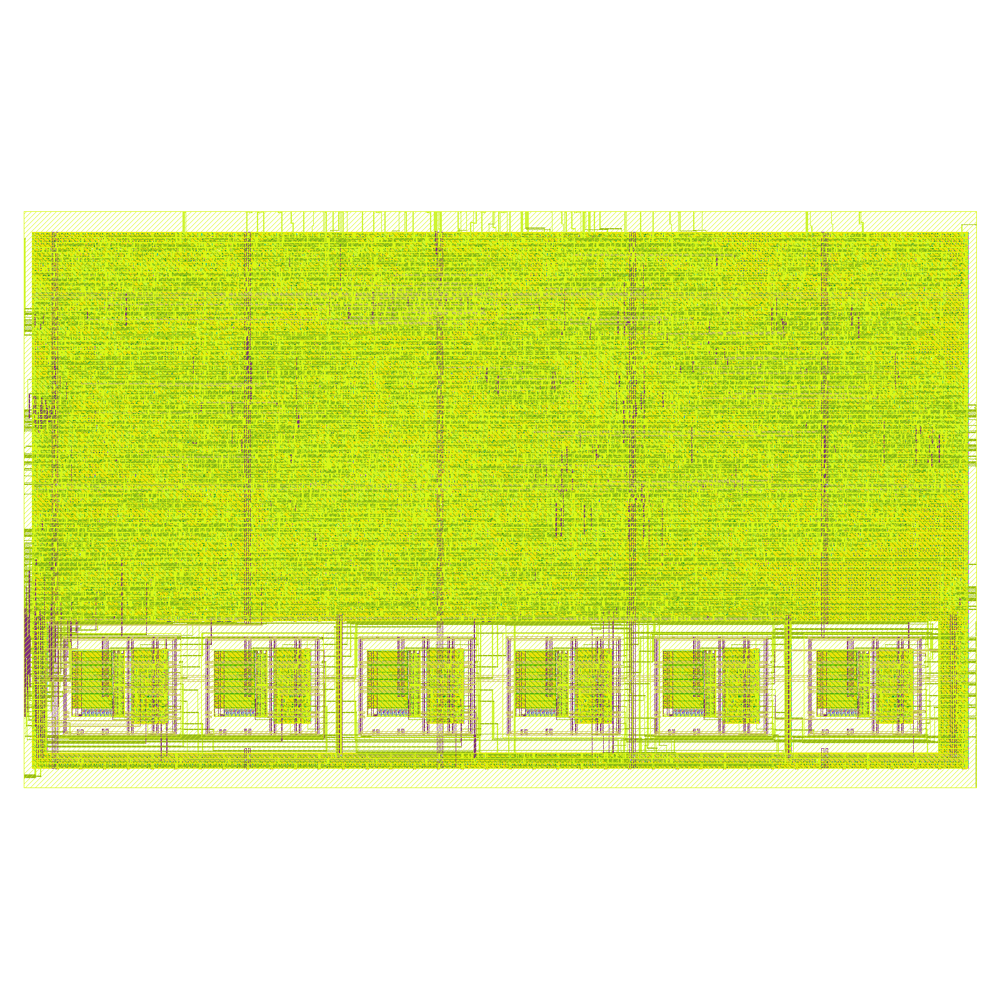
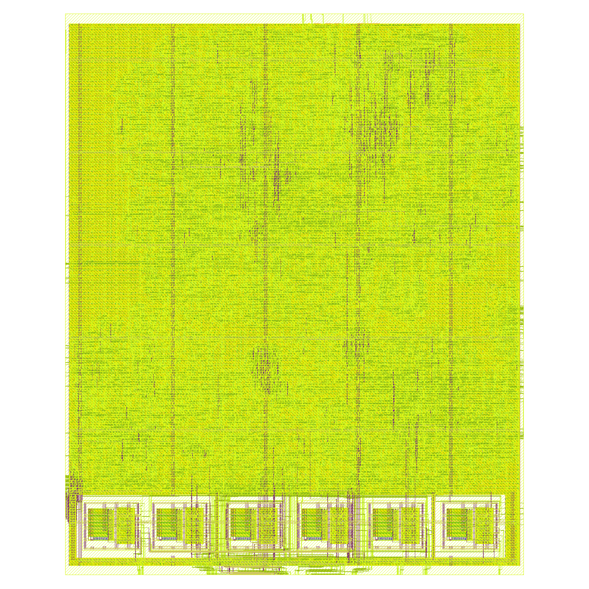
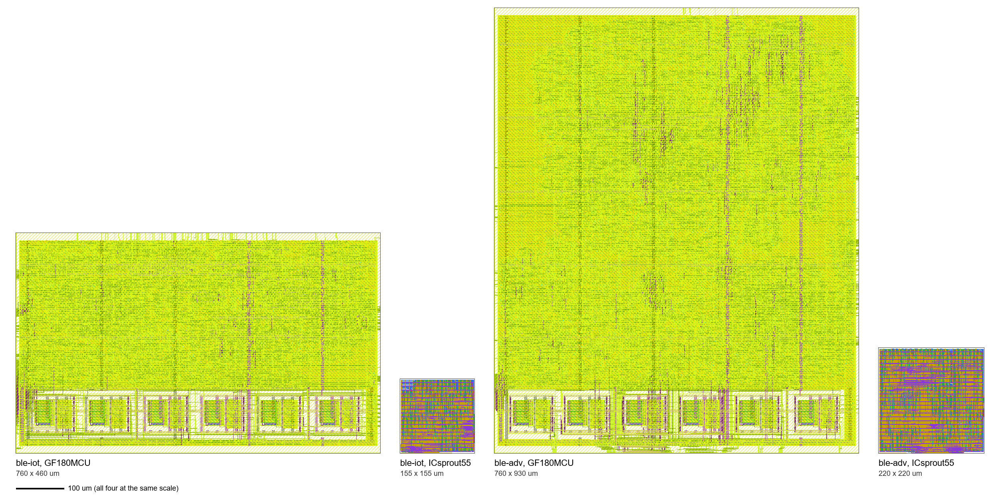
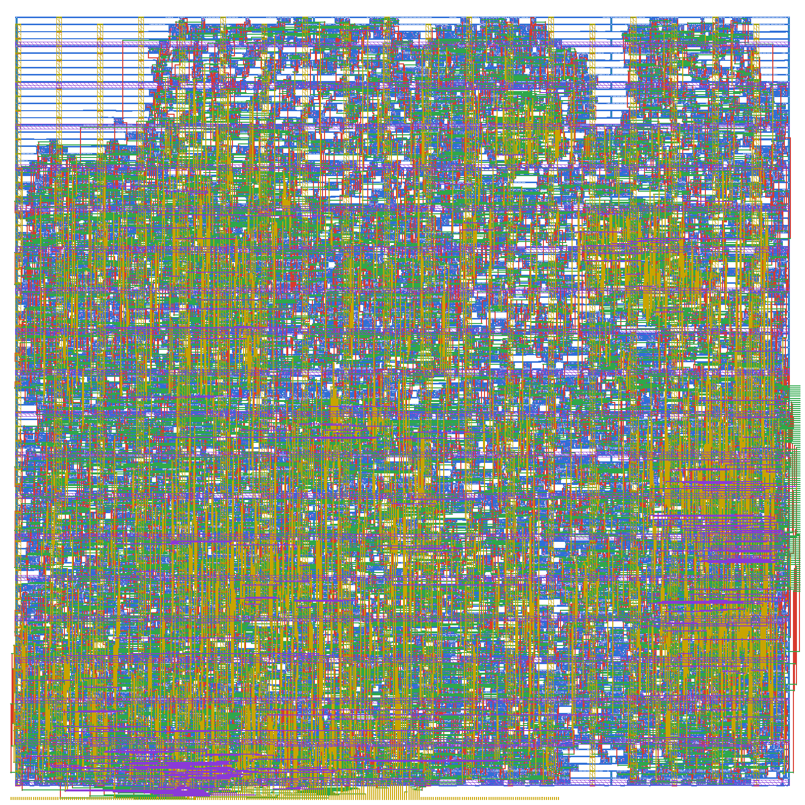
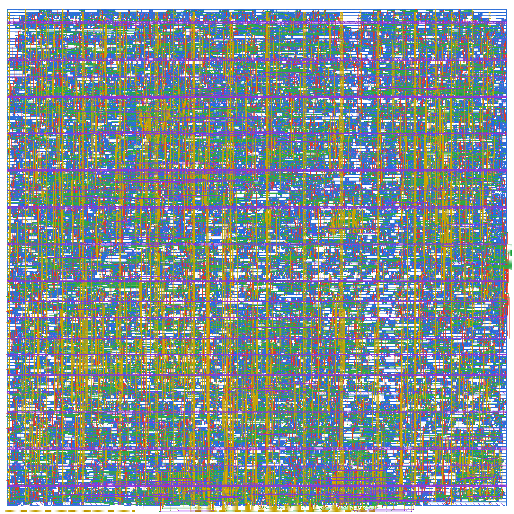

# The complete controllers in the least silicon: `ble-iot` and `ble-adv`

**Project:** BTLE — reconfigurable RISC-V baseband  
**Branches:** `ble-iot` (the IoT tag's transmitter `ble-tx-iot-reg` and its receiver `ble-rx-iot`) and `ble-adv` (the Legacy
Advertising transmitter `ble-tx-min` and the final receiver `ble-rx-2p1c`), each one `btle_phy` with both sides  
**Base:** tag `upstream-baseline` (`8540186`), forked from github.com/JiaoXianjun/BTLE  
**Reference documents:** [`TX_FINAL_DECISIONS.md`](TX_FINAL_DECISIONS.md), [`RX_FINAL_DECISIONS.md`](RX_FINAL_DECISIONS.md),
[`TX_TAG_4_IOT.md`](../Senseworks/TX_TAG_4_IOT.md), [`RX_4_IOT.md`](../Senseworks/RX_4_IOT.md): the halves' own measurements, which
this document does not repeat  
**Date:** 2026-11-10  
**Author:** Miguel Simões  
**Status:** every number below is measured and its evidence is committed in the branch it belongs to (§ 9). Validation of
both controllers, cell area in 45 nm (Nangate45, pre-layout), and the PHY of each laid out as one macro in two open PDKs:
**GF180MCU-D** (180 nm; DRC with the foundry's KLayout deck, LVS, antenna, timing at 9 corners: clean) and **ICsprout55**
(55 nm; routing DRC on the tech LEF's rules, timing at 3 corners: clean; the netlist equal to the RTL clock by clock; the PDK's
foundry DRC and LVS are Calibre decks and were not run). Not a tape-out (`docs/Validation/ASIC_READINESS.md`: NOT READY, as on
every branch).

---

## How to read this document

The transmitter and receiver branches were each cut to the least silicon for one job, and measured alone. A product needs both
in one block: these two branches put each pair in one `btle_phy` and measure that block.

- **`ble-iot`** is the IoT tag's controller: it sends one fixed packet (AdvA, the Company ID, two bytes of a sensor;
  `TX_TAG_4_IOT.md`) and receives only that packet (`RX_4_IOT.md`). Two tags can talk to each other; nothing else can be sent.
- **`ble-adv`** is the Legacy Advertising controller in the least silicon: it sends any Legacy Advertising PDU of up to 39 bytes
  (`ble-tx-min`, `TX_FINAL_DECISIONS.md`) and receives any of up to 42 octets with two sampling phases and a CRC that corrects one
  bit (`ble-rx-2p1c`, `RX_FINAL_DECISIONS.md` § 9.5).

Neither adds a function. The question this document answers is **what the two halves cost together**, laid out as one macro,
against the same halves laid out apart.

| Name | What it is | RTL |
|---|---|---|
| `ble-tx-iot-reg` | the IoT tag's transmitter with AdvA in six registers (48 flip-flops) | branch `ble-tx-iot-reg`; `TX_TAG_4_IOT.md` § 8.2 |
| `ble-rx-iot` | the receiver of the IoT tag's packet only | branch `ble-rx-iot`; `RX_4_IOT.md` |
| `ble-tx-min` | the final Legacy Advertising transmitter | branch `ble-tx-min`; `TX_FINAL_DECISIONS.md` |
| `ble-rx-2p1c` | the final receiver: two phases at the Access Address, one bit corrected by the CRC | branch `ble-rx-2p1c`; `RX_FINAL_DECISIONS.md` § 9.5 |
| **`ble-iot`** | this document: `ble-tx-iot-reg` + `ble-rx-iot` in one `btle_phy` | branch `ble-iot` |
| **`ble-adv`** | this document: `ble-tx-min` + `ble-rx-2p1c` in one `btle_phy` | branch `ble-adv` |

## 1. Summary

| | **`ble-iot`** | **`ble-adv`** | Evidence |
|---|---:|---:|---|
| Sends | one packet: ADV_NONCONN_IND, 14 bytes (AdvA, Company ID, 2 sensor bytes) | any Legacy Advertising PDU, ≤ 39 bytes | § 2 |
| Receives | that packet only | any Legacy Advertising PDU, ≤ 42 octets | § 2 |
| Validation: both halves' own checks, and the PHY's transmitter to its own receiver | **all pass** | **all pass** | § 3 |
| **`btle_phy`, 45 nm** (Nangate45, µm²) / flip-flops | **8 900.9** / 912 | **17 194.8** / 1 854 | § 4 |
| **GF180MCU: placed cells + eFuse blocks** (µm²) | **213 915.6** | **393 224.0** | § 5 |
| **GF180MCU die** (µm²) | **349 600 (760 × 460)** | **706 800 (760 × 930)** | § 5 |
| GF180MCU signoff: DRC (KLayout, Magic), LVS, antenna, slew, capacitance, setup, hold | **clean** | **clean** | § 5 |
| **ICsprout55: placed cells** (µm², AdvA in 48 flip-flops) | **17 552.1** | **34 260.2** | § 6 |
| **ICsprout55 die** (µm²) | **24 025 (155 × 155)** | **48 400 (220 × 220)** | § 6 |
| ICsprout55: routing DRC, VIA4 enclosure, slew, capacitance, setup, hold; the netlist against the RTL, every output on every clock | **clean; 18/18 runs, 4/4 faults** | **clean; 18/18 runs, 4/4 faults** | § 6 |
| One macro against the two halves' macros, GF180MCU: placed / die | +0.8 % / **+6.9 %** | −2.6 % / **−49.1 %** | § 7 |
| Unreviewed warnings of the layouts | **0** | **0** | § 5.2, § 6 |

**In one sentence:** the IoT controller is a 155 × 155 µm block in 55 nm and the Legacy Advertising one a 220 × 220 µm block, twice
its area, each with its transmitter and receiver unchanged and checked together; in GF180MCU one macro costs what the two halves
cost apart in cells (−2.6 to +0.8 %), and saves half the die for `ble-adv`, whose two separate dies were set wide for other reasons.

## 2. What was composed

Each branch is the receiver's tree with the transmitter's RTL, tests and scripts added: composed, not merged (the two lines of
branches share an old history whose results conflict in about 900 files). The RTL of each half is its branch's, byte for byte,
except as listed:

| File | `ble-iot` | `ble-adv` |
|---|---|---|
| Transmitter (`btle_tx.v`, `gfsk_modulation.v`, `gauss_filter.v`, `vco.v`, `scramble.v`, `crc24.v`, ...) | `ble-tx-iot-reg`'s | `ble-tx-min`'s; **`btle_tx.v` gains `ADV_ADDRESS_REG`**: AdvA in six registers written through the pair at PDU addresses 2..7, as `ble-tx-iot-reg` (default 0: the ROM or the OTP, as `ble-tx-min`) |
| Receiver (`btle_rx.v`, `btle_rx_core.v`, `rx_*`, `gfsk_demodulation*.v`, ...) | `ble-rx-iot`'s | `ble-rx-2p1c`'s; `crc24.v` and `scramble.v`, which both sides use, are the transmitter's newer versions (the receiver's regression gives `ble-rx-2p1c`'s own verdicts, § 3) |
| `btle_phy.v` | both sides' parameters; the real `btle_tx` in place of the receiver branch's stub; the AdvA OTP's programming port (`tx_adv_address_otp_prog`, `_ready`) a port of the PHY, a chip's production-test interface | the same |
| `btle_controller.v` | both sides' parameters; the OTP's port tied off (the firmware writes AdvA through the registers) | the same |
| `firmware/btle_ll.c` | the transmitter's (`-A`, AdvA, required in the tag mode) | the transmitter's |
| Lint, warning gate | both sides' exceptions; the lint sweeps `ADV_ADDRESS_REG` too | both sides'; the lint sweeps `ADV_DATA_FLOPS` and `ADV_ADDRESS_REG` too |

**Where AdvA is, in each build.** Each chip must send its own address, so a ROM, the same for every chip, is not used in silicon:

| Build | `ble-iot` | `ble-adv` |
|---|---|---|
| GF180MCU layout | six eFuse blocks (OTP, `ADV_ADDRESS_OTP = 1`), programmed once per chip | the same |
| ICsprout55 layout (no OTP in the PDK) | 48 flip-flops written by the firmware after every power-up (`ADV_ADDRESS_REG = 1`) | the same |
| 45 nm area (§ 4) | registers, as ICsprout55 | registers; AdvData in flip-flops (`ADV_DATA_FLOPS = 1`) |

`ble-adv`'s AdvData is in flip-flops in every build (`ADV_DATA_FLOPS = 1`, `ble-tx-min`'s flip-flop variant): ICsprout55 publishes
no SRAM, and the flip-flop variant is the `ble-tx-min` layout § 7 compares with.

## 3. Validation

Every check of both halves, run on the composed branch, and one new: **the PHY's transmitter into its own receiver**
(`tests/test_phy_loopback.py`): the transmitter written as the firmware writes it, its I/Q samples fed to the receiver (one sample
every other clock), every packet read back through the receiver's port and compared with what was sent. Scripts:
`scripts/senseworks/run_iot_controller_validation.sh` (`ble-iot`) and `scripts/validation/run_adv_controller_validation.sh`
(`ble-adv`).

| Check | **`ble-iot`** (`8433b030`) | **`ble-adv`** (`63bbb634`; the RTL and tests are `6f89c0a2`'s) |
|---|---|---|
| Transmitter against `ble-tx-min`, every output on every clock | **108/108 runs** (AdvA in ROM, OTP, registers × 2 AdvA × 3 seeds × 6 `clkb`), **17/17 faults** | **144/144 runs, 16/16 faults** |
| Transmitter: complete waveforms against the model, the CRC right | **50/50**; scapy's CRC equal on 50/50; 18 packets through the controller's registers | **167/167** waveforms, each a CRC-valid PDU |
| Receiver | against the rule in Python and `ble-rx-2p1c`, **18/18 faults**; `RX_IOT_SENSOR = 0` equal to `ble-rx-2p1c` on every record; end to end through the registers | `ble-rx-2p1c`'s own regression (`btle_rx_core_tb`, `btle_rx_tb`, `gfsk_demodulation_tb`): **162 cases, the same verdict as `ble-rx-2p1c`'s** |
| **Loopback, transmitter into its own receiver** | **9/9 runs** (3 seeds × `clkb` = `clk`, 33.3, 10 MHz), 12 packets each on 6 channels, 4 AdvA: all received exactly; **2/2 faults** | **36/36 runs** (AdvA ROM / registers × AdvData memory / flip-flops × 3 seeds × 3 `clkb`), 12 packets of 8–39 octets each: all received exactly; **2/2 faults** |
| Firmware (`btle_ll.c`) | compiles | compiles |
| `run_lint.py` | **560/560** configurations, 13 reviewed exceptions | **164/164**, 14 reviewed exceptions |

The faults of the loopback: in `ble-iot`, AdvA's register 3 written by address 2 (transmitter) and a Company ID one bit off
(`rx_iot_phase`, receiver); in `ble-adv`, the same register fault and the receiver's decoder storing its octets rotated by one bit.
`ble-rx-2p1c`'s own run of that regression gives 28 `ERROR` verdicts in `btle_rx_tb`, each `RX CRC decision mismatch`: a case where its
CRC decision differs from upstream's reference receiver's (`ble-rx-2p1c` receives advertising packets only and corrects one bit; upstream
receives any Access Address and corrects none). The check is that the composed branch gives `ble-rx-2p1c`'s verdict in each case: 162 of
162 (`results/validation/ref-kfix-matrix-ble-rx-2p1c/summary.tsv`, the reference).
The functions (BER, sensitivity, PER) are the halves' and are not measured again: their RTL is unchanged (§ 2).

## 4. Area in 45 nm (Nangate45)

`scripts/area/run_area.sh` (Yosys, Nangate45, pre-layout), the four tops of each branch with the silicon build's parameters
(§ 2: AdvA in registers; `ble-adv`'s AdvData in flip-flops). `results/area/controllers/<branch>/`.

| µm² (cells / flip-flops) | **`ble-iot`** | **`ble-adv`** |
|---|---:|---:|
| `btle_tx` | 2 770.9 / 278 | 4 793.6 / 534 |
| `btle_rx` | 6 174.7 / 634 | 12 461.8 / 1 320 |
| Sum of the two | 8 945.6 | 17 255.4 |
| **`btle_phy`** (both, one netlist) | **8 900.9 / 912** | **17 194.8 / 1 854** |
| `btle_controller` (the PHY, the RISC-V core, its memories: 4 SRAM macros, 1 066 438 bits) | 26 120.1 | 34 516.7 |

The halves' figures are their branches' (`ble-rx-iot` 6 174.7 and `ble-rx-2p1c` 12 461.8, equal; `ble-tx-iot-reg` 2 774.4, here
3.5 µm² less, 0.1 %). **The PHY is the sum of its halves, 0.35–0.5 % less**: one netlist, flattened, in place of two. `ble-adv` costs 1.93 times `ble-iot`: a receiver of any Legacy Advertising packet (two buffers of
42 octets in flip-flops) against one of a 14-byte packet whose constants are not stored.

## 5. Layout in GF180MCU-D

LibreLane Classic, GF180MCU-D, `gf180mcu_fd_sc_mcu7t5v0`, in the eFuse compiler's Nix environment (`scripts/layout/phy_gf180/run.sh`),
`btle_phy` with both sides; AdvA in six eFuse blocks in a row at the bottom, at the x positions of `TX_FINAL_DECISIONS.md` § 8.1, which
set the width at 760 µm; `clk` 16 MHz, `clkb` 50 MHz, 9 corners. The receiver's settings (`RX_FINAL_DECISIONS.md`: the placement
timing-driven, the resizers' setup margins 1.0 / 0.5 ns, the repair after global routing) are on for both.

| `ble-iot`, 760 × 460 µm | `ble-adv`, 760 × 930 µm |
|---|---|
|  |  |
| logic above, the six eFuse blocks at the bottom | the same |

| Signoff | **`ble-iot`** (`phy-iot-gf180`) | **`ble-adv`** (`phy-adv-gf180`) |
|---|---|---|
| DRC, KLayout (the foundry's deck, whole GDS) / Magic / routing | **0** / 0 / 0 | **0** / 0 / 0 |
| LVS (Netgen) / antenna | clean / 0 | clean / 0 |
| Worst setup slack: ss / tt / ff | +3.890 / +9.232 / +11.583 ns | +0.497 / +7.315 / +10.306 ns |
| Worst hold slack: ff / tt / ss | +0.157 / +0.418 / +1.009 ns | +0.098 / +0.322 / +0.830 ns |
| Max slew / max capacitance violations | 0 / 0 | 0 / 0 |
| Max fanout (10, LibreLane's; the liberty sets none) | every data net within it; **2 buffers of `clkb`'s clock tree** at 11 | every data net within it; **18 clock-tree buffers** (`clk`'s and `clkb`'s) |
| IR drop (worst) / clock skew | 1.42 mV / 0.34 ns | 1.70 mV / 0.52 ns |
| Flip-flops / instances | 872 / 15 356 | 1 822 / 33 513 |
| Flow warnings / unreviewed (§ 5.2) | 33 / **0** | 32 / **0** |

**`ble-adv`'s setup at ss is the tight one** (+0.497 ns of 20 ns): the read of the receiver's two packets on `clkb`, an
84-octet multiplexer behind the read address's buffer tree, the path `RX_FINAL_DECISIONS.md` closed for `ble-rx-2p1c` with the
same settings. It closes from 760 × 930 µm up; at 760 × 900 it fails by 0.30 to 0.78 ns (§ 5.1).

| GF180MCU-D (µm²) | **`ble-iot`** | **`ble-adv`** |
|---|---:|---:|
| eFuse blocks (AdvA, OTP) | 48 452.1 | 48 452.1 |
| Logic: combinational, flip-flops, inverters, buffers, ties | 133 584.4 | 260 274.2 |
| Timing-repair buffers + clock trees | 22 961.9 | 64 516.9 |
| Taps, end caps, antenna diodes | 8 916.9 | 19 980.8 |
| **Placed cells + macros** | **213 915.6** | **393 224.0** |
| **Die** | **349 600** | **706 800** |
| Utilization of the core | 67.1 % | 58.7 % |
| Logic against the 45 nm `btle_phy` | 15.0 × | 15.1 × |

The logic is at the node's ratio, (180 / 45)² = 16 (15.0 and 15.1 times; the GF180MCU build has the OTP in place of the 48 flip-flops
of the 45 nm build's registers, § 2). The timing repair and clock trees weigh more in `ble-adv` (16 % of the placed area against
11 %): the packet read above, and the 60 % slew margin it needs (§ 5.1).

### 5.1 The die sweep

The width stays 760 µm (the eFuse row); the height falls until a run fails. "Clean": no DRC, no slew or capacitance violation,
every slack positive; every run has clock-tree buffers above the fanout of 10 (the reviewed case).
`results/layout/die-sweep-controllers/<branch>.tsv`.

| Branch | Height (µm) | Density | Slew / cap margin | Result | Placed (µm²) |
|---|---:|---:|---|---|---:|
| `ble-iot` | **460** | **64** | **30 / 30 %** | **clean: chosen** | **213 915** |
| `ble-iot` | 440, 420, 400 | 66–74 | 30 / 30 % | 2 to 5 slew violations at ss | 212 519–213 790 |
| `ble-iot` | 420 | 70 | 60 / 30 % | 30 slew violations (the wider margin adds buffers, 232 250 µm², and makes it worse) | 232 250 |
| `ble-iot` | 380 | 78 | 60 / 30 % | detailed placement fails (`DPL-0036`) | — |
| `ble-adv` | 1 040, 960 | 50 | 60 / 30 % | clean | 401 521, 397 276 |
| `ble-adv` | **930** | **52** | **60 / 30 %** | **clean: chosen** | **393 224** |
| `ble-adv` | 900 | 50; 54 | 30 / 30 %; 60 / 30 % | setup −0.304 ns at ss; 4 slew violations and setup −0.783 ns | 365 586; 395 880 |

### 5.2 Synthesis and layout without unreviewed warnings

Every warning of both runs is of a kind `TX_FINAL_DECISIONS.md` § 8.1 and `RX_FINAL_DECISIONS.md` § 8.1 reviewed: `DRT-0349` (× 8,
a LEF58 rule the router does not support; the foundry's deck checks it: 0), `STA-1140` (× 22 and × 20, a liberty read again for
another corner), `VSRC_LOC_FILES` not given and the PHY's input pins without antenna gate information (a macro, not a chip), no
parasitics for the eFuse block's netlist (timed by its liberty). **One more in `ble-adv`, reviewed here:** `RSZ-0062`, "Unable to
repair all setup violations", from the repair after the clock tree: it aims at the 1.0 ns setup margin and left one endpoint at
+0.902 ns, positive but below the margin; the signoff at ss gives +0.497 ns, every slack positive. The clock-tree buffers above the
fanout of 10 are the reviewed case (every data net within it).

## 6. Layout in ICsprout55 (55 nm), AdvA in registers

The flow of `TX_TAG_4_IOT.md` § 8.2 (`scripts/layout/phy_ics55/`: Yosys 0.54, OpenROAD `4534556`, KLayout 0.30.4 in the GF180 runs' Nix
environment, ECC's PDK settings; library `ics55_LLSC_H7CR`, RVT, 7 tracks; corners ss 1.08 V 125 °C, tt 1.2 V 25 °C, ff 1.32 V −40 °C), on
`btle_phy` with both sides. The PDK and what it does not publish (no OTP, no SRAM, no KLayout or Magic decks, no extraction rules) are
described there. Same clocks, SDC, output load and margins as GF180MCU; hold with ECC's uncertainty (0.10 ns); delay cells for hold only.
Synthesis drops `ble-tx-min`'s simulation `$display` (`synth.tcl`: a `$print` cell is no logic, and OpenSTA cannot read it).

| `ble-iot`, ICsprout55, 155 × 155 µm | `ble-adv`, ICsprout55, 220 × 220 µm |
|---|---|
|  |  |

| Checks | **`ble-iot`** (`phy-iot-ics55`) | **`ble-adv`** (`phy-adv-ics55`) |
|---|---|---|
| Routing DRC (OpenROAD, the tech LEF's rules) | **0** | **0** |
| VIA4's enclosure by MET4 (`DRT-0349`, the rule the router skips), on the GDS (`via4_enclosure.py`) | **5 015 / 5 015 cuts** | **9 918 / 9 918 cuts** |
| GDS: every placed cell the library's own layout (`gds.py`) | 125 cells, none missing | 161 cells, none missing |
| Worst setup slack: ss / tt / ff | +10.569 / +13.085 / +14.057 ns | +10.008 / +12.828 / +13.938 ns |
| Worst hold slack: ff / tt / ss | +0.050 / +0.137 / +0.350 ns | +0.047 / +0.134 / +0.346 ns |
| Max slew / max capacitance violations | 0 / 0 | 0 / 0 |
| Max fanout (10, as GF180) | every data net within it; **5 clock-tree buffers** (1 of `clk`, 4 of `clkb`) | every data net within it; **21 clock-tree buffers** (17 of `clk`, 4 of `clkb`) |
| Clock skew, `clk` / `clkb` | 0.35 / 0.30 ns | 0.41 / 0.43 ns |
| Leakage, tt | 3.78 µW | 6.40 µW |
| **Gate level: the routed netlist beside the RTL, every output on every clock** (`phy_gls.py`) | **18/18 runs** (flip-flops from 0 and from 1 × 3 seeds × 3 `clkb`), **4/4 faults** | **18/18 runs, 4/4 faults** |
| Flow warnings / unreviewed | Yosys 0 (ABC's two notes, below); OpenROAD 6 / **0** | Yosys 0 (the same); OpenROAD 6 / **0** |
| Foundry DRC, antenna, LVS (Calibre decks) | **not run** | **not run** |

The OpenROAD warnings are those of `TX_TAG_4_IOT.md` § 8.2: the core's corner snapped to the row grid (`IFP-0028`) and `DRT-0349` on CT,
VIA4, T4V2 and RV (VIA4 checked on the GDS, above; the others not drawn by the router). **The clock-tree buffers above the fanout of 10**
are the case reviewed there: this CTS has no fanout limit, and each such net meets its slew and capacitance limits; `ble-adv` has twice
`ble-iot`'s flip-flops, hence more. ABC, inside Yosys, prints two notes on every ICsprout55 run (`ble-tx-iot-reg`'s too): that the
library has 6 multi-output cells (the adders, which it does not map) and that the network it is given is combinational (the flip-flops
are mapped before it). Neither is a Yosys warning, and neither changes the netlist.

**The gate-level check stands for LVS here, and replaces the SDF of § 8.2.** `phy_gls.py` runs the loopback of § 3
(`tests/phy_loopback_tb.v`, its packets and verdicts, imported) with the routed netlist (every cell of the layout, hold and repair
buffers included, on the PDK's cell models) beside the RTL `btle_phy`, on the same inputs, and compares **every output on every clock**:
the transmitter's I/Q and valids, the receiver's hit, run, end, CRC, phase and length, and the octet read. In zero delay: with the PDK's
models an SDF-annotated run of this PHY is not valid in Icarus, which updates a cell's output only through its `specify` paths, so the
flip-flops' initial value never reaches them. The timing is OpenSTA's, above. The netlist's flip-flops start at 0 in one half of the runs
and at 1 in the other (a clear or set pulsed at 1 ps in a copy of the cell models): those without reset (the Gaussian filter's delay line,
the packet buffers) would otherwise stay unknown in Icarus, and equal outputs from both starts show the outputs do not depend on that
value. A bit the RTL itself leaves unknown is not compared: in `ble-adv`, the octet read (`rx_pdu_octet_mem_data`) from the receiver's
packet buffer before it is first written, 125 968 bits over the 794 064 clocks of the 18 runs (0.39 % of the 41 output bits compared on
each clock; no other output ever unknown); in `ble-iot`, none over 670 988 clocks. The four faults: an XOR made XNOR, a NAND made AND, a NOR made
OR, an inverter made a buffer, each the first such cell of the netlist whose change a run sees; each caught at its first instance in both
netlists. It shows that the netlist the layout was routed from computes what the RTL computes; it does not show that the GDS is that
netlist, which only an extraction and LVS would.

| ICsprout55 (µm²) | **`ble-iot`** | **`ble-adv`** |
|---|---:|---:|
| **Cells after synthesis** (pre-layout) | 12 733.8 (4 735 cells) | 24 300.9 (8 857 cells) |
| against the 45 nm `btle_phy` | 1.43 × | 1.41 × |
| Logic: combinational, flip-flops, inverters, buffers | 12 840.0 | 24 491.9 |
| of which flip-flops | 920 (5 667.2) | 1 870 (11 519.8) |
| Timing-repair buffers + clock trees | 4 531.2 | 9 467.1 |
| of which hold buffers | 2 685.2 (959) | 5 292.0 (1 890) |
| Taps, end caps | 180.9 | 301.3 |
| **Placed cells (the routed block)** | **17 552.1** | **34 260.2** |
| **Die** (the PHY as a macro: no pads, no seal ring) | **24 025** | **48 400** |
| Utilization of the core | 77.6 % (of 22 619.8) | 74.0 % (of 46 267.2) |

1. **The logic is at the node's ratio**: 1.41–1.43 times Nangate45's for the same RTL, against (55 / 45)² = 1.49, as the transmitter
   alone (1.45, `TX_TAG_4_IOT.md` § 8.2).
2. **Hold is the share that does not scale**: the hold buffers are 15 % of the placed cells in both, the repair and clock trees 26–28 %,
   against 11–16 % in GF180MCU. Fast cells need delay to meet hold.
3. **This is the PHY's digital block, not a chip.** Pads, ESD, the clock source, the radio, the RISC-V core and its memories, and the
   memory that keeps AdvA across power-ups are outside it.

### 6.1 The die sweep

Square dies, the target density raised as the die shrinks, the clock tree's clustering as GF180's (7 sinks over 150 µm). "Clean": the gate
of `run.sh` (no routing DRC, no slew or capacitance violation, no data net over the fanout, every slack positive, no `GPL-0302`).

| Branch | Die (µm) | Density | Result | Placed (µm²) |
|---|---:|---:|---|---:|
| `ble-iot` | 160 | 0.68 | routing congestion (`GRT-0232`) | — |
| `ble-iot` | **155** | **0.72** | **clean: chosen** | **17 552** |
| `ble-iot` | 150, 145 | 0.76, 0.80 | routing congestion (`GRT-0116`, `GRT-0232`) | — |
| `ble-adv` | 270, 250, 230 | 0.60 | clean | 34 414, 34 483, 34 324 |
| `ble-adv` | **220** | **0.64** | **clean: chosen** | **34 260** |
| `ble-adv` | 215 | 0.68 | 1 capacitance violation | 34 330 |
| `ble-adv` | 210 | 0.68; 0.74 | `GPL-0302`; 11 slew and 3 capacitance violations | 34 147; 34 192 |
| `ble-adv` | 200 | 0.72 | routing congestion (`GRT-0116`) | — |

`ble-iot` at 160 µm failing where 155 µm passes is the router's congestion at the edge, not monotonic in the die (as `TX_TAG_4_IOT.md`
§ 8.2.1 found for the transmitter alone).

## 7. One macro against the two halves

GF180MCU-D, placed cells and macros (µm²), the halves as each branch laid them out alone (`TX_TAG_4_IOT.md` § 8, `RX_4_IOT.md` § 8,
`TX_FINAL_DECISIONS.md` § 8, `RX_FINAL_DECISIONS.md` § 9.5):

| | Transmitter alone | Receiver alone | Sum | **One macro** | |
|---|---:|---:|---:|---:|---:|
| `ble-iot`: placed | 100 307.1 (`ble-tx-iot`) | 111 902.6 (`ble-rx-iot`) | 212 209.7 | **213 915.6** | **+0.8 %** |
| `ble-iot`: die | 174 800 (760 × 230) | 152 100 (390 × 390) | 326 900 | **349 600 (760 × 460)** | **+6.9 %** |
| `ble-adv`: placed | 160 784.9 (`ble-tx-min`, flip-flops) | 242 936 (`ble-rx-2p1c`) | 403 720.9 | **393 224.0** | **−2.6 %** |
| `ble-adv`: die | 577 600 (760 × 760) | 810 000 (900 × 900) | 1 387 600 | **706 800 (760 × 930)** | **−49.1 %** |

1. **In cells, one macro costs what two do**, within 3 %: the logic is the sum of the halves (§ 4), and what changes is the repair and
   the physical cells. `ble-adv` saves 2.6 %: one set of taps and one clock tree for each clock, in place of two.
2. **The die is where the macros differ.** `ble-tx-min` and `ble-rx-2p1c` were laid out on dies set for other reasons (760 × 760, which
   also holds `ble-tx-min`'s SRAM variant; 900 × 900, the receiver's default), their cells 28 and 30 % of the die: one macro swept to its
   smallest die holds both in half their area. The IoT halves were laid out on dies fitted to them; together they need 6.9 % more die,
   because the eFuse row fixes the width at 760 µm and the receiver's logic, which alone fitted 390 × 390, must sit above it.
3. **In 55 nm** only the IoT transmitter was laid out alone (`ble-tx-iot-reg`, 5 612.0 µm² placed, 86 × 86 µm). The IoT controller,
   17 552.1, is 3.1 times it, as in 45 nm (8 900.9 against `ble-tx-iot-reg`'s 2 774.4: 3.2 times): the receiver is two thirds of it.

**Against each other**, `ble-adv` costs 1.84 times `ble-iot`'s placed cells in GF180MCU, 1.95 times in ICsprout55 and 1.93 times in 45 nm,
for a controller that sends and receives any Legacy Advertising packet instead of one packet format.

### 7.1 Between the nodes

| GF180MCU / ICsprout55 | **`ble-iot`** | **`ble-adv`** | (180 / 55)² |
|---|---:|---:|---:|
| Logic (GF180MCU with the eFuse blocks apart; ICsprout55 with AdvA's 48 flip-flops) | 10.4 × | 10.6 × | 10.7 |
| Placed cells (GF180MCU with the eFuse blocks) | 12.2 × | 11.5 × | |
| **Die** | **14.6 ×** | **14.6 ×** | |

The logic scales with the node. The die scales by more because GF180MCU's holds the six eFuse blocks (48 452.1 µm², 22.7 % of
`ble-iot`'s placed area) and its width is set by them; ICsprout55's has none, and its address must come from outside after every power-up
(`TX_TAG_4_IOT.md` § 8.2).

## 8. What this does not claim

1. **Not a chip.** The layouts are the PHY as a macro: no pads, ESD, clock source or radio, and not the RISC-V core or its memories
   (`btle_controller`, § 4, has 4 SRAM macros).
2. **55 nm signoff is partial.** ICsprout55's DRC, antenna and LVS decks are Calibre's and were not run; the routing DRC is the tech LEF's,
   the parasitics the global route's (no extraction rules), and the netlist is checked against the RTL in zero delay with the timing from
   OpenSTA (§ 6). Its PDK is a preview release that forbids mass production.
3. **The functions are the halves'.** BER, sensitivity, PER and activity were measured on each half (the reference documents) and not
   again here; § 3 shows the halves unchanged and working together, not new performance.
4. **No board, no FPGA run of the composed controllers**, no power with a packet's activity: the leakage of § 6 is activity-free, and the
   tools' total power at their default activity is not reported.
5. **AdvA in registers is volatile** (ICsprout55): whatever writes it must keep the address in a non-volatile memory off this block.

## 9. Evidence and reproduction

| What | Where (in the branch named) | Script |
|---|---|---|
| Validation, `ble-iot` | `ble-iot`: `results/validation/iot-controller-validation/` | `scripts/senseworks/run_iot_controller_validation.sh <label>` |
| Validation, `ble-adv` | `ble-adv`: `results/validation/adv-controller-validation/`, `adv-controller-validation-matrix/`; the receiver's reference `ref-kfix-matrix-ble-rx-2p1c/` | `scripts/validation/run_adv_controller_validation.sh <label>` |
| Area, 45 nm | `results/area/controllers/<branch>/` | `AREA_PARAMS=... scripts/area/run_area.sh controllers/<branch> btle_tx btle_rx btle_phy btle_controller` |
| GF180MCU layouts | `results/layout/phy-iot-gf180/`, `phy-adv-gf180/` (metrics, STA of 9 corners, DRC, LVS, IR drop, warnings, the GDS and netlist) | `DIE_H=460 DENSITY=64 scripts/layout/phy_gf180/run.sh phy-iot-gf180 HEAD iot`; `DIE_H=930 DENSITY=52 SLEW_PCT=60 scripts/layout/phy_gf180/run.sh phy-adv-gf180 HEAD adv` |
| ICsprout55 layouts | `results/layout/phy-iot-ics55/`, `phy-adv-ics55/` (`gate.txt`, `summary.txt`, `area.*.txt`, `sta.*.txt.gz`, `power.*.txt`, `skew.txt`, `via4_enclosure.txt`, `gls.txt`, the GDS, netlist and SDFs) | `DIE_W=155 DIE_H=155 DENSITY=0.72 scripts/layout/phy_ics55/run.sh phy-iot-ics55 HEAD iot`; `DIE_W=220 DIE_H=220 DENSITY=0.64 ... phy-adv-ics55 HEAD adv`; `via4_enclosure.py`; `phy_gls.py NETLIST CELLS_V` |
| Die sweeps | `results/layout/die-sweep-controllers/<branch>.tsv` | the same scripts, `KEEP=0` |
| Figures | `results/figures/controllers/` | `run.sh` (each GDS); the same-scale figure from the four GDS at 1.2 px/µm |

The GF180MCU runs are at `ble-iot` `8433b030` and `ble-adv` `6f89c0a2` (`provenance.txt`: no file under `scripts/layout` changed); the
ICsprout55 runs at the same commits, their `gls.txt` from `phy_gls.py` as committed after them (the RTL's unknown bits not compared, § 6).
