# The final receiver: `ble-rx-2p1c`, against upstream, `ble-rx-best` and `ble-rx-micro`, every result side by side

**Project:** BTLE — reconfigurable RISC-V baseband  
**Branch:** `ble-rx-micro` (runs `rx-final` and `rx-clean`; the RTL of `ble-rx-best` at `18de7f5f`, of `ble-rx-micro` at `ef209ed7`, the same circuits as `3d92ea80` and `745e4bba`, proved: § 8.1) and `ble-rx-2p1c` (runs `rx-clean`, `rx-2p1c`, `xc7z020-rx-clean`, `rx-clean-gf180-2p1c` for it; its RTL at `41b5059a`, the same circuit as `cb56849e`, proved: § 8.1); run `rx-kfix` on `ble-rx-3p1c` (`RX_BRANCH_COMPARISON.md` § 18)  
**Base:** tag `upstream-baseline` (`8540186`), forked from github.com/JiaoXianjun/BTLE  
**Reference results:** [`open_btle_baseband_chip/`](../../open_btle_baseband_chip/open_btle_baseband_chip.md), upstream's own report (2024-05-13)  
**Companion:** [TX_FINAL_DECISIONS.md](TX_FINAL_DECISIONS.md) (the transmitter)  
**Date:** 2026-11-04 (first version 2026-10-23; `ble-rx-2p1c` and the decision of § 9.5 added 2026-11-04)  
**Author:** Miguel Simões  
**Status:** every number below is measured and its evidence is committed on `ble-rx-micro` and `ble-rx-2p1c`
(§ 11). Pre-layout results in 45 nm, a routed FPGA implementation, and signoff-clean layouts of the three
receivers in an open 180 nm PDK; **the synthesis (Vivado, Yosys) and the layout (LibreLane) of the three
receivers end with no warning that is not a reviewed exception** (§ 8.1); not a tape-out
(`docs/Validation/ASIC_READINESS.md`: NOT READY, as on every branch). **The decision (§ 9.5): `ble-rx-2p1c`
is the receiver of the final architecture.**

---

## How to read this document

The receiver (RX) of upstream's BLE baseband turns the I/Q samples of the radio into packets: a GFSK
demodulator, an Access Address search, a decoder (de-whitening, CRC-24) and a packet RAM, all eight times,
once per sampling phase, and the phase whose CRC is right wins. This thesis replaced it, block by block,
with smaller receivers of Legacy Advertising (`RX_BRANCH_COMPARISON.md` §§ 12–18), and ends with three:

- **`ble-rx-best`**, the smallest receiver **equivalent** to upstream's on advertising traffic: every
  packet upstream receives, it receives, proved and measured packet by packet;
- **`ble-rx-micro`**, smaller again, which **decodes less by design**: one sampling phase instead of
  eight and an 8-bit demodulator, for about 2 dB of sensitivity;
- **`ble-rx-2p1c`**, `ble-rx-micro` with **two** phases chosen at the Access Address and the **CRC-24
  correcting one wrong bit** when neither phase has its CRC right: not equivalent either, but **more
  sensitive than upstream** (0.5–1.8 dB), in 5.2 % of its area, with no SRAM. **It is the decision of § 9.5.**

This document compares the three with upstream's receiver on everything upstream reports in
`open_btle_baseband_chip/` (the receiver's decisions, bit error rate, FPGA implementation, layout in an
open PDK) and on what the thesis measured besides (area, timing, power, packet error rate, validation).
Each section gives the numbers in a table, the figure next to upstream's when upstream has one, and what
the numbers mean. § 9 records the decisions.

The configurations:

| Name | What it is | RTL |
|---|---|---|
| **upstream 2024** | the design `open_btle_baseband_chip.md` describes and measured: its FPGA table and its figures | commit `fc5bc42` (2024-05-13) |
| **upstream** | the upstream design this repository forked: the 2024 design plus a RISC-V-ready Link Layer, a 1 Mbit IQ-capture RAM and an 8-bit payload length; its receiver is the 2024 one | `upstream-baseline` (`8540186`) |
| **corrected master** | upstream with the product audit's corrections and the lint closure: **the reference every branch is validated against**, and of the switching activity (§ 7.1) | `master` (`fca6ac6`) |
| **`ble-rx-best`** | the final equivalent receiver, its defaults (`RX_BRANCH_COMPARISON.md` § 16) | `18de7f5f` (≡ `3d92ea80`, § 8.1) |
| **`ble-rx-micro`** | the final reduced receiver, its defaults (§ 17) | `ef209ed7` (≡ `745e4bba`, § 8.1) |
| **`ble-rx-2p1c`** | **the final receiver**: `ble-rx-micro` with 2 phases chosen at the Access Address, each decoded and stored, and the CRC-24 correcting 1 wrong bit, its defaults (`RX_AA_PHASES = 2`, `RX_CRC_FIX = 1`; § 18) | `41b5059a` (≡ `cb56849e`, § 8.1) |

The controllers of the three branches carry corrected master's transmitter (the receiver branches change
only the receiver); `TX_FINAL_DECISIONS.md` is the transmitter's account. The branches' RTL was cleaned of
every synthesis warning that came from it (§ 8.1): the same circuits, proved; the measures of synthesis and
layout are those of the cleaned RTL, the packet error rates of `3d92ea80`, `745e4bba` and `cb56849e`
(`12c5905b` for the random timing of § 3.3), which the proofs carry over.

## 1. Summary

| | upstream | `ble-rx-best` | `ble-rx-micro` | **`ble-rx-2p1c`** | Evidence |
|---|---:|---:|---:|---:|---|
| Packets it can receive | any Access Address, PDUs of 2–257 bytes | **Legacy Advertising** (`0x8E89BED6`), ≤ 42 octets | the same | the same | § 2 |
| Sampling phases decoded / chosen by | 8 / the CRC | 8 / the CRC | **1 / the Access Address** | **2 / the Access Address, then the CRC; 1 wrong bit corrected** | § 2 |
| Same packets as upstream (advertising) | — | **yes**: proved (unbounded), 60/60 lockstep runs, 0 of 32 000 packets different | **no, by design**: ≡ its own model on 9 600/9 600 packets | **no, by design: more**. Of 32 000: 28 494 against upstream's 25 981 (130 of upstream's lost, 2 643 more), **no false packet** | § 3 |
| **SNR at PER 10 %**, 0 / 20 / −30 / 50 ppm (RTL, 1 000 packets per point) | 9.34 / 12.01 / 14.44 / 25.05 dB | **the same** | 10.98 / 13.65 / 16.15 / 27.17 dB (**+1.6 to +2.1 dB**) | **8.83 / 10.94 / 13.27 / 23.24 dB (−0.5 to −1.8 dB)** | § 3.3 |
| **RX area, 45 nm** (cells + SRAM macros, µm²) | 238 488.1 | 20 896.7 (−91.2 %) | 6 976.1 (−97.1 %) | **12 461.8 (−94.8 %)** | § 4 |
| SRAM bits in the RX | 32 768 (8 × 512 × 8, two ports) | 2 688 (336 × 8, one port) | 0 | **0** | § 4 |
| RX on the xc7z020: LUTs / flip-flops / RAMB18 / DSP48 | 2 247 / 2 572 / 8 / 48 | 911 / 1 181 / 1 / 2 | 482 / 435 / 0 / 0 | **1 252 / 1 304 / 0 / 0** | § 6 |
| `btle_rx` min period, 45 nm (target 62.5 ns) | 1.862 ns | 2.092 ns | 1.461 ns | **1.506 ns** | § 5 |
| Switching activity of the controller, `mixed`, against corrected master | −2.9 % | +8.8 % | −32.4 % | **−23.9 %** | § 7 |
| RX logic leakage, 45 nm | 1 063.4 µW | 263.2 µW | 138.5 µW | **248.3 µW** | § 7 |
| Open-PDK layout | sky130: STA failed (one RX core); global routing failed (whole chip); another PDK and other blocks, not laid out in GF180MCU (§ 8) | **GF180MCU, signoff clean**, with the PDK's SRAM: 513 642 µm² | **GF180MCU, signoff clean**: 144 817 µm² | **GF180MCU, signoff clean: 242 936 µm²** | § 8 |
| Warnings of synthesis (Vivado, Yosys) and layout (LibreLane) | Vivado: 207 in synthesis, none reviewed | **0 unreviewed** (the gate: Vivado 150, Yosys 0, LibreLane 25, all reviewed exceptions) | **0 unreviewed** (Vivado 150, Yosys 0, LibreLane 16) | **0 unreviewed** (Vivado 150, Yosys 0, LibreLane 16) | § 8.1 |

**In one sentence:** `ble-rx-best` receives every Legacy Advertising packet upstream receives, in 8.8 % of
upstream's receiver area (45 nm); `ble-rx-micro` takes it to 2.9 % with no SRAM, for 1.6–2.1 dB of
sensitivity; and **`ble-rx-2p1c`, the final receiver, receives more than both and than upstream (0.5–1.8 dB
more sensitive, 2 643 packets more of 32 000, none of them false), in 5.2 % of upstream's area and 59.6 % of
`ble-rx-best`'s, with no SRAM at all**; the three receive only Legacy Advertising.

## 2. What changed, block by block

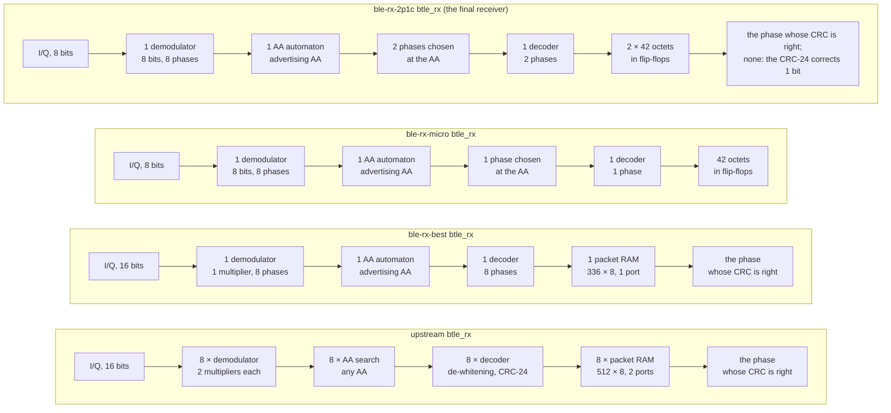

| Block | upstream | `ble-rx-best` | `ble-rx-micro` | **`ble-rx-2p1c`** | Where it was decided (`RX_BRANCH_COMPARISON.md`) |
|---|---|---|---|---|---|
| Demodulator | 8 × `gfsk_demodulation`, `sign(i0·q1 − i1·q0)`, 2 multipliers of 16 bits each | one for the 8 phases (one history entry per phase), one multiplier for the two products | the same, its samples saturated to 8 bits | **the same as `ble-rx-micro`** (8 bits) | `ble-rx-dm` (B1), `ble-rx-dmult` (§ 5), `ble-rx-micro` (§ 17) |
| Access Address search | 8 × a 32-bit correlator of any AA | one automaton, the advertising AA only | the same | the same | `ble-rx-aa` (§ 12) |
| Decoder | 8 × scrambler, CRC-24 and state machine | one, time-shared by the 8 phases | one, for one phase | **one, time-shared by the 2 phases kept** | `ble-rx-shared` (§ 13), §§ 17, 18 |
| Packet memory | 8 × 512 × 8, two ports (any PDU of up to 257 bytes) | one single-port macro, 8 × 42 words packed (336 × 8): Legacy Advertising | 42 octets in flip-flops | **2 × 42 octets in flip-flops**, each with its CRC-24 residual | `ble-rx-adv` (§ 14), `ble-rx-min` (§ 15), `ble-rx-best` (§ 16), §§ 17, 18 |
| Choice of the phase | the CRC, at the end of the packet | the same | **at the Access Address**: the middle of the phases that find it within a symbol | **at the Access Address, two**: that middle *c* and *c* − 1; then **the CRC** between them, and **when neither is right, the CRC-24 corrects 1 wrong bit** (the nearest to *c* searched first) | `ble-rx-micro` (§ 17), `ble-rx-3p1c`/`ble-rx-2p1c` (§ 18) |

**The contract.** The three branches receive Legacy Advertising: the advertising Access Address
`0x8E89BED6`, PDUs of at most 42 octets with their CRC; a sample never in two consecutive clocks (the
controller's `clock_domain_conversion_iq` gives that, proved on `ble-rx-dmult`). `ble-rx-best` also reads
its packet RAM on the link layer's clock with a latency of 4 clocks after each octet
(`RX_MIN_VALIDATION.md`). `ble-rx-2p1c` holds the receiver in the packet until its correction ends, as
`ble-rx-best` holds it until its 8 decoders end: at most 5.4 µs after a 42-octet packet at 16 MHz (both
kept phases searched for one bit without a solution; `RX_BRANCH_COMPARISON.md` § 18.1). Upstream's own
report states the packet limit as its design's: "PDU (Protocol Data Unit) has 2–39 octets"
(`open_btle_baseband_chip.md`, *Introduction*).

**Why `ble-rx-best` is exact and the other two are not.** Every step to `ble-rx-best` is a rewrite that
keeps the bits each phase decodes and the CRC choice among the eight: each was proved equivalent or
checked clock by clock against the step before (§ 3.5). `ble-rx-micro` chooses the phase before the CRC
is known: when the phase it chooses fails and another would have passed, the packet is lost (the 2 dB of
§ 3.3). `ble-rx-2p1c` keeps two phases and, when both fail, corrects one wrong bit: the packets it gains
are those whose best phase still has one wrong bit, which upstream's CRC choice cannot save; the packets it
loses are those only one of the six phases it does not keep decodes. Both are measured, not proved away.

## 3. Function: the receiver's decision, the bit error rate and the packet error rate

### 3.1 The receiver's decision (upstream's `py-fig4.png`)

| upstream (Python model, example 2) | the four RTL receivers (Icarus), example 0 |
|---|---|
|  | 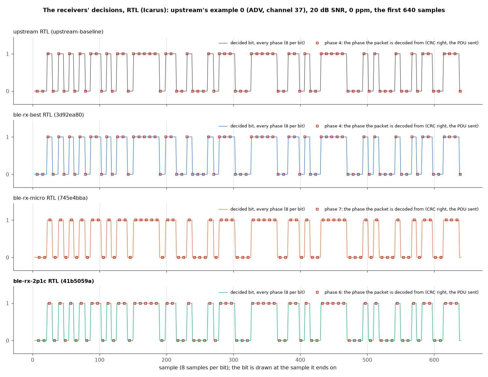 |

Upstream's figure is its Python model's demodulator output, `sign(i0·q1 − i1·q0)` at every sample, with
the best of the 8 sampling phases in red, for its example 2 (a data-channel PDU on channel 10). Example 2
uses a data-channel Access Address, which the branches do not receive, so the right figure is upstream's
**example 0** (an advertising PDU on channel 37, 34 bytes, 3 104 samples) after the same channel (20 dB
SNR, 0 ppm, upstream's `btlelib.py`, the noise seeded), fed to the **RTL** of each receiver; every bit their
demodulator decides, at the sample it ends on, and marked the phase each one decodes the packet from. All
four receive it, CRC right and the PDU equal to the one sent: upstream and `ble-rx-best` from phase 4 (the
CRC choice), `ble-rx-micro` from phase 7 (its choice at the Access Address), `ble-rx-2p1c` from phase 6, the
other of its two kept phases (7 and 6), whose CRC is right first.

Against upstream's Python model on the same samples (each bit paired with the model's bit that ends on the
same sample, the RTL's pipeline 3 samples late; `results/figures/rx-final/rx_final_decision.json`):

| | bits compared | bits that differ |
|---|---:|---:|
| upstream RTL | 3 094 | 7: the last bit of 7 phases, after the packet's end, where the RTL resets its demodulators and the model goes on |
| `ble-rx-best` RTL | 3 094 | the same 7 |
| `ble-rx-micro` RTL | 3 094 | 6 after the packet's end, and **one** inside it (sample 2 275, phase 3, not the phase decoded): a sample beyond ±127 saturated by the 8-bit demodulator |
| **`ble-rx-2p1c` RTL** | 3 095 | 5 after the packet's end, and **the same one** inside it (sample 2 275, phase 3, neither of the phases decoded): its demodulator is `ble-rx-micro`'s |

### 3.2 Bit error rate (upstream's `open_btle_baseband_chip_21_1.png`, `_23_1.png`)

| | upstream (published) |
|---|---|
| 50 ppm |  |
| −30 ppm |  |

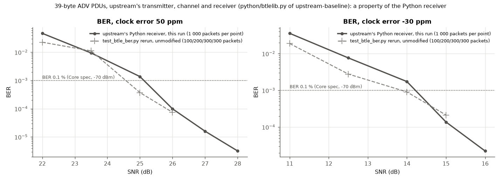

**The BER of `test_btle_ber.py` is a property of upstream's Python receiver**, and only of it: when a
packet's CRC fails, the script counts the bits of the PDU the receiver decoded, over the length that PDU's
own header gives. The RTL receivers do not give that PDU: when the CRC fails, upstream's `btle_rx` (and
`ble-rx-best`'s, its equivalent) leaves `payload_length` at 0 and its packet RAM shows the phase
`best_phase` points to, not the one the model would return; a reader that follows the hardware's outputs
takes only packets with the right CRC. So the BER here is upstream's Python receiver's, measured on the
very samples the RTL is fed, and **the RTL receivers are compared by their packet error rate (§ 3.3)**.

Method, as upstream's `test_btle_ber.py`: 39-byte ADV PDUs (the header 0x42 0x25 and 37 random octets),
channel 37, a clock error that also shifts the carrier (50 ppm = 122.5 kHz at 2.45 GHz), AWGN, all from
upstream's own `btlelib.py` (`upstream-baseline`), the packet from the first sample; **1 000 packets per
point** (upstream: 100/200/300/300), at upstream's four SNR points of each ppm and four more above them
(`scripts/validation/rx_ber/`, `results/validation/rx-final/rx_ber_exact/`).

| BER 0.1 % at (log-linear interpolation) | 50 ppm | −30 ppm | 20 ppm | 0 ppm |
|---|---:|---:|---:|---:|
| upstream's Python receiver, this run (1 000 packets per point) | **25.12 dB** | **14.22 dB** | **12.09 dB** | 8.97 dB |
| the transmitter's 20 noise realizations together (`TX_FINAL_DECISIONS.md` § 3.3: 100/200/300/300 packets each) | 25.17 dB | 13.97 dB | — | — |
| one realization of 100/200/300/300 packets: the range over those 20 | 23.8 – 25.4 dB | 13.6 – 14.4 dB | — | — |
| upstream, published (one realization; read off its figures, its text for 20 ppm) | ≈ 24.6 dB | ≈ 13.8 dB | ≈ 11.5 dB | — |
| `test_btle_ber.py` rerun, unmodified (one realization) | 24.6 dB | 13.9 dB | — | — |

**The rows are not one comparison**: each has its own packets and noise. Upstream's published figure and
the rerun are one realization each at upstream's 100–300 packets per point, and one realization of
those counts crosses 0.1 % anywhere in a range of 1.5 dB (50 ppm) and 0.8 dB (−30 ppm): both lie in it.
The BER is the mean over many packets: the 20 realizations together give 25.17 and 13.97 dB, this run's
1 000 packets per point 25.12 and 14.22 dB (similar packets: the header 0x42 0x25 and 37 random octets
here, the chip's AdvA and 31 random octets there). One realization tends to lie below the mean: near the
threshold the BER is dominated by the rare packets whose Access Address is not found (all 312 bits
counted wrong), which a draw of 100–300 packets often does not hold. 1 000 packets are few for them too
at −30 ppm: at 14 dB one such packet makes 312 of the 543 errors, and without it the curve would cross
at about 13.8 dB.

### 3.3 Packet error rate of the RTL receivers

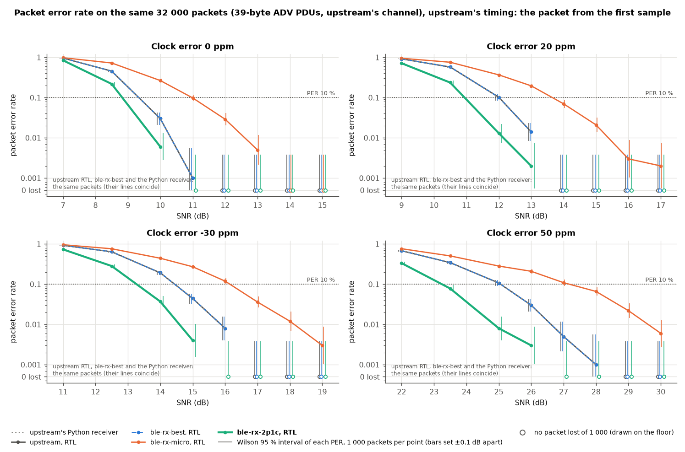

The same packets and samples as § 3.2, fed to the RTL of the four receivers (`tb_rx_ber.v`, Icarus; each
receiver with its defaults, one sample every second clock), and upstream's Python receiver beside them. A
packet is received when the receiver gives it with the right CRC and the PDU sent. 1 000 packets per point,
the bands the Wilson 95 % interval; 32 000 packets per receiver. Each SNR at PER 10 % is one noise
realization of 1 000 packets per point (about ±0.1 dB from the noise); the differences between the
receivers are measured on the same samples, so the noise does not enter them. `ble-rx-2p1c` was measured in
run `rx-kfix` (`RX_BRANCH_COMPARISON.md` § 18), on these samples: every chunk's packets are those of run
`rx-final`, and `ble-rx-best` and `ble-rx-micro`, measured in both runs, give byte-identical simulation logs
(`scripts/validation/rx_ber/merge_chunks.py`, `results/validation/rx-2p1c/stats_vs_upstream_exact.txt` on
`ble-rx-2p1c`).

| SNR at PER 10 % (log-linear) | 0 ppm | 20 ppm | −30 ppm | 50 ppm |
|---|---:|---:|---:|---:|
| upstream's Python receiver | 9.34 dB | 12.01 dB | 14.44 dB | 25.05 dB |
| **upstream, RTL** | 9.34 dB | 12.01 dB | 14.44 dB | 25.05 dB |
| **`ble-rx-best`, RTL** | **9.34 dB** | **12.01 dB** | **14.44 dB** | **25.05 dB** |
| **`ble-rx-micro`, RTL** | **10.98 dB** (+1.64) | **13.65 dB** (+1.64) | **16.15 dB** (+1.71) | **27.17 dB** (+2.12) |
| **`ble-rx-2p1c`, RTL** | **8.83 dB** (−0.51) | **10.94 dB** (−1.07) | **13.27 dB** (−1.17) | **23.24 dB** (−1.81) |

| Of the 32 000 packets, against upstream's RTL | received | of upstream's, lost | that upstream lost, received | false packets (CRC right, PDU not the one sent) |
|---|---:|---:|---:|---:|
| upstream, RTL | 25 981 | — | — | 0 |
| `ble-rx-best` | 25 981 | 0 | 0 | 0 |
| `ble-rx-micro` | 22 981 | 3 072 | 72 | 0 |
| **`ble-rx-2p1c`** | **28 494** | **130** | **2 643** | **0** |

- **Upstream's RTL, `ble-rx-best` and upstream's Python receiver receive exactly the same packets**:
  the same 25 981 of the 32 000, compared packet by packet (`rx_ber_same.py`, `rx_ber_exact/same.txt`;
  e.g. 924, 638, 191, 44, 8, 0 lost at −30 ppm, 11 to 16 dB): the RTL is the model, and `ble-rx-best` is
  upstream.
- **`ble-rx-micro` needs 1.6–2.1 dB more** for the same PER: of upstream's 25 981 it loses 3 072, the
  packets that only a phase other than the one chosen at the Access Address decodes; it receives 72 that
  the three others lose (on the same samples its one phase, 8-bit decisions and later end of packet make
  other decisions). With 3 dB above upstream's PER-10 % point it loses
  about 3 %, with 5–6 dB almost none (0 ppm: 0.5 % at 13 dB, 0 at 14 dB).
- **`ble-rx-2p1c` needs 0.5–1.8 dB less** than upstream for the same PER, the more the larger the clock
  error: it loses 130 of upstream's packets (0.5 %: those only one of the six phases it does not keep
  decodes) and receives 2 643 that upstream loses, the packets whose phase still has one wrong bit. **None
  of its 28 494 is a false packet**: a 1-bit correction lets a packet with 3 or more wrong bits through
  only if its residual equals a 1-bit one, with a probability of 328 / 2²³ = 0.0039 %
  (`RX_BRANCH_COMPARISON.md` §§ 18.1, 18.5).
- With the packet at a random time (64–127 samples and a fraction of a sample after the start: the
  receiver does not know the symbol timing), every receiver needs 0.2–0.7 dB more (PER 10 % at 9.53,
  12.22, 14.73 and 25.73 dB for upstream; another run, other noise: the smallest of these differences is
  about twice the uncertainty of one run), and the picture is the same: upstream's RTL, `ble-rx-best` and
  the Python receiver receive the same 25 175 packets of 32 000; `ble-rx-micro` needs 11.04, 14.03,
  16.43 and 28.18 dB (+1.5, +1.8, +1.7, +2.5 dB); **`ble-rx-2p1c` 8.83, 11.19, 13.48 and 23.96 dB (−0.70,
  −1.03, −1.25, −1.77 dB)**, 27 969 packets received, 150 of upstream's lost, 2 944 gained, no false packet
  ([`rx_final_per_random.png`](../../results/figures/rx-final/rx_final_per_random.png),
  `results/validation/rx-final/rx_ber_random/`; `ble-rx-2p1c`: run `rx-2p1c` on `ble-rx-2p1c`, with
  `ble-rx-micro` again on the same samples, byte-identical to its `rx-final` logs,
  `results/validation/rx-2p1c/stats_vs_upstream_random.txt`).

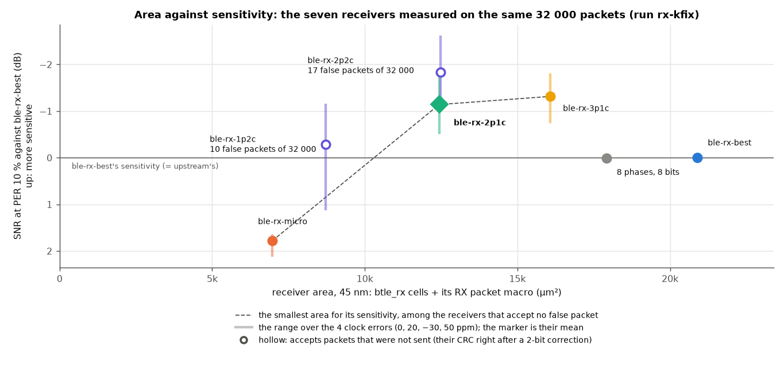

**Area against sensitivity.** The seven receivers of run `rx-kfix` (`RX_BRANCH_COMPARISON.md` § 18), on
the same 32 000 packets: of those that accept no false packet, `ble-rx-micro`, `ble-rx-2p1c` and
`ble-rx-3p1c` are each the smallest for its sensitivity; `ble-rx-best` and the 8 phases at 8 bits are
larger and less sensitive than `ble-rx-2p1c`. `ble-rx-3p1c` gains 0.0–0.3 dB more for 29 % more area
(16 085.0 against 12 437.4 µm² in that run); `ble-rx-2p2c` gains 0.5–0.8 dB in the area of `ble-rx-2p1c`,
but accepts 17 false packets of 32 000 (§ 9.5).

### 3.4 Alignment with the SDR program (upstream's `py-fig0.png`, `py-fig1.png`)

Not repeated: those figures compare upstream's Python transmitter with the C program of the SDR project, a
property of the Python model, not of a receiver (`TX_FINAL_DECISIONS.md` § 3.4).

### 3.5 Verification against upstream

Upstream verifies each module and the controller with testbenches that compare the Verilog with the
Python model's vectors ("rx test_ok 1"). The thesis kept those testbenches and added proofs and
clock-by-clock lockstep against the step before and against corrected master
(`RX_BEST_VALIDATION.md`, `RX_MICRO_VALIDATION.md`, `RX_BRANCH_COMPARISON.md` §§ 12–18):

| Check | `ble-rx-best` | `ble-rx-micro` | **`ble-rx-2p1c`** |
|---|---|---|---|
| Each step, formally | B1, one multiplier, one AA automaton, one decoder, the packet memory: each **equivalent, unbounded** (k-induction), every mutant rejected (§§ 12–16) | `RX_ONE_PHASE = 0` ≡ `ble-rx-best`'s `btle_rx` (yosys `equiv`, **unbounded**); the narrower demodulator ≡ the wide one on samples that fit (unbounded at 4/8 bits, bounded at 8/16); one stored phase: bounded proofs | everything but the K phases and the correction is `ble-rx-micro`'s; `rx_k_phase` with K = 1 and no correction ≡ `rx_one_phase` on the 32 000 packets of § 3.3 (640/640 chunks identical, every decode the same, § 18.6); **the K phases and the correction are measured, not proved** |
| Lockstep of `btle_rx`, every output on every clock | **60/60** runs in 5 campaigns against `ble-rx-shared` and corrected master, 7 975 453 packet-RAM reads compared at 103 MHz, every mutant caught | one stored phase against the 8 decoders on the same bits: **10/10** (2 000 packets), 6/6 mutants | — |
| Packet by packet against a model (`rx_per`, 9 600 packets) | the model `best8` (upstream's): the same packets | **the model `centre1`: 9 600/9 600 the same**, 4/4 mutants; its gate-level netlist the same | no model; **its gate-level netlist (Nangate45) against its RTL: 9 600/9 600 packets the same** (the stimuli of `rx_per`, 7 658 received; `gate_vs_rtl.py`) |
| Upstream's 5 testbenches × 54 conditions (the product audit's matrix, against corrected master) | 220 PASS; the 50 data-channel cases ERROR (advertising only); 270/270 with full function | 214 PASS; the 50 data-channel cases and 3 advertising packets at the threshold that one phase loses | **214 PASS**; the 50 data-channel cases, and **3 advertising packets (6 cases) that corrected master rejects and it receives**, each PDU the one sent (`error_cases.tsv`) |
| The BER/PER campaign of § 3 (32 000 packets) | **0 packets different from upstream's RTL** | +1.6–2.1 dB at PER 10 % | **−0.5 to −1.8 dB** at PER 10 %; 130 of upstream's lost, 2 643 more, **0 false packets** (random timing: 150, 2 944, 0) |
| Gate-level netlists of the controller beside corrected master, 5 scenarios (§ 7.1) | every output the same (`PDU_CONTRACT`: the raw packet-RAM read port outside the packet excepted) | the receiver's outputs differ by design, counted (`RX_DIFFERS`) | counted (`RX_DIFFERS`): **none**: on this traffic every output and register read is corrected master's, in the 5 scenarios |
| Strict lint (Verilator 5.020, warnings fatal) | **32/32** configurations | **64/64** configurations | **73/73** configurations (`ble-rx-micro`'s 64 and the 9 of `RX_AA_PHASES` ∈ {1, 2, 3} × `RX_CRC_FIX` ∈ {0, 1, 2}), 12 reviewed exceptions, none new |
| The GF180 layout's SRAM (§ 8), GlobalFoundries' model in place of the RAM (`sim_sram512.sh`) | every decode and every word read the same as with the RAM model: 6 runs (3 points × `clkb` = `clk` and `clkb` asynchronous at 16.13 MHz), 1 158 decodes, 678 of them with a CRC failure (39 words read each) | — (no SRAM) | — (no SRAM) |

## 4. Area in 45 nm (Nangate45 cells + OpenRAM macros, FreePDK45)

Yosys + ABC with the Nangate45 library (`results/area/rx-final/upstream/`, and the three branches after the
cleanup, `results/area/rx-clean/`); the SRAMs as OpenRAM macros in FreePDK45, sized exactly as the RTL
needs them (upstream's 512 × 8 two-port, `openram-rx-adv`; `ble-rx-best`'s 336 × 8 one-port,
`openram-rx-best`, layout only: OpenRAM cannot characterize a macro whose words are not a power of two,
`RX_BEST_VALIDATION.md` § 1).

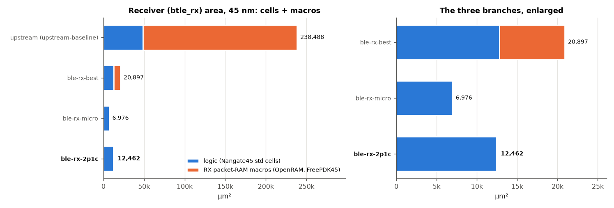

| `btle_rx` | cells | flip-flops | logic (µm²) | SRAM macros | macros (µm²) | **RX total (µm²)** | vs upstream |
|---|---:|---:|---:|---|---:|---:|---:|
| upstream | 36 864 | 2 068 | 48 824.3 | 8 × 512 × 8, two ports | 189 663.8 | **238 488.1** | — |
| `ble-rx-best` | 7 255 | 1 371 | 12 780.2 | 336 × 8, one port | 8 116.5 | **20 896.7** | −91.2 % (11.4 × smaller) |
| `ble-rx-micro` | 3 624 | 787 | 6 976.1 | none | 0 | **6 976.1** | −97.1 % (34.2 × smaller) |
| **`ble-rx-2p1c`** | 6 607 | 1 320 | 12 461.8 | **none** | **0** | **12 461.8** | **−94.8 %** (19.1 × smaller) |

| Inside `btle_rx` (µm²) | upstream | `ble-rx-best` | `ble-rx-micro` | **`ble-rx-2p1c`** |
|---|---:|---:|---:|---:|
| Demodulators | 8 × 4 757.4 = 38 059.2 (16 multipliers) | 5 226.6 (one, 1 multiplier) | one, 8 bits (not synthesized alone) | the same as `ble-rx-micro` |
| AA search | 8 × 324.8 = 2 598.4 | 491.3 (one automaton) | the same | the same |
| Packet RAM macros | 189 663.8 | 8 116.5 | 0 (42 octets in flip-flops) | **0** (2 × 42 octets in flip-flops) |

1. **Upstream's receiver is 80 % memory.** Its eight two-port 512 × 8 RAMs are 189 663.8 µm² of
   238 488.1; `ble-rx-best` keeps one single-port macro of 336 words (2 688 of the 32 768 bits),
   `ble-rx-micro` and `ble-rx-2p1c` none.
2. **The logic falls by 74 %, 86 % and 74 %** (48 824.3 → 12 780.2, 6 976.1, 12 461.8 µm²): eight
   demodulators of two 16-bit multipliers each become one with one multiplier; eight AA correlators, one
   automaton; eight decoders, one.
3. **`ble-rx-2p1c` is 59.6 % of `ble-rx-best`** (−40.4 %), and 1.79 times `ble-rx-micro`: the 336 × 8 macro
   goes, as in `ble-rx-micro`, and the second kept phase (its 42 octets in flip-flops, its slot of the
   decoder, its residual: about 3 650 µm²) and the correction (about 1 750 µm²) come back
   (`RX_BRANCH_COMPARISON.md` § 18.3). Its logic is about `ble-rx-best`'s, without `ble-rx-best`'s macro.

The whole controller (the transmitter of corrected master, the link layer and the IQ-capture RAM
included, untouched):

| `btle_controller` | cells | flip-flops | cell area (µm²) | SRAM macros / bits |
|---|---:|---:|---:|---:|
| upstream | 50 295 | 4 578 | 71 706.4 | 15 / 1 136 070 |
| `ble-rx-best` | 23 119 | 4 003 | 38 680.9 | 8 / 1 105 990 |
| `ble-rx-micro` | 19 525 | 3 419 | 32 988.5 | 7 / 1 103 302 |
| **`ble-rx-2p1c`** | 22 416 | 3 952 | 38 315.4 | 7 / 1 103 302 |
| corrected master (`TX_FINAL_DECISIONS.md` § 4) | 52 357 | 4 722 | 74 684.8 | 15 / 1 136 070 |

The three branches are corrected master with their receiver, so corrected master is their controllers'
reference: −48.2 %, −55.8 % and −48.7 % against it. Against upstream (−46.1 %, −54.0 %, −46.6 %) the
difference also holds corrected master's own changes, 2 978.4 µm² more than upstream, most in its
transmitter.

## 5. Timing

### 5.1 Static timing in 45 nm

`scripts/timing/run_sta.sh`: the mapped netlist cut at the flip-flops, sized by ABC, worst path +
clock-to-Q + setup (Nangate45 typical, no wires); target 62.5 ns (the 16 MHz baseband clock).

| | upstream | `ble-rx-best` | `ble-rx-micro` | **`ble-rx-2p1c`** |
|---|---:|---:|---:|---:|
| `btle_rx` alone: logic path / **min period** / Fmax | 1.515 / **1.862 ns** / 537 MHz | 1.745 / **2.092 ns** / 478 MHz | 1.114 / **1.461 ns** / 684 MHz | 1.159 / **1.506 ns** / 664 MHz |
| `btle_rx`'s worst path | a demodulator's multiply (`i0 → signal_for_decision`) | the history read into the one multiplier | the same, 8 bits | the same, 8 bits |
| Controller: min period / worst path | 1.991 ns, an RX demodulator | 3.376 ns, corrected master's TX Gaussian tail | 3.417 ns, the same | 3.420 ns, the same |

The one multiplier of `ble-rx-best` takes its operands through a multiplexer in the clock of the history
read (+0.23 ns; ABC's mapping moves it by about 0.1 ns from run to run); the 8-bit one of `ble-rx-micro`
and `ble-rx-2p1c` is the shortest receiver path of every branch (the correction's search, 8 steps of the
residual per clock, stays below it). The controllers of the three branches time at the transmitter of
corrected master (the audit's Gaussian tail, `TX_FINAL_DECISIONS.md` § 5.1): corrected master's controller
has a min period of 3.410 ns on that path, so against it the branches move the controller by −0.034,
+0.007 and +0.010 ns; the step from upstream's 1.991 ns is the transmitter's, not the receivers'. At
16 MHz none of it matters (slack > 59 ns). `ble-rx-best`'s macro and its address are not timed here (no
timing model; § 8 times the GF180 SRAM).

### 5.2 In the FPGA and in GF180MCU

On the xc7z020 (§ 6) the baseband clock meets 62.5 ns with 42.1–47.6 ns of slack in every configuration;
the AXI clock (10 ns) has its worst path **from the packet RAM to the AXI read register**: +2.858 ns
(upstream's two-port RAMs), **+1.434 ns** (`ble-rx-best`'s single-port RAM, read on the AXI clock through
its output multiplexer), +3.652 ns (`ble-rx-micro`: no RAM; its worst AXI path is in the link layer),
**+1.681 ns** (`ble-rx-2p1c`: the link layer's read address into the read register of its two packets in
flip-flops, an 84-octet multiplexer). In the GF180MCU layouts every corner meets setup and hold (§ 8).

## 6. FPGA: the xc7z020 of upstream's report

Upstream implemented its 2024 design on the xc7z020 with Vivado 2021.1; the same flow as
`TX_FINAL_DECISIONS.md` § 6 (Vivado 2026.1, `xc7z020clg484-1`, default strategies; `scripts/fpga/xc7z020/`,
`results/fpga/xc7z020-rx/`), which reproduces upstream's published table (LUTs within 0.2 %, registers,
muxes and DSPs identical: `TX_FINAL_DECISIONS.md` § 6). The current designs run out of context with
`btle_controller` as top, `bb_clk` at 16 MHz, the AXI and IQ-capture clocks at 100 MHz, in mode `ooc_hd`:
the out-of-context constraints that Vivado otherwise warns about (each clock's source, the ports' partition
pins, the resets deasserted in the power analysis; § 8.1), the same for the four
(`results/fpga/xc7z020-rx-clean/`; the 2024 design: `results/fpga/xc7z020-rx/up2024/`).

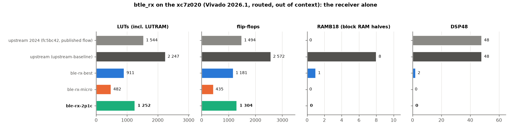

| Routed, xc7z020 | upstream 2024 (wrapper) | upstream | `ble-rx-best` | `ble-rx-micro` | **`ble-rx-2p1c`** |
|---|---:|---:|---:|---:|---:|
| **`btle_rx`**: LUTs (of which LUTRAM) | 1 544 (96) | 2 247 (0) | 911 (0) | 482 (12) | **1 252 (0)** |
| **`btle_rx`**: flip-flops | 1 494 | 2 572 | 1 181 | 435 | **1 304** |
| **`btle_rx`**: RAMB18 / DSP48 | 0 / 48 | 8 / 48 | 1 / 2 | 0 / 0 | **0 / 0** |
| **`btle_rx`**: dynamic power (vectorless) | 9 mW | 20 mW | 4 mW | 1 mW | **2 mW** |
| Controller: LUTs / flip-flops | 3 568 / 2 307 | 4 458 / 5 756 | 3 411 / 4 509 | 2 985 / 3 763 | 3 751 / 4 632 |
| Controller: block RAM tiles / DSPs | 0 / 48 | 38 / 48 | 34.5 / 2 | 34 / 0 | 34 / 0 |
| WNS `bb_clk` (62.5 ns) / AXI (10 ns) | 29.278 ns (`clk`) | 42.058 / 2.858 ns | 47.438 / 1.434 ns | 47.558 / 3.652 ns | 46.675 / 1.681 ns |
| Total on-chip power (vectorless) | 0.119 W | 0.211 W | 0.196 W | 0.192 W | 0.193 W |
| Synthesis warnings (Vivado's count) / unreviewed (§ 8.1) | 12 / — | 207 / 207 | 73 / 0 | 73 / 0 | **73 / 0** |

- **The DSPs were the receiver's**: all 48 DSP48 of upstream's controller are in its receiver, the
  8 demodulators' multipliers; `ble-rx-best` keeps 2 (its one multiplier), `ble-rx-micro` and `ble-rx-2p1c`
  none (Vivado maps their 8-bit product to LUTs).
- **The block RAM**: upstream's receiver takes 8 RAMB18 (its 8 packet RAMs), `ble-rx-best` one,
  `ble-rx-micro` none (its 42 octets in 12 LUTs of distributed RAM and flip-flops), `ble-rx-2p1c` none (its
  two packets in flip-flops: the store is read at two addresses, the read port and the length of the phase
  searched, which neither block RAM nor distributed RAM gives). The 32 RAMB36 of every current
  configuration are the IQ-capture RAM, upstream's.
- **The receiver goes from 2 247 LUTs to 911, 482 and 1 252** (−59 %, −79 %, −44 %), its flip-flops from
  2 572 to 1 181, 435 and 1 304. **On the FPGA `ble-rx-2p1c` is larger than `ble-rx-best`** (+341 LUTs,
  +123 flip-flops): its two packets are in fabric, where `ble-rx-best` puts its one packet RAM in a RAMB18,
  a block the FPGA has whether it is used or not; in silicon the macro is area, and the order is the other
  way (§§ 4, 8). The 2024 receiver (1 544 LUTs, its packet RAMs in 96 LUTRAM) is the published flow's,
  with IOs; it is the calibration of the flow, not a configuration compared.
- **The controller rows hold corrected master's transmitter**, not upstream's: corrected master's
  controller is 4 535 LUTs / 5 900 flip-flops, 38 block RAM tiles, 48 DSPs, 0.211 W
  (`TX_FINAL_DECISIONS.md` § 6). Against it the branches' controllers take 1 124, 1 550 and 784 LUTs and
  1 391, 2 137 and 1 268 flip-flops fewer.
- Vivado's power is vectorless (default toggle rates) and rounds to 1 mW: an estimate; 0.106 W of every
  total is the device's static power.

**The Device view (upstream's `btle_controller_xilinx_7z020.jpg`).** Vivado's Device view of the
routed designs, as in `TX_FINAL_DECISIONS.md` § 6 (the implementations before the cleanup of § 8.1, mode
`ooc`, RTL `3d92ea80` and `745e4bba`: the same circuits, placed by another run): the checkpoints opened in Vivado 2026.1's GUI,
`btle_rx`'s primitives highlighted in orange (`device_view.ps1` with `btle_rx_i`, `device_view.tcl`,
`device_crop.py`; each image and what it highlights in `results/fpga/xc7z020-rx/<configuration>/device.png`,
`device.txt`; `ble-rx-2p1c`'s in `results/fpga/xc7z020-rx-clean/ble-rx-2p1c/`):

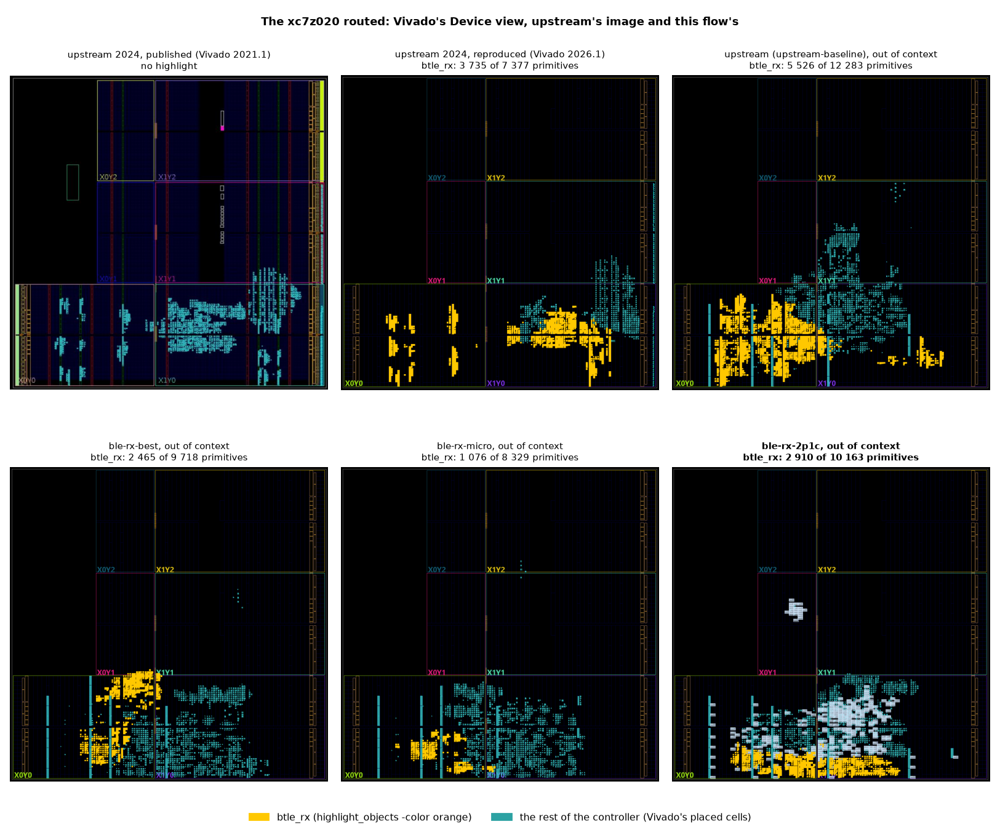

- **In upstream's 2024 design the receiver is half the device's logic**: 3 735 of 7 377 primitives
  (50.6 %), in the bottom clock regions (X0Y0, X1Y0), the transmitter's tall block (orange in
  `TX_FINAL_DECISIONS.md`) to its right.
- **Out of context, where the receiver lands means nothing; how much of the device it takes does.** The
  receiver is 5 526 of upstream's 12 283 primitives (45.0 %), with 8 RAMB18 and 48 DSP48 among them;
  2 465 of `ble-rx-best`'s 9 718 (25.4 %, −55.4 %), 1 076 of `ble-rx-micro`'s 8 329 (12.9 %, −80.5 %), and
  **2 910 of `ble-rx-2p1c`'s 10 163 (28.6 %, −47.3 %)**, LUTs and flip-flops only. The rest of each
  controller (the IQ-capture RAM's 32 RAMB36, the link layer, corrected master's transmitter in the
  branches) fills everything else. `ble-rx-2p1c`'s panel is the implementation of § 6 (mode `ooc_hd`,
  `41b5059a`, `results/fpga/xc7z020-rx-clean/ble-rx-2p1c/device.png`, `device.txt`), the others the
  implementations before the cleanup (mode `ooc`); the pale blocks only it shows are not `btle_rx`'s
  (its primitives are the orange ones, 2 910, as `count_prims.tcl` counts them in batch).

## 7. Power

Four measures, from the most relative to the most absolute; none is a silicon measurement.

**7.1 Switching activity of the controller.** Gate-level netlists (Nangate45) of each configuration and
of corrected master, in one Verilator simulation per scenario, 100 000 baseband clocks, the vectors of run
`all-branches`: Σ toggles × pin capacitance of data pins and flip-flop clock pins (`results/power/rx-final/upstream/`,
`results/power/rx-clean/` for the three branches).
Scenarios: `rx` (packets received), `tx` (packets sent), `mixed`, `idle` (noise at the input), `idle0`
(no input).

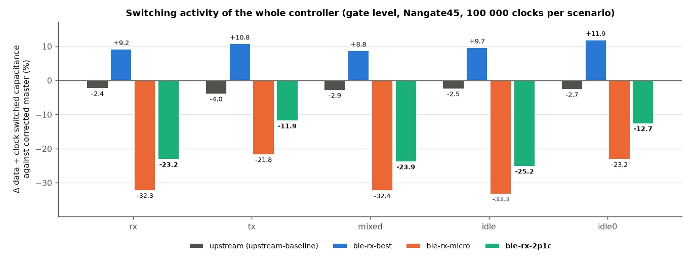

| Data + clock switched capacitance against corrected master | `rx` | `tx` | `mixed` | `idle` | `idle0` |
|---|---:|---:|---:|---:|---:|
| corrected master (fF·toggles) | 1.258 × 10⁹ | 1.040 × 10⁹ | 1.302 × 10⁹ | 1.290 × 10⁹ | 0.975 × 10⁹ |
| upstream | −2.4 % | −4.0 % | −2.9 % | −2.5 % | −2.7 % |
| `ble-rx-best` | +9.2 % | +10.8 % | +8.8 % | +9.7 % | +11.9 % |
| `ble-rx-micro` | −32.3 % | −21.8 % | −32.4 % | −33.3 % | −23.2 % |
| **`ble-rx-2p1c`** | **−23.2 %** | **−11.9 %** | **−23.9 %** | **−25.2 %** | **−12.7 %** |

Upstream's outputs are corrected master's on all five scenarios (0 mismatches): on this traffic the
audit's corrections change no output, and add 2–4 % of switching (the most in `tx`). **`ble-rx-best` switches
more than upstream**: one multiplier computes two products in two clocks, its operands' multiplexers and
the single-port RAM's clock-domain logic (132 flip-flops on the AXI clock) toggle; the clock load falls
(−15.1 %), the data rises (+62.9 %). **`ble-rx-micro` switches a third less**: one decoder instead of
eight, 584 flip-flops fewer, an 8-bit datapath (clock −27.4 %, data −43.7 % in `mixed`). **`ble-rx-2p1c`
switches a quarter less** (−23.9 % in `mixed`): its data switch as little as `ble-rx-micro`'s (−41.4 %: the
same 8-bit datapath, one decoder, its second phase in the same time slots), and its clock load falls less
(−16.2 %: the 533 flip-flops of its second packet, residual and correction, clocked on every edge, 51 fewer
than `ble-rx-best`'s but without its RAM). **Its outputs and register reads are corrected master's in all
five scenarios**: on this traffic it receives the same packets (17 interrupts in `rx`, 9 in `mixed`, the
same CRC results), so `RX_DIFFERS` counts no difference. The cleanup of § 8.1 removes no logic that toggles
but the link layer's dead TX UART: −0.8 and −0.6 points, which corrected master still has.

**7.2 The SRAMs' energy (SPICE).** **`ble-rx-best`'s 336 × 8 macro could not be characterized**: OpenRAM's flow probes the address of all ones, which a 336-word macro lacks; `openram_char.py` now probes its last word, and then the measurement at a 5 ns period fails (ngspice: "Couldn't run a simulation", `results/power/sram-char-rx-final-5ns/`), and the search for a feasible period did not end within the 6 h limit (`results/power/sram-char-rx-final/`). **Upstream's 512 × 8 two-port macro** (eight in its receiver) could not be characterized either: it did not finish in 6 h in run `sram-char`, and run again without that limit it ended after 14.4 h with OpenRAM's "Sense amp enable timing error" at the 5 ns period (`results/power/sram-char-rx-final-upstream/`): the macro as generated does not read at that period, and its energy stays unknown. For reference, the one-port 512 × 8 of `ble-rx-min` (the same column width, more words on each bitline) costs 1.161 pJ per write, 1.068 pJ per read and 25.11 µW of settled leakage (`RX_BRANCH_COMPARISON.md` § 15.4): a bound from above for `ble-rx-best`'s macro. **`ble-rx-micro` and `ble-rx-2p1c` have no SRAM**: their whole energy is in the logic of §§ 7.1 and 7.3.

**7.3 Leakage of the receiver's logic** (`scripts/power/logic_leakage.py`, the Nangate45 liberty's
`cell_leakage_power` of every cell, 1.10 V typical; `results/power/rx-clean-leakage/summary.md` and, with
`ble-rx-2p1c`, `results/power/rx-clean-leakage-2p1c/summary.md` on `ble-rx-2p1c`):

| | `btle_rx` logic leakage | of which flip-flops | controller logic leakage |
|---|---:|---:|---:|
| upstream | 1 063.38 µW | 163.60 µW | 1 529.29 µW |
| `ble-rx-best` | 263.20 µW | 108.46 µW | 796.08 µW |
| `ble-rx-micro` | 138.51 µW | 62.26 µW | 675.53 µW |
| **`ble-rx-2p1c`** | **248.26 µW** | 104.43 µW | 782.55 µW |

The macros are not included (§ 7.2): `ble-rx-best`'s figure is a lower bound, `ble-rx-micro`'s and
`ble-rx-2p1c`'s are their whole receivers'. In this 45 nm library (predictive, leaky) the logic dominates:
upstream's receiver leaks 7.7 times `ble-rx-micro`'s and 4.3 times `ble-rx-2p1c`'s; `ble-rx-2p1c` leaks
6 % less than `ble-rx-best`'s logic alone. The controller column holds corrected master's transmitter in
the branches: it leaks 182.58 µW against upstream's 112.61 µW (`TX_FINAL_DECISIONS.md` § 7.3), about 70 µW
of the branches' controllers that is not the receiver's.

**7.4 In GF180MCU** (§ 8), OpenSTA's vectorless estimate at 5 V, the default activity of every net:
67.54 mW for `ble-rx-best` (its SRAM's internal power included), 23.51 mW for `ble-rx-micro` and
35.79 mW for `ble-rx-2p1c`; leakage 4.6, 2.0 and 3.2 µW. An estimate of the order of magnitude,
not of the difference.

## 8. Layout in an open PDK (upstream's OpenLane images)

Upstream ran OpenLane2 with sky130 on two blocks, and neither closed:

| upstream (sky130, OpenLane2) | |
|---|---|
|  |  |
| `btle_rx_core` (one of its 8 phases): GDSII; "Static Timing Analysis (Post-PnR) failed" | the whole controller: detailed placement and CTS; "Global Routing failed" |

The thesis laid out the three final receivers, `btle_rx` alone, with LibreLane (OpenLane2's successor) in
**GF180MCU-D**, the PDK of the transmitter's layout (`TX_FINAL_DECISIONS.md` § 8), 9 corners (ss 125 °C
4.5 V, tt 25 °C 5 V, ff −40 °C 5.5 V × three RC), `clk` at 16 MHz (`scripts/layout/rx_final_gf180/`):

- **`ble-rx-best`** with its packet RAM on the PDK's SRAM `gf180mcu_fd_ip_sram__sram512x8m8wm1` (the PDK
  has 64, 128, 256 and 512 words; 336 of 512 used), selected only in the clocks it is read or written; its
  cycle is 55.6 ns, so `clkb`, the RAM's clock, is constrained at **16 MHz** (on the boards the AXI clock
  is 100 MHz: a faster SRAM would be needed); die 1 150 × 1 150 µm;
- **`ble-rx-micro`**, no macro, `clkb` at 50 MHz (as the transmitter's layout); die 760 × 760 µm;
- **`ble-rx-2p1c`**, no macro, `clkb` at 50 MHz, the settings of `ble-rx-micro`; die 900 × 900 µm (its
  1 320 flip-flops against `ble-rx-micro`'s 787, at the same 50 % placement density).

| `ble-rx-best`, SRAM 512 × 8 | `ble-rx-micro`, flip-flops | **`ble-rx-2p1c`, flip-flops** |
|---|---|---|
| 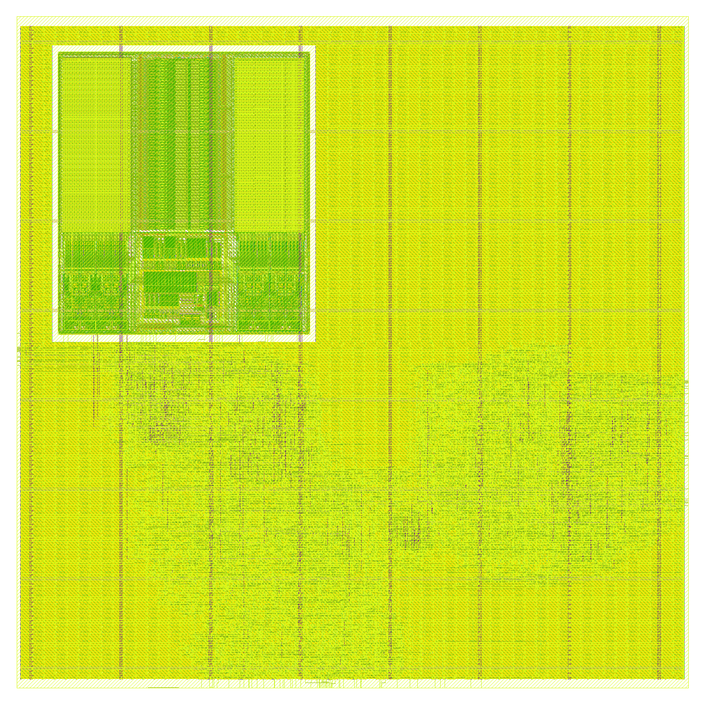 | 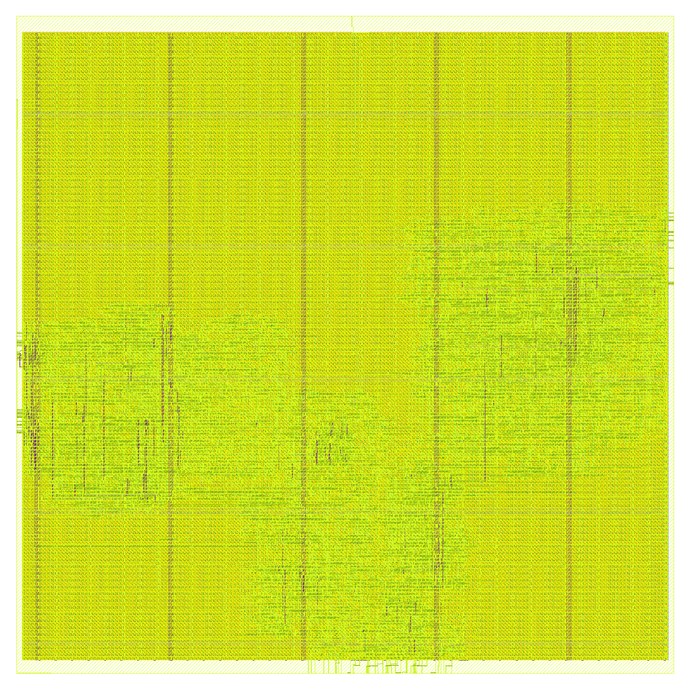 | 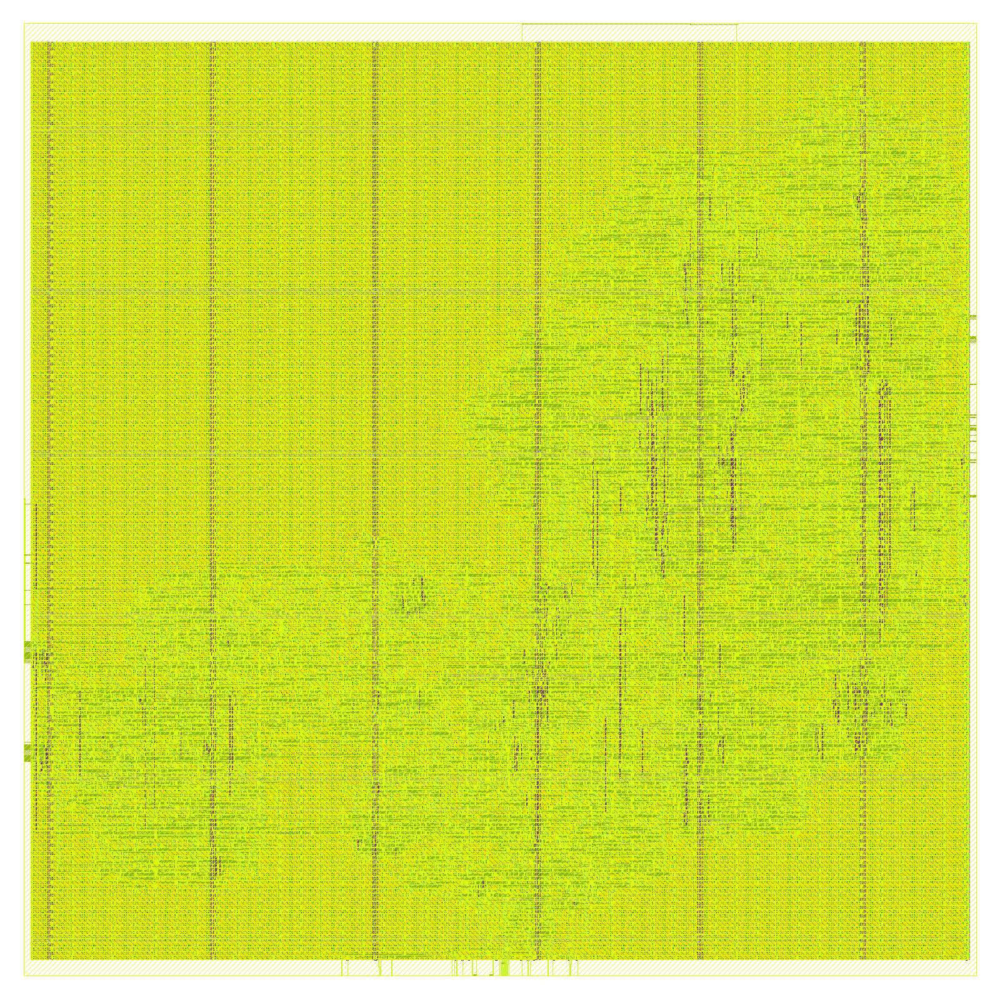 |
| the GlobalFoundries SRAM at the top left, the logic around it | logic only | logic only |

| Signoff | `ble-rx-best` (`rx-clean-gf180-best`) | `ble-rx-micro` (`rx-clean-gf180-micro`) | **`ble-rx-2p1c` (`rx-clean-gf180-2p1c-grt-td`)** |
|---|---|---|---|
| DRC, KLayout (the foundry's deck, whole GDS) | **0** (the SRAM's inside included) | **0** | **0** |
| DRC, Magic | 2 516, **all inside the GlobalFoundries SRAM** (`magic_drc_sram.txt`: 0 outside it), whose own layout Magic's deck rejects | 0 | 0 |
| LVS (Netgen) / antenna / routing DRC | clean / 0 / 0 | clean / 0 / 0 | clean / 0 / 0 |
| Worst setup slack: ss / tt / ff | +13.934 / +36.258 / +42.954 ns (`clkb` at 62.5 ns) | +2.266 / +8.463 / +11.202 ns (`clkb` at 20 ns) | +1.099 / +7.696 / +10.594 ns (`clkb` at 20 ns) |
| Worst hold slack (9 corners) | +0.157 ns | +0.124 ns | +0.177 ns |
| Max slew / max capacitance violations | 0 / 0 | 0 / 0 | 0 / 0 |
| Max fanout (10, LibreLane's for the PDK; the liberty sets none) | every data net within it; 7 clock-tree buffers at 11–13 | every data net within it; 1 clock-tree buffer at 11 | every data net within it; 12 clock-tree buffers at 11–18 |
| IR drop (worst) / clock skew | 0.55 mV / 0.39 ns | 0.67 mV / 0.47 ns | 1.01 mV / 0.56 ns |
| Flow warnings / unreviewed (§ 8.1) | 25 / **0** | 16 / **0** | 16 / **0** |

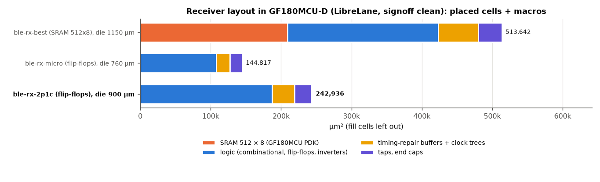

| GF180MCU-D (µm²) | `ble-rx-best` | `ble-rx-micro` | **`ble-rx-2p1c`** |
|---|---:|---:|---:|
| SRAM (431.86 × 484.88 µm) | 209 400.0 | — | — |
| Logic: combinational, flip-flops, inverters | 213 724.7 (1 371 flip-flops) | 108 008.2 (787 flip-flops) | 187 467.4 (1 320 flip-flops) |
| Timing-repair buffers + clock trees | 57 242.1 | 19 576.7 | 31 492.3 |
| Taps, end caps, antenna diodes | 33 274.8 | 17 232.3 | 23 976.0 |
| **Placed cells + macros** | **513 641.6** | **144 817.2** (−71.8 %) | **242 935.7** (−52.7 % against `ble-rx-best`) |

- **In GF180MCU the gap widens**: `ble-rx-micro` is 28.2 % of `ble-rx-best` (33.4 % in 45 nm), and not
  through the SRAM, which is about the same share of `ble-rx-best` in both (40.8 % here, 38.8 % in
  45 nm). Without it `ble-rx-micro` is 47.6 % of the rest of `ble-rx-best` here, 54.6 % in 45 nm:
  `ble-rx-best` has 2.9 times the timing-repair buffers and clock trees (its tighter targets, below),
  1.9 times the taps and end caps (a die of 1 150 µm against 760 µm, sized for the SRAM) and 2.0 times
  the logic (1.8 times in 45 nm). The two runs differ in settings (the targets below; `clkb` at 16 and
  50 MHz): the ratio is of these two layouts, not of the two receivers alone.
- **`ble-rx-2p1c` is 47.3 % of `ble-rx-best` here** (59.6 % in 45 nm) and 1.68 times `ble-rx-micro`
  (1.79 in 45 nm): the 209 400 µm² of the SRAM go, and its logic is 0.88 times `ble-rx-best`'s (0.98 in
  45 nm), on a die of 900 µm instead of 1 150. Against `ble-rx-micro` it has 1.74 times the logic, 1.61
  times the timing-repair buffers and clock trees, and 1.39 times the taps and end caps (a die of 900 µm
  against 760).
- **`ble-rx-2p1c` closed its timing at the third layout** (the three in `results/layout/`, all of
  `41b5059a`, DRC, LVS and antenna clean): with `ble-rx-micro`'s settings its ss setup ends at −0.92 ns
  (`rx-clean-gf180-2p1c`), with the timing repair after global routing at −1.01 ns
  (`rx-clean-gf180-2p1c-grt`), on one path, the read address (an input on `clkb`, 4 ns of input delay)
  through its buffer tree into the read register of the two packets, an 84-octet multiplexer: 20.95 ns
  for 20. The flow passes them (`TIMING_VIOLATION_CORNERS` is `*tt*`), the warning gate fails them.
  Timing-driven placement and the resizers' setup margins of 1.0 ns (placement) and 0.5 ns (global
  routing) close it with +1.10 ns at ss (`rx-clean-gf180-2p1c-grt-td`, the run of the tables above),
  with 1.1 % less timing-repair and clock-tree area and 2 more clock-tree buffers above the max fanout.
- The settings of the runs, all recorded in `run.sh` (§ 8.1): `ble-rx-best` places and routes with
  tighter targets (max transition 2.0 ns, max fanout 8, signoff with the library's: without them pins of
  one net end 0.03 ns over the max slew at ss), its SRAM at x = 70 µm (at 60 a strap of the power grid
  ends on the edge of one of its VSS rails); `ble-rx-micro` and `ble-rx-2p1c` close without them (with
  them `ble-rx-micro`'s ss setup ends at −1.38 ns); `ble-rx-2p1c` with the timing-driven placement and
  the setup margins above (its defaults in `run.sh`). The clock tree's sink clustering, the I/O cells
  left out, the heuristic diodes off: § 8.1.
- **Upstream's receiver has no GF180MCU layout to set beside these**: its eight packet RAMs write on the
  baseband clock and read on the AXI clock in the same cycle (two ports, two clocks), and the PDK's SRAMs
  have one port and one clock; as flip-flops they would be 32 768 of them.

### 8.1 Synthesis and layout without unreviewed warnings

After the first version of this document, the RTL of the branches was cleaned of every warning its
synthesis gave, and the flows of the warnings that came from them; what is left is a short list of
**reviewed exceptions**, each with its reason (`scripts/validation/synth_warning_exceptions.tsv`), and a
gate (`scripts/validation/synth_warning_gate.py`) that fails on any other warning, of Vivado (synthesis and
implementation), of Yosys (every top of the area flow) and of LibreLane (the whole layout flow, and its
signoff metrics: DRC, LVS, antenna, setup, hold, slew, capacitance, fanout).

**The RTL** (`ble-rx-best` `18de7f5f`, `ble-rx-micro` `ef209ed7`; the interface of `btle_controller` kept):

- unused ports of internal modules removed, so that they end at `btle_controller`'s interface:
  `auxiliary_daemon` (the BRAM's port-A write side), `btle_ll` (the IQ samples, the AGC's outputs, the AXI
  `PROT`), `ll_s_axi` (`PROT`), `rx_ram` (the RX configuration, `bb_clk`, `bb_rst`),
  `clock_domain_conversion_iq` (the RF IQ bits above I and Q); the RAM models' `rst`, which they never read;
- the link layer's TX UART, whose frame and enable (`slv_reg47`) the lint closure tied to 0, replaced by
  its outputs after reset (`uart_tx` = 1, `tx_done` = 0);
- `rx_pdu_ram_1rw`'s `lost_q`, read only by the testbenches and the proof, not synthesized;
- the arrays synthesis turns into registers marked `(* mem2reg *)`; the clocked loops that shared their
  index with combinational ones given their own (`k_seq`);
- the lint closure's lists of intentionally unused fields following: lint 32/32 and 64/64, 12 reviewed
  exceptions, none new.

**`ble-rx-2p1c`** (`41b5059a`, from `cb56849e`, which has `ble-rx-micro`'s cleanup): its new module
`rx_k_phase` gave 106 Yosys warnings (on `btle_rx`, `rx_k_phase` and `btle_controller`) and 4 unreviewed
Vivado ones, now 0, in two commits:

- `12c5905b`: `wc` and `residual` marked `(* mem2reg *)`; the packet store's clocked loop, which shared its
  index `kk` with the counters' clocked loop (32 "multiple conflicting drivers" per top), given its own
  (`kk_mem`);
- `41b5059a`: the parameter `KEEP` (the phases kept) renamed `KEPT`, since Vivado carries a parameter to the
  instance as a property and `KEEP` is its own (CRITICAL WARNING `Netlist 29-72`); `restart_r` removed,
  `restart` = `decode_end`, whose next state and reset it had (`Synth 8-6014`); the packet store, read at two
  addresses, marked `(* ram_style = "registers" *)` (`Synth 8-4767`);
- lint 73/73, 12 reviewed exceptions, none new.

**The same circuits** (`scripts/validation/equiv_cleanup/run_equiv_cleanup.sh`, `results/validation/best-clean/`
on `ble-rx-best`, `micro-clean/`, `2p1c-clean2/` on `ble-rx-2p1c`): Yosys equivalence of each branch's
`btle_rx` and `btle_controller` against the RTL before the cleanup, the RAM models as blackboxes —
**`ble-rx-best` 3 228 and 15 541 equivalence points, `ble-rx-micro` 1 808 and 14 121, `ble-rx-2p1c` 2 931 and
14 842 (`41b5059a` against `cb56849e`; `12c5905b` against it: 2 932 and 14 843, `2p1c-clean/`), all proven,
none unproven** — and the replaced UART by its own proof (SBY, k-induction: from reset with `frame_en` = 0,
`uart_tx` = 1, `tx_done` = 0 and the state IDLE on every clock). For `ble-rx-2p1c` the base already has
`ble-rx-micro`'s cleanup (`BASE_PREP=0`: no UART to prove), and `btle_rx`'s memories are mapped to registers
on both sides (`MEM_MAP=btle_rx`: `equiv_induct` has no model of a memory). Every earlier result of the
branches (proofs, lockstep, PER) holds for the cleaned RTL; the product audit's matrix again: 220 + 50,
214 + 56 and 214 + 56 (`ble-rx-2p1c`: its ERROR cases, case by case, those of `cb56849e`); the switching
activity again: every output the same (§ 7.1).

**The flows**: Vivado mode `ooc_hd` (each clock's `HD.CLK_SRC`, the ports' partition-pin ranges, the
resets deasserted in the power analysis; § 6); LibreLane (`scripts/layout/rx_final_gf180/run.sh`, variants
`best`, `micro`, `2p1c`): the PDK's I/O cells not loaded (a macro has no pads), the clock tree's sink
clustering limited (`ble-rx-best` 9 flip-flops over 300 µm, `ble-rx-micro` and `ble-rx-2p1c` 7 over 150 µm,
the settings of those tried with the fewest buffers above the max fanout), no heuristic diodes (each is a
load and pushed nets over the max fanout; the antenna repair leaves no violation), the long-wire check run,
the SRAM timed by its liberty, and the SRAM moved to x = 70 µm (§ 8); for `ble-rx-2p1c` the placement
timing-driven, the resizers' setup margins 1.0 and 0.5 ns and the timing repair after global routing
(§ 8: without them its ss setup fails, and the gate with it); the check before synthesis accepts as
a conflicting driver only a loop index (a name declared `integer` and used as a `for` index in the run's
sources).

| Warnings | upstream | `ble-rx-best` | `ble-rx-micro` | **`ble-rx-2p1c`** |
|---|---:|---:|---:|---:|
| Vivado synthesis (its count) | 207 | 238 → **73** | 238 → **73** | **73** (4 unreviewed → 0) |
| Vivado implementation (mode `ooc_hd`) | 4 | 4, reviewed | 4, reviewed | 4, reviewed |
| Yosys, every top of the area flow | 919 | 178 → **0** | 143 → **0** | 106 → **0** |
| LibreLane (`warning.log`) | — | 186 → **25** | 160 → **16** | **16** |
| **Unreviewed, after the gate** | 415 (Vivado; Yosys 919) | **0** | **0** | **0** |

The reviewed exceptions (the same for the three branches; `ble-rx-2p1c` adds none):

| Tool | Warning | Why it stays |
|---|---|---|
| Vivado | `Synth 8-7129` on `btle_controller`'s `s00_axi_arprot`, `s00_axi_awprot` | the interface (kept): an AXI4-Lite slave without protection levels ignores them |
| Vivado | `Synth 8-7129` on `btle_controller`'s `bram_en_a`, `bram_rst_a`, `bram_we_a`, `bram_wrdata_a` | the interface (kept): the PS only reads the IQ-capture BRAM |
| Vivado | `Synth 8-7129` on `search_unique_bit_sequence_shared`'s `unique_bit_sequence` | a configuration's port: with `RX_ADV_AA_ONLY` = 1 (the defaults) the automaton searches the advertising AA; `RX_ADV_AA_ONLY` = 0 reads it |
| Vivado | `DRC 23-814` (× 3) | out of context, the DRCs that need the device's IOs do not run |
| Vivado | `Constraints 18-8777` | the tool's installation lacks device files for splitting tiles |
| LibreLane | `DRT-0349` (× 8) | a LEF58 rule of the PDK's technology LEF the router does not support (the foundry's deck checks it: 0) |
| LibreLane | `STA-1140` (× 6, × 12) | the PDK has 3 liberties for the 9 signoff corners: STA reads one again for another corner |
| LibreLane | `VSRC_LOC_FILES` not given | a macro, not a chip (the flow's own advice) |
| LibreLane | input pins without antenna gate information: `btle_rx`; the SRAM | a macro's ports; the PDK's LEF of the SRAM (the antenna check is clean) |
| LibreLane | no parasitics for the SRAM's netlist; `N Magic DRC errors found` (`ble-rx-best`) | the PDK ships no SPEF for the SRAM (timed by its liberty); Magic's deck rejects GlobalFoundries' layout of the SRAM |
| signoff metric | Magic's DRC count (`ble-rx-best`: 2 516) | accepted only when every error lies inside the SRAM and the foundry's deck gives 0 on the whole GDS |
| signoff metric | max fanout (`ble-rx-best`: 7, `ble-rx-micro`: 1, `ble-rx-2p1c`: 12) | accepted only when every violator is a clock-tree buffer: the 10 is LibreLane's setting (the liberty sets none), every data net meets it, and every transition and capacitance is within the liberty's limits |

Two things the cleanup found that were not warnings: at x = 60 µm a strap of `ble-rx-best`'s power grid
ended on the edge of an SRAM VSS rail (`PDN-0110`, and a Metal3 sliver 0.17 µm wide that the first
version's Magic count hid among the SRAM's own errors), now gone; and the heuristic antenna diodes were the
loads that pushed `ble-rx-micro`'s nets over the max fanout (214 of its 277 violations).

## 9. The decisions

| # | Block | upstream | Decision | Alternatives measured (µm², 45 nm unless stated) | Status |
|---|---|---|---|---|---|
| 9.1 | Demodulator | 8 × 2 multipliers of 16 bits, 38 059.2 | **one, shared by the 8 phases, one multiplier, its samples saturated to 8 bits** (`ble-rx-micro`, `ble-rx-2p1c`) | one with two multipliers (`ble-rx-dm`); 16 bits, 5 226.6 (`ble-rx-best`): the 8 bits cost ±0.05 dB (`RX_BRANCH_COMPARISON.md` § 18.2) | decided (the sharing equivalent; the width measured) |
| 9.2 | Access Address | 8 correlators of any AA, 2 598.4 | **one automaton, the advertising AA**: 491.3 | one correlator of any AA (`ble-rx-aa`, full function) | decided (supervisor: Legacy Advertising) |
| 9.3 | Decoder | 8 × scrambler, CRC, state machine | **one, time-shared** by the phases it decodes (`ble-rx-shared`; 2 in `ble-rx-2p1c`) | — | decided (equivalent) |
| 9.4 | Packet memory | 8 × 512 × 8, two ports, 189 663.8 | **2 × 42 octets in flip-flops** (`ble-rx-2p1c`), no SRAM | 8 × 64 words (`ble-rx-adv`); one RAM, two ports, 23 708.0; one port 512 × 8, 10 703.9 (`ble-rx-min`); 336 × 8, one port, 8 116.5 (`ble-rx-best`); 42 octets (`ble-rx-micro`) | decided |
| 9.5 | Phases decoded, their choice | 8, CRC choice | **2, chosen at the Access Address, the CRC between them, 1 wrong bit corrected by the CRC-24: `ble-rx-2p1c`** | 8 (`ble-rx-best`); 1 (`ble-rx-micro`); 3 and 1 bit (`ble-rx-3p1c`); 2 and 2 bits (`ble-rx-2p2c`); 1 and 2 bits (`ble-rx-1p2c`); 4 or 2 phases without correction (models of `RX_PER.md`) | **decided** |

**9.5, the choice that was left.** The first version of this document left it open between `ble-rx-best`
(every packet upstream receives, 20 896.7 µm² with an SRAM) and `ble-rx-micro` (a third of that, 2 dB less
sensitive), a requirement of the product rather than a measurement. `ble-rx-2p1c` removes the trade-off:

| | `ble-rx-best` | `ble-rx-micro` | **`ble-rx-2p1c`** | Better |
|---|---|---|---|---|
| Packets received (of 32 000; upstream 25 981) | 25 981, upstream's, every one | 22 981 | **28 494** (130 of upstream's lost, 2 643 more) | **`ble-rx-2p1c`** |
| SNR at PER 10 %, against upstream | the same | +1.6 to +2.1 dB | **−0.5 to −1.8 dB** (random timing: −0.7 to −1.8) | **`ble-rx-2p1c`** |
| False packets (32 000 × 2 timings) | 0 | 0 | 0 | — |
| 45 nm area (RX, cells + macros) | 20 896.7 µm² | 6 976.1 µm² | **12 461.8 µm²** (−40.4 % against `ble-rx-best`) | `ble-rx-micro`, then **`ble-rx-2p1c`** |
| GF180MCU area (layout) | 513 641.6 µm² | 144 817.2 µm² | **242 936 µm²** | `ble-rx-micro`, then **`ble-rx-2p1c`** |
| Switching activity (controller, `mixed`) | +8.8 % | −32.4 % | **−23.9 %** | `ble-rx-micro`, then **`ble-rx-2p1c`** |
| Logic leakage (45 nm) | 263.2 µW (+ the SRAM's) | 138.5 µW | 248.3 µW | `ble-rx-micro` |
| FPGA (`btle_rx`) | 911 LUTs, 1 RAMB18, 2 DSP48 | 482 LUTs, no RAMB18, no DSP48 | 1 252 LUTs, no RAMB18, no DSP48 | `ble-rx-micro` |
| SRAM macro needed | 336 × 8, one port (GF180: a 512 × 8 at 16 MHz) | none | **none** | `ble-rx-micro`, **`ble-rx-2p1c`** |
| Warnings of synthesis and layout | 0 unreviewed | 0 unreviewed | 0 unreviewed | — |
| Equivalence | proved to upstream's | its own model, measured | measured: more packets than upstream, none false | `ble-rx-best` |

**Decision: `ble-rx-2p1c` is the receiver of the final architecture.**

- **It is more sensitive than upstream, and so than `ble-rx-best`, at every clock error** (0.5, 1.1, 1.2 and
  1.8 dB at 0, 20, −30 and 50 ppm; 0.7–1.8 dB with the packet at a random time), on the same samples: of
  32 000 packets it receives 2 513 more than upstream, net, and loses 130 of upstream's (0.5 %). The
  sensitivity `ble-rx-best` keeps by equivalence, `ble-rx-2p1c` exceeds by measurement.
- **It needs no SRAM**, as `ble-rx-micro`: no compiler, no macro to characterize (§ 7.2: neither
  upstream's nor `ble-rx-best`'s could be), no second clock for a RAM (`ble-rx-best`'s GF180 SRAM limits its
  read clock to 16 MHz, § 8), and its 45 nm area is 59.6 % of `ble-rx-best`'s.
- **Against `ble-rx-micro`**, 1.79 times its area buys 2.1–3.9 dB (10.98 → 8.83 dB at 0 ppm, 27.17 →
  23.24 dB at 50 ppm): `ble-rx-micro` was the smallest receiver, with the cost of 2 dB that the
  requirement had to accept; `ble-rx-2p1c` has no such cost.
- **Against the other K-phase branches** (`RX_BRANCH_COMPARISON.md` § 18): `ble-rx-3p1c` is 0.0–0.3 dB more
  sensitive for 29 % more area; `ble-rx-2p2c` is 0.5–0.8 dB more sensitive in the same area but **accepts
  false packets** (17 of 32 000: a 2-bit correction lets a packet with 4 or more wrong bits through with a
  probability of 0.64 %), which the Core specification's reliance on the CRC-24 does not allow; `ble-rx-1p2c`
  is smaller but loses 1.1 dB at 50 ppm and accepts false packets too. With one bit corrected the CRC lets a
  wrong packet through 160 times less often than with two (0.0039 %), none in 64 000 packets.
- **What it costs**: the 8-bit demodulator (`ble-rx-micro`'s; a 12-bit front end needs `RX_IQ_SHIFT = 4`);
  the receiver held at most 5.4 µs after a packet whose two phases fail; 341 LUTs more than `ble-rx-best` on
  the FPGA, where `ble-rx-best`'s RAM is a block the device has anyway; and **its K phases and its
  correction are measured, not proved** (§ 10). The other receivers stay as parameters of the same RTL:
  `RX_AA_PHASES = 1`, `RX_CRC_FIX = 0` give `ble-rx-micro`'s receiver (≡ `rx_one_phase` on 32 000 packets),
  and `RX_ONE_PHASE = 0` the 8 decoders of `ble-rx-best` (proved on `ble-rx-micro`).

## 10. What the final receivers give up, and what this does not claim

**Give up** (against upstream): every Access Address but the advertising one (no data-channel packets, no
connections); PDUs of more than 42 octets (no Legacy Advertising PDU has more); samples on consecutive
clocks (the controller never gives them); for `ble-rx-best`, the raw packet-RAM read port outside the
packet (the words of the packet are exact); for `ble-rx-micro`, 1.6–2.1 dB of sensitivity and the 16-bit
demodulator (an 8-bit one, at the matrix's scale; a 12-bit front end needs `RX_IQ_SHIFT = 4`); **for
`ble-rx-2p1c`, the 16-bit demodulator as `ble-rx-micro`, 130 of upstream's 25 981 packets (it receives 2 643
others), up to 5.4 µs of receiver time after a packet whose two phases fail, and the CRC-24's distance by
one bit**: a packet with 3 or more wrong bits whose residual is a 1-bit one is accepted (0.0039 % of them;
none in 64 000 packets).

**Does not claim:**
- The 45 nm figures are pre-layout (no wires, no clock tree); the macros are OpenRAM's in FreePDK45, an
  academic PDK; `ble-rx-best`'s 336 × 8 macro is a layout without characterization by OpenRAM's own flow.
- The BER is upstream's Python receiver's (§ 3.2); the RTL receivers are compared by PER, in simulation,
  on upstream's channel model (AWGN and a clock error), not a real radio.
- **`ble-rx-2p1c`'s choice of two phases and its correction are not formally proved**: they are measured
  (64 000 packets at two timings, the matrix, its gate-level netlist ≡ its RTL on 9 600 packets), and `rx_k_phase` reduced to one phase without
  correction is `ble-rx-micro`'s receiver on 32 000 packets; no lockstep against a model, since none exists
  for them.
- The FPGA results are out of context (no pins), with Vivado 2026.1 and vectorless power; the Device
  views of upstream, `ble-rx-best` and `ble-rx-micro` are of the implementation before the cleanup of § 8.1,
  `ble-rx-2p1c`'s of the cleaned one (mode `ooc_hd`).
- "No warning" means none outside the reviewed exceptions of § 8.1, which a gate enforces; it is not the
  absence of every message of the tools.
- The GF180MCU layouts are `btle_rx` as a macro (no pads, no seal ring, no chip-level integration, no
  parasitic-annotated simulation); `ble-rx-best`'s SRAM limits its read clock to 18 MHz; their power is
  vectorless.
- No receiver SRAM is priced in energy (§ 7.2): upstream's and `ble-rx-best`'s leakage are lower bounds.
- `py-fig0.png` and `py-fig1.png` (the SDR C program) are not repeated (§ 3.4).

## 11. Evidence and reproduction

| Result | Evidence (on `ble-rx-micro`; `ble-rx-2p1c`'s on `ble-rx-2p1c`) | Command (WSL, at the root of `ble-rx-micro` or `ble-rx-2p1c`) |
|---|---|---|
| Area, 45 nm | `results/area/rx-final/upstream/summary.md`, `results/area/rx-clean/<branch>/summary.md`, `results/area/openram-rx-adv/`, `openram-rx-best/` | `RTL_REV=<rev> scripts/area/run_area.sh rx-clean/<branch> [tops]` |
| Timing, 45 nm | `results/timing/rx-final/upstream/`, `results/timing/rx-clean/<branch>/summary.txt` | `DUT_REV=<rev> DUT_PARAMS= scripts/timing/run_sta.sh rx-clean/<branch> 62.5 fca6ac6` |
| Activity | `results/power/rx-final/upstream/`, `results/power/rx-clean/<branch>/` | `DUT_REV=<rev> DUT_PARAMS= [PDU_CONTRACT=1] [RX_DIFFERS=1] VEC_DIR=<d53f2d49 vectors> scripts/power/run_activity.sh rx-clean/<branch> 100000 1 fca6ac6` |
| Logic leakage | `results/power/rx-clean-leakage/summary.md`; with `ble-rx-2p1c`: `results/power/rx-clean-leakage-2p1c/` | `python3 scripts/power/logic_leakage.py <liberty> <name>=<stat.json> ...` |
| SRAM energy | `results/power/sram-char-rx-final-5ns/`, `sram-char-rx-final/` (336 × 8: not characterized); `sram-char-rx-final-upstream/` (512 × 8 two-port: not characterized) | `PERIOD_NS=5 scripts/power/run_sram_char.sh <label> <macro>`, `scripts/power/run_sram_leakage.sh <label> <macro>` |
| BER and PER | `results/validation/rx-final/rx_ber_exact/`, `rx_ber_random/` (`report.txt`, `points.tsv`); `ble-rx-2p1c`: exact `results/validation/rx-kfix/rx_ber_exact/` (on `ble-rx-3p1c`), random `results/validation/rx-2p1c/rx_ber_random/`, both against upstream packet by packet `results/validation/rx-2p1c/stats_vs_upstream_<timing>.txt` | `POINTS="<ppm:snr ...>" TIMING=exact\|random CHUNK=50 scripts/validation/rx_ber/run_rx_ber.sh rx-final 1000 upstream=upstream-baseline best=3d92ea80 micro=745e4bba`; on `ble-rx-2p1c`: `... TIMING=random ... run_rx_ber.sh rx-2p1c 1000 micro=origin/ble-rx-micro k2f1=12c5905b`, then `merge_chunks.py <rx-final dir> <rx-2p1c dir> <out>` and `kfix_stats.py <ble-rx-3p1c> <out> upstream best micro k2f1` |
| The receiver's decision | `results/figures/rx-final/rx_final_py_fig4.png`, `rx_final_decision.json` | `python3 scripts/figures/rx_final_figures.py decision results/figures/rx-final` (on `ble-rx-2p1c`: the four receivers) |
| Gate level of `ble-rx-2p1c` | `results/validation/rx-2p1c-gate/`, `rx-2p1c-rtl/` | `QBITS=8 DUT_REV=cb56849e MUTANTS=0 [GATE=1] scripts/validation/rx_per/run_rx_per.sh rx-2p1c-<rtl\|gate> 400 centre1`, then the two `packets.tsv` compared |
| FPGA | `results/fpga/xc7z020-rx-clean/<configuration>/` (and its `warning_gate.txt`; `ble-rx-2p1c/primitives.txt`), `results/fpga/xc7z020-rx/up2024/`, `provenance.txt` | Windows: `vivado -mode batch -source scripts/fpga/xc7z020/impl.tcl -tclargs <dir> <ooc_hd\|wrapper2024>`, then `post.tcl <root> upstream best micro` (`ble-rx-2p1c`), `count_prims.tcl <dir> btle_rx_i` |
| FPGA Device view | `results/fpga/xc7z020-rx/<configuration>/device.png`, `device.txt` | Windows, Vivado GUI: `powershell -ExecutionPolicy Bypass -File scripts/fpga/xc7z020/device_view.ps1 <dir> <vivado.bat> btle_rx_i`, then `device_crop.py` |
| Layout | `results/layout/rx-clean-gf180-best/`, `rx-clean-gf180-micro/` (the first version's: `rx-final-gf180-*`), `rx-clean-gf180-2p1c-grt-td/` (on `ble-rx-2p1c`; its two runs that fail setup at ss: `rx-clean-gf180-2p1c/`, `-grt/`); the SRAM's simulation `rx-final-gf180-sram512-sim/` | `scripts/layout/rx_final_gf180/run.sh <label> <rev> best\|micro\|2p1c`; `scripts/layout/rx_final_gf180/sim_sram512.sh <label> 3d92ea80 200` |
| The cleanup: equivalence, warning gate | `results/validation/best-clean/equiv_cleanup/` (on `ble-rx-best`), `micro-clean/equiv_cleanup/`, `2p1c-clean/`, `2p1c-clean2/` (on `ble-rx-2p1c`); `results/validation/rx-clean-warning-gate.txt`, `rx-clean-warning-gate-2p1c.txt` | `scripts/validation/equiv_cleanup/run_equiv_cleanup.sh <label> <rev before>` (`ble-rx-2p1c`: `BASE_PREP=0 MEM_MAP=btle_rx ... 2p1c-clean2 cb56849e`); `scripts/validation/synth_warning_gate.py --vivado <log> --yosys <area dir> --librelane <layout dir>` |
| Validation | `results/validation/best*`, `micro*`; `ble-rx-2p1c`: `2p1c-clean-lint/`, `2p1c-clean-matrix-product/` (`error_cases.tsv`) | `RX_BEST_VALIDATION.md` § 4, `RX_MICRO_VALIDATION.md`; `run_lint.py --output results/validation/2p1c-clean-lint`, `run_rx_regression.sh 2p1c-clean-matrix-product fca6ac64`, `kfix_matrix_check.sh` (on `ble-rx-3p1c`) |
| Figures | `results/figures/rx-final/` (`data.json`: every number read from its evidence by `rx_final_data.py`, which checks that the runs it joins are the same packets) | `python3 scripts/figures/rx_final_data.py <ble-rx-3p1c worktree> > results/figures/rx-final/data.json`; `python3 scripts/figures/rx_final_figures.py data results/figures/rx-final/data.json results/figures/rx-final` |

Related reports: `docs/Comparison/RX_BRANCH_COMPARISON.md` (every receiver branch, §§ 12–18),
`docs/Validation/RX_BEST_VALIDATION.md`, `RX_MICRO_VALIDATION.md`, `RX_PER.md`, `RX_MIN_VALIDATION.md`, and
the transmitter's [TX_FINAL_DECISIONS.md](TX_FINAL_DECISIONS.md).
