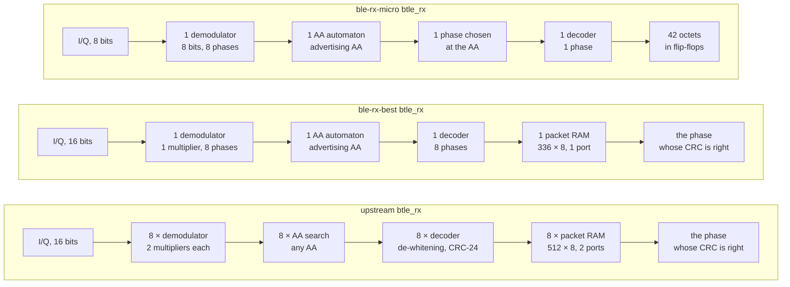

# The final receiver: upstream against `ble-rx-best` and `ble-rx-micro`, every result side by side

**Project:** BTLE — reconfigurable RISC-V baseband  
**Branch:** `ble-rx-micro` (the runs of this document, run `rx-final`; the RTL of `ble-rx-best` at `3d92ea80`, of `ble-rx-micro` at `745e4bba`)  
**Base:** tag `upstream-baseline` (`8540186`), forked from github.com/JiaoXianjun/BTLE  
**Reference results:** [`open_btle_baseband_chip/`](../../open_btle_baseband_chip/open_btle_baseband_chip.md), upstream's own report (2024-05-13)  
**Companion:** [TX_FINAL_DECISIONS.md](TX_FINAL_DECISIONS.md) (the transmitter)  
**Date:** 2026-10-23  
**Author:** Miguel Simões  
**Status:** every number below is measured and its evidence is committed on `ble-rx-micro` (§ 11). Pre-layout
results in 45 nm, a routed FPGA implementation, and signoff-clean layouts of the two receivers in an open
180 nm PDK; not a tape-out (`docs/Validation/ASIC_READINESS.md`: NOT READY, as on every branch).

---

## How to read this document

The receiver (RX) of upstream's BLE baseband turns the I/Q samples of the radio into packets: a GFSK
demodulator, an Access Address search, a decoder (de-whitening, CRC-24) and a packet RAM, all eight times,
once per sampling phase, and the phase whose CRC is right wins. This thesis replaced it, block by block,
with smaller receivers of Legacy Advertising (`RX_BRANCH_COMPARISON.md` §§ 12–17), and ends with two:

- **`ble-rx-best`**, the smallest receiver **equivalent** to upstream's on advertising traffic: every
  packet upstream receives, it receives, proved and measured packet by packet;
- **`ble-rx-micro`**, smaller again, which **decodes less by design**: one sampling phase instead of
  eight and an 8-bit demodulator, for about 2 dB of sensitivity.

This document compares the two with upstream's receiver on everything upstream reports in
`open_btle_baseband_chip/` (the receiver's decisions, bit error rate, FPGA implementation, layout in an
open PDK) and on what the thesis measured besides (area, timing, power, packet error rate, validation).
Each section gives the numbers in a table, the figure next to upstream's when upstream has one, and what
the numbers mean. § 9 records the decisions.

The configurations:

| Name | What it is | RTL |
|---|---|---|
| **upstream 2024** | the design `open_btle_baseband_chip.md` describes and measured: its FPGA table and its figures | commit `fc5bc42` (2024-05-13) |
| **upstream** | the upstream design this repository forked: the 2024 design plus a RISC-V-ready Link Layer, a 1 Mbit IQ-capture RAM and an 8-bit payload length; its receiver is the 2024 one | `upstream-baseline` (`8540186`) |
| **corrected master** | upstream with the product audit's corrections and the lint closure: **the reference every branch is validated against**, and of the switching activity (§ 7.1) | `master` (`fca6ac6`) |
| **`ble-rx-best`** | the final equivalent receiver, its defaults (`RX_BRANCH_COMPARISON.md` § 16) | `3d92ea80` |
| **`ble-rx-micro`** | the final reduced receiver, its defaults (§ 17) | `745e4bba` |

The controllers of `ble-rx-best` and `ble-rx-micro` carry corrected master's transmitter (the receiver
branches change only the receiver); `TX_FINAL_DECISIONS.md` is the transmitter's account.

## 1. Summary

| | upstream | **`ble-rx-best`** | **`ble-rx-micro`** | Evidence |
|---|---:|---:|---:|---|
| Packets it can receive | any Access Address, PDUs of 2–257 bytes | **Legacy Advertising** (`0x8E89BED6`), ≤ 42 octets | the same | § 2 |
| Sampling phases decoded / chosen by | 8 / the CRC | 8 / the CRC | **1 / the Access Address** | § 2 |
| Same packets as upstream (advertising) | — | **yes**: proved (unbounded), 60/60 lockstep runs, 0 of 32 000 packets different | **no, by design**: ≡ its own model on 9 600/9 600 packets | § 3 |
| **SNR at PER 10 %**, 0 / 20 / −30 / 50 ppm (RTL, 1 000 packets per point) | 9.34 / 12.01 / 14.44 / 25.05 dB | **the same** | 10.98 / 13.65 / 16.15 / 27.17 dB (**+1.6 to +2.1 dB**) | § 3.3 |
| **RX area, 45 nm** (cells + SRAM macros, µm²) | 238 488.1 | **20 896.5 (−91.2 %)** | **6 993.7 (−97.1 %)** | § 4 |
| SRAM bits in the RX | 32 768 (8 × 512 × 8, two ports) | 2 688 (336 × 8, one port) | **0** | § 4 |
| RX on the xc7z020: LUTs / flip-flops / RAMB18 / DSP48 | 2 243 / 2 572 / 8 / 48 | **914 / 1 181 / 1 / 2** | **482 / 435 / 0 / 0** | § 6 |
| `btle_rx` min period, 45 nm (target 62.5 ns) | 1.862 ns | 1.997 ns | **1.459 ns** | § 5 |
| Switching activity of the controller, `mixed`, against corrected master | −2.9 % | +9.6 % | **−31.8 %** | § 7 |
| RX logic leakage, 45 nm | 1 063.4 µW | 263.5 µW | **139.0 µW** | § 7 |
| Open-PDK layout | sky130: STA failed (one RX core); global routing failed (whole chip) | **GF180MCU, signoff clean**, with the PDK's SRAM: 513 211 µm² | **GF180MCU, signoff clean**: 152 189 µm² | § 8 |

**In one sentence:** `ble-rx-best` receives every Legacy Advertising packet upstream receives, the same
packets at every SNR and clock error, in 8.8 % of upstream's receiver area (45 nm), and `ble-rx-micro`
takes it to 2.9 % with no SRAM at all and a third of the switching, for 1.6–2.1 dB of sensitivity; both
receive only Legacy Advertising.

## 2. What changed, block by block

| Block | upstream | `ble-rx-best` | `ble-rx-micro` | Where it was decided (`RX_BRANCH_COMPARISON.md`) |
|---|---|---|---|---|
| Demodulator | 8 × `gfsk_demodulation`, `sign(i0·q1 − i1·q0)`, 2 multipliers of 16 bits each | one for the 8 phases (one history entry per phase), one multiplier for the two products | the same, its samples saturated to 8 bits | `ble-rx-dm` (B1), `ble-rx-dmult` (§ 5), `ble-rx-micro` (§ 17) |
| Access Address search | 8 × a 32-bit correlator of any AA | one automaton, the advertising AA only | the same | `ble-rx-aa` (§ 12) |
| Decoder | 8 × scrambler, CRC-24 and state machine | one, time-shared by the 8 phases | one, for one phase | `ble-rx-shared` (§ 13), `ble-rx-micro` (§ 17) |
| Packet memory | 8 × 512 × 8, two ports (any PDU of up to 257 bytes) | one single-port macro, 8 × 42 words packed (336 × 8): Legacy Advertising | 42 octets in flip-flops | `ble-rx-adv` (§ 14), `ble-rx-min` (§ 15), `ble-rx-best` (§ 16), `ble-rx-micro` (§ 17) |
| Choice of the phase | the CRC, at the end of the packet | the same | **at the Access Address**: the middle of the phases that find it within a symbol | `ble-rx-micro` (§ 17) |

**The contract.** `ble-rx-best` and `ble-rx-micro` receive Legacy Advertising: the advertising Access
Address `0x8E89BED6`, PDUs of at most 42 octets with their CRC; a sample never in two consecutive clocks
(the controller's `clock_domain_conversion_iq` gives that, proved on `ble-rx-dmult`). `ble-rx-best` also
reads its packet RAM on the link layer's clock with a latency of 4 clocks after each octet
(`RX_MIN_VALIDATION.md`). Upstream's own report states the packet limit as its design's: "PDU (Protocol
Data Unit) has 2–39 octets" (`open_btle_baseband_chip.md`, *Introduction*).

**Why `ble-rx-best` is exact and `ble-rx-micro` is not.** Every step to `ble-rx-best` is a rewrite that
keeps the bits each phase decodes and the CRC choice among the eight: each was proved equivalent or
checked clock by clock against the step before (§ 3.5). `ble-rx-micro` chooses the phase before the CRC
is known: when the phase it chooses fails and another would have passed, the packet is lost. That is the
2 dB of § 3.3, measured, not proved away.

## 3. Function: the receiver's decision, the bit error rate and the packet error rate

### 3.1 The receiver's decision (upstream's `py-fig4.png`)

| upstream (Python model, example 2) | the three RTL receivers (Icarus), example 0 |
|---|---|
|  |  |

Upstream's figure is its Python model's demodulator output, `sign(i0·q1 − i1·q0)` at every sample, with
the best of the 8 sampling phases in red, for its example 2 (a data-channel PDU on channel 10). Example 2
uses a data-channel Access Address, which `ble-rx-best` and `ble-rx-micro` do not receive, so the right
figure is upstream's **example 0** (an advertising PDU on channel 37, 34 bytes, 3 104 samples) after the
same channel (20 dB SNR, 0 ppm, upstream's `btlelib.py`, the noise seeded), fed to the **RTL** of each
receiver; every bit their demodulator decides, at the sample it ends on, and in red the phase each one
decodes the packet from. All three receive it, CRC right and the PDU equal to the one sent: upstream and
`ble-rx-best` from phase 4 (the CRC choice), `ble-rx-micro` from phase 7 (its choice at the Access Address).

Against upstream's Python model on the same samples (each bit paired with the model's bit that ends on the
same sample, the RTL's pipeline 3 samples late; `results/figures/rx-final/rx_final_decision.json`):

| | bits compared | bits that differ |
|---|---:|---:|
| upstream RTL | 3 094 | 7: the last bit of 7 phases, after the packet's end, where the RTL resets its demodulators and the model goes on |
| `ble-rx-best` RTL | 3 094 | the same 7 |
| `ble-rx-micro` RTL | 3 094 | 6 after the packet's end, and **one** inside it (sample 2 275, phase 3, not the phase decoded): a sample beyond ±127 saturated by the 8-bit demodulator |

### 3.2 Bit error rate (upstream's `open_btle_baseband_chip_21_1.png`, `_23_1.png`)

| | upstream (published) |
|---|---|
| 50 ppm |  |
| −30 ppm |  |

**The BER of `test_btle_ber.py` is a property of upstream's Python receiver**, and only of it: when a
packet's CRC fails, the script counts the bits of the PDU the receiver decoded, over the length that PDU's
own header gives. The RTL receivers do not give that PDU: when the CRC fails, upstream's `btle_rx` (and
`ble-rx-best`'s, its equivalent) leaves `payload_length` at 0 and its packet RAM shows the phase
`best_phase` points to, not the one the model would return; a reader that follows the hardware's outputs
takes only packets with the right CRC. So the BER here is upstream's Python receiver's, measured on the
very samples the RTL is fed, and **the RTL receivers are compared by their packet error rate (§ 3.3)**.

Method, as upstream's `test_btle_ber.py`: 39-byte ADV PDUs (the header 0x42 0x25 and 37 random octets),
channel 37, a clock error that also shifts the carrier (50 ppm = 122.5 kHz at 2.45 GHz), AWGN, all from
upstream's own `btlelib.py` (`upstream-baseline`), the packet from the first sample; **1 000 packets per
point** (upstream: 100/200/300/300), at upstream's four SNR points of each ppm and four more above them
(`scripts/validation/rx_ber/`, `results/validation/rx-final/rx_ber_exact/`).

| BER 0.1 % at (log-linear interpolation) | 50 ppm | −30 ppm | 20 ppm | 0 ppm |
|---|---:|---:|---:|---:|
| upstream, published (`open_btle_baseband_chip.md`) | ≈ 24.5 dB | ≈ 13.5 dB | ≈ 11.5 dB | — |
| `test_btle_ber.py` rerun, unmodified (`TX_FINAL_DECISIONS.md` § 3.3) | 24.6 dB | 13.9 dB | — | — |
| upstream's Python receiver, this run (1 000 packets per point) | **25.12 dB** | **14.22 dB** | **12.09 dB** | 8.97 dB |

The three agree to within 0.7 dB, the spread of upstream's few packets per point: the BER of a point near
the threshold is dominated by the packets whose Access Address is not found (all 312 bits counted wrong),
a few per hundred (`TX_FINAL_DECISIONS.md` § 3.3).

### 3.3 Packet error rate of the RTL receivers

The same packets and samples as § 3.2, fed to the RTL of the three receivers (`tb_rx_ber.v`, Icarus; each
receiver with its defaults, one sample every second clock), and upstream's Python receiver beside them. A
packet is received when the receiver gives it with the right CRC and the PDU sent. 1 000 packets per point,
the bars the Wilson 95 % interval; 32 000 packets per receiver.

| SNR at PER 10 % (log-linear) | 0 ppm | 20 ppm | −30 ppm | 50 ppm |
|---|---:|---:|---:|---:|
| upstream's Python receiver | 9.34 dB | 12.01 dB | 14.44 dB | 25.05 dB |
| **upstream, RTL** | 9.34 dB | 12.01 dB | 14.44 dB | 25.05 dB |
| **`ble-rx-best`, RTL** | **9.34 dB** | **12.01 dB** | **14.44 dB** | **25.05 dB** |
| **`ble-rx-micro`, RTL** | **10.98 dB** (+1.64) | **13.65 dB** (+1.64) | **16.15 dB** (+1.71) | **27.17 dB** (+2.12) |

- **Upstream's RTL, `ble-rx-best` and upstream's Python receiver receive exactly the same packets**:
  the same 25 981 of the 32 000, compared packet by packet (`rx_ber_same.py`, `rx_ber_exact/same.txt`;
  e.g. 924, 638, 191, 44, 8, 0 lost at −30 ppm, 11 to 16 dB): the RTL is the model, and `ble-rx-best` is
  upstream.
- **`ble-rx-micro` needs 1.6–2.1 dB more** for the same PER: of upstream's 25 981 it loses 3 072, the
  packets that only a phase other than the one chosen at the Access Address decodes; it receives 72 that
  the three others lose (on the same samples its one phase, 8-bit decisions and later end of packet make
  other decisions). With 3 dB above upstream's PER-10 % point it loses
  about 3 %, with 5–6 dB almost none (0 ppm: 0.5 % at 13 dB, 0 at 14 dB).
- With the packet at a random time (64–127 samples and a fraction of a sample after the start: the
  receiver does not know the symbol timing), every receiver needs 0.2–0.7 dB more (PER 10 % at 9.53,
  12.22, 14.73 and 25.73 dB for upstream), and the picture is the same: upstream's RTL, `ble-rx-best` and
  the Python receiver receive the same 25 175 packets of 32 000, and `ble-rx-micro` needs 11.04, 14.03,
  16.43 and 28.18 dB (+1.5, +1.8, +1.7, +2.5 dB)
  ([`rx_final_per_random.png`](../../results/figures/rx-final/rx_final_per_random.png),
  `results/validation/rx-final/rx_ber_random/`).

### 3.4 Alignment with the SDR program (upstream's `py-fig0.png`, `py-fig1.png`)

Not repeated: those figures compare upstream's Python transmitter with the C program of the SDR project, a
property of the Python model, not of a receiver (`TX_FINAL_DECISIONS.md` § 3.4).

### 3.5 Verification against upstream

Upstream verifies each module and the controller with testbenches that compare the Verilog with the
Python model's vectors ("rx test_ok 1"). The thesis kept those testbenches and added proofs and
clock-by-clock lockstep against the step before and against corrected master
(`RX_BEST_VALIDATION.md`, `RX_MICRO_VALIDATION.md`, `RX_BRANCH_COMPARISON.md` §§ 12–17):

| Check | `ble-rx-best` | `ble-rx-micro` |
|---|---|---|
| Each step, formally | B1, one multiplier, one AA automaton, one decoder, the packet memory: each **equivalent, unbounded** (k-induction), every mutant rejected (§§ 12–16) | `RX_ONE_PHASE = 0` ≡ `ble-rx-best`'s `btle_rx` (yosys `equiv`, **unbounded**); the narrower demodulator ≡ the wide one on samples that fit (unbounded at 4/8 bits, bounded at 8/16); one stored phase: bounded proofs |
| Lockstep of `btle_rx`, every output on every clock | **60/60** runs in 5 campaigns against `ble-rx-shared` and corrected master, 7 975 453 packet-RAM reads compared at 103 MHz, every mutant caught | one stored phase against the 8 decoders on the same bits: **10/10** (2 000 packets), 6/6 mutants |
| Packet by packet against a model (`rx_per`, 9 600 packets) | the model `best8` (upstream's): the same packets | **the model `centre1`: 9 600/9 600 the same**, 4/4 mutants; its gate-level netlist the same |
| Upstream's 5 testbenches × 54 conditions (the product audit's matrix, against corrected master) | 220 PASS; the 50 data-channel cases ERROR (advertising only); 270/270 with full function | 214 PASS; the 50 data-channel cases and 3 advertising packets at the threshold that one phase loses |
| The BER/PER campaign of § 3 (32 000 packets) | **0 packets different from upstream's RTL** | +1.6–2.1 dB at PER 10 % |
| Gate-level netlists of the controller beside corrected master, 5 scenarios (§ 7.1) | every output the same (`PDU_CONTRACT`: the raw packet-RAM read port outside the packet excepted) | the receiver's outputs differ by design, counted (`RX_DIFFERS`) |
| Strict lint (Verilator 5.020, warnings fatal) | **32/32** configurations | **64/64** configurations |
| The GF180 layout's SRAM (§ 8), GlobalFoundries' model in place of the RAM (`sim_sram512.sh`) | every decode and every word read the same as with the RAM model: 6 runs (3 points × `clkb` = `clk` and `clkb` asynchronous at 16.13 MHz), 1 158 decodes, 678 of them with a CRC failure (39 words read each) | — (no SRAM) |

## 4. Area in 45 nm (Nangate45 cells + OpenRAM macros, FreePDK45)

Yosys + ABC with the Nangate45 library, the three receivers in one run (`results/area/rx-final/`); the
SRAMs as OpenRAM macros in FreePDK45, sized exactly as the RTL needs them (upstream's 512 × 8 two-port,
`openram-rx-adv`; `ble-rx-best`'s 336 × 8 one-port, `openram-rx-best`, layout only: OpenRAM cannot
characterize a macro whose words are not a power of two, `RX_BEST_VALIDATION.md` § 1).

| `btle_rx` | cells | flip-flops | logic (µm²) | SRAM macros | macros (µm²) | **RX total (µm²)** | vs upstream |
|---|---:|---:|---:|---|---:|---:|---:|
| upstream | 36 864 | 2 068 | 48 824.3 | 8 × 512 × 8, two ports | 189 663.8 | **238 488.1** | — |
| **`ble-rx-best`** | 7 281 | 1 371 | 12 780.0 | **336 × 8, one port** | **8 116.5** | **20 896.5** | **−91.2 %** (11.4 × smaller) |
| **`ble-rx-micro`** | 3 668 | 787 | 6 993.7 | **none** | **0** | **6 993.7** | **−97.1 %** (34.1 × smaller) |

| Inside `btle_rx` (µm²) | upstream | `ble-rx-best` | `ble-rx-micro` |
|---|---:|---:|---:|
| Demodulators | 8 × 4 757.4 = 38 059.2 (16 multipliers) | 5 226.6 (one, 1 multiplier) | one, 8 bits (not synthesized alone) |
| AA search | 8 × 324.8 = 2 598.4 | 491.3 (one automaton) | the same |
| Packet RAM macros | 189 663.8 | 8 116.5 | 0 (42 octets in flip-flops) |

1. **Upstream's receiver is 80 % memory.** Its eight two-port 512 × 8 RAMs are 189 663.8 µm² of
   238 488.1; `ble-rx-best` keeps one single-port macro of 336 words (2 688 of the 32 768 bits),
   `ble-rx-micro` none.
2. **The logic falls by 74 % and 86 %** (48 824.3 → 12 780.0 → 6 993.7 µm²): eight demodulators of two
   16-bit multipliers each become one with one multiplier; eight AA correlators, one automaton; eight
   decoders, one.
3. **`ble-rx-micro` is a third of `ble-rx-best`** (−66.5 %): the macro and its single-port logic go, the
   decoder keeps one phase of eight, and the multiplier and its history halve in width.

The whole controller (the transmitter of corrected master, the link layer and the IQ-capture RAM
included, untouched):

| `btle_controller` | cells | flip-flops | cell area (µm²) | SRAM macros / bits |
|---|---:|---:|---:|---:|
| upstream | 50 295 | 4 578 | 71 706.4 | 15 / 1 136 070 |
| `ble-rx-best` | 22 983 | 4 025 | 38 700.1 | 8 / 1 105 990 |
| `ble-rx-micro` | 19 671 | 3 441 | 33 226.1 | 7 / 1 103 302 |

## 5. Timing

### 5.1 Static timing in 45 nm

`scripts/timing/run_sta.sh`: the mapped netlist cut at the flip-flops, sized by ABC, worst path +
clock-to-Q + setup (Nangate45 typical, no wires); target 62.5 ns (the 16 MHz baseband clock).

| | upstream | `ble-rx-best` | `ble-rx-micro` |
|---|---:|---:|---:|
| `btle_rx` alone: logic path / **min period** / Fmax | 1.515 / **1.862 ns** / 537 MHz | 1.650 / **1.997 ns** / 501 MHz | 1.112 / **1.459 ns** / 686 MHz |
| `btle_rx`'s worst path | a demodulator's multiply (`i0 → signal_for_decision`) | the history read into the one multiplier | the same, 8 bits |
| Controller: min period / worst path | 1.991 ns, an RX demodulator | 3.334 ns, corrected master's TX Gaussian tail | 3.340 ns, the same |

The one multiplier of `ble-rx-best` takes its operands through a multiplexer in the clock of the history
read (+0.14 ns); `ble-rx-micro`'s 8-bit one is the shortest receiver of every branch. The controllers of
the two branches time at the transmitter of corrected master (the audit's Gaussian tail,
`TX_FINAL_DECISIONS.md` § 5.1); at 16 MHz none of it matters (slack > 59 ns). `ble-rx-best`'s macro and
its address are not timed here (no timing model; § 8 times the GF180 SRAM).

### 5.2 In the FPGA and in GF180MCU

On the xc7z020 (§ 6) the baseband clock meets 62.5 ns with 47.3–47.5 ns of slack in every configuration;
the AXI clock (10 ns) has its worst path **from the packet RAM to the AXI read register**: +2.778 ns
(upstream's two-port RAMs), **+1.077 ns** (`ble-rx-best`'s single-port RAM, read on the AXI clock through
its output multiplexer), +3.401 ns (`ble-rx-micro`: no RAM; its worst AXI path is in the link layer). In
the GF180MCU layouts every corner meets setup and hold (§ 8).

## 6. FPGA: the xc7z020 of upstream's report

Upstream implemented its 2024 design on the xc7z020 with Vivado 2021.1; the same flow as
`TX_FINAL_DECISIONS.md` § 6 (Vivado 2026.1, `xc7z020clg484-1`, default strategies; `scripts/fpga/xc7z020/`,
`results/fpga/xc7z020-rx/`), which reproduces upstream's published table (LUTs within 0.2 %, registers,
muxes and DSPs identical: `TX_FINAL_DECISIONS.md` § 6). The current designs run out of context with
`btle_controller` as top, `bb_clk` at 16 MHz, the AXI and IQ-capture clocks at 100 MHz.

| Routed, xc7z020 | upstream 2024 (wrapper) | upstream | **`ble-rx-best`** | **`ble-rx-micro`** |
|---|---:|---:|---:|---:|
| **`btle_rx`**: LUTs (of which LUTRAM) | 1 544 (96) | 2 243 (0) | **914 (0)** | **482 (12)** |
| **`btle_rx`**: flip-flops | 1 494 | 2 572 | **1 181** | **435** |
| **`btle_rx`**: RAMB18 / DSP48 | 0 / 48 | 8 / 48 | **1 / 2** | **0 / 0** |
| **`btle_rx`**: dynamic power (vectorless) | 9 mW | 15 mW | **4 mW** | **1 mW** |
| Controller: LUTs / flip-flops | 3 568 / 2 307 | 4 457 / 5 756 | 3 418 / 4 509 | 2 988 / 3 763 |
| Controller: block RAM tiles / DSPs | 0 / 48 | 38 / 48 | 34.5 / 2 | 34 / 0 |
| WNS `bb_clk` (62.5 ns) / AXI (10 ns) | 29.278 ns (`clk`) | 47.450 / 2.778 ns | 47.331 / 1.077 ns | 47.322 / 3.401 ns |
| Total on-chip power (vectorless) | 0.119 W | 0.206 W | 0.196 W | 0.192 W |

- **The DSPs were the receiver's**: all 48 DSP48 of upstream's controller are in its receiver, the
  8 demodulators' multipliers; `ble-rx-best` keeps 2 (its one multiplier), `ble-rx-micro` none (Vivado
  maps its 8-bit product to LUTs).
- **The block RAM**: upstream's receiver takes 8 RAMB18 (its 8 packet RAMs), `ble-rx-best` one,
  `ble-rx-micro` none (its 42 octets in 12 LUTs of distributed RAM and flip-flops). The 32 RAMB36 of every
  current configuration are the IQ-capture RAM, upstream's.
- **The receiver goes from 2 243 LUTs to 914 and 482** (−59 % and −79 %), its flip-flops from 2 572 to
  1 181 and 435. The 2024 receiver (1 544 LUTs, its packet RAMs in 96 LUTRAM) is the published flow's,
  with IOs; it is the calibration of the flow, not a configuration compared.
- Vivado's power is vectorless (default toggle rates) and rounds to 1 mW: an estimate; 0.106 W of every
  total is the device's static power.

**The Device view (upstream's `btle_controller_xilinx_7z020.jpg`).** **Pending.** Vivado's Device view of the four routed designs, with `btle_rx`'s primitives in orange, is captured from the GUI (`device_view.ps1`, which drives the screen and the mouse); a first capture was spoiled by input from another window and discarded. The counts are known (`device.txt`): `btle_rx` is 3 735 of the 2024 design's 7 377 primitives, 5 526 of upstream's 12 283, 2 465 of `ble-rx-best`'s 9 718 and 1 076 of `ble-rx-micro`'s 8 329; the images will be added in a later commit (`rx_final_fpga_device.png`).

## 7. Power

Four measures, from the most relative to the most absolute; none is a silicon measurement.

**7.1 Switching activity of the controller.** Gate-level netlists (Nangate45) of each configuration and
of corrected master, in one Verilator simulation per scenario, 100 000 baseband clocks, the vectors of run
`all-branches`: Σ toggles × pin capacitance of data pins and flip-flop clock pins (`results/power/rx-final/`).
Scenarios: `rx` (packets received), `tx` (packets sent), `mixed`, `idle` (noise at the input), `idle0`
(no input).

| Data + clock switched capacitance against corrected master | `rx` | `tx` | `mixed` | `idle` | `idle0` |
|---|---:|---:|---:|---:|---:|
| corrected master (fF·toggles) | 1.258 × 10⁹ | 1.040 × 10⁹ | 1.302 × 10⁹ | 1.290 × 10⁹ | 0.975 × 10⁹ |
| upstream | −2.4 % | −4.0 % | −2.9 % | −2.5 % | −2.7 % |
| **`ble-rx-best`** | +10.0 % | +11.7 % | +9.6 % | +10.4 % | +12.3 % |
| **`ble-rx-micro`** | **−31.8 %** | **−21.2 %** | **−31.8 %** | **−32.8 %** | **−22.7 %** |

Upstream's outputs are corrected master's on all five scenarios (0 mismatches): on this traffic the
audit's corrections change no output, and add 2–4 % of switching (the most in `tx`). **`ble-rx-best` switches
more than upstream**: one multiplier computes two products in two clocks, its operands' multiplexers and
the single-port RAM's clock-domain logic (132 flip-flops on the AXI clock) toggle; the clock load falls
(−14.7 %), the data rises (+64.6 %). **`ble-rx-micro` switches a third less**: one decoder instead of
eight, 584 flip-flops fewer, an 8-bit datapath (clock −26.9 %, data −42.9 % in `mixed`).

**7.2 The SRAMs' energy (SPICE).** **`ble-rx-best`'s 336 × 8 macro could not be characterized**: OpenRAM's flow probes the address of all ones, which a 336-word macro lacks; `openram_char.py` now probes its last word, and then the measurement at a 5 ns period fails (ngspice: "Couldn't run a simulation", `results/power/sram-char-rx-final-5ns/`), and the search for a feasible period did not end within the 6 h limit (`results/power/sram-char-rx-final/`). **Upstream's 512 × 8 two-port macro** (eight in its receiver) did not finish in 6 h in run `sram-char` and is **pending**: running again without that limit. For reference, the one-port 512 × 8 of `ble-rx-min` (the same column width, more words on each bitline) costs 1.161 pJ per write, 1.068 pJ per read and 25.11 µW of settled leakage (`RX_BRANCH_COMPARISON.md` § 15.4): a bound from above for `ble-rx-best`'s macro. `ble-rx-micro` has no SRAM.

**7.3 Leakage of the receiver's logic** (`scripts/power/logic_leakage.py`, the Nangate45 liberty's
`cell_leakage_power` of every cell, 1.10 V typical; `results/power/rx-final-leakage/summary.md`):

| | `btle_rx` logic leakage | of which flip-flops | controller logic leakage |
|---|---:|---:|---:|
| upstream | 1 063.38 µW | 163.60 µW | 1 529.29 µW |
| `ble-rx-best` | 263.45 µW | 108.46 µW | 795.90 µW |
| **`ble-rx-micro`** | **138.95 µW** | 62.26 µW | 679.88 µW |

The macros are not included (§ 7.2). In this 45 nm library (predictive, leaky) the logic dominates:
upstream's receiver leaks 7.7 times `ble-rx-micro`'s.

**7.4 In GF180MCU** (§ 8), OpenSTA's vectorless estimate at 5 V, the default activity of every net:
68.47 mW for `ble-rx-best` (its SRAM's internal power included) and 22.49 mW for `ble-rx-micro`; leakage
4.6 and 2.3 µW. An estimate of the order of magnitude, not of the difference.

## 8. Layout in an open PDK (upstream's OpenLane images)

Upstream ran OpenLane2 with sky130 on two blocks, and neither closed:

| upstream (sky130, OpenLane2) | |
|---|---|
|  |  |
| `btle_rx_core` (one of its 8 phases): GDSII; "Static Timing Analysis (Post-PnR) failed" | the whole controller: detailed placement and CTS; "Global Routing failed" |

The thesis laid out the two final receivers, `btle_rx` alone, with LibreLane (OpenLane2's successor) in
**GF180MCU-D**, the PDK of the transmitter's layout (`TX_FINAL_DECISIONS.md` § 8), 9 corners (ss 125 °C
4.5 V, tt 25 °C 5 V, ff −40 °C 5.5 V × three RC), `clk` at 16 MHz (`scripts/layout/rx_final_gf180/`):

- **`ble-rx-best`** with its packet RAM on the PDK's SRAM `gf180mcu_fd_ip_sram__sram512x8m8wm1` (the PDK
  has 64, 128, 256 and 512 words; 336 of 512 used), selected only in the clocks it is read or written; its
  cycle is 55.6 ns, so `clkb`, the RAM's clock, is constrained at **16 MHz** (on the boards the AXI clock
  is 100 MHz: a faster SRAM would be needed); die 1 150 × 1 150 µm;
- **`ble-rx-micro`**, no macro, `clkb` at 50 MHz (as the transmitter's layout); die 760 × 760 µm.

| `ble-rx-best`, SRAM 512 × 8 | `ble-rx-micro`, flip-flops |
|---|---|
|  |  |
| the GlobalFoundries SRAM at the top left, the logic around it | logic only |

| Signoff | `ble-rx-best` (`rx-final-gf180-best`) | `ble-rx-micro` (`rx-final-gf180-micro`) |
|---|---|---|
| DRC, KLayout (the foundry's deck, whole GDS) | **0** (the SRAM's inside included) | **0** |
| DRC, Magic | 2 603, all inside the GlobalFoundries SRAM (as the transmitter's SRAM 64 × 8; the run fails if one lies outside it) | 0 |
| LVS (Netgen) / antenna / routing DRC | clean / 0 / 0 | clean / 0 / 0 |
| Worst setup slack: ss / tt / ff | +11.354 / +34.784 / +41.696 ns | +1.875 / +8.368 / +11.200 ns (`clkb` at 20 ns) |
| Worst hold slack (9 corners) | +0.075 ns | +0.087 ns |
| Max slew / max capacitance violations | 0 / 0 | 0 / 0 |
| Max fanout warnings (limit 10, a design rule of the flow) | 103 | 274 (the transmitter's layout: 174) |
| IR drop (worst) / clock skew | 0.57 mV / 0.43 ns | 0.68 mV / 0.38 ns |

| GF180MCU-D (µm²) | `ble-rx-best` | **`ble-rx-micro`** |
|---|---:|---:|
| SRAM (431.86 × 484.88 µm) | 209 400.0 | — |
| Logic: combinational, flip-flops, inverters | 212 679.7 (1 371 flip-flops) | 108 341.9 (787 flip-flops) |
| Timing-repair buffers + clock trees | 57 856.7 | 16 411.3 |
| Taps, end caps, antenna diodes | 33 274.8 | 27 435.7 |
| **Placed cells + macros** | **513 211.2** | **152 189.0** (−70.3 %) |

- **In GF180MCU the gap widens**: `ble-rx-micro` is 29.7 % of `ble-rx-best` (33.5 % in 45 nm), because
  the PDK's smallest SRAM that holds 336 words is a 512 × 8 of 209 400 µm², sized for its periphery.
- Two settings differ between the runs, both recorded in `run.sh`: `ble-rx-best` places and routes with
  tighter targets (max transition 2.0 ns, max fanout 8, signoff with the library's: without them 11 pins
  of one net end 0.03 ns over the max slew at ss, as the transmitter's layout needed); `ble-rx-micro`
  closes without them (with them its ss setup ends at −1.38 ns). Yosys's check before synthesis reports
  the loop indices of two modules (`integer k`, no fanout) as registers driven by constants; the flow does
  not stop on them, and `run.sh` checks that they are the only ones.
- **Upstream's receiver has no GF180MCU layout to set beside these**: its eight packet RAMs write on the
  baseband clock and read on the AXI clock in the same cycle (two ports, two clocks), and the PDK's SRAMs
  have one port and one clock; as flip-flops they would be 32 768 of them.

## 9. The decisions

| # | Block | upstream | Decision | Alternatives measured (µm², 45 nm unless stated) | Status |
|---|---|---|---|---|---|
| 9.1 | Demodulator | 8 × 2 multipliers of 16 bits, 38 059.2 | **one, shared by the 8 phases, one multiplier**: 5 226.6 | one with two multipliers (`ble-rx-dm`); 8 bits (`ble-rx-micro`, § 9.5) | decided (equivalent) |
| 9.2 | Access Address | 8 correlators of any AA, 2 598.4 | **one automaton, the advertising AA**: 491.3 | one correlator of any AA (`ble-rx-aa`, full function) | decided (supervisor: Legacy Advertising) |
| 9.3 | Decoder | 8 × scrambler, CRC, state machine | **one, time-shared** (`ble-rx-shared`) | — | decided (equivalent) |
| 9.4 | Packet memory | 8 × 512 × 8, two ports, 189 663.8 | **336 × 8, one port, 8 116.5** (`ble-rx-best`) | 8 × 64 words (`ble-rx-adv`); one RAM, two ports, 23 708.0; one port 512 × 8, 10 703.9 (`ble-rx-min`); 42 octets in flip-flops (`ble-rx-micro`) | decided |
| 9.5 | Phases decoded, demodulator width | 8, CRC choice; 16 bits | **open: `ble-rx-best` or `ble-rx-micro`** (below) | 4 or 2 phases, the first phase (models of `RX_PER.md`) | open: a recommendation |

**9.5, the one choice left.** Both receivers are built, validated and laid out; they differ by what they
decode:

| | `ble-rx-best` | `ble-rx-micro` | Better |
|---|---|---|---|
| Packets received | upstream's, every one | 1.6–2.1 dB more SNR for the same PER | `ble-rx-best` |
| 45 nm area (RX, cells + macros) | 20 896.5 µm² | 6 993.7 µm² (−66.5 %) | `ble-rx-micro` |
| GF180MCU area (layout) | 513 211.2 µm² | 152 189.0 µm² (−70.3 %) | **`ble-rx-micro`, clearly** |
| Switching activity (controller, `mixed`) | +9.6 % | −31.8 % | `ble-rx-micro` |
| Logic leakage (45 nm) | 263.5 µW (+ the SRAM's) | 139.0 µW | `ble-rx-micro` |
| FPGA (`btle_rx`) | 914 LUTs, 1 RAMB18, 2 DSP48 | 482 LUTs, no RAMB18, no DSP48 | `ble-rx-micro` |
| SRAM macro needed | 336 × 8, one port (GF180: a 512 × 8 at 16 MHz) | none | `ble-rx-micro` |
| Equivalence | proved to upstream's | its own model, measured | `ble-rx-best` |

**Recommendation:** **`ble-rx-micro`** where the link budget leaves 2 dB at the sensitivity the product
needs (upstream's report notes that the SNR of BER 0.1 % "is easy to have with RSSI −70 dBm", the Core
specification's reference sensitivity): it is a third of the area in 45 nm and in GF180MCU, needs no SRAM
compiler, and switches a third less. **`ble-rx-best`** where every dB counts (the weakest advertisers,
the longest range): it receives every packet upstream receives. The decision is a requirement of the
product, not a measurement; both are kept as parameters (`RX_ONE_PHASE`, `RX_IQ_BITS` on `ble-rx-micro`
give `ble-rx-best`'s receiver back, proved).

## 10. What the final receivers give up, and what this does not claim

**Give up** (against upstream): every Access Address but the advertising one (no data-channel packets, no
connections); PDUs of more than 42 octets (no Legacy Advertising PDU has more); samples on consecutive
clocks (the controller never gives them); for `ble-rx-best`, the raw packet-RAM read port outside the
packet (the words of the packet are exact); **for `ble-rx-micro`, 1.6–2.1 dB of sensitivity** and the
16-bit demodulator (an 8-bit one, at the matrix's scale; a 12-bit front end needs `RX_IQ_SHIFT = 4`).

**Does not claim:**
- The 45 nm figures are pre-layout (no wires, no clock tree); the macros are OpenRAM's in FreePDK45, an
  academic PDK; `ble-rx-best`'s 336 × 8 macro is a layout without characterization by OpenRAM's own flow.
- The BER is upstream's Python receiver's (§ 3.2); the RTL receivers are compared by PER, in simulation,
  on upstream's channel model (AWGN and a clock error), not a real radio.
- The FPGA results are out of context (no pins), with Vivado 2026.1 and vectorless power.
- The GF180MCU layouts are `btle_rx` as a macro (no pads, no seal ring, no chip-level integration, no
  parasitic-annotated simulation); `ble-rx-best`'s SRAM limits its read clock to 18 MHz; their power is
  vectorless.
- Upstream's SRAMs are not priced in energy unless § 7.2 says so; its leakage is then a lower bound.
- `py-fig0.png` and `py-fig1.png` (the SDR C program) are not repeated (§ 3.4).

## 11. Evidence and reproduction

| Result | Evidence (on `ble-rx-micro`) | Command (WSL, at the root of `ble-rx-micro`) |
|---|---|---|
| Area, 45 nm | `results/area/rx-final/<configuration>/summary.md`, `results/area/openram-rx-adv/`, `openram-rx-best/` | `RTL_REV=<rev> scripts/area/run_area.sh rx-final/<configuration> [tops]` |
| Timing, 45 nm | `results/timing/rx-final/<configuration>/summary.txt` | `DUT_REV=<rev> DUT_PARAMS= scripts/timing/run_sta.sh rx-final/<configuration> 62.5 fca6ac6` |
| Activity | `results/power/rx-final/<configuration>/` | `DUT_REV=<rev> DUT_PARAMS= [PDU_CONTRACT=1] [RX_DIFFERS=1] VEC_DIR=<d53f2d49 vectors> scripts/power/run_activity.sh rx-final/<configuration> 100000 1 fca6ac6` |
| Logic leakage | `results/power/rx-final-leakage/summary.md` | `python3 scripts/power/logic_leakage.py <liberty> <name>=<stat.json> ...` |
| SRAM energy | `results/power/sram-char-rx-final-5ns/`, `sram-char-rx-final/` (336 × 8: not characterized); upstream's 512 × 8 two-port: pending | `PERIOD_NS=5 scripts/power/run_sram_char.sh <label> <macro>`, `scripts/power/run_sram_leakage.sh <label> <macro>` |
| BER and PER | `results/validation/rx-final/rx_ber_exact/`, `rx_ber_random/` (`report.txt`, `points.tsv`) | `POINTS="<ppm:snr ...>" TIMING=exact\|random CHUNK=50 scripts/validation/rx_ber/run_rx_ber.sh rx-final 1000 upstream=upstream-baseline best=3d92ea80 micro=745e4bba` |
| The receiver's decision | `results/figures/rx-final/rx_final_py_fig4.png`, `rx_final_decision.json` | `python3 scripts/figures/rx_final_figures.py decision results/figures/rx-final` |
| FPGA | `results/fpga/xc7z020-rx/<configuration>/`, `provenance.txt` | Windows: `vivado -mode batch -source scripts/fpga/xc7z020/impl.tcl -tclargs <dir> <ooc\|wrapper2024>`, then `post.tcl <root> up2024 upstream best micro` |
| FPGA Device view | `results/fpga/xc7z020-rx/<configuration>/device.png`, `device.txt` | Windows, Vivado GUI: `powershell -ExecutionPolicy Bypass -File scripts/fpga/xc7z020/device_view.ps1 <dir> <vivado.bat> btle_rx_i`, then `device_crop.py` |
| Layout | `results/layout/rx-final-gf180-best/`, `rx-final-gf180-micro/`; the SRAM's simulation `rx-final-gf180-sram512-sim/` | `scripts/layout/rx_final_gf180/run.sh <label> <rev> best\|micro`; `scripts/layout/rx_final_gf180/sim_sram512.sh <label> 3d92ea80 200` |
| Validation | `results/validation/best*`, `micro*` | `RX_BEST_VALIDATION.md` § 4, `RX_MICRO_VALIDATION.md` |
| Figures | `results/figures/rx-final/` (`data.json` names the source of every number) | `python3 scripts/figures/rx_final_figures.py data results/figures/rx-final/data.json results/figures/rx-final` |

Related reports: `docs/Comparison/RX_BRANCH_COMPARISON.md` (every receiver branch, §§ 12–17),
`docs/Validation/RX_BEST_VALIDATION.md`, `RX_MICRO_VALIDATION.md`, `RX_PER.md`, `RX_MIN_VALIDATION.md`, and
the transmitter's [TX_FINAL_DECISIONS.md](TX_FINAL_DECISIONS.md).
