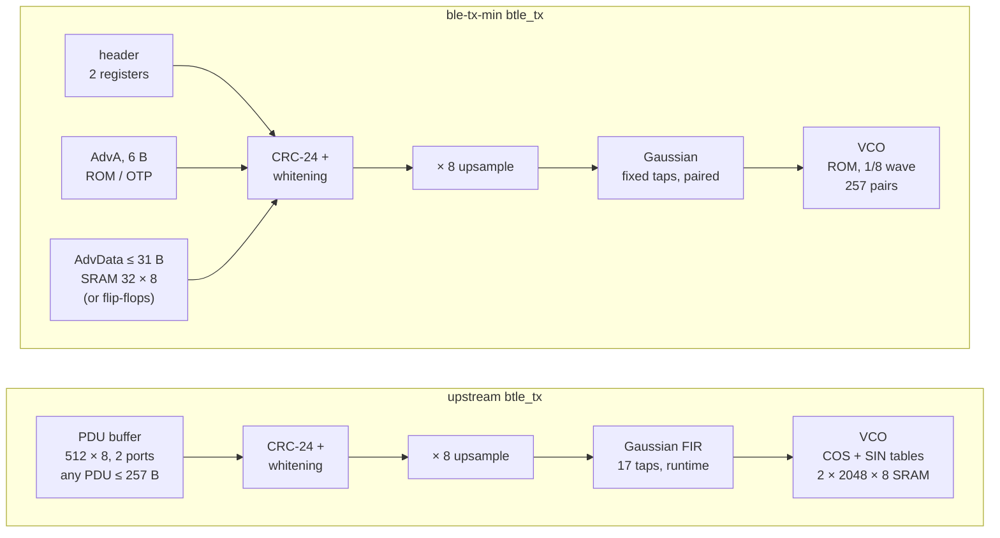

# The final transmitter: upstream against `ble-tx-min`, every result side by side

**Project:** BTLE — reconfigurable RISC-V baseband  
**Branch:** `ble-tx-min` (`a613226` and the runs of this document)  
**Base:** tag `upstream-baseline` (`8540186`), forked from github.com/JiaoXianjun/BTLE  
**Reference results:** [`open_btle_baseband_chip/`](../open_btle_baseband_chip/open_btle_baseband_chip.md), upstream's own report (2024-05-13)  
**Date:** 2026-10-17  
**Author:** Miguel Simões  
**Status:** every number below is measured and its evidence is committed (§ 12). Pre-layout
results in 45 nm, a routed FPGA implementation, and a signoff-clean layout of the transmitter in an open
180 nm PDK; not a tape-out (`docs/Validation/ASIC_READINESS.md`: NOT READY, as on every branch).

---

## How to read this document

The transmitter (TX) of upstream's BLE baseband turns a packet into the I/Q samples of a GFSK signal.
This thesis replaced it, block by block, with smaller exact equivalents, and finally with a transmitter
that sends only Legacy Advertising packets. This document compares that final transmitter, branch
`ble-tx-min`, with upstream's, on everything upstream reports in `open_btle_baseband_chip/` (signals,
bit error rate, FPGA implementation, layout in an open PDK) and on what the thesis measured besides
(area, timing, power, validation). Each section gives the numbers in a table, the figure next to
upstream's when upstream has one, and what the numbers mean. § 10 records the decisions.

Five configurations appear throughout:

| Name | What it is | RTL |
|---|---|---|
| **upstream 2024** | the design `open_btle_baseband_chip.md` describes and measured: its FPGA table and its figures | commit `fc5bc42` (2024-05-13) |
| **upstream** | the upstream design this repository forked: the 2024 design plus a RISC-V-ready Link Layer (AXI registers), a 1 Mbit IQ-capture RAM and an 8-bit payload length | `upstream-baseline` (`8540186`) |
| **corrected master** | upstream with the product audit's corrections and the lint closure (`docs/Validation/PRODUCT_VALIDATION.md`, `LINT_CLOSURE.md`): **the reference every branch is validated against** | `master` (`fca6ac6`) |
| **`ble-tx-min`** | the final transmitter, AdvData in a 32 × 8 SRAM (the branch's default) | `ble-tx-min` |
| **`ble-tx-min`, flip-flops** | the same, AdvData in 31 bytes of flip-flops (`ADV_DATA_FLOPS = 1`) | `ble-tx-min` |

`ble-tx-rom`, the branch `ble-tx-min` was cut from, is shown where it explains a step.

## 1. Summary

| | upstream | corrected master | **`ble-tx-min`** | flip-flops | Evidence |
|---|---:|---:|---:|---:|---|
| PDUs it can send | any, 2–257 bytes | any, 2–257 bytes | **Legacy Advertising, ≤ 39 bytes, the chip's AdvA** | the same | § 2 |
| Same outputs as the reference, every clock (within its contract) | — | reference | **yes**: 144/144 runs, 270/270 matrix | yes | § 3 |
| **TX area, 45 nm** (cells + SRAM macros, µm²) | 167 731.4 | 170 967.6 | **5 007.1 (−97.0 %)** | 4 446.5 (−97.3 %) | § 4 |
| SRAM bits in the TX | 36 864 | 36 864 | **256** | 0 | § 4 |
| TX on the xc7z020: LUTs / flip-flops / RAMB18 | 680 / 401 / 3 | 986 / 544 / 3 | **387 / 254 / 0** | 377 / 245 / 0 | § 6 |
| Controller min period, 45 nm (target 62.5 ns) | 1.991 ns | 3.410 ns | **2.036 ns** | 1.913 ns | § 5 |
| Worst path | RX demodulator | TX Gaussian tail | **RX demodulator** | RX demodulator | § 5 |
| Switching activity of the controller, `mixed` | — | reference | **−4.79 %** | −1.18 % | § 7 |
| TX leakage, 45 nm: logic + SRAM (µW) | 112.61 + not characterized | 182.58 + not characterized | **51.57 + 16.41 = 67.98** | 88.32 + 0 = 88.32 | § 7 |
| BER 0.1 % at 50 ppm / −30 ppm | ≈ 24.5 / ≈ 13.5 dB (published) | — | **24.5 / 13.8 dB** (RTL) | the same TX bits | § 3.3 |
| Open-PDK layout | sky130: global routing failed (whole chip); STA failed (RX core) | — | **GF180MCU, signoff clean**, with the AdvA OTP: 234 603.9 µm² | 157 538.1 µm² | § 8 |

**In one sentence:** `ble-tx-min` sends every Legacy Advertising packet exactly as upstream does, sample
for sample, in 3.0 % of upstream's transmitter area (45 nm), with no SRAM larger than 32 bytes and no
block RAM on the FPGA; the controller's timing stays within the flow's noise of upstream's (its
critical path is in the unchanged receiver), and its switching activity and leakage go down. Its price
is that it sends only Legacy Advertising PDUs, from a device address fixed per chip.

## 2. What changed, block by block

| Block | upstream | `ble-tx-min` | Branch where it was decided |
|---|---|---|---|
| Gaussian filter | FIR, 17 positions, 9 runtime taps written through register 1 | the taps fixed (BT = 0.5, the values of `python/btlelib.py`), computed as 2·Σ(b ? h : 0) − Σh with the two positions of each tap added first | `ble-tx-table` (B2), paired on `ble-tx-pdu` |
| VCO | phase accumulator + COS and SIN tables in two 2 048 × 8 memories written by software | phase accumulator + a ROM in logic of the first eighth of the wave (257 {cos, sin} pairs), unfolded to the whole wave by the quadrant | `ble-tx-rom` |
| Packet buffer | 512 × 8, two ports (AXI clock writes, baseband clock reads), any PDU of up to 257 bytes | header in 2 registers, AdvA (bytes 2–7) fixed per chip (ROM in the RTL, OTP in the ASIC), AdvData (bytes 8–38) in a 32 × 8 one-port memory | `ble-tx-pdu` (one port), `ble-tx-min` (the split) |
| Counters | 12-bit PDU bit counter, 8-bit length, 13-bit input counts in CRC and whitening | 9-bit PDU bit counter, 6-bit byte address and length (saturated at 37), 6-bit counts | `ble-tx-pdu` (exact rewrites), `ble-tx-min` (39 bytes) |
| CRC-24, whitening, upsampling, timing of every output | upstream's | upstream's, on every clock | — |

**The contract** (`docs/Validation/TX_MIN_VALIDATION.md` § 1): a Legacy Advertising PDU of at most 39
bytes (2 header bytes and a payload of at most 37: AdvA and at most 31 bytes of AdvData), whose bytes
2–7 are the chip's AdvA, written before `tx_start`, with the AXI clock at 8 MHz or faster. ADV_IND,
ADV_NONCONN_IND, ADV_SCAN_IND, SCAN_RSP and ADV_DIRECT_IND fit. Upstream's own report states the same
limit as a feature of its design — "PDU (Protocol Data Unit) has 2–39 octets"
(`open_btle_baseband_chip.md`, *Introduction*) — which its RTL later extended to 257 bytes
(commit `6605dcb`, "extend the payload len to 8bit", 2026-02-03).

**Why it is exact.** Every change keeps the bits on air and their timing: the fixed taps are the ones
upstream's software writes, the ROM holds the values of upstream's tables at every one of the 2 048
phases, and the packet buffer is read with `ble-tx-pdu`'s protocol (the byte is asked 12 clocks before it
is used, and is ready in at most four AXI clocks): no stall, no new timing constraint. § 3 proves it.

## 3. Function: the signals, the receiver and the bit error rate

### 3.1 Signals in the transmitter (upstream's `py-fig3.png`)

| upstream (Python model) | `ble-tx-min` (RTL, Icarus) |
|---|---|
|  |  |
| example 2: PDU `0100` (data, empty payload), channel 10 | the same packet: PDU `0100`, channel 10, AA 0x11850A1B, CRC init 0x123456 |

Top: the upsampled PHY bit (±1), the Gaussian filter's output (red, normalized) and the normalized
frequency deviation measured on the I/Q samples (dashed); bottom: I and Q. Both figures are the same
packet, upstream's example 2 (`test_vector_for_btle_verilog.py 2`): 80 bits, 656 samples, the same axes.
Its 2 bytes never reach AdvA (bytes 2..7), so the ROM plays no part. Upstream's figure is its
Python model; ours is the RTL's actual output, captured by the upstream testbench `btle_tx_tb.v` plus a
monitor of the filter, and compared with the Python model on every sample: **0 samples differ**
(`results/figures/tx-min/tx_min_figures_tx.json`). Since the samples are the Python model's, the
frequency deviation is the one upstream checks against the Core spec's 185 kHz minimum (0.185
normalized): the same tables, taps and modulation index 0.5.

The packet this chip actually sends, a 39-byte ADV_NONCONN_IND (AdvA from the ROM, upstream's BER
AdvData, channel 37), is 376 bits, 3 024 samples, also 0 samples differ:
[`tx_min_py_fig3_adv.png`](../results/figures/tx-min/tx_min_py_fig3_adv.png).

### 3.2 The receiver's decision (upstream's `py-fig4.png`)

| upstream | `ble-tx-min` |
|---|---|
|  |  |

The same waveform after the channel of upstream's run (20 dB SNR, 0 ppm), demodulated by upstream's
receiver (`sign(i0·q1 − i1·q0)` on the 8 sampling phases; red: the best phase). The noise is another draw,
so the small ripples differ. With the RTL transmitter: CRC OK, the PDU received equal to the one sent. The 39-byte
ADV packet after 20 dB and 20 ppm, also CRC OK and equal to the one sent (37 payload bytes):
[`tx_min_py_fig4_adv.png`](../results/figures/tx-min/tx_min_py_fig4_adv.png).

### 3.3 Bit error rate (upstream's `open_btle_baseband_chip_21_1.png`, `_23_1.png`)

| | upstream (published) | `ble-tx-min` (RTL transmitter) |
|---|---|---|
| 50 ppm |  |  |
| −30 ppm |  |  |

Method, as upstream's `test_btle_ber.py`: 39-byte ADV PDUs with a random payload (here: the chip's AdvA
and 31 random bytes of AdvData), 100/200/300/300 packets at the four SNR points (31 200 to 93 600 bits),
a clock error that also shifts the carrier (50 ppm = 122.5 kHz at 2.45 GHz), AWGN, upstream's receiver.
For `ble-tx-min` the transmitter is the RTL: 300 packets simulated, each compared with the Python model
(0 samples differ), then the same channel noise applied to both, which gives two identical curves
(`results/figures/tx-min/tx_min_figures_ber.json`). Upstream's curve is its script run again,
unmodified (`results/figures/tx-final/upstream_ber_rerun.txt`).

| SNR (dB) | upstream, rerun | `ble-tx-min`, RTL | | SNR (dB) | upstream, rerun | `ble-tx-min`, RTL |
|---:|---:|---:|---|---:|---:|---:|
| **50 ppm** | | | | **−30 ppm** | | |
| 22.0 | 2.27 × 10⁻² | 4.45 × 10⁻² | | 11.0 | 1.89 × 10⁻² | 4.92 × 10⁻² |
| 23.5 | 1.12 × 10⁻² | 1.14 × 10⁻² | | 12.5 | 2.79 × 10⁻³ | 3.17 × 10⁻³ |
| 25.0 | 3.74 × 10⁻⁴ | 3.21 × 10⁻⁴ | | 14.0 | 9.08 × 10⁻⁴ | 8.01 × 10⁻⁴ |
| 26.0 | 7.48 × 10⁻⁵ | 7.48 × 10⁻⁵ | | 15.0 | 2.14 × 10⁻⁴ | 1.82 × 10⁻⁴ |
| **BER 0.1 % at** (log-linear interpolation) | **24.6 dB** | **24.5 dB** | | | **13.9 dB** | **13.8 dB** |

Upstream's report gives 24.5 dB at 50 ppm and about 13.5 dB at −30 ppm. The three agree to within
0.4 dB. The points of lowest SNR differ by a factor of about two between runs: there a few packets
whose access address is not found count all their bits as wrong, so 100 packets give a coarse estimate
(upstream's published point at 22 dB, about 5 × 10⁻², is above its own rerun, 2.3 × 10⁻²; ours,
4.5 × 10⁻², is between). The transmitter is not the cause: with the same noise, the RTL and the Python
transmitter give the same errors at every point.

**Which receiver.** The BER uses upstream's receiver model (`python/btlelib.py` of `upstream-baseline`),
as the published figures do. The audited model returns no PDU when the CRC fails, which would count a
whole packet as wrong: a packet error rate, not a BER.

### 3.4 Alignment with the SDR program (upstream's `py-fig0.png`, `py-fig1.png`)

Not repeated: those figures compare upstream's Python model with the C program of the SDR project
(`btle_tx` of JiaoXianjun/BTLE), a property of the Python model. `ble-tx-min`'s RTL produces the Python
model's samples exactly for every PDU in its contract (§ 3.5), so the alignment carries over; example 0
of `py-fig1.png` (an ADV PDU on channel 37 with AdvA 01:02:03:04:05:06, the branch's default AdvA) is in
the contract and is one of the matrix's packets.

### 3.5 Verification against upstream

Upstream verifies each module and the controller with testbenches that compare the Verilog with the
Python model's vectors ("tx test_ok 1, rx test_ok 1"). The thesis kept those testbenches and added
clock-by-clock lockstep against the corrected reference. For `ble-tx-min` (`TX_MIN_VALIDATION.md` § 3,
at `b723c06`, against `fca6ac6`):

| Check | Result |
|---|---|
| Upstream's 5 testbenches × 54 conditions (3 packets, 3 SNR, 3 clock errors, 2 delays), `GAUSS_TABLE = 1` on every level | **270/270**, also on a one-port model of the AdvData memory |
| The transmitter against the reference, every output on every clock: PDUs of 0–37 payload bytes, 2 AdvA values, 6 AXI clocks, 4 builds (RAM model, one-port macro model, flip-flops, OTP programmed once) | **144/144 runs, no difference**; **16/16 deliberate faults caught** |
| TX waveforms against the Python model, each decoded by the RTL receiver | **167/167** |
| The whole controller against the reference through its AXI registers | **6/6 runs**, 369 606 cycles, 36 TX and 36 RX packets; 5/5 faults caught |
| Gate-level netlists (Nangate45) of the controller, side by side with the reference, 5 scenarios | **0 mismatches** on every output (§ 7) |
| Strict lint (Verilator 5.020, warnings fatal) | **PASS**, 4/4 configurations |

## 4. Area in 45 nm (Nangate45 cells + OpenRAM macros, FreePDK45)

Yosys + ABC with the Nangate45 library, every configuration in one run (`results/area/tx-min/`); the
SRAMs as OpenRAM macros in FreePDK45, the process behind Nangate45, sized exactly as the RTL needs
them.

| `btle_tx` | cells | flip-flops | logic (µm²) | SRAM macros | macros (µm²) | **TX total (µm²)** | vs upstream | vs corrected master |
|---|---:|---:|---:|---|---:|---:|---:|---:|
| upstream | 3 409 | 404 | 5 322.9 | 2 × 2 048 × 8 (COS, SIN) + 512 × 8, 2 ports | 162 408.5 | **167 731.4** | — | −1.9 % |
| corrected master | 5 823 | 547 | 8 559.1 | the same | 162 408.5 | **170 967.6** | +1.9 % | — |
| `ble-tx-rom` | 1 463 | 236 | 2 520.6 | 256 × 8, 1 port | 6 979.1 | **9 499.7** | −94.3 % | −94.4 % |
| **`ble-tx-min`** | 1 470 | 239 | 2 531.3 | **32 × 8, 1 port** | **2 475.8** | **5 007.1** | **−97.0 %** | **−97.1 %** |
| `ble-tx-min`, flip-flops | 2 251 | 486 | 4 446.5 | none | 0 | **4 446.5** | −97.3 % | −97.4 % |

| Inside `btle_tx` (µm²) | upstream | corrected master | **`ble-tx-min`** |
|---|---:|---:|---:|
| Gaussian filter (`gauss_filter`) | 3 366.0 | 3 366.0 | **256.7** (−92.4 %) |
| VCO logic (`vco`) | 150.0 | 150.0 | 597.4 (the ROM) |
| VCO macros | 138 700.5 | 138 700.5 | **0** |
| Packet buffer macro | 23 708.0 | 23 708.0 | **2 475.8** |

1. **Upstream's transmitter is 97 % memory.** Its two 2 048 × 8 tables and its 512 × 8 buffer are
   162 408.5 µm² of 167 731.4. `ble-tx-min` keeps 256 bits of the 36 864: the VCO's tables become a
   ROM of 597.4 µm² (257 constant pairs fold into logic), the packet buffer a 32 × 8 macro.
2. **The logic halves too** (5 322.9 → 2 531.3 µm², −52.4 %; −70.4 % against corrected master): the
   fixed taps take the Gaussian filter from 3 366.0 to 256.7 µm². The corrections of the product audit
   and the lint closure add 3 236.2 µm² to upstream's transmitter (8 559.1 against 5 322.9), most of it
   the Gaussian tail weighing the runtime taps; with fixed taps the audit added 35–150 µm²
   (`TX_BRANCH_COMPARISON.md` § 4.4).
3. **`ble-tx-min` is 33.5 times smaller than upstream's transmitter** (37.7 with flip-flops), and
   47.3 % smaller than `ble-tx-rom`.

The whole controller (the receiver, eight demodulators and the IQ-capture RAM included, untouched):

| `btle_controller` | cells | flip-flops | cell area (µm²) | SRAM bits |
|---|---:|---:|---:|---:|
| upstream | 50 295 | 4 578 | 71 706.4 | 1 136 070 |
| corrected master | 52 357 | 4 722 | 74 684.8 | 1 136 070 |
| **`ble-tx-min`** | 48 140 | 4 414 | 68 701.1 | 1 099 462 |
| `ble-tx-min`, flip-flops | 48 780 | 4 661 | 70 500.9 | 1 099 206 |

## 5. Timing

### 5.1 Static timing in 45 nm

`scripts/timing/run_sta.sh`: the mapped netlist cut at the flip-flops, sized by ABC, worst path +
clock-to-Q + setup (Nangate45 typical, no wires); target 62.5 ns (the 16 MHz baseband clock).

| `btle_controller` | upstream | corrected master | `ble-tx-rom` | **`ble-tx-min`** | flip-flops |
|---|---:|---:|---:|---:|---:|
| Logic path | 1.631 ns | 3.050 ns | 1.658 ns | **1.677 ns** | 1.553 ns |
| **Min period** | 1.991 ns | 3.410 ns | 2.017 ns | **2.036 ns** | 1.913 ns |
| Slack at 62.5 ns / Fmax | +60.509 / 502 MHz | +59.090 / 293 MHz | +60.483 / 496 MHz | **+60.464 / 491 MHz** | +60.587 / 523 MHz |
| Worst path | RX demodulator multiply | **TX** Gaussian tail (runtime taps) | RX demodulator | **RX demodulator** | RX demodulator |

The transmitter of `ble-tx-min` is off the critical path: the controller's worst path is in the
receiver, which the branch does not touch, and the differences between upstream and the last four
columns are the flow's noise (the same receiver RTL, `btle_rx`, times at 1.52–1.64 ns of logic across
these runs). Corrected master's worst path
is the Gaussian tail that the audit added, which weighs the runtime taps; with fixed taps it is short.

### 5.2 In the FPGA and in GF180MCU

The same picture holds in both implementations (§§ 6, 8): on the xc7z020 the worst path of the
baseband clock is in the receiver in every configuration (slack 44.6–47.5 ns at 62.5 ns), and the
transmitter's own worst path in `ble-tx-min` is the AdvData read on the 100 MHz AXI clock (+5.99 ns at
10 ns). In the GF180MCU layout every corner meets setup and hold (§ 8).

## 6. FPGA: the xc7z020 of upstream's report

Upstream implemented its 2024 design on the xc7z020 (Zynq-7020) with Vivado 2021.1
(`btle_controller_xilinx_7z020.jpg`). Here: Vivado 2026.1, the same part (`xc7z020clg484-1`), default
strategies, synthesis, placement and routing (`scripts/fpga/xc7z020/`, `results/fpga/xc7z020/`).

**First, the flow reproduces upstream's published table.** Upstream's 2024 project, rebuilt as it was
(top `btle_controller_wrapper`, its `btle_controller_wrapper.xdc`, commit `fc5bc42`):

| | Published (Vivado 2021.1) | Reproduced (Vivado 2026.1) |
|---|---:|---:|
| Slice LUTs | 3 563 | 3 568 |
| LUT as logic / as memory | 2 687 / 876 | 2 692 / 876 |
| Slice registers | 2 307 | 2 307 |
| F7 / F8 muxes | 75 / 16 | 75 / 16 |
| Slices | 1 180 | 1 193 |
| DSPs | 48 | 48 |
| WNS / TNS / failing endpoints | 27.701 ns / 0 / 0 | 29.278 ns / 0 / 0 |
| Total on-chip power / junction temperature | 0.12 W / 26.4 °C | 0.119 W / 26.4 °C |

LUTs within 0.2 %, registers, muxes and DSPs identical, slices +1.1 % (packing), the same power and
junction temperature, a WNS 1.6 ns larger: the tool version moves these results by little, and the
comparisons below are all made with the same one. Since then upstream's controller changed its ports, and
its wrapper no longer matches it (`clk`, `rst`, `clkb` no longer exist), so the current designs run
out of context with `btle_controller` as top (as upstream's current `btle_controller.tcl` names it):
`bb_clk` at 16 MHz and `rf_clk` at 8 MHz (the documented 2:1 interface), the AXI and the IQ-capture
port at 100 MHz, asynchronous to them.

| Routed, xc7z020 | upstream | corrected master | `ble-tx-rom` | **`ble-tx-min`** | flip-flops |
|---|---:|---:|---:|---:|---:|
| **`btle_tx`**: LUTs (of which LUTRAM) | 680 (0) | 986 (0) | 366 (0) | **387 (8)** | 377 (6) |
| **`btle_tx`**: flip-flops | 401 | 544 | 243 | **254** | 245 |
| **`btle_tx`**: RAMB18 | 3 | 3 | 1 | **0** | 0 |
| **`btle_tx`**: dynamic power (vectorless) | 3 mW | 4 mW | 2 mW | **1 mW** | 1 mW |
| Controller: LUTs / flip-flops | 4 457 / 5 756 | 4 534 / 5 900 | 3 846 / 5 541 | **3 871 / 5 552** | 3 858 / 5 543 |
| Controller: block RAM tiles / DSPs | 38 / 48 | 38 / 48 | 37 / 48 | **36.5 / 48** | 36.5 / 48 |
| WNS `bb_clk` (62.5 ns) / AXI (10 ns) | 47.450 / 2.778 ns | 44.595 / 3.012 ns | 46.806 / 2.554 ns | **44.741 / 2.604 ns** | 46.478 / 2.920 ns |
| Total on-chip power (vectorless) | 0.206 W | 0.206 W | 0.205 W | **0.204 W** | 0.204 W |

- **The transmitter uses no block RAM** in `ble-tx-min`: 387 LUTs (−43 % against upstream, −61 %
  against corrected master), 254 flip-flops, and the 32-byte AdvData store in 8 LUTs of distributed RAM.
- **On the FPGA the two AdvData stores are the same thing**: Vivado infers distributed RAM from the 31
  bytes of flip-flops too (6 LUTRAM, 245 flip-flops), so the choice of § 10.5 is an ASIC question.
- **The DSPs and the power are the receiver's**: the 48 DSPs are the 8 demodulators' multipliers, and
  0.106 W of the 0.204 W is the device's static power; the IQ-capture RAM (32 RAMB36) is upstream's.
  Vivado's power is vectorless (default toggle rates) and rounds to 1 mW: an estimate.

**Upstream's picture, side by side.** `btle_controller_xilinx_7z020.jpg` is Vivado's Device view of
upstream's routed 2024 design. Vivado's batch mode cannot export that view, so the routed checkpoints
were opened in Vivado 2026.1's GUI, `btle_tx`'s primitives highlighted in orange (`highlight_objects`),
the Device panel maximized and fitted to the device, and the window captured
(`scripts/fpga/xc7z020/device_view.ps1`, `device_view.tcl`, `device_crop.py`; each image and what it
highlights in `results/fpga/xc7z020/<configuration>/device.png`, `device.txt`):

- **The reproduced 2024 design lands where upstream's did**: the logic in the two bottom clock regions
  (X0Y0, X1Y0), a tall block rising from X1Y0 into X1Y1 on the right, the IOs along the right edge, and
  the Zynq's processing system (the black top-left corner) unused. In the reproduction that tall block
  is the 2024 transmitter: 2 417 of the design's 7 377 primitives (33 %), 780 of its 1 519 LUTs used as
  LUTRAM. The placement differs in detail, as the tool version does, and Vivado 2026.1 draws the device
  on black where 2021.1 filled the clock regions in dark blue.
- **Out of context, where the transmitter lands means nothing; how much of the device it takes does.**
  With no pins the placer is free, so `btle_tx` in X1Y1 (upstream) or in X1Y0 (`ble-tx-min`) is an
  accident of the run. What the pictures show is its share: upstream's 1 316 primitives (10.7 % of the
  controller's), 3 RAMB18 among them, against `ble-tx-min`'s 767 (6.8 %, −42 %), LUTs and flip-flops
  only. The rest of the controller, the same in both, fills everything else.

## 7. Power

Four measures, from the most relative to the most absolute; none is a silicon measurement.

**7.1 Switching activity of the controller.** Gate-level netlists (Nangate45) of each configuration and
of the reference, in one Verilator simulation per scenario, every output compared on every clock (0
mismatches), 100 000 baseband clocks: Σ toggles × pin capacitance of data pins and flip-flop clock pins
(`results/power/tx-min/`). Scenarios: `rx` (packets received), `tx` (packets sent), `mixed`, `idle`
(noise at the input), `idle0` (no input).

| Data + clock switched capacitance against corrected master | `rx` | `tx` | `mixed` | `idle` | `idle0` |
|---|---:|---:|---:|---:|---:|
| corrected master (fF·toggles) | 1.258 × 10⁹ | 1.040 × 10⁹ | 1.302 × 10⁹ | 1.290 × 10⁹ | 0.975 × 10⁹ |
| `ble-tx-rom` | −4.70 % | −6.23 % | −4.75 % | −4.61 % | −6.08 % |
| **`ble-tx-min`** | **−4.73 %** | **−6.20 %** | **−4.79 %** | **−4.61 %** | **−6.04 %** |
| `ble-tx-min`, flip-flops | −0.98 % | −1.74 % | −1.18 % | −0.94 % | −1.23 % |

The saving is the transmitter's clock load: the Gaussian filter's (3.38 × 10⁷ → 4.18 × 10⁶
fF·toggles, −88 %, its 156 tap flip-flops gone) and the rest of the transmitter's (7.01 → 4.12 × 10⁷:
mostly the copy of the runtime taps that the Gaussian tail keeps, 144 flip-flops, which fixed taps
remove, and the shorter counters; `btle_tx` has 547 flip-flops in corrected master, 239 here);
`ble-tx-min` is `ble-tx-rom` within 0.05 points. The 248 AdvData
flip-flops, clocked on every AXI clock without gating, give three quarters of it back (the
transmitter's clock load 4.12 → 8.81 × 10⁷ fF·toggles).

**7.2 The SRAMs' energy (SPICE).** Each OpenRAM macro characterized with ngspice on its whole netlist
(FreePDK45, TT, 1.0 V, 25 °C; `results/power/sram-char-min/`, `sram-leakage-min/`), its accesses counted
at RTL in the same five scenarios against the reference (`results/power/sram-energy-min/`):

| Macro | Write | Read | Deselected clock | Leakage (settled) |
|---|---:|---:|---:|---:|
| 256 × 8, 1 port (`ble-tx-rom`) | 0.889 pJ | 0.821 pJ | 0.323 pJ | 15.02 µW |
| **32 × 8, 1 port (`ble-tx-min`)** | **0.479 pJ** | **0.351 pJ** | **0.182 pJ** | **16.41 µW** |

| TX SRAM dynamic power (µW) | `rx` | `tx` | `mixed` | `idle` | `idle0` | Leakage (µW) |
|---|---:|---:|---:|---:|---:|---:|
| corrected master (2 × 2 048 × 8 + 512 × 8, 2 ports) | not characterized | | | | | not characterized |
| `ble-tx-rom` | 19.40 | 19.39 | 19.39 | 19.40 | 19.40 | 15.02 |
| **`ble-tx-min`** | **2.92** | **10.51** | **10.10** | **2.92** | **2.92** | **16.41** |

`ble-tx-min`'s buffer is written only when the software's pair falls inside AdvData (none at rest:
only its clock, 2.92 µW), where `ble-tx-rom`'s 256-byte buffer takes the pair on every clock. The
32 × 8 leaks as much as the 256 × 8: at this size the periphery leaks, not the array. Upstream's macros
could not be characterized: OpenRAM's ngspice did not finish the 2 048 × 8 two-port netlist in hours
(`TX_BRANCH_COMPARISON.md` § 6.6); its accesses are counted (a write and a read of all three memories on
every clock), not priced. The summarizer therefore reports `RESULT: FAIL` for incomplete
characterization, as the original run does; every check on the counted configurations passes.

**7.3 Leakage of the transmitter's logic** (`scripts/power/logic_leakage.py`, the Nangate45 liberty's
`cell_leakage_power` of every cell, 1.10 V typical; `results/power/tx-min-leakage/summary.md`):

| `btle_tx` | logic leakage | of which flip-flops | + SRAM leakage | **TX static** |
|---|---:|---:|---:|---:|
| upstream | 112.61 µW | 31.96 µW | not characterized | > 112.61 µW |
| corrected master | 182.58 µW | 43.27 µW | not characterized | > 182.58 µW |
| `ble-tx-rom` | 51.24 µW | 18.67 µW | 15.02 µW | 66.26 µW |
| **`ble-tx-min`** | **51.57 µW** | **18.91 µW** | **16.41 µW** | **67.98 µW** |
| `ble-tx-min`, flip-flops | 88.32 µW | 38.45 µW | — | 88.32 µW |

In this 45 nm library (predictive, leaky) **the 31 bytes of flip-flops leak more than the 32 × 8 SRAM**
(+36.75 µW of logic against 16.41 µW of macro), and their clock costs about 4.5 µW more (§ 7.1, ½CV²
of the extra clock-pin load at 1.1 V): in 45 nm the SRAM is the lower-power store.

**7.4 In GF180MCU** (§ 8), OpenSTA's vectorless estimate at 5 V, the default activity of every net:
38.58 mW with flip-flops, 43.07 mW with the SRAM 64 × 8 (leakage 1.7 and 1.3 µW). An estimate of the
order of magnitude, not of the difference.

## 8. Layout in an open PDK (upstream's OpenLane images)

Upstream ran OpenLane2 with sky130 on two blocks, and neither closed:

| upstream (sky130, OpenLane2) | |
|---|---|
|  |  |
| `btle_rx_core`: GDSII; "Static Timing Analysis (Post-PnR) failed" | the whole controller: detailed placement and CTS; "Global Routing failed" |

The thesis laid out `ble-tx-min`'s transmitter with LibreLane (OpenLane2's successor) in **GF180MCU-D**,
the open PDK that has an OTP: AdvA in six eFuse blocks generated by the open GF180MCU eFuse compiler
(§ 9), the supervisor's architecture **header in registers, AdvA in OTP, AdvData in SRAM**, and the
alternative with AdvData in flip-flops. Die 760 × 760 µm for both, `clk` at 16 MHz and `clkb` (the AXI
side) at 50 MHz, 9 corners (ss 125 °C 4.5 V, tt 25 °C 5 V, ff −40 °C 5.5 V × three RC).

| `ble-tx-min`, AdvData in flip-flops | `ble-tx-min`, AdvData in the PDK's SRAM 64 × 8 |
|---|---|
|  |  |
| logic above, the six eFuse blocks (AdvA) in a row at the bottom | the GlobalFoundries SRAM at the top, logic, the eFuse row at the bottom |

| Signoff | flip-flops (`tx-min-gf180`) | **SRAM 64 × 8 (`tx-min-gf180-sram64`)** |
|---|---|---|
| DRC, KLayout (the foundry's deck, whole GDS) | **0** | **0** (the SRAM's inside included) |
| DRC, Magic | 0 | 2 413, all inside the GlobalFoundries SRAM (Magic's deck does not accept the foundry's layout; the run fails if one lies outside it) |
| LVS (Netgen) / antenna / routing DRC | clean / 0 / 0 | clean / 0 / 0 |
| Worst setup slack: ss / tt / ff | +6.388 / +10.652 / +12.547 ns | +7.495 / +11.032 / +12.647 ns |
| Worst hold slack: ff / tt / ss | +0.192 / +0.470 / +1.097 ns | +0.190 / +0.464 / +1.088 ns |
| Max slew / max capacitance violations | 0 / 0 | 0 / 0 |
| IR drop (worst) / clock skew | 1.43 mV / 0.32 ns | 1.22 mV / 0.38 ns |

| GF180MCU-D (µm²) | flip-flops | **SRAM 64 × 8** |
|---|---:|---:|
| eFuse blocks (AdvA, OTP) | 48 452.1 | 48 452.1 |
| SRAM (431.86 × 232.88 µm) | — | **100 571.6** |
| Logic: combinational, flip-flops, inverters, buffers | 72 329.7 (501 flip-flops) | 52 164.5 (247 flip-flops) |
| Timing-repair buffers + clock trees | 13 676.1 | 20 735.8 |
| Taps, end caps, antenna diodes, tie cells | 23 080.4 | 12 679.5 |
| **Placed cells + macros** | **157 538.1** | **234 603.9** (+48.9 %) |

In GF180MCU the SRAM costs five times the flip-flops it replaces (100 571.6 µm² against 20 165 µm² of
logic): the PDK's smallest SRAM is a general-purpose 64 × 8 (half its words unused here), sized for its
periphery, and no 32-word macro exists; OpenRAM cannot generate one for this PDK (its `gf180mcu`
technology lacks the flip-flop, sense amplifier and write driver, and its periphery is 3.3 V, not the
5 V of the logic and the eFuses). Its behaviour was checked with GlobalFoundries' own model of the macro
in place of the memory: 144/144 lockstep runs, 16/16 faults caught (`results/validation/min-sram64-sim/`).

Upstream's transmitter has no GF180MCU layout to set beside these: its three memories write and read
in the same clock (two ports), and the PDK's SRAMs (`gf180mcu_fd_ip_sram`: one clock, one address) have
one.

## 9. The AdvA OTP (GF180MCU eFuse)

Neither FreePDK45 nor OpenRAM has an OTP; the open GF180MCU eFuse compiler (github.com/egorxe/
gf180_efuse_compiler, Apache-2.0) generates one: `./efuse.py 1 8 --async-efuse --digital-wrapper=async`
gives `efuse_async_mem_1x8`, eight fuses with their sense amplifiers and latches, read once after reset.

|  |  |
|---|---|
| the block, 97.27 × 83.02 µm (KLayout) | Xyce on its extracted netlist: programming (≈ 17 mA per fuse while it blows), then sensing after reset |

| | Result |
|---|---|
| DRC / LVS (KLayout, GF180MCU decks) | clean / clean |
| Xyce on the PEX netlist, 4 programming and 4 reading tests | all pass |
| Area: one block / six (AdvA, 48 bits) | 8 075.4 µm² / **48 452.1 µm²** (arrays alone: 2 241.2 / 13 447 µm²) |
| Programming | a 1 held ≥ 50 µs on `prog[i]` blows fuse i, read as 1 from the next reset on |
| In the RTL | `ADV_ADDRESS_OTP = 1`; checked with a model of the block: the unprogrammed chip reads 0, AdvA is programmed once, the transmitter then sends it (§ 3.5) |

The ROM (`ADV_ADDRESS`, the default) costs nothing in area — synthesis folds it into the read
multiplexer — but gives every chip the same address; the OTP gives each chip its own, programmed once in
production, at 48 452.1 µm² in GF180MCU: two thirds of the flip-flop variant's logic (72 329.7 µm²),
since each 8-bit block carries its own sense amplifiers, latches and power ring (a single 48-bit block
would share them; the compiler's asynchronous blocks are 8 bits wide). Its programming port must reach a
production test interface, which this controller does not have (it is tied off in `btle_phy`).

## 10. The decisions

| # | Block | upstream | Decision | Alternatives measured (µm², 45 nm unless stated) | Status |
|---|---|---|---|---|---|
| 10.1 | Gaussian filter | runtime FIR, 3 366.0 | **fixed taps, paired**, 256.7 | folded FIR (runtime taps) 2 311.5; constant tables 348.5; tables in SRAM 20 917.1, in flip-flops 23 221.5 (`GAUSS_FILTER_OPTIONS.md`) | decided |
| 10.2 | VCO tables | 2 × 2 048 × 8 SRAM, 138 700.5 | **ROM of an eighth of the wave**, 597.4 of logic | quarter tables, 512 × 8 with one port, 10 703.9; eighth table 256 × 16, 10 424.9; exact CORDIC (15 iterations) 2 317.9 and the controller's worst path at 5.5 ns (`VCO_MEMORY_SWEEP.md`, `TX_BRANCH_COMPARISON.md` § 4.4) | decided |
| 10.3 | Packet scope | any PDU ≤ 257 B, 512 × 8, two ports, 23 708.0 | **Legacy Advertising ≤ 39 B**: header in registers, AdvA fixed per chip, AdvData ≤ 31 B | one port 256 × 8 + 1 byte, 6 979.1; 64 × 8, 3 135.5; 128 × 16 with a byte mask, 6 652.0 | decided (supervisor) |
| 10.4 | AdvA | written by software with the packet | **OTP**, programmed once per chip (a ROM in the RTL) | ROM: no area, one address for every chip; registers written by software: not built (a changeable address, e.g. a random private address) | decided (supervisor) |
| 10.5 | AdvData store | — | **depends on the process** (below) | SRAM 32 × 8: TX 5 007.1, 67.98 µW static; flip-flops: TX 4 446.5, 88.32 µW static; GF180: SRAM 234 603.9 against flip-flops 157 538.1 | open: a recommendation |
| 10.6 | Counters, read protocol | upstream's | **9-bit PDU counter, length saturated at 37; ble-tx-pdu's read protocol** (no stall) | — | decided |

**10.5, the one choice left.** The two stores are equally exact and both built and validated; they
differ by process:

| | SRAM | flip-flops | Better |
|---|---|---|---|
| 45 nm area (TX) | 5 007.1 µm² | 4 446.5 µm² (−11.2 %) | flip-flops, slightly |
| 45 nm static power (TX) | 67.98 µW | 88.32 µW (+29.9 %) | SRAM |
| 45 nm activity (controller, `mixed`) | −4.79 % | −1.18 % | SRAM (ungated flip-flop clocks) |
| GF180MCU area (layout) | 234 603.9 µm² | 157 538.1 µm² (−32.8 %) | **flip-flops, clearly** |
| FPGA | 8 LUTRAM | 6 LUTRAM | the same |

**Recommendation:** in GF180MCU, the open PDK where the OTP exists and the one this transmitter was laid
out in, **keep AdvData in flip-flops**, and gate their clock (one clock gate for the 31 bytes, enabled
only by a write to AdvData), which removes the clock cost of § 7.1 since the bytes change only between
advertising events; in a process with an SRAM compiler sized to 32 words and leaky flip-flops, the SRAM.
The clock gate is not built.

## 11. What the final transmitter gives up, and what this does not claim

**Gives up** (against upstream): PDUs other than Legacy Advertising of at most 39 bytes (no data
channel, no extended advertising; the receiver keeps everything); a changeable AdvA (no random or
resolvable private addresses); the runtime Gaussian taps and COS/SIN tables (fixed to the project's,
BT = 0.5, modulation index 0.5); rewriting a packet byte while it is sent; an AXI clock below 8 MHz.

**Does not claim:**
- The 45 nm figures are pre-layout (no wires, no clock tree); the macros are OpenRAM's in FreePDK45, an
  academic PDK.
- The FPGA results are out of context (no pins) for the current designs, with Vivado 2026.1 instead of
  upstream's 2021.1, and vectorless power; the calibration of § 6 bounds the tool difference.
- The GF180MCU layouts are the transmitter as a macro (no pads, no seal ring, no chip-level
  integration, no parasitic-annotated simulation); their power is vectorless.
- Upstream's SRAMs are not priced in energy (§ 7.2); its leakage is a lower bound.
- `py-fig0.png` and `py-fig1.png` (the SDR C program) are not repeated (§ 3.4).
- The eFuse compiler's IP is "not ASIC-proven yet" (its documentation); the Xyce results are
  simulation.

## 12. Evidence and reproduction

| Result | Evidence | Command (WSL, at the root of `ble-tx-min`) |
|---|---|---|
| Area, 45 nm | `results/area/tx-min/<configuration>/summary.md`, `results/area/openram-min/` | `RTL_REV=<rev> AREA_PARAMS=<params> scripts/area/run_area.sh <label>` |
| Timing, 45 nm | `results/timing/tx-min/<configuration>/summary.txt` | `DUT_REV=<rev> DUT_PARAMS=<params> scripts/timing/run_sta.sh <label> 62.5 fca6ac6` |
| Activity | `results/power/tx-min/<configuration>/` | `DUT_REV=<rev> DUT_PARAMS=<params> VEC_DIR=<d53f2d49 vectors> scripts/power/run_activity.sh <label> 100000 1 fca6ac6` |
| SRAM energy | `results/power/sram-char-min/`, `sram-leakage-min/`, `sram-energy-min/` | `scripts/power/run_sram_char.sh`, `run_sram_leakage.sh`, `run_sram_energy.sh <label> master ble-tx-rom ble-tx-min` (`REF_REV=fca6ac6`) |
| Logic leakage | `results/power/tx-min-leakage/summary.md` | `python3 scripts/power/logic_leakage.py <liberty> <name>=<stat.json> ...` |
| FPGA | `results/fpga/xc7z020/<configuration>/`, `provenance.txt` | `vivado -mode batch -source scripts/fpga/xc7z020/impl.tcl -tclargs <dir> <ooc|wrapper2024>`, then `post.tcl` |
| FPGA Device view | `results/fpga/xc7z020/<configuration>/device.png`, `device.txt` | Windows, Vivado GUI: `powershell -ExecutionPolicy Bypass -File scripts/fpga/xc7z020/device_view.ps1 <dir>`, then `python3 scripts/fpga/xc7z020/device_crop.py <dir>/device_full.png <results dir>/device.png` |
| Layout and OTP | `results/layout/tx-min-gf180*/`, `results/otp/gf180-efuse/` | `scripts/layout/tx_min_gf180/run.sh <label> HEAD [sram64]` (`TX_MIN_VALIDATION.md` § 10) |
| Validation | `results/validation/min-*` | `TX_MIN_VALIDATION.md` § 10 |
| Figures of §§ 3–8 | `results/figures/tx-min/`, `results/figures/tx-final/` (`data.json` names the source of every number) | `python3 scripts/figures/tx_min_figures.py tx|ber <dir>`; `python3 scripts/figures/tx_final_figures.py results/figures/tx-final/data.json <dir>` |
| Upstream's BER, rerun | `results/figures/tx-final/upstream_ber_rerun.txt` | `git archive upstream-baseline python \| tar -x; cd python; python3 test_btle_ber.py 50` (and `-30`) |

Related reports: `docs/Validation/TX_MIN_VALIDATION.md` (this branch in full), `TX_ROM_VALIDATION.md`,
`TX_PDU_VALIDATION.md`, `docs/Comparison/TX_BRANCH_COMPARISON.md` and `RX_BRANCH_COMPARISON.md` (every branch),
`docs/Design Decisions/GAUSS_FILTER_OPTIONS.md` and `VCO_MEMORY_SWEEP.md` (the alternatives of § 10).
