# The final transmitter: upstream against `ble-tx-min`, every result side by side

**Project:** BTLE — reconfigurable RISC-V baseband  
**Branch:** `ble-tx-min` (the runs of this document: `a613226`, and after the synthesis-warning cleanup `b81bf288`, the same circuit, proved: § 8.1)  
**Base:** tag `upstream-baseline` (`8540186`), forked from github.com/JiaoXianjun/BTLE  
**Reference results:** [`open_btle_baseband_chip/`](../../open_btle_baseband_chip/open_btle_baseband_chip.md), upstream's own report (2024-05-13)  
**Date:** 2026-10-27 (first version 2026-10-17)  
**Author:** Miguel Simões  
**Status:** every number below is measured and its evidence is committed (§ 12). Pre-layout
results in 45 nm, a routed FPGA implementation, and a signoff-clean layout of the transmitter in an open
180 nm PDK; **the synthesis (Vivado, Yosys) and the layout (LibreLane) of both AdvData stores end with no
warning that is not a reviewed exception** (§ 8.1); not a tape-out (`docs/Validation/ASIC_READINESS.md`:
NOT READY, as on every branch).

---

## How to read this document

The transmitter (TX) of upstream's BLE baseband turns a packet into the I/Q samples of a GFSK signal.
This thesis replaced it, block by block, with smaller exact equivalents, and finally with a transmitter
that sends only Legacy Advertising packets. This document compares that final transmitter, branch
`ble-tx-min`, with upstream's, on everything upstream reports in `open_btle_baseband_chip/` (signals,
bit error rate, FPGA implementation, layout in an open PDK) and on what the thesis measured besides
(area, timing, power, validation). Each section gives the numbers in a table, the figure next to
upstream's when upstream has one, and what the numbers mean. § 10 records the decisions.

Five configurations appear throughout:

| Name | What it is | RTL |
|---|---|---|
| **upstream 2024** | the design `open_btle_baseband_chip.md` describes and measured: its FPGA table and its figures | commit `fc5bc42` (2024-05-13) |
| **upstream** | the upstream design this repository forked: the 2024 design plus a RISC-V-ready Link Layer (AXI registers), a 1 Mbit IQ-capture RAM and an 8-bit payload length | `upstream-baseline` (`8540186`) |
| **corrected master** | upstream with the product audit's corrections and the lint closure (`docs/Validation/PRODUCT_VALIDATION.md`, `LINT_CLOSURE.md`): **the reference every branch is validated against** | `master` (`fca6ac6`) |
| **`ble-tx-min`** | the final transmitter, AdvData in a 32 × 8 SRAM (the branch's default) | `ble-tx-min` |
| **`ble-tx-min`, flip-flops** | the same, AdvData in 31 bytes of flip-flops (`ADV_DATA_FLOPS = 1`) | `ble-tx-min` |

`ble-tx-rom`, the branch `ble-tx-min` was cut from, is shown where it explains a step.

After the first version of this document, the RTL of `ble-tx-min` was cleaned of every synthesis warning
that came from it (§ 8.1): the same circuit, proved, in every configuration. The measures of synthesis and
layout of the two `ble-tx-min` columns are those of the cleaned RTL (`b81bf288`), the signals, the bit error
rate and the SRAMs' energy (§§ 3, 7.2) those of `a613226`, which the proof carries over.

## 1. Summary

| | upstream | corrected master | **`ble-tx-min`** | flip-flops | Evidence |
|---|---:|---:|---:|---:|---|
| PDUs it can send | any, 2–257 bytes | any, 2–257 bytes | **Legacy Advertising, ≤ 39 bytes, the chip's AdvA** | the same | § 2 |
| Same outputs as the reference, every clock (within its contract) | — | reference | **yes**: 144/144 runs, 270/270 matrix | yes | § 3 |
| **TX area, 45 nm** (cells + SRAM macros, µm²) | 167 731.4 | 170 967.6 | **5 018.5 (−97.0 %)** | 4 420.4 (−97.4 %) | § 4 |
| SRAM bits in the TX | 36 864 | 36 864 | **256** | 0 | § 4 |
| TX on the xc7z020: LUTs / flip-flops / RAMB18 | 680 / 401 / 3 | 987 / 544 / 3 | **387 / 254 / 0** | 377 / 245 / 0 | § 6 |
| Controller min period, 45 nm (target 62.5 ns) | 1.991 ns | 3.410 ns | **1.940 ns** | 1.884 ns | § 5 |
| Worst path | RX demodulator | TX Gaussian tail | **RX demodulator** | RX demodulator | § 5 |
| Switching activity of the controller, `mixed` | — | reference | **−5.15 %** | −1.58 % | § 7 |
| TX leakage, 45 nm: logic + SRAM (µW) | 112.61 + not characterized | 182.58 + not characterized | **51.71 + 16.41 = 68.12** | 87.84 + 0 = 87.84 | § 7 |
| BER 0.1 % at 50 ppm / −30 ppm | ≈ 24.5 / ≈ 13.5 dB (published); 24.5 / 13.8 dB with the same noise as the RTL | — | **24.5 / 13.8 dB** (RTL; the same errors as upstream's TX in 20 noise draws) | the same TX bits | § 3.3 |
| Open-PDK layout | sky130: global routing failed (whole chip); STA failed (RX core) | — | **GF180MCU, signoff clean**, with the AdvA OTP: 234 009.0 µm² | 160 784.9 µm² | § 8 |
| Warnings of synthesis (Vivado, Yosys) and layout (LibreLane) | Vivado: 207 in synthesis, none reviewed | Vivado: 206 | **0 unreviewed** (Vivado 109 in synthesis, Yosys 0, LibreLane 37, all reviewed exceptions) | **0 unreviewed** (109, 0, 29) | § 8.1 |

**In one sentence:** `ble-tx-min` sends every Legacy Advertising packet exactly as upstream does, sample
for sample, in 3.0 % of upstream's transmitter area (45 nm), with no SRAM larger than 32 bytes and no
block RAM on the FPGA; the controller's timing stays within the flow's noise of upstream's (its
critical path is in the unchanged receiver), and its switching activity and leakage go down. Its price
is that it sends only Legacy Advertising PDUs, from a device address fixed per chip.

## 2. What changed, block by block

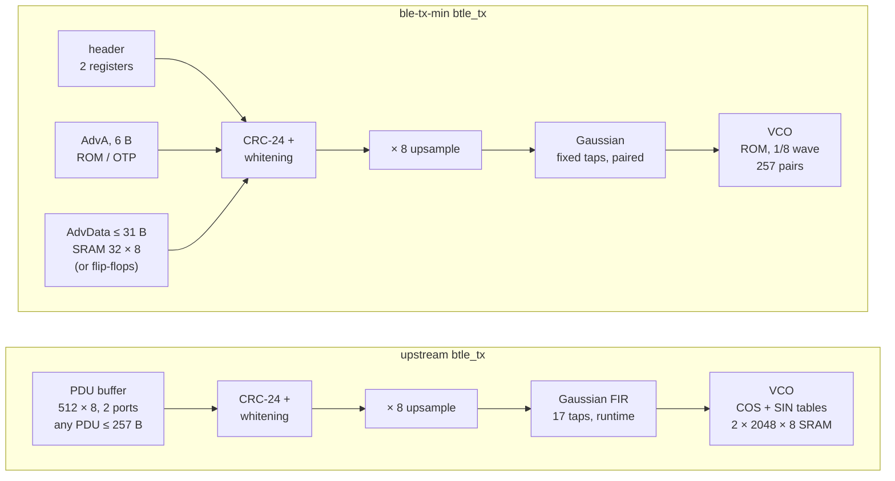

| Block | upstream | `ble-tx-min` | Branch where it was decided |
|---|---|---|---|
| Gaussian filter | FIR, 17 positions, 9 runtime taps written through register 1 | the taps fixed (BT = 0.5, the values of `python/btlelib.py`), computed as 2·Σ(b ? h : 0) − Σh with the two positions of each tap added first | `ble-tx-table` (B2), paired on `ble-tx-pdu` |
| VCO | phase accumulator + COS and SIN tables in two 2 048 × 8 memories written by software | phase accumulator + a ROM in logic of the first eighth of the wave (257 {cos, sin} pairs), unfolded to the whole wave by the quadrant | `ble-tx-rom` |
| Packet buffer | 512 × 8, two ports (AXI clock writes, baseband clock reads), any PDU of up to 257 bytes | header in 2 registers, AdvA (bytes 2–7) fixed per chip (ROM in the RTL, OTP in the ASIC), AdvData (bytes 8–38) in a 32 × 8 one-port memory | `ble-tx-pdu` (one port), `ble-tx-min` (the split) |
| Counters | 12-bit PDU bit counter, 8-bit length, 13-bit input counts in CRC and whitening | 9-bit PDU bit counter, 6-bit byte address and length (saturated at 37), 6-bit counts | `ble-tx-pdu` (exact rewrites), `ble-tx-min` (39 bytes) |
| CRC-24, whitening, upsampling, timing of every output | upstream's | upstream's, on every clock | — |

**The contract** (`docs/Validation/TX_MIN_VALIDATION.md` § 1): a Legacy Advertising PDU of at most 39
bytes (2 header bytes and a payload of at most 37: AdvA and at most 31 bytes of AdvData), whose bytes
2–7 are the chip's AdvA, written before `tx_start`, with the AXI clock at 8 MHz or faster. ADV_IND,
ADV_NONCONN_IND, ADV_SCAN_IND, SCAN_RSP and ADV_DIRECT_IND fit. Upstream's own report states the same
limit as a feature of its design — "PDU (Protocol Data Unit) has 2–39 octets"
(`open_btle_baseband_chip.md`, *Introduction*) — which its RTL later extended to 257 bytes
(commit `6605dcb`, "extend the payload len to 8bit", 2026-02-03).

**Why it is exact.** Every change keeps the bits on air and their timing: the fixed taps are the ones
upstream's software writes, the ROM holds the values of upstream's tables at every one of the 2 048
phases, and the packet buffer is read with `ble-tx-pdu`'s protocol (the byte is asked 12 clocks before it
is used, and is ready in at most four AXI clocks): no stall, no new timing constraint. § 3 proves it.

## 3. Function: the signals, the receiver and the bit error rate

### 3.1 Signals in the transmitter (upstream's `py-fig3.png`)

| upstream (Python model) | `ble-tx-min` (RTL, Icarus) |
|---|---|
|  | 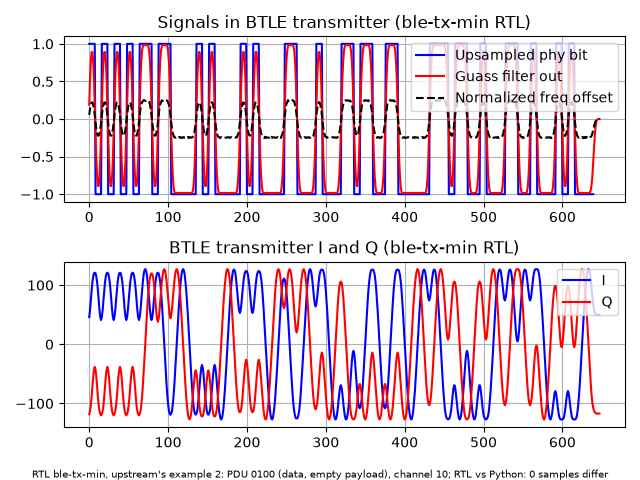 |
| example 2: PDU `0100` (data, empty payload), channel 10 | the same packet: PDU `0100`, channel 10, AA 0x11850A1B, CRC init 0x123456 |

Top: the upsampled PHY bit (±1), the Gaussian filter's output (red, normalized) and the normalized
frequency deviation measured on the I/Q samples (dashed); bottom: I and Q. Both figures are the same
packet, upstream's example 2 (`test_vector_for_btle_verilog.py 2`): 80 bits, 656 samples, the same axes.
Its 2 bytes never reach AdvA (bytes 2..7), so the ROM plays no part. Upstream's figure is its
Python model; ours is the RTL's actual output, captured by the upstream testbench `btle_tx_tb.v` plus a
monitor of the filter, and compared with the Python model on every sample: **0 samples differ**
(`results/figures/tx-min/tx_min_figures_tx.json`). Since the samples are the Python model's, the
frequency deviation is the one upstream checks against the Core spec's 185 kHz minimum (0.185
normalized): the same tables, taps and modulation index 0.5.

The packet this chip actually sends, a 39-byte ADV_NONCONN_IND (AdvA from the ROM, upstream's BER
AdvData, channel 37), is 376 bits, 3 024 samples, also 0 samples differ:
[`tx_min_py_fig3_adv.png`](../../results/figures/tx-min/tx_min_py_fig3_adv.png).

### 3.2 The receiver's decision (upstream's `py-fig4.png`)

| upstream | `ble-tx-min` |
|---|---|
|  | 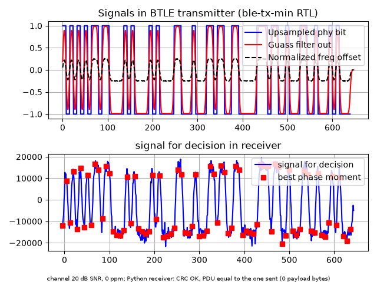 |

The same waveform after the channel of upstream's run (20 dB SNR, 0 ppm), demodulated by upstream's
receiver (`sign(i0·q1 − i1·q0)` on the 8 sampling phases; red: the best phase). The noise is another draw,
so the small ripples differ. With the RTL transmitter: CRC OK, the PDU received equal to the one sent. The 39-byte
ADV packet after 20 dB and 20 ppm, also CRC OK and equal to the one sent (37 payload bytes):
[`tx_min_py_fig4_adv.png`](../../results/figures/tx-min/tx_min_py_fig4_adv.png).

### 3.3 Bit error rate (upstream's `open_btle_baseband_chip_21_1.png`, `_23_1.png`)

| | upstream (published) | `ble-tx-min` (RTL transmitter) |
|---|---|---|
| 50 ppm |  | 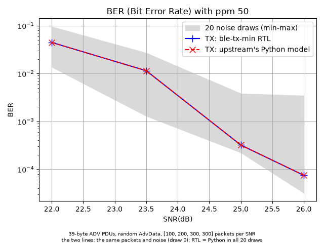 |
| −30 ppm |  | 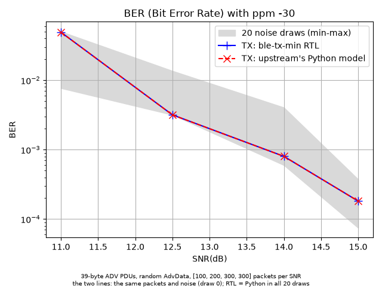 |

**The two columns are not a comparison.** The left one is upstream's published picture: its script draws
new packets and new noise at every run (it sets no seed), so its draw is not known and cannot be repeated.
It stands here for the form of the result (axes, SNR points, where the curve crosses 0.1 %). The
comparison is inside the right column: the same packets and the same noise through the `ble-tx-min` RTL
(blue) and upstream's Python transmitter (red, `btle_tx` of `python/btlelib.py`, whose transmitter is
upstream's to the bit: the thesis changed only where it writes its debug files). The two lines are one.
The grey band is how far the BER of these packet counts moves from one noise draw to another (20 draws).

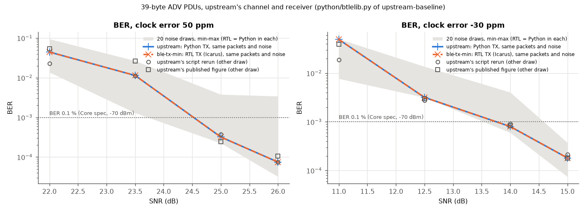

Method, as upstream's `test_btle_ber.py`: 39-byte ADV PDUs with a random payload (here: the chip's AdvA
and 31 random bytes of AdvData), 100/200/300/300 packets at the four SNR points (31 200 to 93 600 bits),
a clock error that also shifts the carrier (50 ppm = 122.5 kHz at 2.45 GHz), AWGN, upstream's receiver.
The transmitter is the RTL: 300 packets simulated, each compared with the Python model (0 samples
differ). Each packet then goes through the channel once per noise draw, with a fixed seed, and the same
seed for the RTL's waveform and the Python model's: **in all 20 draws, at every point, the two give the
same errors** (`results/figures/tx-min/tx_min_figures_ber.json`; draw 0 is the one of the first version of
this document, reproduced exactly). Upstream's script run again unmodified
(`results/figures/tx-final/upstream_ber_rerun.txt`) and its published figure (read off the PNG, about
±2 %) are two more draws, with their own packets: they are placed against the band, not against a line.

| SNR (dB) | upstream TX, same noise | **`ble-tx-min` RTL, same noise** | 20 draws: min – median – max | upstream rerun | upstream published |
|---:|---:|---:|---:|---:|---:|
| **50 ppm** | | | | | |
| 22.0 | 4.45 × 10⁻² | **4.45 × 10⁻²** | 1.4 × 10⁻² – 4.4 × 10⁻² – 9.5 × 10⁻² | 2.27 × 10⁻² | ≈ 5.4 × 10⁻² |
| 23.5 | 1.14 × 10⁻² | **1.14 × 10⁻²** | 1.3 × 10⁻³ – 1.1 × 10⁻² – 2.7 × 10⁻² | 1.12 × 10⁻² | ≈ 2.7 × 10⁻² |
| 25.0 | 3.21 × 10⁻⁴ | **3.21 × 10⁻⁴** | 2.2 × 10⁻⁴ – 3.4 × 10⁻⁴ – 3.8 × 10⁻³ | 3.74 × 10⁻⁴ | ≈ 2.5 × 10⁻⁴ |
| 26.0 | 7.48 × 10⁻⁵ | **7.48 × 10⁻⁵** | 3.2 × 10⁻⁵ – 7.5 × 10⁻⁵ – 3.4 × 10⁻³ | 7.48 × 10⁻⁵ | ≈ 1.1 × 10⁻⁴ |
| BER 0.1 % at | 24.5 dB | **24.5 dB** | median: 24.5 dB | 24.6 dB | 24.6 dB |
| **−30 ppm** | | | | | |
| 11.0 | 4.92 × 10⁻² | **4.92 × 10⁻²** | 7.7 × 10⁻³ – 2.0 × 10⁻² – 5.0 × 10⁻² | 1.89 × 10⁻² | ≈ 3.9 × 10⁻² |
| 12.5 | 3.17 × 10⁻³ | **3.17 × 10⁻³** | 3.2 × 10⁻³ – 4.1 × 10⁻³ – 1.4 × 10⁻² | 2.79 × 10⁻³ | ≈ 3.0 × 10⁻³ |
| 14.0 | 8.01 × 10⁻⁴ | **8.01 × 10⁻⁴** | 6.0 × 10⁻⁴ – 8.2 × 10⁻⁴ – 4.0 × 10⁻³ | 9.08 × 10⁻⁴ | ≈ 8.4 × 10⁻⁴ |
| 15.0 | 1.82 × 10⁻⁴ | **1.82 × 10⁻⁴** | 7.5 × 10⁻⁵ – 1.9 × 10⁻⁴ – 3.7 × 10⁻⁴ | 2.14 × 10⁻⁴ | ≈ 1.8 × 10⁻⁴ |
| BER 0.1 % at | 13.8 dB | **13.8 dB** | median: 13.8 dB | 13.9 dB | 13.8 dB |

(0.1 % by log-linear interpolation between the points.) What the table shows:

- **The transmitter changes nothing**: with the same packets and noise, upstream's transmitter and the RTL
  give the same errors, at every point of every draw.
- **The noise draw changes a lot at low SNR**: at 22 dB the 20 draws span 1.4 × 10⁻² to 9.5 × 10⁻², a
  factor of 7. A packet whose access address is not found counts all its 312 bits as wrong, so at 100
  packets each lost packet adds 1 × 10⁻² to the BER; at 25–26 dB one lost packet in 300 lifts the point
  by about 3 × 10⁻³ (the band's top). The median, not one draw, is the estimate.
- **Upstream's two runs fall where another draw falls**: 14 of their 16 points lie inside the band. The
  exceptions, −30 ppm at 12.5 dB (rerun 2.79 × 10⁻³, published ≈ 3.0 × 10⁻³, band from 3.17 × 10⁻³), are
  within 12 % of the band's edge, and their packets are not ours (fully random payloads, against the
  chip's AdvA plus random AdvData); 20 draws of one set of packets do not cover every set.
- **The 0.1 % point**: 24.5–24.6 dB at 50 ppm and 13.8–13.9 dB at −30 ppm in every curve (upstream's report
  writes "about 13.5" for the latter, read off its figure). The Core spec's sensitivity is met at the
  same SNR.

In the first version of this document the table and the overlay set one draw of the RTL against the
rerun, another draw, and the RTL looked worse at the lowest SNR (4.45 against 2.27 × 10⁻² at 22 dB). That
gap was the noise: the same-noise comparison, the one above, was in the data but not in the figure.

**Which receiver.** The BER uses upstream's receiver model (`python/btlelib.py` of `upstream-baseline`),
as the published figures do. The audited model returns no PDU when the CRC fails, which would count a
whole packet as wrong: a packet error rate, not a BER.

### 3.4 Alignment with the SDR program (upstream's `py-fig0.png`, `py-fig1.png`)

Not repeated: those figures compare upstream's Python model with the C program of the SDR project
(`btle_tx` of JiaoXianjun/BTLE), a property of the Python model. `ble-tx-min`'s RTL produces the Python
model's samples exactly for every PDU in its contract (§ 3.5), so the alignment carries over; example 0
of `py-fig1.png` (an ADV PDU on channel 37 with AdvA 01:02:03:04:05:06, the branch's default AdvA) is in
the contract and is one of the matrix's packets.

### 3.5 Verification against upstream

Upstream verifies each module and the controller with testbenches that compare the Verilog with the
Python model's vectors ("tx test_ok 1, rx test_ok 1"). The thesis kept those testbenches and added
clock-by-clock lockstep against the corrected reference. For `ble-tx-min` (`TX_MIN_VALIDATION.md` § 3,
at `b723c06`, against `fca6ac6`; on the cleaned RTL of § 8.1, `b81bf288`, the matrix, the lockstep, the
controller and the lint again, with the same results, the rest carried over by the proof):

| Check | Result |
|---|---|
| Upstream's 5 testbenches × 54 conditions (3 packets, 3 SNR, 3 clock errors, 2 delays), `GAUSS_TABLE = 1` on every level | **270/270**, also on a one-port model of the AdvData memory |
| The transmitter against the reference, every output on every clock: PDUs of 0–37 payload bytes, 2 AdvA values, 6 AXI clocks, 4 builds (RAM model, one-port macro model, flip-flops, OTP programmed once) | **144/144 runs, no difference**; **16/16 deliberate faults caught** |
| TX waveforms against the Python model, each decoded by the RTL receiver | **167/167** |
| The whole controller against the reference through its AXI registers | **6/6 runs**, 369 606 cycles, 36 TX and 36 RX packets; 5/5 faults caught |
| Gate-level netlists (Nangate45) of the controller, side by side with the reference, 5 scenarios | **0 mismatches** on every output (§ 7) |
| Strict lint (Verilator 5.020, warnings fatal) | **PASS**, 4/4 configurations |

## 4. Area in 45 nm (Nangate45 cells + OpenRAM macros, FreePDK45)

Yosys + ABC with the Nangate45 library (`results/area/tx-min/`; `ble-tx-min` after the cleanup of § 8.1,
`results/area/tx-clean/`); the
SRAMs as OpenRAM macros in FreePDK45, the process behind Nangate45, sized exactly as the RTL needs
them.

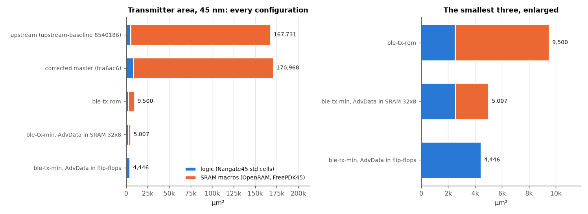

| `btle_tx` | cells | flip-flops | logic (µm²) | SRAM macros | macros (µm²) | **TX total (µm²)** | vs upstream | vs corrected master |
|---|---:|---:|---:|---|---:|---:|---:|---:|
| upstream | 3 409 | 404 | 5 322.9 | 2 × 2 048 × 8 (COS, SIN) + 512 × 8, 2 ports | 162 408.5 | **167 731.4** | — | −1.9 % |
| corrected master | 5 823 | 547 | 8 559.1 | the same | 162 408.5 | **170 967.6** | +1.9 % | — |
| `ble-tx-rom` | 1 463 | 236 | 2 520.6 | 256 × 8, 1 port | 6 979.1 | **9 499.7** | −94.3 % | −94.4 % |
| **`ble-tx-min`** | 1 488 | 239 | 2 542.7 | **32 × 8, 1 port** | **2 475.8** | **5 018.5** | **−97.0 %** | **−97.1 %** |
| `ble-tx-min`, flip-flops | 2 234 | 486 | 4 420.4 | none | 0 | **4 420.4** | −97.4 % | −97.4 % |

| Inside `btle_tx` (µm²) | upstream | corrected master | **`ble-tx-min`** |
|---|---:|---:|---:|
| Gaussian filter (`gauss_filter`) | 3 366.0 | 3 366.0 | **256.7** (−92.4 %) |
| VCO logic (`vco`) | 150.0 | 150.0 | 593.2 (the ROM) |
| VCO macros | 138 700.5 | 138 700.5 | **0** |
| Packet buffer macro | 23 708.0 | 23 708.0 | **2 475.8** |

1. **Upstream's transmitter is 97 % memory.** Its two 2 048 × 8 tables and its 512 × 8 buffer are
   162 408.5 µm² of 167 731.4. `ble-tx-min` keeps 256 bits of the 36 864: the VCO's tables become a
   ROM of 593.2 µm² (257 constant pairs fold into logic), the packet buffer a 32 × 8 macro.
2. **The logic halves too** (5 322.9 → 2 542.7 µm², −52.2 %; −70.3 % against corrected master): the
   fixed taps take the Gaussian filter from 3 366.0 to 256.7 µm². The corrections of the product audit
   and the lint closure add 3 236.2 µm² to upstream's transmitter (8 559.1 against 5 322.9), most of it
   the Gaussian tail weighing the runtime taps; with fixed taps the audit added 35–150 µm²
   (`TX_BRANCH_COMPARISON.md` § 4.4).
3. **`ble-tx-min` is 33.4 times smaller than upstream's transmitter** (37.9 with flip-flops), and
   47.2 % smaller than `ble-tx-rom`.

The whole controller (the receiver, eight demodulators and the IQ-capture RAM included, untouched):

| `btle_controller` | cells | flip-flops | cell area (µm²) | SRAM bits |
|---|---:|---:|---:|---:|
| upstream | 50 295 | 4 578 | 71 706.4 | 1 136 070 |
| corrected master | 52 357 | 4 722 | 74 684.8 | 1 136 070 |
| **`ble-tx-min`** | 47 971 | 4 392 | 68 470.0 | 1 099 462 |
| `ble-tx-min`, flip-flops | 48 678 | 4 639 | 70 274.0 | 1 099 206 |

## 5. Timing

### 5.1 Static timing in 45 nm

`scripts/timing/run_sta.sh` (`results/timing/tx-min/`, `ble-tx-min` `results/timing/tx-clean/`): the mapped netlist cut at the flip-flops, sized by ABC, worst path +
clock-to-Q + setup (Nangate45 typical, no wires); target 62.5 ns (the 16 MHz baseband clock).

| `btle_controller` | upstream | corrected master | `ble-tx-rom` | **`ble-tx-min`** | flip-flops |
|---|---:|---:|---:|---:|---:|
| Logic path | 1.631 ns | 3.050 ns | 1.658 ns | **1.581 ns** | 1.524 ns |
| **Min period** | 1.991 ns | 3.410 ns | 2.017 ns | **1.940 ns** | 1.884 ns |
| Slack at 62.5 ns / Fmax | +60.509 / 502 MHz | +59.090 / 293 MHz | +60.483 / 496 MHz | **+60.560 / 515 MHz** | +60.616 / 531 MHz |
| Worst path | RX demodulator multiply | **TX** Gaussian tail (runtime taps) | RX demodulator | **RX demodulator** | RX demodulator |

The transmitter of `ble-tx-min` is off the critical path: the controller's worst path is in the
receiver, which the branch does not touch, and the differences between upstream and the last four
columns are the flow's noise (the same receiver RTL, `btle_rx`, times at 1.52–1.64 ns of logic across
these runs). Corrected master's worst path
is the Gaussian tail that the audit added, which weighs the runtime taps; with fixed taps it is short.

### 5.2 In the FPGA and in GF180MCU

The same picture holds in both implementations (§§ 6, 8): on the xc7z020 the worst path of the
baseband clock is in the receiver in every configuration (slack 42.1–47.9 ns at 62.5 ns), and the
transmitter's own worst path in `ble-tx-min` is the AdvData read on the 100 MHz AXI clock (+5.901 ns at
10 ns). In the GF180MCU layout every corner meets setup and hold (§ 8).

## 6. FPGA: the xc7z020 of upstream's report

Upstream implemented its 2024 design on the xc7z020 (Zynq-7020) with Vivado 2021.1
(`btle_controller_xilinx_7z020.jpg`). Here: Vivado 2026.1, the same part (`xc7z020clg484-1`), default
strategies, synthesis, placement and routing (`scripts/fpga/xc7z020/`, `results/fpga/xc7z020/`; the current
designs in mode `ooc_hd`, after the cleanup of § 8.1: `results/fpga/xc7z020-clean/`).

**First, the flow reproduces upstream's published table.** Upstream's 2024 project, rebuilt as it was
(top `btle_controller_wrapper`, its `btle_controller_wrapper.xdc`, commit `fc5bc42`):

| | Published (Vivado 2021.1) | Reproduced (Vivado 2026.1) |
|---|---:|---:|
| Slice LUTs | 3 563 | 3 568 |
| LUT as logic / as memory | 2 687 / 876 | 2 692 / 876 |
| Slice registers | 2 307 | 2 307 |
| F7 / F8 muxes | 75 / 16 | 75 / 16 |
| Slices | 1 180 | 1 193 |
| DSPs | 48 | 48 |
| WNS / TNS / failing endpoints | 27.701 ns / 0 / 0 | 29.278 ns / 0 / 0 |
| Total on-chip power / junction temperature | 0.12 W / 26.4 °C | 0.119 W / 26.4 °C |

LUTs within 0.2 %, registers, muxes and DSPs identical, slices +1.1 % (packing), the same power and
junction temperature, a WNS 1.6 ns larger: the tool version moves these results by little, and the
comparisons below are all made with the same one. Since then upstream's controller changed its ports, and
its wrapper no longer matches it (`clk`, `rst`, `clkb` no longer exist), so the current designs run
out of context with `btle_controller` as top (as upstream's current `btle_controller.tcl` names it):
`bb_clk` at 16 MHz and `rf_clk` at 8 MHz (the documented 2:1 interface), the AXI and the IQ-capture
port at 100 MHz, asynchronous to them. Mode `ooc_hd` adds the out-of-context constraints Vivado otherwise
warns about (each clock's source, the ports' partition pins, the resets deasserted in the power analysis),
the same for the five.

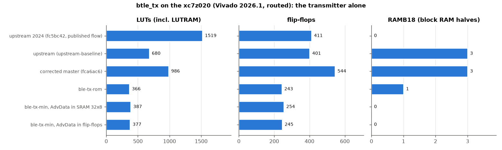

| Routed, xc7z020 | upstream | corrected master | `ble-tx-rom` | **`ble-tx-min`** | flip-flops |
|---|---:|---:|---:|---:|---:|
| **`btle_tx`**: LUTs (of which LUTRAM) | 680 (0) | 987 (0) | 366 (0) | **387 (8)** | 377 (6) |
| **`btle_tx`**: flip-flops | 401 | 544 | 243 | **254** | 245 |
| **`btle_tx`**: RAMB18 | 3 | 3 | 1 | **0** | 0 |
| **`btle_tx`**: dynamic power (vectorless) | 3 mW | 4 mW | 2 mW | **1 mW** | 1 mW |
| Controller: LUTs / flip-flops | 4 458 / 5 756 | 4 535 / 5 900 | 3 844 / 5 541 | **3 871 / 5 552** | 3 861 / 5 543 |
| Controller: block RAM tiles / DSPs | 38 / 48 | 38 / 48 | 37 / 48 | **36.5 / 48** | 36.5 / 48 |
| WNS `bb_clk` (62.5 ns) / AXI (10 ns) | 42.058 / 2.858 ns | 47.895 / 2.947 ns | 46.696 / 2.704 ns | **46.041 / 2.475 ns** | 43.935 / 2.863 ns |
| Total on-chip power (vectorless) | 0.211 W | 0.211 W | 0.209 W | **0.208 W** | 0.208 W |
| Synthesis warnings (Vivado's count) / unreviewed (§ 8.1) | 207 / 207 | 206 / 206 | 263 / 263 | **109 / 0** | **109 / 0** |

- **The transmitter uses no block RAM** in `ble-tx-min`: 387 LUTs (−43 % against upstream, −61 %
  against corrected master), 254 flip-flops, and the 32-byte AdvData store in 8 LUTs of distributed RAM.
- **On the FPGA the two AdvData stores are the same thing**: Vivado infers distributed RAM from the 31
  bytes of flip-flops too (6 LUTRAM, 245 flip-flops), so the choice of § 10.5 is an ASIC question.
- **The DSPs and the power are the receiver's**: the 48 DSPs are the 8 demodulators' multipliers, and
  0.106 W of the 0.208 W is the device's static power; the IQ-capture RAM (32 RAMB36) is upstream's.
  Vivado's power is vectorless (default toggle rates) and rounds to 1 mW: an estimate.

**Upstream's picture, side by side.** `btle_controller_xilinx_7z020.jpg` is Vivado's Device view of
upstream's routed 2024 design. Vivado's batch mode cannot export that view, so the routed checkpoints
were opened in Vivado 2026.1's GUI (the implementations before the cleanup of § 8.1, mode `ooc`, RTL
`a613226`: the same circuit, placed by another run), `btle_tx`'s primitives highlighted in orange (`highlight_objects`),
the Device panel maximized and fitted to the device, and the window captured
(`scripts/fpga/xc7z020/device_view.ps1`, `device_view.tcl`, `device_crop.py`; each image and what it
highlights in `results/fpga/xc7z020/<configuration>/device.png`, `device.txt`):

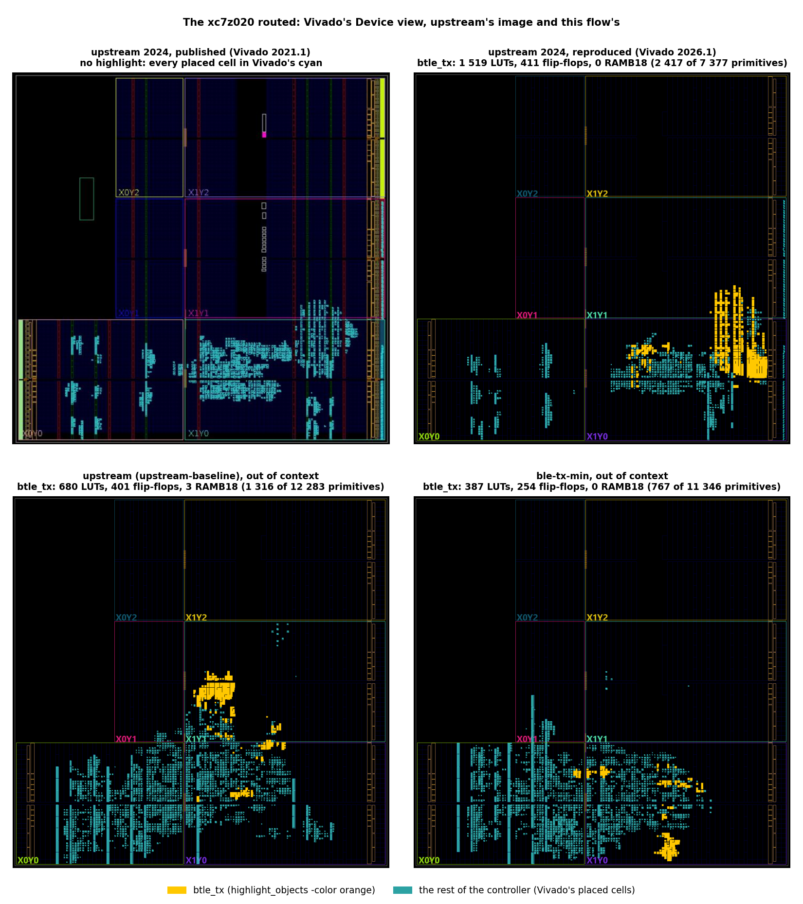

- **The reproduced 2024 design lands where upstream's did**: the logic in the two bottom clock regions
  (X0Y0, X1Y0), a tall block rising from X1Y0 into X1Y1 on the right, the IOs along the right edge, and
  the Zynq's processing system (the black top-left corner) unused. In the reproduction that tall block
  is the 2024 transmitter: 2 417 of the design's 7 377 primitives (33 %), 780 of its 1 519 LUTs used as
  LUTRAM. The placement differs in detail, as the tool version does, and Vivado 2026.1 draws the device
  on black where 2021.1 filled the clock regions in dark blue.
- **Out of context, where the transmitter lands means nothing; how much of the device it takes does.**
  With no pins the placer is free, so `btle_tx` in X1Y1 (upstream) or in X1Y0 (`ble-tx-min`) is an
  accident of the run. What the pictures show is its share: upstream's 1 316 primitives (10.7 % of the
  controller's), 3 RAMB18 among them, against `ble-tx-min`'s 767 (6.8 %, −42 %), LUTs and flip-flops
  only. The rest of the controller, the same in both, fills everything else.

## 7. Power

Four measures, from the most relative to the most absolute; none is a silicon measurement.

**7.1 Switching activity of the controller.** Gate-level netlists (Nangate45) of each configuration and
of the reference, in one Verilator simulation per scenario, every output compared on every clock (0
mismatches), 100 000 baseband clocks: Σ toggles × pin capacitance of data pins and flip-flop clock pins
(`results/power/tx-min/`; `ble-tx-min` `results/power/tx-clean/`). Scenarios: `rx` (packets received), `tx` (packets sent), `mixed`, `idle`
(noise at the input), `idle0` (no input).

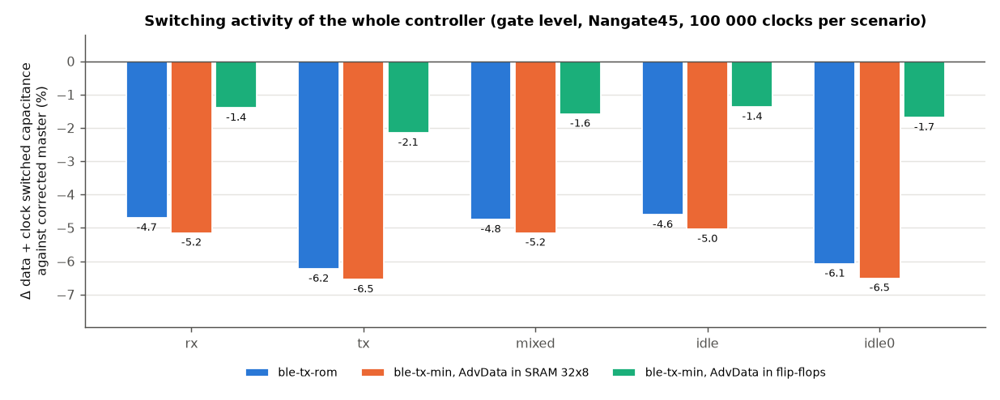

| Data + clock switched capacitance against corrected master | `rx` | `tx` | `mixed` | `idle` | `idle0` |
|---|---:|---:|---:|---:|---:|
| corrected master (fF·toggles) | 1.258 × 10⁹ | 1.040 × 10⁹ | 1.302 × 10⁹ | 1.290 × 10⁹ | 0.975 × 10⁹ |
| `ble-tx-rom` | −4.70 % | −6.23 % | −4.75 % | −4.61 % | −6.08 % |
| **`ble-tx-min`** | **−5.15 %** | **−6.55 %** | **−5.15 %** | **−5.04 %** | **−6.51 %** |
| `ble-tx-min`, flip-flops | −1.40 % | −2.15 % | −1.58 % | −1.37 % | −1.69 % |

The saving is the transmitter's clock load: the Gaussian filter's (3.38 × 10⁷ → 4.18 × 10⁶
fF·toggles, −88 %, its 156 tap flip-flops gone) and the rest of the transmitter's (7.01 → 4.12 × 10⁷:
mostly the copy of the runtime taps that the Gaussian tail keeps, 144 flip-flops, which fixed taps
remove, and the shorter counters; `btle_tx` has 547 flip-flops in corrected master, 239 here);
`ble-tx-min` was `ble-tx-rom` within 0.05 points, and the cleanup of § 8.1 takes 0.4 more: the link layer's
dead TX UART, whose clock it removes (`btle_ll` 9 558 → 9 407 cells). The 248 AdvData
flip-flops, clocked on every AXI clock without gating, give three quarters of it back (the
transmitter's clock load 4.12 → 8.81 × 10⁷ fF·toggles).

**7.2 The SRAMs' energy (SPICE).** Each OpenRAM macro characterized with ngspice on its whole netlist
(FreePDK45, TT, 1.0 V, 25 °C; `results/power/sram-char-min/`, `sram-leakage-min/`), its accesses counted
at RTL in the same five scenarios against the reference (`results/power/sram-energy-min/`; the cleanup of
§ 8.1 changes no access: the same circuit):

| Macro | Write | Read | Deselected clock | Leakage (settled) |
|---|---:|---:|---:|---:|
| 256 × 8, 1 port (`ble-tx-rom`) | 0.889 pJ | 0.821 pJ | 0.323 pJ | 15.02 µW |
| **32 × 8, 1 port (`ble-tx-min`)** | **0.479 pJ** | **0.351 pJ** | **0.182 pJ** | **16.41 µW** |

| TX SRAM dynamic power (µW) | `rx` | `tx` | `mixed` | `idle` | `idle0` | Leakage (µW) |
|---|---:|---:|---:|---:|---:|---:|
| corrected master (2 × 2 048 × 8 + 512 × 8, 2 ports) | not characterized | | | | | not characterized |
| `ble-tx-rom` | 19.40 | 19.39 | 19.39 | 19.40 | 19.40 | 15.02 |
| **`ble-tx-min`** | **2.92** | **10.51** | **10.10** | **2.92** | **2.92** | **16.41** |

`ble-tx-min`'s buffer is written only when the software's pair falls inside AdvData (none at rest:
only its clock, 2.92 µW), where `ble-tx-rom`'s 256-byte buffer takes the pair on every clock. The
32 × 8 leaks as much as the 256 × 8: at this size the periphery leaks, not the array. Upstream's macros
could not be characterized: OpenRAM's ngspice did not finish the 2 048 × 8 two-port netlist in hours
(`TX_BRANCH_COMPARISON.md` § 6.6); its accesses are counted (a write and a read of all three memories on
every clock), not priced. The summarizer therefore reports `RESULT: FAIL` for incomplete
characterization, as the original run does; every check on the counted configurations passes.

**7.3 Leakage of the transmitter's logic** (`scripts/power/logic_leakage.py`, the Nangate45 liberty's
`cell_leakage_power` of every cell, 1.10 V typical; `results/power/tx-clean-leakage/summary.md`):

| `btle_tx` | logic leakage | of which flip-flops | + SRAM leakage | **TX static** |
|---|---:|---:|---:|---:|
| upstream | 112.61 µW | 31.96 µW | not characterized | > 112.61 µW |
| corrected master | 182.58 µW | 43.27 µW | not characterized | > 182.58 µW |
| `ble-tx-rom` | 51.24 µW | 18.67 µW | 15.02 µW | 66.26 µW |
| **`ble-tx-min`** | **51.71 µW** | **18.91 µW** | **16.41 µW** | **68.12 µW** |
| `ble-tx-min`, flip-flops | 87.84 µW | 38.45 µW | — | 87.84 µW |

In this 45 nm library (predictive, leaky) **the 31 bytes of flip-flops leak more than the 32 × 8 SRAM**
(+36.13 µW of logic against 16.41 µW of macro), and their clock costs about 4.5 µW more (§ 7.1, ½CV²
of the extra clock-pin load at 1.1 V): in 45 nm the SRAM is the lower-power store.

**7.4 In GF180MCU** (§ 8), OpenSTA's vectorless estimate at 5 V, the default activity of every net:
43.28 mW with flip-flops, 35.29 mW with the SRAM 64 × 8 (leakage 1.5 and 1.3 µW). An estimate of the
order of magnitude, not of the difference (the first version's layouts gave 38.58 and 43.07 mW).

## 8. Layout in an open PDK (upstream's OpenLane images)

Upstream ran OpenLane2 with sky130 on two blocks, and neither closed:

| upstream (sky130, OpenLane2) | |
|---|---|
|  |  |
| `btle_rx_core`: GDSII; "Static Timing Analysis (Post-PnR) failed" | the whole controller: detailed placement and CTS; "Global Routing failed" |

The thesis laid out `ble-tx-min`'s transmitter with LibreLane (OpenLane2's successor) in **GF180MCU-D**,
the open PDK that has an OTP: AdvA in six eFuse blocks generated by the open GF180MCU eFuse compiler
(§ 9), the supervisor's architecture **header in registers, AdvA in OTP, AdvData in SRAM**, and the
alternative with AdvData in flip-flops. Die 760 × 760 µm for both, `clk` at 16 MHz and `clkb` (the AXI
side) at 50 MHz, 9 corners (ss 125 °C 4.5 V, tt 25 °C 5 V, ff −40 °C 5.5 V × three RC).

| `ble-tx-min`, AdvData in flip-flops | `ble-tx-min`, AdvData in the PDK's SRAM 64 × 8 |
|---|---|
| 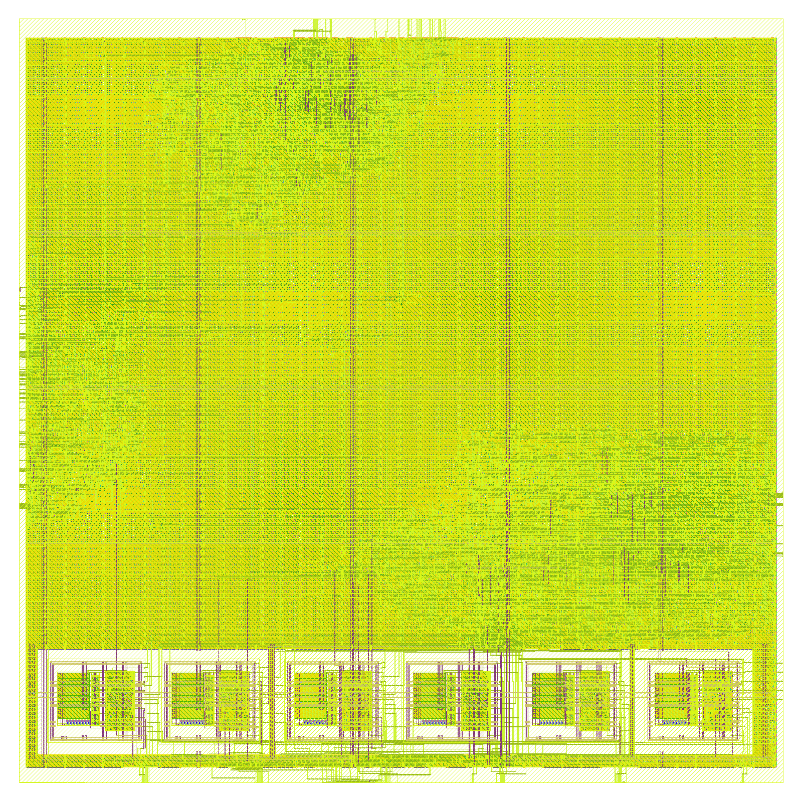 | 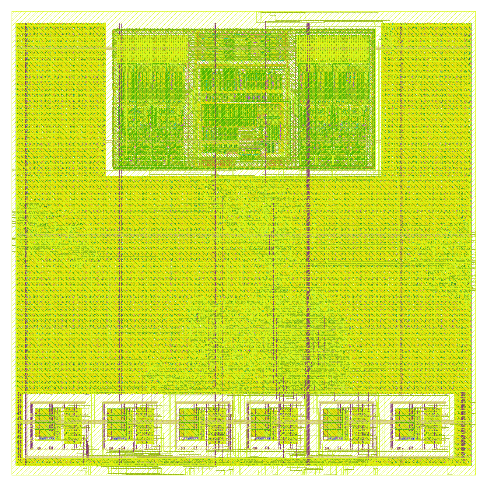 |
| logic above, the six eFuse blocks (AdvA) in a row at the bottom | the GlobalFoundries SRAM at the top, logic, the eFuse row at the bottom |

| Signoff | flip-flops (`tx-clean-gf180`) | **SRAM 64 × 8 (`tx-clean-gf180-sram64`)** |
|---|---|---|
| DRC, KLayout (the foundry's deck, whole GDS) | **0** | **0** (the SRAM's inside included) |
| DRC, Magic | 0 | 2 353, **all inside the GlobalFoundries SRAM** (`magic_drc_sram.txt`: 0 outside it), whose own layout Magic's deck rejects |
| LVS (Netgen) / antenna / routing DRC | clean / 0 / 0 | clean / 0 / 0 |
| Worst setup slack: ss / tt / ff | +3.888 / +10.639 / +12.479 ns | +5.581 / +10.022 / +12.013 ns |
| Worst hold slack: ff / tt / ss | +0.191 / +0.465 / +1.090 ns | +0.146 / +0.464 / +1.089 ns |
| Max slew / max capacitance violations | 0 / 0 | 0 / 0 |
| Max fanout (10, LibreLane's for the PDK; the liberty sets none) | every data net within it; 4 clock-tree buffers at 11–12 | **0** |
| Every strap of the power grid with its vias (`PDN-0110`) | yes (the first version: 3 without) | yes (the first version: 5 without) |
| IR drop (worst) / clock skew | 1.92 mV / 0.33 ns | 1.81 mV / 0.38 ns |
| Flow warnings / unreviewed (§ 8.1) | 29 / **0** (the first version: 394) | 37 / **0** (the first version: 218) |

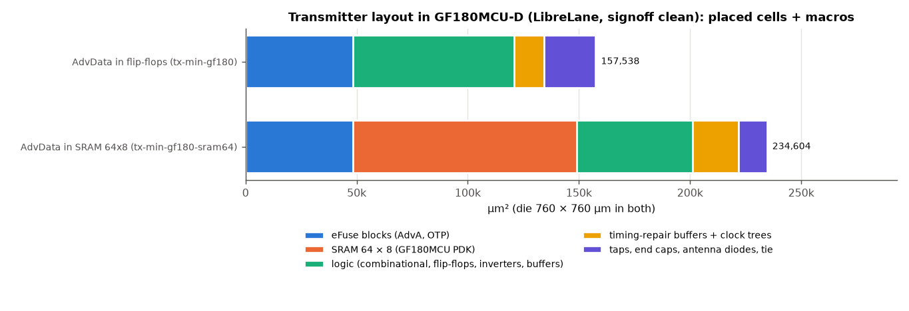

| GF180MCU-D (µm²) | flip-flops | **SRAM 64 × 8** |
|---|---:|---:|
| eFuse blocks (AdvA, OTP) | 48 452.1 | 48 452.1 |
| SRAM (431.86 × 232.88 µm) | — | **100 571.6** |
| Logic: combinational, flip-flops, inverters, buffers | 74 685.1 (502 flip-flops) | 50 204.2 (247 flip-flops) |
| Timing-repair buffers + clock trees | 21 719.3 | 21 565.7 |
| Taps, end caps, antenna diodes, tie cells | 15 928.4 | 13 215.1 |
| **Placed cells + macros** | **160 784.9** | **234 009.0** (+45.5 %) |

In GF180MCU the SRAM costs four times the flip-flops it replaces (100 571.6 µm² against 24 480.9 µm² of
logic): the PDK's smallest SRAM is a general-purpose 64 × 8 (half its words unused here), sized for its
periphery, and no 32-word macro exists; OpenRAM cannot generate one for this PDK (its `gf180mcu`
technology lacks the flip-flop, sense amplifier and write driver, and its periphery is 3.3 V, not the
5 V of the logic and the eFuses). Its behaviour was checked with GlobalFoundries' own model of the macro
in place of the memory: 144/144 lockstep runs, 16/16 faults caught (`results/validation/min-sram64-sim/`).

Upstream's transmitter has no GF180MCU layout to set beside these: its three memories write and read
in the same clock (two ports), and the PDK's SRAMs (`gf180mcu_fd_ip_sram`: one clock, one address) have
one.

### 8.1 Synthesis and layout without unreviewed warnings

After the first version of this document, the RTL of `ble-tx-min` was cleaned of every warning its
synthesis gave, and the layout flow of the warnings that came from it, as for the receiver branches
(`RX_FINAL_DECISIONS.md` § 8.1); what is left is a short list of **reviewed exceptions**, each with its
reason (`scripts/validation/synth_warning_exceptions.tsv`), and a gate
(`scripts/validation/synth_warning_gate.py`) that fails on any other warning, of Vivado (synthesis and
implementation), of Yosys (every top of the area flow) and of LibreLane (the whole layout flow, and its
signoff metrics: DRC, LVS, antenna, setup, hold, slew, capacitance, fanout). Both AdvData stores pass
(`results/validation/tx-clean-warning-gate.txt`).

**The RTL** (`62c63f09`, `b81bf288`; `btle_controller`'s interface kept):

- the receiver branches' cleanup on the modules they share: unused ports of internal modules removed, so
  that they end at `btle_controller`'s interface (`auxiliary_daemon`, `btle_ll`, `ll_s_axi`, `rx_ram`,
  `clock_domain_conversion_iq`); the RAM models' `rst`, which they never read; the link layer's TX UART,
  whose frame and enable (`slv_reg47`) the lint closure tied to 0, replaced by its outputs after reset;
  `(* mem2reg *)` on `payload_length_store`;
- the transmitter's: the VCO's table writes, which its ROM never reads, end at `btle_tx`'s ports (kept);
  `pdu_buffer_ram`'s `rst`, read by nothing, removed (also in the GF180 wrappers of the layout); the runtime
  taps of `gauss_filter` and `btle_gauss_tail` are registers only with `GAUSS_TABLE = 0`, constants with the
  fixed taps (no flip-flops for synthesis to remove), `btle_gauss_tail`'s array `(* mem2reg *)`;
- lint 4/4, 14 reviewed exceptions, none new.

**The same circuit** (`scripts/validation/equiv_cleanup/run_equiv_cleanup.sh`, `results/validation/min-clean/`):
Yosys equivalence of `btle_tx` and `btle_controller` against `a359b08a`, the RAM models and the eFuse block
as blackboxes, in four configurations — the branch's defaults (1 662 and 18 923 equivalence points), the
fixed taps with AdvData in the memory (1 263, 18 404), in flip-flops (1 485, 18 626), with the OTP (1 268,
18 406), **all proven, none unproven** — and the replaced UART by its own proof (SBY, k-induction). The
validation again on `b81bf288`: the transmitter against `master`'s on every clock **144/144** runs and
**16/16** mutants (`min-clean-tx/`), the same with GlobalFoundries' model of the SRAM 144/144 and 16/16
(`min-clean-sram64-sim/`), the product audit's matrix **270/270** (`min-clean-matrix-ex{0,1,2}/`), the
controller lockstep 6/6 runs, 369 606 cycles, 5/5 mutations (`min-clean-controller/`), lint 4/4
(`min-clean-lint/`); the switching activity: every output the same (§ 7.1).

**The layout** (`scripts/layout/tx_min_gf180/run.sh`, `config.json`, `config_sram64.json`): the receiver's
settings — the PDK's I/O cells not loaded (a macro has no pads), no heuristic diodes, the long-wire check,
the macros timed by their liberties — and three of this layout, found by experiment, each fixing a warning
the first version had:

- **every strap of the power grid gets its vias** (`PDN-0110`, 3 and 5 in the first version): the eFuse
  block's Metal4 power pins repeat every 20 µm, VDD then VSS 3.3 µm apart, as the core's strap pairs; blocks
  1 and 5 sat with a core strap of one net on a pin of the other, the strap was cut and its end overlapped
  the block's ring by less than a via. At x = 141.56 and 622.36 µm (were 146, 618) the straps lie on the
  pins of their nets. The SRAM's LEF has a VSS rail on Metal3 0.11 µm high (x 118.4–207.0 µm of the macro):
  at (124.6, 480) µm (was 164, 500) no strap crosses it, none ends on one of its shapes, and the pins of the
  top edge keep room for their buffers above it;
- **no pin on the bottom edge** (the SRAM's floorplan): the eFuse row lies along it; with 175 of the 242
  pins there, the logic reading them went into the strip below the row, and a net of the AdvA multiplexer
  detoured there over the max slew at ss (2 to 70 violations, depending on the SRAM's position). The
  flip-flops' placement has no such net (and with the exclusion its setup slack falls to 0.2 ns);
- the slew repair's margin at 60 % (the SRAM's already) and the clock tree's sink clustering (7 flip-flops
  over 150 µm: of the settings tried, the fewest tree buffers above the max fanout).

The flow is deterministic: the first version's layouts, run again at `a359b08a`, give every number of the
first version (`results/layout/tx-before-gf180*`), so the counts below compare the same layouts.

| Warnings | upstream | `ble-tx-min` (memory) | `ble-tx-min` (flip-flops) |
|---|---:|---:|---:|
| Vivado synthesis (its count) | 207 | 311 → **109** | 311 → **109** |
| Vivado, the whole log (synthesis and implementation, mode `ooc_hd`) | 419 | 661 → 243, all reviewed | 659 → 242, all reviewed |
| Yosys, every top of the area flow | — | 23 → **0** | 23 → **0** |
| LibreLane (`warning.log`) | — | 218 → **37** | 394 → **29** |
| **Unreviewed, after the gate** | 415 (Vivado) | **0** | **0** |

The reviewed exceptions:

| Tool | Warning | Why it stays |
|---|---|---|
| Vivado | `Synth 8-7129` on `btle_controller`'s `s00_axi_arprot`, `s00_axi_awprot` | the interface (kept): an AXI4-Lite slave without protection levels ignores them |
| Vivado | `Synth 8-7129` on `btle_controller`'s `bram_en_a`, `bram_rst_a`, `bram_we_a`, `bram_wrdata_a` | the interface (kept): the PS only reads the IQ-capture BRAM |
| Vivado | `Synth 8-7129` on `tap_index`, `tap_value` of `gauss_filter`, `btle_gauss_tail` and `gfsk_modulation` | a configuration's port: with `GAUSS_TABLE = 1` (the final transmitter) the taps are constants; `GAUSS_TABLE = 0` (upstream's runtime FIR, the branch's default) reads them |
| Vivado | `Synth 8-7129` on `adv_pdu_buffer`'s `otp_prog` | a configuration's port: with `ADV_ADDRESS_OTP = 0` (the ROM: the FPGA, 45 nm) AdvA is the parameter; with the OTP (the ASIC) it programs the eFuse blocks |
| Vivado | `Synth 8-7129` on `pdu_buffer_ram`'s `read_enable` (AdvData in the memory) | the memory's port: the GF180 SRAM's wrapper drives the macro's `CEN` with it; the RTL's model reads in every clock |
| Vivado | `DRC 23-814` (× 3), `Constraints 18-8777` | out of context, the DRCs that need the device's IOs do not run; the tool's installation lacks device files for splitting tiles |
| LibreLane | `DRT-0349` (× 8) | a LEF58 rule of the PDK's technology LEF the router does not support (the foundry's deck checks it: 0) |
| LibreLane | `STA-1140` | the PDK has 3 liberties for the 9 signoff corners, and the eFuse compiler's liberties all name one library: STA reads a name again for another corner |
| LibreLane | `VSRC_LOC_FILES` not given; `btle_tx`'s input pins without antenna gate information | a macro, not a chip (the flow's own advice); its ports drive gates through its own cells |
| LibreLane | no parasitics for the netlists of the eFuse block and the SRAM; `N Magic DRC errors found` (memory) | the macros come with their liberties (timed by them); Magic's deck rejects GlobalFoundries' layout of the SRAM |
| signoff metric | Magic's DRC count (memory: 2 353) | accepted only when every error lies inside the SRAM and the foundry's deck gives 0 on the whole GDS |
| signoff metric | max fanout (flip-flops: 4) | accepted only when every violator is a clock-tree buffer: the 10 is LibreLane's setting (the liberty sets none), every data net meets it |

## 9. The AdvA OTP (GF180MCU eFuse)

Neither FreePDK45 nor OpenRAM has an OTP; the open GF180MCU eFuse compiler (github.com/egorxe/
gf180_efuse_compiler, Apache-2.0) generates one: `./efuse.py 1 8 --async-efuse --digital-wrapper=async`
gives `efuse_async_mem_1x8`, eight fuses with their sense amplifiers and latches, read once after reset.

| 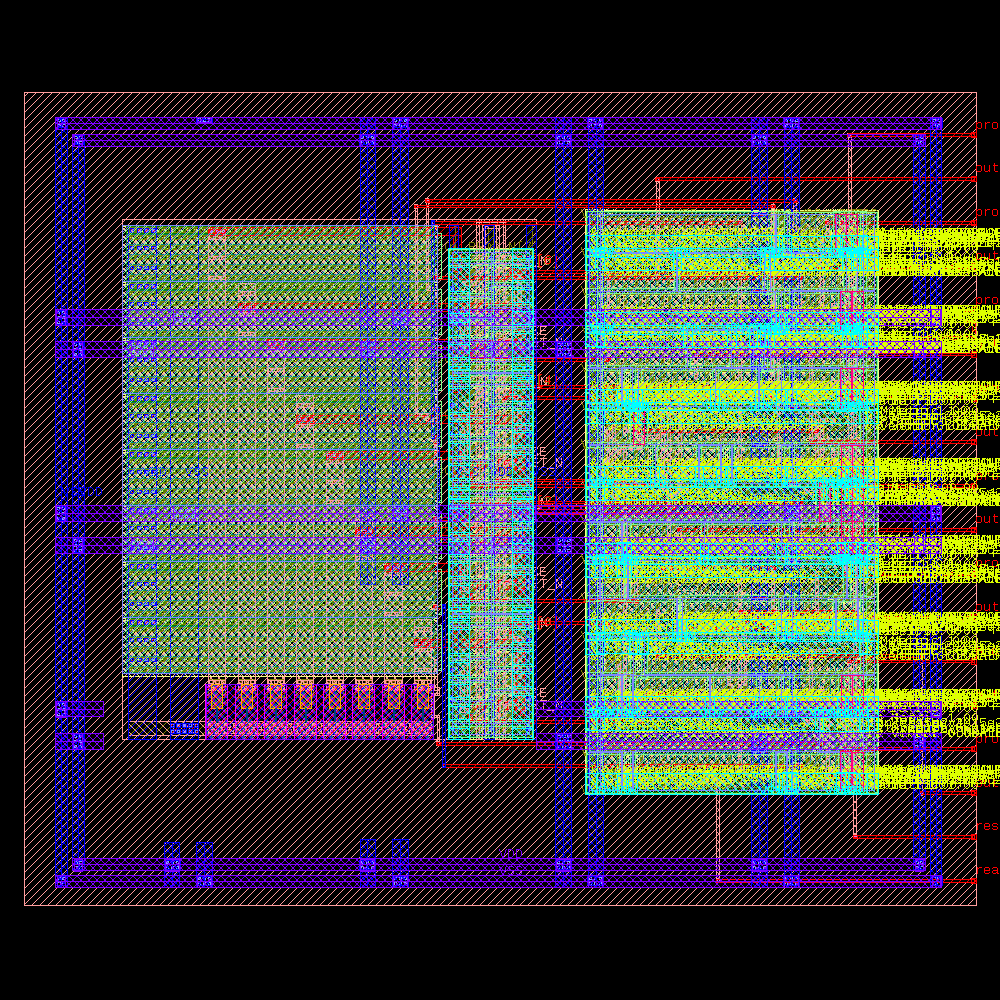 | 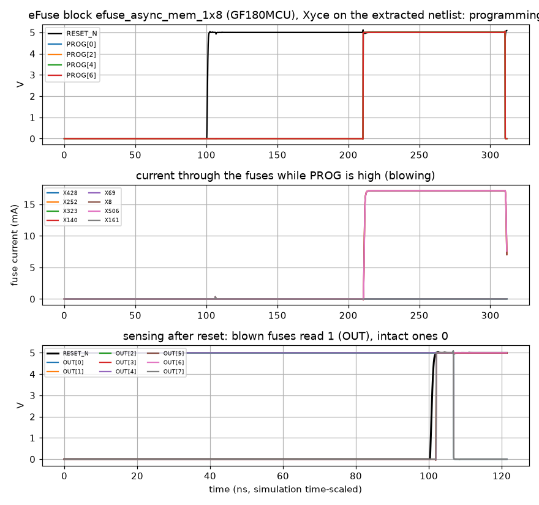 |
|---|---|
| the block, 97.27 × 83.02 µm (KLayout) | Xyce on its extracted netlist: programming (≈ 17 mA per fuse while it blows), then sensing after reset |

| | Result |
|---|---|
| DRC / LVS (KLayout, GF180MCU decks) | clean / clean |
| Xyce on the PEX netlist, 4 programming and 4 reading tests | all pass |
| Area: one block / six (AdvA, 48 bits) | 8 075.4 µm² / **48 452.1 µm²** (arrays alone: 2 241.2 / 13 447 µm²) |
| Programming | a 1 held ≥ 50 µs on `prog[i]` blows fuse i, read as 1 from the next reset on |
| In the RTL | `ADV_ADDRESS_OTP = 1`; checked with a model of the block: the unprogrammed chip reads 0, AdvA is programmed once, the transmitter then sends it (§ 3.5) |

The ROM (`ADV_ADDRESS`, the default) costs nothing in area — synthesis folds it into the read
multiplexer — but gives every chip the same address; the OTP gives each chip its own, programmed once in
production, at 48 452.1 µm² in GF180MCU: two thirds of the flip-flop variant's logic (74 685.1 µm²),
since each 8-bit block carries its own sense amplifiers, latches and power ring (a single 48-bit block
would share them; the compiler's asynchronous blocks are 8 bits wide). Its programming port must reach a
production test interface, which this controller does not have (it is tied off in `btle_phy`).

## 10. The decisions

| # | Block | upstream | Decision | Alternatives measured (µm², 45 nm unless stated) | Status |
|---|---|---|---|---|---|
| 10.1 | Gaussian filter | runtime FIR, 3 366.0 | **fixed taps, paired**, 256.7 | folded FIR (runtime taps) 2 311.5; constant tables 348.5; tables in SRAM 20 917.1, in flip-flops 23 221.5 (`GAUSS_FILTER_OPTIONS.md`) | decided |
| 10.2 | VCO tables | 2 × 2 048 × 8 SRAM, 138 700.5 | **ROM of an eighth of the wave**, 593.2 of logic | quarter tables, 512 × 8 with one port, 10 703.9; eighth table 256 × 16, 10 424.9; exact CORDIC (15 iterations) 2 317.9 and the controller's worst path at 5.5 ns (`VCO_MEMORY_SWEEP.md`, `TX_BRANCH_COMPARISON.md` § 4.4) | decided |
| 10.3 | Packet scope | any PDU ≤ 257 B, 512 × 8, two ports, 23 708.0 | **Legacy Advertising ≤ 39 B**: header in registers, AdvA fixed per chip, AdvData ≤ 31 B | one port 256 × 8 + 1 byte, 6 979.1; 64 × 8, 3 135.5; 128 × 16 with a byte mask, 6 652.0 | decided (supervisor) |
| 10.4 | AdvA | written by software with the packet | **OTP**, programmed once per chip (a ROM in the RTL) | ROM: no area, one address for every chip; registers written by software: not built (a changeable address, e.g. a random private address) | decided (supervisor) |
| 10.5 | AdvData store | — | **depends on the process** (below) | SRAM 32 × 8: TX 5 018.5, 68.12 µW static; flip-flops: TX 4 420.4, 87.84 µW static; GF180: SRAM 234 009.0 against flip-flops 160 784.9 | open: a recommendation |
| 10.6 | Counters, read protocol | upstream's | **9-bit PDU counter, length saturated at 37; ble-tx-pdu's read protocol** (no stall) | — | decided |

**10.5, the one choice left.** The two stores are equally exact and both built and validated; they
differ by process:

| | SRAM | flip-flops | Better |
|---|---|---|---|
| 45 nm area (TX) | 5 018.5 µm² | 4 420.4 µm² (−11.9 %) | flip-flops, slightly |
| 45 nm static power (TX) | 68.12 µW | 87.84 µW (+29.0 %) | SRAM |
| 45 nm activity (controller, `mixed`) | −5.15 % | −1.58 % | SRAM (ungated flip-flop clocks) |
| GF180MCU area (layout) | 234 009.0 µm² | 160 784.9 µm² (−31.3 %) | **flip-flops, clearly** |
| Warnings of synthesis and layout | 0 unreviewed; Magic's errors inside the PDK's SRAM | 0 unreviewed; 4 clock buffers above the max fanout | the same |
| FPGA | 8 LUTRAM | 6 LUTRAM | the same |

**Recommendation:** in GF180MCU, the open PDK where the OTP exists and the one this transmitter was laid
out in, **keep AdvData in flip-flops**, and gate their clock (one clock gate for the 31 bytes, enabled
only by a write to AdvData), which removes the clock cost of § 7.1 since the bytes change only between
advertising events; in a process with an SRAM compiler sized to 32 words and leaky flip-flops, the SRAM.
The clock gate is not built.

## 11. What the final transmitter gives up, and what this does not claim

**Gives up** (against upstream): PDUs other than Legacy Advertising of at most 39 bytes (no data
channel, no extended advertising; the receiver keeps everything); a changeable AdvA (no random or
resolvable private addresses); the runtime Gaussian taps and COS/SIN tables (fixed to the project's,
BT = 0.5, modulation index 0.5); rewriting a packet byte while it is sent; an AXI clock below 8 MHz.

**Does not claim:**
- The 45 nm figures are pre-layout (no wires, no clock tree); the macros are OpenRAM's in FreePDK45, an
  academic PDK.
- The FPGA results are out of context (no pins) for the current designs, with Vivado 2026.1 instead of
  upstream's 2021.1, and vectorless power; the calibration of § 6 bounds the tool difference; the Device
  views are of the implementation before the cleanup of § 8.1.
- "No warning" means none outside the reviewed exceptions of § 8.1, which a gate enforces; it is not the
  absence of every message of the tools.
- The GF180MCU layouts are the transmitter as a macro (no pads, no seal ring, no chip-level
  integration, no parasitic-annotated simulation); their power is vectorless.
- Upstream's SRAMs are not priced in energy (§ 7.2); its leakage is a lower bound.
- `py-fig0.png` and `py-fig1.png` (the SDR C program) are not repeated (§ 3.4).
- The eFuse compiler's IP is "not ASIC-proven yet" (its documentation); the Xyce results are
  simulation.

## 12. Evidence and reproduction

| Result | Evidence | Command (WSL, at the root of `ble-tx-min`) |
|---|---|---|
| Area, 45 nm | `results/area/tx-min/<configuration>/summary.md`, `ble-tx-min` `results/area/tx-clean/<configuration>/`, `results/area/openram-min/` | `RTL_REV=<rev> AREA_PARAMS=<params> scripts/area/run_area.sh <label>` |
| Timing, 45 nm | `results/timing/tx-min/<configuration>/summary.txt`, `ble-tx-min` `results/timing/tx-clean/` | `DUT_REV=<rev> DUT_PARAMS=<params> scripts/timing/run_sta.sh <label> 62.5 fca6ac6` |
| Activity | `results/power/tx-min/<configuration>/`, `ble-tx-min` `results/power/tx-clean/` | `DUT_REV=<rev> DUT_PARAMS=<params> VEC_DIR=<d53f2d49 vectors> scripts/power/run_activity.sh <label> 100000 1 fca6ac6` |
| SRAM energy | `results/power/sram-char-min/`, `sram-leakage-min/`, `sram-energy-min/` | `scripts/power/run_sram_char.sh`, `run_sram_leakage.sh`, `run_sram_energy.sh <label> master ble-tx-rom ble-tx-min` (`REF_REV=fca6ac6`) |
| Logic leakage | `results/power/tx-clean-leakage/summary.md` (the first version: `tx-min-leakage/`) | `python3 scripts/power/logic_leakage.py <liberty> <name>=<stat.json> ...` |
| FPGA | `results/fpga/xc7z020-clean/<configuration>/` (and its `warning_gate.txt`), `results/fpga/xc7z020/up2024/`, `provenance.txt` | `vivado -mode batch -source scripts/fpga/xc7z020/impl.tcl -tclargs <dir> <ooc_hd|wrapper2024>`, then `post.tcl <root> upstream master rom min minflops` |
| FPGA Device view | `results/fpga/xc7z020/<configuration>/device.png`, `device.txt` | Windows, Vivado GUI: `powershell -ExecutionPolicy Bypass -File scripts/fpga/xc7z020/device_view.ps1 <dir>`, then `python3 scripts/fpga/xc7z020/device_crop.py <dir>/device_full.png <results dir>/device.png` |
| Layout and OTP | `results/layout/tx-clean-gf180*/` (the first version: `tx-min-gf180*`, again at `a359b08a`: `tx-before-gf180*`), `results/otp/gf180-efuse/` | `scripts/layout/tx_min_gf180/run.sh <label> <rev> [sram64]` (`TX_MIN_VALIDATION.md` § 10) |
| The cleanup: equivalence, validation, warning gate | `results/validation/min-clean/equiv_cleanup/`, `min-clean-*/`; `results/validation/tx-clean-warning-gate.txt` | `scripts/validation/equiv_cleanup/run_equiv_cleanup.sh <label> a359b08a`; `scripts/validation/synth_warning_gate.py --vivado <log> --yosys <area dir> --librelane <layout dir>` |
| Validation | `results/validation/min-*` | `TX_MIN_VALIDATION.md` § 10 |
| Figures of §§ 3–8 | `results/figures/tx-min/`, `results/figures/tx-final/` (`data.json` names the source of every number) | `python3 scripts/figures/tx_min_figures.py tx|ber <dir>` (`ber`: `--realizations 20`, the default; in a Windows worktree under WSL, `BTLE_UPSTREAM_PY=<upstream-baseline's python/, extracted>`); `python3 scripts/figures/tx_final_figures.py results/figures/tx-final/data.json <dir>` |
| Upstream's BER, rerun | `results/figures/tx-final/upstream_ber_rerun.txt` | `git archive upstream-baseline python \| tar -x; cd python; python3 test_btle_ber.py 50` (and `-30`) |

Related reports: `docs/Validation/TX_MIN_VALIDATION.md` (this branch in full), `TX_ROM_VALIDATION.md`,
`TX_PDU_VALIDATION.md`, `docs/Comparison/TX_BRANCH_COMPARISON.md` and `RX_BRANCH_COMPARISON.md` (every branch),
`docs/Design Decisions/GAUSS_FILTER_OPTIONS.md` and `VCO_MEMORY_SWEEP.md` (the alternatives of § 10).
