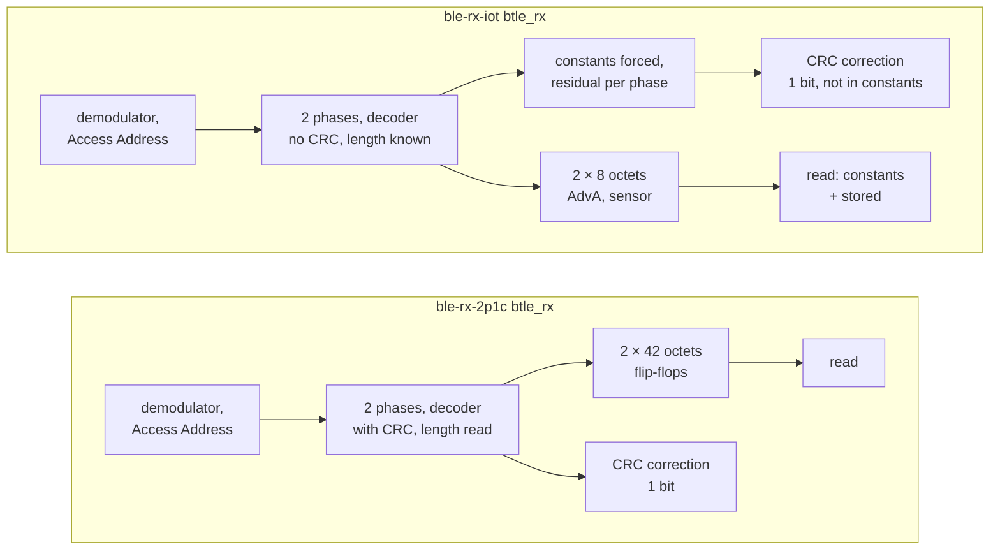
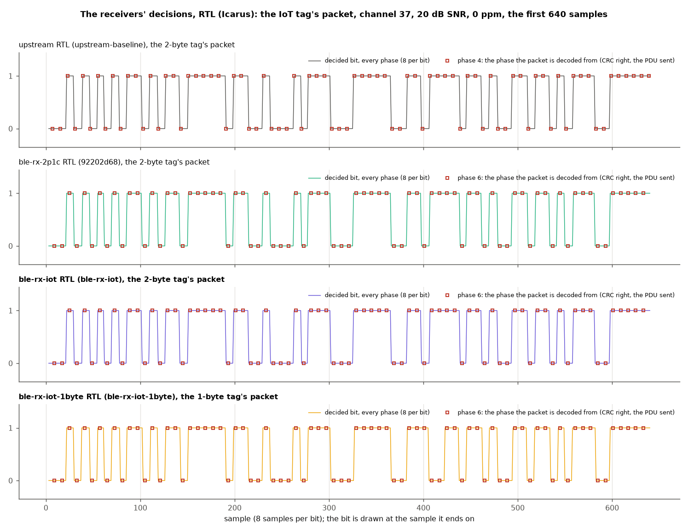
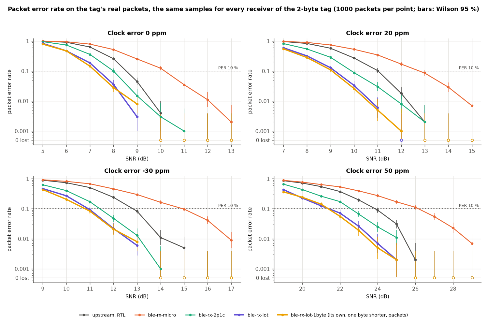
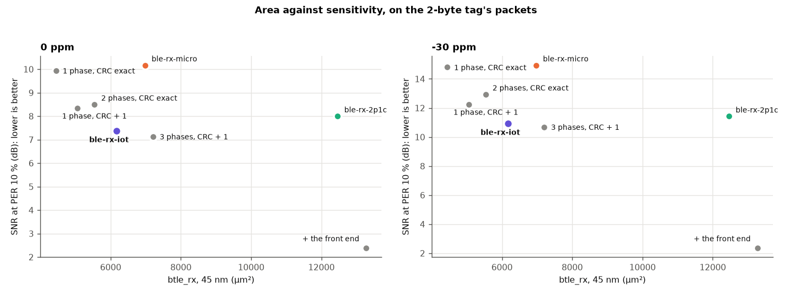
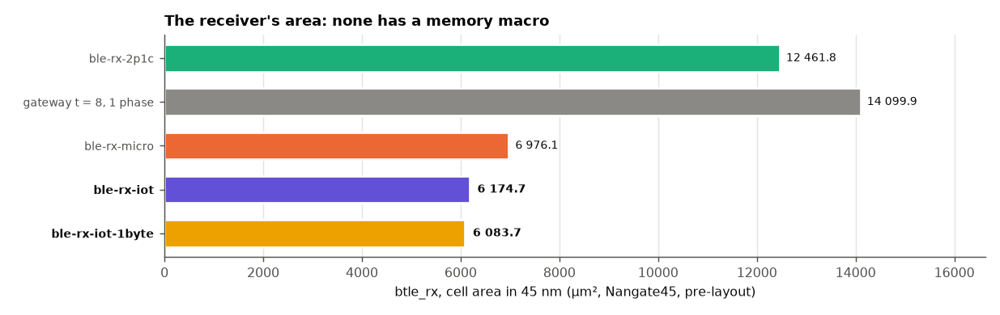
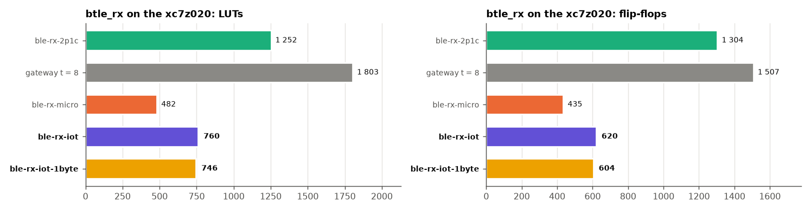
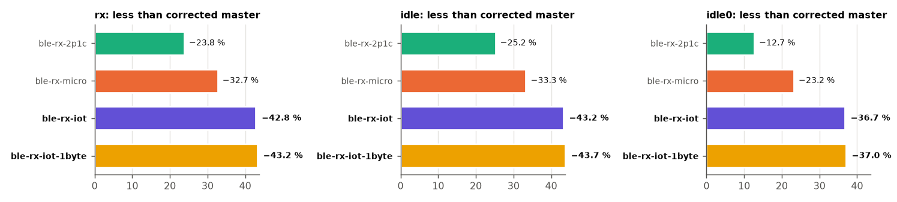
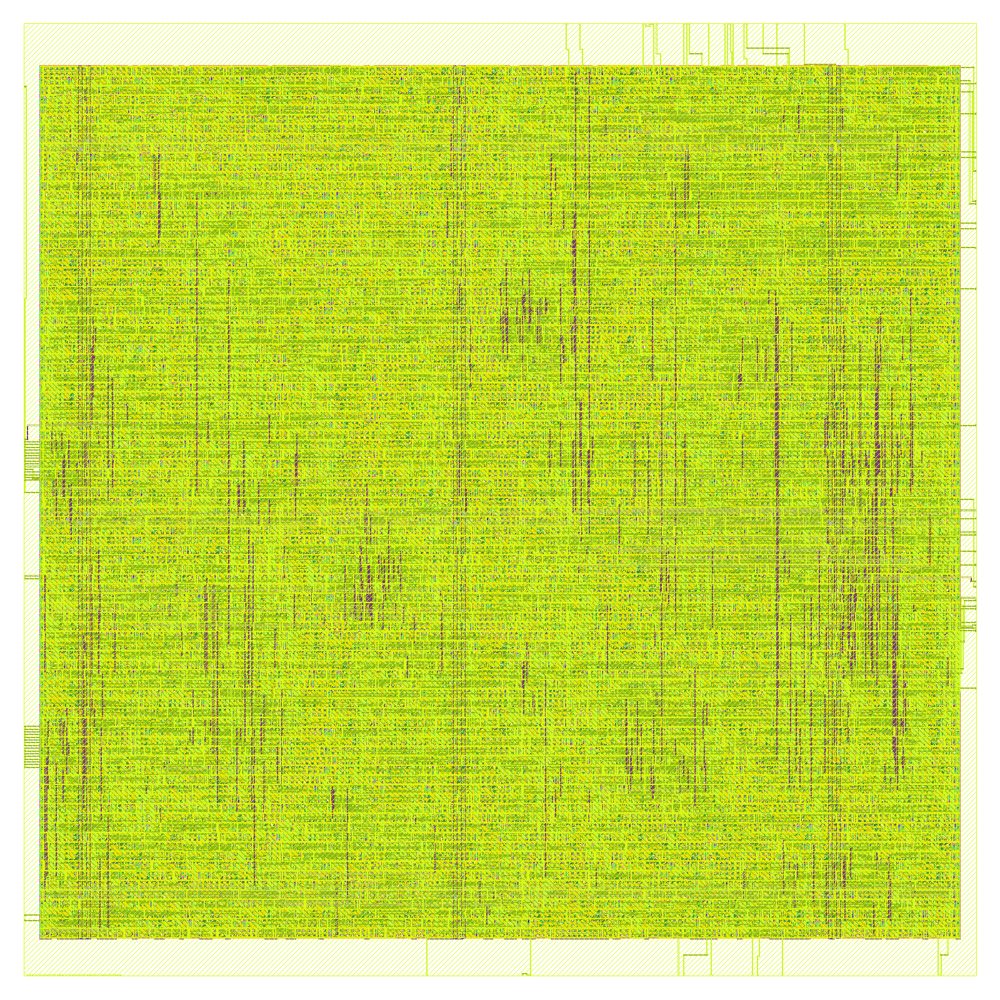
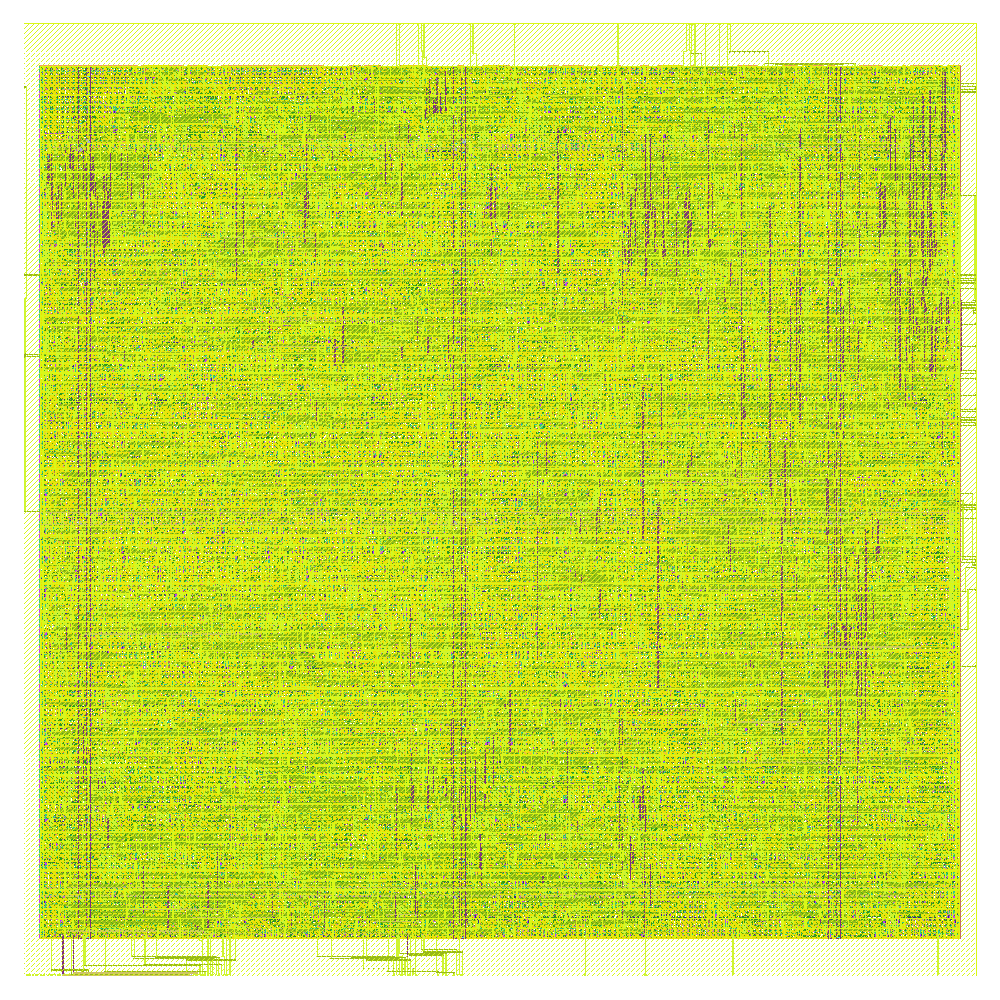
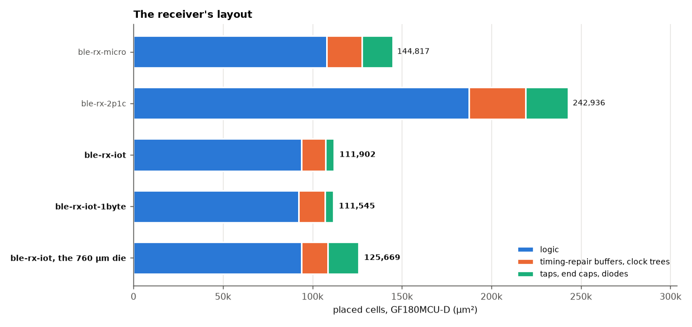

# The IoT receiver: `ble-rx-iot` and `ble-rx-iot-1byte`, every result of the final receiver

**Project:** BTLE — reconfigurable RISC-V baseband  
**Branches:** `ble-rx-iot` (the two-byte tag's packet) and `ble-rx-iot-1byte` (the one-byte tag's), both cut from `ble-rx-gateway-8` without its BCH code  
**Base:** tag `upstream-baseline` (`8540186`), forked from github.com/JiaoXianjun/BTLE  
**Reference document:** [`RX_FINAL_DECISIONS.md`](../Final%20Decisions/RX_FINAL_DECISIONS.md), whose measurements this one repeats section by section; the other end is [`TX_TAG_4_IOT.md`](TX_TAG_4_IOT.md)  
**Date:** 2026-11-07  
**Author:** Miguel Simões  
**Status:** run `rx-iot`. Every number below is measured or computed from a measurement, and its evidence is committed (§ 12).
Cell area in 45 nm (Nangate45, pre-layout), an out-of-context FPGA implementation (§ 6: not a board's, its DRC lists two critical warnings
of that mode), and GF180MCU macros with DRC, LVS and timing clean; **the
synthesis (Vivado, Yosys) and the layout (LibreLane) of both branches end with no warning that is not a reviewed exception**,
one of them new (§ 8.1). **Not done:** a test on a board, Vivado's Device view (§ 6), a formal proof or a gate-level check of the
new logic (§ 11). Not a tape-out (`docs/Validation/ASIC_READINESS.md`: NOT READY, as on every branch).

---

## How to read this document

`TX_TAG_4_IOT.md` measured a tag that sends one fixed advertising packet with no error correction. This document measures the
receiver of that packet. A receiver that hears only one packet format does not need what a general receiver keeps: the transmitter,
a length to read, a memory for 42 octets, or storage for fields whose value it already knows.

The receiver keeps the decision of `ble-rx-2p1c`, the final receiver (`RX_FINAL_DECISIONS.md` § 9.5): two sampling phases chosen at
the Access Address, and a CRC-24 that corrects one wrong bit. The result is **half the area of `ble-rx-2p1c`, smaller than
`ble-rx-micro`, and more sensitive than both**. This is not a free gain: it holds only for the tag's own packet. § 10 records the decisions.

| Name | What it is | RTL |
|---|---|---|
| **upstream** | the upstream design this repository forked | `upstream-baseline` (`8540186`) |
| **corrected master** | upstream with the product audit's corrections: the reference of the switching activity (§ 7) | `master` (`fca6ac6`) |
| `ble-rx-micro` | the smallest general receiver: one phase, the CRC exact | `d67b1070` |
| `ble-rx-2p1c` | **the final receiver**: two phases, the CRC correcting one bit | `92202d68` |
| gateway | `ble-rx-gateway-8`, the receiver of the tag with a BCH code | `RX_GATEWAY_COMPARISON.md` |
| **`ble-rx-iot`** | this document: only the packet of `ble-tx-iot`, 14 octets; no transmitter | branch `ble-rx-iot` |
| **`ble-rx-iot-1byte`** | this document: only the packet of `ble-iot-1byte`, 13 octets; no transmitter | branch `ble-rx-iot-1byte` |

## 1. Summary

The SNR is on each tag's own packets, 1 000 per point; the columns of the other receivers are on the two-byte tag's.

| | upstream | `ble-rx-micro` | `ble-rx-2p1c` | **`ble-rx-iot`** | **`ble-rx-iot-1byte`** | Evidence |
|---|---:|---:|---:|---:|---:|---|
| Packets it can receive | any, 2–257 octets | Legacy Advertising, ≤ 42 octets | the same | **one format, 14 octets + CRC** | **one format, 13 octets + CRC** | § 2 |
| **SNR at PER 10 %**, 0 / 20 / −30 / 50 ppm (dB) | 8.54 / 11.02 / 12.82 / 23.86 | 10.17 / 12.77 / 14.94 / 26.16 | 8.00 / 9.89 / 11.42 / 22.57 | **7.38 / 9.18 / 10.93 / 21.40** | **7.23 / 9.06 / 10.80 / 21.38** | § 3.3 |
| Against `ble-rx-2p1c`, the same samples: its packets lost; more received; false | | | — | **0; 2 478; 0** of 38 000 | **0; 2 468; 0** of 38 000 | § 3.3 |
| **`btle_rx`, 45 nm** (µm²) | 238 488.1 (with SRAM) | 6 976.1 | 12 461.8 | **6 174.7 (−50.5 %)** | **6 083.7 (−51.2 %)** | § 4 |
| Flip-flops in `btle_rx`, 45 nm | 2 068 | 787 | 1 320 | **634** | **618** | § 4 |
| SRAM bits in the receiver | 32 768 | 0 | 0 | **0** | **0** | § 4 |
| `btle_rx` on the xc7z020: LUTs / flip-flops / DSP48 | 2 247 / 2 572 / 48 | 482 / 435 / 0 | 1 252 / 1 304 / 0 | **760 / 620 / 0** | **746 / 604 / 0** | § 6 |
| `btle_rx` min period, 45 nm (target 62.5 ns) | 1.862 ns | 1.461 ns | 1.506 ns | **1.492 ns** | **1.457 ns** | § 5 |
| Activity of the controller, packets received, against corrected master | | −32.7 % | −23.8 % | **−42.8 %** | **−43.2 %** | § 7 |
| Logic leakage of `btle_rx`, 45 nm (µW) | 1 063.38 | 138.51 | 248.26 | **125.37** | **123.22** | § 7 |
| **GF180MCU layout, placed cells** (µm²) | not closed | 144 817 | 242 936 | **111 902.6** | **111 544.8** | § 8 |
| **GF180MCU die** (µm²) | — | 577 600 | 810 000 | **152 100 (390 × 390)** | **152 100 (390 × 390)** | § 8 |
| GF180MCU macro signoff: DRC, LVS, antenna, slew, capacitance, setup, hold | — | clean | clean | **clean** | **clean** | § 8 |
| Unreviewed warnings of synthesis and layout (reviewed exceptions remain: § 6, § 8.1) | 207 (Vivado synthesis) | 0 | 0 | **0** | **0** | § 8.1 |

The percentages are against `ble-rx-2p1c`. As in the other documents, a low SNR is upstream's definition (`btlelib.add_noise`), not a link budget: differences between rows are what this document uses.

**In one sentence:** on the tag's packet, each branch receives every packet `ble-rx-2p1c` receives and more, 0.5–1.2 dB better at PER 10 %,
accepting no false packet in the campaign, in half its area and on a GF180MCU die 81 % smaller; the price is that it receives nothing else.

**Against each other:** one byte fewer of sensor saves 16 flip-flops, −91.0 µm² in 45 nm (−1.5 %) and −357.8 µm² placed in GF180MCU
(−0.3 %), on the same die; the sensitivity is within the spread of a run. § 10 keeps the receiver equal to whichever tag is chosen.

## 2. What changed, block by block

| Block | `ble-rx-2p1c` | gateway | **`ble-rx-iot`** | **`ble-rx-iot-1byte`** |
|---|---|---|---|---|
| Transmitter in the controller | yes | no | **no** | **no** |
| Demodulator, Access Address | shared, exact | with filter, CFO, 3 wrong bits | **as `ble-rx-2p1c`** | **as `ble-rx-2p1c`** |
| Phases kept, chosen at the Access Address | 2 | 3 | **2** | **2** |
| Length | read from the packet | known | **known** | **known** |
| Stored per phase | 42 octets | 25 octets | **8 octets** | **7 octets** |
| Constants | stored, checked by the CRC | stored, forced in software | **forced into the CRC, not stored** | **forced into the CRC, not stored** |
| CRC correction | 1 bit, not in the length | none | **1 bit, only in AdvA, sensor, CRC** | **1 bit, only in AdvA, sensor, CRC** |
| Error correction beyond it | none | BCH in software | **none** | **none** |

**The new module** is `verilog/rx_iot_phase.v`, reached with `RX_IOT_SENSOR` (the sensor's bytes; 0 keeps `rx_k_phase` and `rx_one_phase`). Three ideas make it small:

1. **The constants enter the CRC as the constants**, whatever was received in their place. A wrong bit in the header or the AD structure
   costs nothing, and no comparator is needed: a packet with other constants fails its own CRC. § 3.5 shows it on other devices' packets, and one mutant shows the condition this needs: a correction allowed to point into a constant lets them through (8 of 8).
2. **Only AdvA and the sensor are stored**: 8 or 7 octets per phase instead of 42.
3. **The decoder keeps no CRC of its own** (`rx_decoder_shared`, `NO_CRC`, `FIXED_LEN`): each kept phase has one residual, over the octets as forced.

**The packet** (`scripts/senseworks/tag_packet.py`, as `TX_TAG_4_IOT.md` § 2):

| Word | Field | `ble-rx-iot` | `ble-rx-iot-1byte` | In the receiver |
|---|---|---:|---:|---|
| 0 | header byte 0, `ADV_NONCONN_IND`, TxAdd 1 | `0x42` | `0x42` | constant |
| 1 | header byte 1, the payload length | 12 | 11 | constant |
| 2–7 | AdvA | received | received | stored per phase |
| 8 | AD structure: length | 5 | 4 | constant |
| 9 | AD structure: type | `0xFF` | `0xFF` | constant |
| 10–11 | Company ID | `0xFFFF` by default | `0xFFFF` by default | constant (`COMPANY_ID`) |
| 12– | sensor | 2 octets | 1 octet | stored per phase |
| then | CRC-24 | | | residual only; **its words read 0** |

**The contract.** The Company ID must be the tag's. `0xFFFF` is the value for tests: a product needs its own, assigned by the Bluetooth SIG, and this receiver then hears only that one. The sensor's size must be the tag's. Channel and CRC init remain registers, as on `ble-rx-2p1c`.

## 3. Function: the receiver's decision, the bit error rate and the packet error rate

### 3.1 The receiver's decision (upstream's `py-fig4.png`)

| upstream (Python model, its example 2) | the RTL receivers (Icarus), each tag's packet |
|---|---|
|  |  |

Upstream's figure is a data-channel PDU, which these receivers do not take. The right figure is each tag's packet on channel 37 after 20 dB SNR and 0 ppm, fed to the RTL: all receive it with the CRC right and the phase marked. Against upstream's Python model on the same samples (`rx_iot_decision.json`):

| | decoded from phase | bits compared | bits that differ |
|---|---:|---:|---|
| upstream RTL | 4 | 1 814 | 2, both after the packet's end |
| `ble-rx-2p1c` RTL | 6 | 1 815 | 4, all after the packet's end |
| **`ble-rx-iot`** RTL | **6** | **1 815** | **the same 4** |
| **`ble-rx-iot-1byte`** RTL | **6** | **1 751** | 6: 4 after the packet's end (1 360 samples), and 2 inside it, in phase 3 (samples 739, 875), not a phase decoded. Their cause was not traced; the 8-bit saturation explained such a bit in `RX_FINAL_DECISIONS.md` § 3.1, and it is likely here |

### 3.2 Bit error rate (upstream's `open_btle_baseband_chip_21_1.png`, `_23_1.png`)

Not repeated. As `RX_FINAL_DECISIONS.md` § 3.2 explains, the BER of `test_btle_ber.py` is a property of upstream's Python receiver, not of these RTL receivers, which give no packet when the CRC fails. These tags' packets through that Python receiver are in `TX_TAG_4_IOT.md` § 3.3; **the RTL receivers are compared by their packet error rate.**

### 3.3 Packet error rate of the RTL receivers

`scripts/senseworks/run_rx_iot_per.py`: each tag's packets with random AdvA and sensor, channel 37, upstream's clock error and noise, the samples saturated to 8 bits, one sample every second clock, 400 samples of noise before and after. A packet is received when it ends with the CRC right and it is the one sent. 1 000 packets per point, the bands the Wilson 95 % interval; the same samples for every receiver of a tag, so the noise does not enter the differences between them. Each SNR at PER 10 % is one realization, about ±0.1 dB.

| SNR at PER 10 % (dB, log-linear) | 0 ppm | 20 ppm | −30 ppm | 50 ppm |
|---:|---:|---:|---:|---:|
| **Two-byte tag** | | | | |
| upstream, RTL | 8.54 | 11.02 | 12.82 | 23.86 |
| `ble-rx-micro` | 10.17 | 12.77 | 14.94 | 26.16 |
| `ble-rx-2p1c` | 8.00 | 9.89 | 11.42 | 22.57 |
| **`ble-rx-iot`** | **7.38** | **9.18** | **10.93** | **21.40** |
| against `ble-rx-2p1c` | −0.62 | −0.71 | −0.49 | −1.17 |
| against upstream | −1.16 | −1.84 | −1.89 | −2.46 |
| **One-byte tag** | | | | |
| `ble-rx-micro` | 10.02 | 12.63 | 14.81 | 25.98 |
| `ble-rx-2p1c` | 7.90 | 10.01 | 11.32 | 22.30 |
| **`ble-rx-iot-1byte`** | **7.23** | **9.06** | **10.80** | **21.38** |
| against `ble-rx-2p1c` | −0.67 | −0.95 | −0.52 | −0.92 |

| Packet by packet, 38 points, 38 000 packets | received | the other's received | of the other's, lost | that the other lost, received | false (this / the other) |
|---|---:|---:|---:|---:|---:|
| `ble-rx-iot` against upstream | 33 651 | 27 134 | 84 | 6 601 | 0 / 0 |
| `ble-rx-iot` against `ble-rx-micro` | 33 651 | 23 241 | **0** | 10 410 | 0 / 0 |
| **`ble-rx-iot` against `ble-rx-2p1c`** | **33 651** | **31 173** | **0** | **2 478** | **0 / 0** |
| `ble-rx-iot-1byte` against `ble-rx-micro` | 34 016 | 23 528 | **0** | 10 488 | 0 / 0 |
| **`ble-rx-iot-1byte` against `ble-rx-2p1c`** | **34 016** | **31 548** | **0** | **2 468** | **0 / 0** |

- **The cut loses nothing on the tag's packet**: not one of `ble-rx-2p1c`'s packets is lost. It has the same phases and the same demodulator, and what it adds decides only when a bit was wrong in a field it knows.
- **The gain has two likely sources, not separated here.** A wrong bit in the constants no longer costs the packet, and a wrong length no longer sends the decoder to the wrong end.
- **It loses 84 of upstream's packets** (0.3 %): packets that only a phase it does not keep decodes, as `ble-rx-2p1c`'s 130 of 25 981 in `RX_FINAL_DECISIONS.md` § 3.3.
- **The gain grows with the clock error**, as for `ble-rx-2p1c` against upstream: 1.17 dB at 50 ppm against 0.49–0.71 dB for the others on the two-byte tag.

**Random timing.** The packet at a fraction of a sample, after 400 + 0..7 samples: the receiver does not know the symbol timing (`results/validation/rx-iot-campaigns/random/`, the method by linear interpolation, another run with other noise).

| SNR at PER 10 % (dB), random timing | 0 ppm | 20 ppm | −30 ppm | 50 ppm | of `ble-rx-2p1c`'s, lost; more received; false |
|---|---:|---:|---:|---:|---|
| upstream, two-byte tag | 8.61 | 11.17 | 12.99 | 24.45 | |
| `ble-rx-2p1c`, two-byte tag | 7.99 | 10.09 | 11.66 | 23.24 | |
| **`ble-rx-iot`** | **7.37** | **9.20** | **11.17** | **22.14** | **0; 2 718; 0** of 38 000 |
| `ble-rx-2p1c`, one-byte tag | 8.10 | 10.06 | 11.54 | 23.06 | |
| **`ble-rx-iot-1byte`** | **7.42** | **9.15** | **11.03** | **22.04** | **0; 2 731; 0** of 38 000 |

The picture is the same: −0.5 to −1.1 dB against `ble-rx-2p1c`, none of its packets lost.

**Area against sensitivity.** The alternatives are the same RTL with other parameters, on the same samples (§ 10.3):

### 3.4 Alignment with the SDR program (upstream's `py-fig0.png`, `py-fig1.png`)

Not repeated, as in `RX_FINAL_DECISIONS.md` § 3.4: a property of upstream's Python transmitter and the C program, not of a receiver.

### 3.5 False packets: noise, and other devices

**The rule, computed.** On noise, the Access Address is found at 8 × 10⁶ / 2³² = 1.86 × 10⁻³ triggers a second (each of the 8 phases tests a 32-bit address a million times a second). A random word passes a kept phase with a probability of (1 + the correctable bits) / 2²⁴. These figures assume the residual uniform and independent.

| Noise alone, 2 kept phases | correctable bits | per trigger | one false packet in |
|---|---:|---:|---:|
| `ble-rx-iot` | 88 | 1.06 × 10⁻⁵ | **1.6 years** |
| `ble-rx-iot-1byte` | 80 | 9.66 × 10⁻⁶ | **1.8 years** |
| `ble-rx-2p1c`, this tag's length | 128 | 1.54 × 10⁻⁵ | 1.1 years |
| 2 phases, the CRC exact (§ 10.3) | 0 | 1.19 × 10⁻⁷ | 143 years |
| `ble-rx-iot` with the Access Address within 3 bits (§ 10.3), at the gateway's measured 10.7 triggers/s | 88 | 1.06 × 10⁻⁵ | **2.4 hours** |

A false packet carries a random AdvA, so firmware that knows its tags discards it at once (48 bits); the hardware does no such check. **The RTL, measured:** 12 s of noise, 6 s per tag, gave 0 triggers (0.02 expected), which confirms little beyond the absence of a gross fault.

**Other devices' packets**, the RTL, `run_rx_iot_per.py traffic`: 100 of each kind at each of two SNRs, on each tag's length, the tail long enough for a shorter packet to be read past its end.

| Kind | Sent (each SNR, each tag) | Accepted, 30 dB | Accepted, 6 dB |
|---|---:|---:|---:|
| Eddystone, iBeacon, device name, manufacturer data | 100 each | **0** | **0** |
| all-zero PDU, empty, `ADV_SCAN_IND` | 100 each | **0** | **0** |
| the tag's length, valid CRC: `ADV_IND`; TxAdd 0; another AD type; another Company ID | 100 each | **0** | **0** |
| **The tag, the control of this test** | 100 | **100 / 100** | 51 (two-byte), 58 (one-byte) |

**0 of 4 400** other devices' packets accepted, the ones of the tag's length included. They were rejected by their own CRC, with no comparator.

### 3.6 Verification

The chain is this receiver against a rule written apart from it, against `ble-rx-2p1c`, and with its parameter off, `ble-rx-2p1c` again. `scripts/senseworks/run_rx_iot_validation.sh`, each branch's own run; both branches run both tags, as `RX_IOT_SENSOR` is a parameter, and their results are the same.

| Check | What it shows | Result (each branch) |
|---|---|---|
| `tests/test_rx_iot.py`, the rule: `rx_iot_phase` against `tag_packet.decide` in Python, the bits of each kept phase read from another design (the gateway's RTL, its front end off); 12 points of SNR and clock error; 2 tags × 5 configurations of phases and correction | each packet's verdict and its PDU, the first hit on the same clock | **4 710 packets, no difference**; 0 wrong |
| The same against `ble-rx-2p1c`, 480 packets per tag | nothing it receives is lost; the first hit on the same clock; `decode_end` never later | **lost 0**, 19 + 21 gained, 0 wrong. Where both end on the same phase: same clock on 401 + 393 packets, earlier on 10 + 11 (a wrong bit in a constant, nothing to search); 26 + 26 ended on another phase |
| The same, other devices' packets of the same length, each constant changed, 20 per kind | none accepted; the tag, as control, all | **0**; 20/20 on both tags |
| `--mutants`: 18 deliberate faults in the RTL | each makes a check above fail | **18/18 caught** |
| `tests/test_rx_iot_base.py`: `RX_IOT_SENSOR = 0` against `ble-rx-2p1c`, 8 of the receiver's configurations, every first hit, `decode_end`, CRC flag, phase and packet read, with their clocks; the tag's and 39-octet packets | the base is untouched | **SAME** on all 8 |
| `tests/test_rx_iot_controller.py`: end to end, packets and noise at the controller's RF port, read through its AXI registers as the firmware reads them; both tags, 1 and 2 phases | length, constants and PDU read right | at 30 dB 30/30, 0 wrong; at 9 dB 28–30 of 30, 0 wrong |
| `firmware/btle_ll.c` compiles | `ble-rx-2p1c`'s firmware again, no `-G` | compiles (syntax check with gcc) |
| `run_lint.py` (Verilator 5.020, warnings fatal) | | **PASS 280/280**, 11 reviewed exceptions, none new |

**"The same as `ble-rx-2p1c`" is measured, packet by packet, and is not clock-for-clock everywhere.** A wrong bit in a constant makes `decode_end` earlier here, and the packet may then end on the other phase. Nothing it accepts differs from what was sent. As for `ble-rx-2p1c` itself (`RX_FINAL_DECISIONS.md` § 10), **the new logic is measured, not proved**.

## 4. Area in 45 nm (Nangate45 cells)

Yosys + ABC with the Nangate45 library (`results/area/rx-iot/<branch>/`). Neither branch has a memory, so the cell area is the total.

| `btle_rx` | cells | flip-flops | total (µm²) | vs `ble-rx-2p1c` | vs `ble-rx-micro` | vs upstream |
|---|---:|---:|---:|---:|---:|---:|
| upstream, with its 8 SRAM macros | 36 872 | 2 068 | 238 488.1 | | | — |
| `ble-rx-micro` | 3 624 | 787 | 6 976.1 | −44.0 % | — | −97.1 % |
| `ble-rx-2p1c` | 6 607 | 1 320 | 12 461.8 | — | | −94.8 % |
| gateway t = 8, 1 phase | 8 718 | 1 298 | 14 099.9 | +13.1 % | | |
| gateway t = 8, 3 phases | 11 214 | 1 899 | 19 190.3 | +54.0 % | | |
| **`ble-rx-iot`** | **3 481** | **634** | **6 174.7** | **−50.5 %** | **−11.5 %** | **−97.4 %** |
| **`ble-rx-iot-1byte`** | **3 465** | **618** | **6 083.7** | **−51.2 %** | **−12.8 %** | **−97.4 %** |

| Each block synthesized alone (µm²) | `ble-rx-iot`, `ble-rx-iot-1byte` |
|---|---:|
| `gfsk_demodulation_shared`, 16 bits as measured alone | 5 226.9 |
| `search_unique_bit_sequence_shared` | 491.3 |
| `rx_iot_phase`, with its decoder, its default parameters | 3 487.0 |

These blocks were synthesized at their own defaults, so they do not add up to `btle_rx`: `btle_rx` runs the demodulator at 8 bits. In particular `rx_iot_phase`'s default is the two-byte tag on either branch, so its row says nothing about the difference between the two.

1. **Half of `ble-rx-2p1c`**: 686 flip-flops fewer, almost all of them the two 42-octet stores (2 × 34 octets = 544 bits fewer).
2. **Smaller than `ble-rx-micro` while decoding two phases**: `ble-rx-micro` stores one 42-octet packet (336 bits), this 16 octets (128 bits).
3. **The memory is no longer the receiver's weight**; what remains is the demodulator and the search.

The whole controller (no transmitter; the Link Layer and the FPGA platform's IQ-capture RAM remain, which a receiver chip would not carry):

| `btle_controller` | cells | flip-flops | cell area (µm²) |
|---|---:|---:|---:|
| upstream | 50 310 | 4 578 | 71 706.4 |
| `ble-rx-micro` (with its transmitter) | 19 532 | 3 419 | 32 988.5 |
| `ble-rx-2p1c` (with its transmitter) | 22 423 | 3 952 | 38 315.4 |
| gateway t = 8 (no transmitter) | 20 823 | 3 976 | 36 246.8 |
| **`ble-rx-iot`** | **13 043** | **2 696** | **23 066.2** |
| **`ble-rx-iot-1byte`** | **13 129** | **2 680** | **23 055.8** |

At the controller, the byte is worth 10.4 µm², with one cell more: this is the flow's spread (`TX_TAG_COMPARISON.md` § 6), not a measure of the byte.

## 5. Timing

### 5.1 Static timing in 45 nm

`scripts/timing/run_sta.sh`, `STA_SET=rx` (`results/timing/rx-iot/<branch>/`): the mapped netlist cut at the flip-flops, sized by ABC, worst path + clock-to-Q + setup; target 62.5 ns (the 16 MHz baseband clock).

| | comb. path | **min period** | slack at 62.5 ns | Fmax |
|---|---:|---:|---:|---:|
| `btle_controller`, `ble-rx-2p1c` | 3.060 ns | 3.420 ns | +59.080 ns | 292.4 MHz |
| `btle_controller`, **`ble-rx-iot`** | 1.204 ns | **1.564 ns** | +60.936 ns | 639.5 MHz |
| `btle_controller`, **`ble-rx-iot-1byte`** | 1.199 ns | **1.558 ns** | +60.942 ns | 641.9 MHz |
| `btle_rx`, `ble-rx-2p1c` | 1.159 ns | 1.506 ns | +60.994 ns | 663.8 MHz |
| `btle_rx`, **`ble-rx-iot`** | 1.145 ns | **1.492 ns** | +61.008 ns | 670.3 MHz |
| `btle_rx`, **`ble-rx-iot-1byte`** | 1.110 ns | **1.457 ns** | +61.043 ns | 686.1 MHz |

The receiver's period is `ble-rx-2p1c`'s within the flow's spread, about 40 times faster than its clock needs.

### 5.2 In the FPGA and in GF180MCU

Every clock and every corner meets timing with room: on the xc7z020 +48.4 ns or more on `bb_clk` and +3.7 ns on the AXI clock (§ 6), in GF180MCU +4.45 ns or more of setup in the worst of 9 corners (§ 8).

## 6. FPGA: the xc7z020 of upstream's report

Vivado 2026.1, `xc7z020clg484-1`, default strategies, `scripts/fpga/xc7z020/impl.tcl` in mode `ooc_hd`, then `post.tcl` (`results/fpga/xc7z020-rx-iot/<iot, iot1>/`). The other columns are run `xc7z020-gw`'s, of the same flow. The calibration against upstream's table is `RX_FINAL_DECISIONS.md` § 6.

| Out of context, xc7z020 | `ble-rx-micro` | `ble-rx-2p1c` | gateway t = 8 | **`ble-rx-iot`** | **`ble-rx-iot-1byte`** |
|---|---:|---:|---:|---:|---:|
| **`btle_rx`**: LUTs | 482 | 1 252 | 1 803 | **760** | **746** |
| **`btle_rx`**: flip-flops | 435 | 1 304 | 1 507 | **620** | **604** |
| **`btle_rx`**: DSP48 / block RAM | 0 / 0 | 0 / 0 | 0 / 0 | **0 / 0** | **0 / 0** |
| Controller: LUTs / flip-flops | 2 985 / 3 763 | 3 751 / 4 632 | 3 195 / 4 150 | **2 141 / 3 255** | **2 125 / 3 239** |
| Controller: RAMB36 / RAMB18 | 32 / 4 | 32 / 4 | 32 / 1 | **32 / 1** | **32 / 1** |
| WNS `bb_clk` (16 MHz) | +47.558 ns | +46.675 ns | +40.684 ns | **+48.368 ns** | **+48.810 ns** |
| WNS AXI (100 MHz) | +3.652 ns | +1.681 ns | +2.016 ns | **+3.680 ns** | **+3.757 ns** |
| `btle_rx`'s worst path, slack | +48.900 ns | +46.694 ns | +40.684 ns | **+48.368 ns** | **+48.810 ns** |
| Power, total / dynamic (vectorless) | 0.192 / 0.087 W | 0.193 / 0.087 W | 0.190 / 0.084 W | **0.187 / 0.081 W** | **0.187 / 0.081 W** |
| of which `btle_rx`, dynamic | 0.001 W | 0.002 W | 0.004 W | **0.001 W** | **0.001 W** |
| Vivado's warnings in the whole log / unreviewed | 150 / 0 | 150 / 0 | 447 / 0 | **495 / 0** | **495 / 0** |

- **Here, unlike in 45 nm, `ble-rx-micro` stays the smallest** (482 LUTs against 760, 435 flip-flops against 620): its 42 octets cost 12 LUTs of distributed RAM, a cheap memory on an FPGA, so storing less saves less here. That this explains the whole difference was not shown. `ble-rx-iot` is 39 % below `ble-rx-2p1c` in LUTs and 52 % in flip-flops.
- The 32 RAMB36 are the FPGA platform's IQ-capture RAM. Vivado's power is an estimate and rounds to 1 mW.
- **What "routed" means here.** The router ends with 0 failed nets ("Router Completed Successfully"), but `drc.rpt` reports the design
  state as **Partially Routed**, as the mode `ooc_hd` leaves the ports as partition pins to be routed partially (Route 35-198), and finds
  4 checks: **NSTD-1 and UCIO-1, critical** (none of the 39 ports has an I/O standard or a location: there are no pins), RTSTAT-10 (131 nets
  with no routable load, in the Link Layer's counters) and ZPS7-1 (no PS7 block). The log has 494 warnings and 1 critical warning (Common
  17-69: `rf_clk`, which no longer clocks anything with the transmitter gone, cannot take `HD.CLK_SRC`), all reviewed exceptions (§ 8.1).
  The same 4 checks and design state are in `ble-rx-2p1c`'s and the gateway's runs of this flow. **They are what an out-of-context
  block reports and are not a board's DRC**: a bitstream needs the block design, its pins and its PS7, not built here; the timing is that
  of the paths inside the block.
- **Vivado's Device view was not made**: `device_view.ps1` needs the screen left alone for minutes per figure. Out of context, where the block lands means little (`RX_FINAL_DECISIONS.md` § 6).

## 7. Power

Three measures; none is a silicon measurement.

**7.1 Switching activity of the controller.** Gate-level netlists (Nangate45) of each branch and of corrected master, in one Verilator simulation per scenario, 100 000 baseband clocks, Σ toggles × pin capacitance of data pins and flip-flop clock pins (`results/power/rx-iot/`). **Each tag's own packet is at the RF port** (`scripts/senseworks/rx_iot_vectors.py`, 20 dB, 20 ppm), so the numbers are compared within a run, not with `RX_FINAL_DECISIONS.md` § 7.1's. `tx` and `mixed` need a transmitter and do not run.

| Data + clock switched capacitance, against corrected master | `rx` | `idle` | `idle0` |
|---|---:|---:|---:|
| corrected master, the two-byte tag's packet (fF·toggles) | 1.262 × 10⁹ | 1.290 × 10⁹ | 0.975 × 10⁹ |
| `ble-rx-2p1c`, two-byte packet | −23.8 % | −25.2 % | −12.7 % |
| `ble-rx-micro`, two-byte packet | −32.7 % | −33.3 % | −23.2 % |
| **`ble-rx-iot`** | **−42.8 %** | **−43.2 %** | **−36.7 %** |
| **`ble-rx-iot-1byte`** | **−43.2 %** | **−43.7 %** | **−37.0 %** |

| Of which, `ble-rx-iot` | `rx` | `idle` | `idle0` |
|---|---:|---:|---:|
| data | −44.5 % | −45.8 % | +32.3 % |
| clock | −42.1 % | −42.1 % | −42.1 % |

Most of the saving is clock load: 42 % fewer clock pins' switching, as the transmitter and the stored octets are gone. With no input (`idle0`), data switches **more** than corrected master's on every branch here, `ble-rx-2p1c` and `ble-rx-micro` included (+29 to +32 %), so this is not the IoT cut's; it was not traced. `ble-rx-2p1c` and `ble-rx-micro` still carry a transmitter in these controllers, so part of the difference from them is the transmitter's clock load, not the receiver's. The lockstep is not a check here (`RX_DIFFERS`): the outputs and register reads that differ are counted, and they are expected to, starting with the length and the CRC's words. On `rx`, 158 of 403 register reads differ on `ble-rx-iot`, against 104 on `ble-rx-2p1c`; this count was not analysed further.

**7.2 The SRAMs' energy (SPICE).** Neither branch has an SRAM, so there is nothing to characterize.

**7.3 Leakage of the receiver's logic** (the Nangate45 liberty's `cell_leakage_power` of every cell, 1.10 V typical; `results/figures/rx-iot/data.json`):

| | `btle_rx` logic leakage | of which flip-flops | controller logic leakage |
|---|---:|---:|---:|
| upstream | 1 063.38 µW (and its macros') | 163.60 µW | 1 529.29 µW |
| `ble-rx-micro` | 138.51 µW | 62.26 µW | 675.53 µW |
| `ble-rx-2p1c` | 248.26 µW | 104.43 µW | 782.55 µW |
| **`ble-rx-iot`** | **125.37 µW (−49.5 %)** | **50.16 µW** | **466.80 µW** |
| **`ble-rx-iot-1byte`** | **123.22 µW (−50.4 %)** | **48.89 µW** | **466.73 µW** |

**7.4 In GF180MCU** (§ 8), OpenSTA's vectorless estimate at 5 V, the default activity of every net: 18.94 mW for `ble-rx-iot` and 18.42 mW for `ble-rx-iot-1byte` (leakage 1.11 µW each), against 23.51 mW for `ble-rx-micro` and 35.79 mW for `ble-rx-2p1c`. An estimate of the order of magnitude, not of the difference. The compact die costs nothing here: the same `ble-rx-iot` on the 760 µm die gives 19.17 mW and 1.80 µW.

## 8. Layout in an open PDK (GF180MCU-D)

LibreLane Classic, GF180MCU-D, `gf180mcu_fd_sc_mcu7t5v0`, in the eFuse compiler's Nix environment (`scripts/layout/rx_final_gf180/run.sh <label> HEAD iot`), `btle_rx`, `ble-rx-2p1c`'s settings, `clk` 62.5 ns and `clkb` 20 ns, 9 corners. No OTP: the receiver holds no address of its own.

| `ble-rx-iot`, 390 × 390 µm | `ble-rx-iot-1byte`, 390 × 390 µm |
|---|---|
|  |  |

| Signoff | `ble-rx-micro` | `ble-rx-2p1c` | **`ble-rx-iot`** (`rx-iot-gf180`) | **`ble-rx-iot-1byte`** (`rx-iot1-gf180`) |
|---|---:|---:|---:|---:|
| DRC: KLayout, Magic, routing | 0, 0, 0 | 0, 0, 0 | **0, 0, 0** | **0, 0, 0** |
| LVS / antenna | 0 / 0 | 0 / 0 | **0 / 0** | **0 / 0** |
| Worst setup / hold, 9 corners | +2.266 / +0.124 ns | +1.099 / +0.177 ns | **+4.447 / +0.149 ns** | **+5.027 / +0.166 ns** |
| Max slew / capacitance violations | 0 / 0 | 0 / 0 | **0 / 0** | **0 / 0** |
| Max fanout (clock-tree buffers only) | 1 | 12 | **7** | **7** |
| IR drop (worst) / clock skew | 0.67 mV / 0.47 ns | 1.01 mV / 0.56 ns | **1.12 mV / 0.32 ns** | **1.09 mV / 0.47 ns** |
| Flow warnings / unreviewed | 16 / 0 | 16 / 0 | **16 / 0** | **16 / 0** |

| GF180MCU-D (µm²) | `ble-rx-micro` | `ble-rx-2p1c` | `ble-rx-iot`, the old die | **`ble-rx-iot`** | **`ble-rx-iot-1byte`** |
|---|---:|---:|---:|---:|---:|
| Die (µm) | 760 × 760 | 900 × 900 | 760 × 760 | **390 × 390** | **390 × 390** |
| Logic: combinational, flip-flops, inverters, ties | 108 008 | 187 467 | 93 904 | **93 770** | **92 258** |
| Timing-repair buffers + clock trees | 19 577 | 31 492 | 14 532 | **13 457** | **14 611** |
| Taps, end caps, antenna diodes | 17 232 | 23 976 | 17 232 | **4 676** | **4 676** |
| **Placed cells** | 144 817.0 | 242 936.0 | 125 668.0 | **111 902.6** | **111 544.8** |
| vs `ble-rx-2p1c` | −40.4 % | — | −48.3 % | **−53.9 %** | **−54.1 %** |
| vs `ble-rx-micro` | — | | −13.2 % | **−22.7 %** | **−23.0 %** |
| Flip-flops | 787 | 1 320 | 634 | **634** | **618** |
| **Die area** | 577 600 | 810 000 | 577 600 | **152 100** | **152 100** |
| Die vs `ble-rx-2p1c` | −28.7 % | — | −28.7 % | **−81.2 %** | **−81.2 %** |
| Utilization of the core | 26.8 % | 31.6 % | 23.2 % | **83.4 %** | **83.1 %** |

### 8.0 Against the 45 nm figure

Scaling alone predicts (180 / 45)² = 16 (`TX_TAG_4_IOT.md` § 8.0: the libraries' cells are 13.8–16.5 times).

| Against the 45 nm cell area | `ble-rx-iot`, old die | **`ble-rx-iot`** | **`ble-rx-iot-1byte`** | In the 45 nm figure? |
|---|---:|---:|---:|---|
| Logic | 15.2 × | **15.2 ×** | **15.2 ×** | yes |
| Timing-repair buffers + clock trees | 2.4 × | **2.2 ×** | **2.4 ×** | no: pre-layout, no wires, no clock tree |
| Taps, end caps, diodes | 2.8 × | **0.8 ×** | **0.8 ×** | no: physical cells |
| **Placed cells** | 20.4 × | **18.1 ×** | **18.3 ×** | |
| **Die** | 93.5 × | **24.6 ×** | **25.0 ×** | |

The logic is at the node's ratio, and with no eFuse blocks to weigh it, the placed area is within 14 % of it. The fair comparison of the two nodes needs a 45 nm layout, which is not in this document.

### 8.0.1 The die sweep

Each run on a die of its size, the density and the repair's margin on slew and capacitance as listed (`results/layout/die-sweep/<branch>.tsv`). "Gate": `synth_warning_gate.py --librelane`. All listed runs have 0 DRC, LVS and antenna errors and positive setup and hold; a run fails the gate on max slew.

`ble-rx-iot`:

| Die (µm) | Density | Margin | Gate | Placed (µm²) | Utilization | Worst setup (ns) | Slew violations |
|---:|---:|---:|---|---:|---:|---:|---:|
| 760 | 50 | 40 % | passes | 125 668 | 23.2 % | +5.934 | 0 |
| 560 | 50 | 40 % | passes | 118 995 | 41.4 % | +4.736 | 0 |
| 480 | 50 | 40 % | passes | 116 006 | 55.6 % | +5.363 | 0 |
| 440 | 60 | 40 % | passes | 114 447 | 65.9 % | +4.898 | 0 |
| 420 | 65 | 40 % | passes | 113 703 | 72.1 % | +4.645 | 0 |
| 410 | 68 | 40 % | passes | 113 390 | 76.0 % | +3.905 | 0 |
| 400 | 70 | 40 % | passes | 113 468 | 79.7 % | +4.235 | 0 |
| 400 | 68 | 30 % | passes | 111 982 | 78.6 % | +4.879 | 0 |
| 400 | 70 | 20 % | fails | 111 301 | 78.2 % | +4.231 | 2 |
| 400 | 75 | 10 % | fails | 111 073 | 78.0 % | +5.509 | 20 |
| **390** | **72** | **30 %** | **passes: chosen** | **111 903** | **83.4 %** | **+4.447** | **0** |
| 380 | 76 | 40 % | fails | 112 697 | 89.2 % | +3.361 | 24 |
| 380 | 78 | 10 % | fails | 110 370 | 87.4 % | +3.484 | 16 |

`ble-rx-iot-1byte` (margin 40 %):

| Die (µm) | Density | Gate | Placed (µm²) | Utilization | Worst setup (ns) | Slew violations |
|---:|---:|---|---:|---:|---:|---:|
| 420 | 65 | passes | 112 002 | 71.0 % | +5.806 | 0 |
| 410 | 68 | passes | 111 709 | 74.9 % | +5.094 | 0 |
| 400 | 70 | passes | 111 609 | 78.4 % | +6.185 | 0 |
| **390** | **72** | **passes: chosen** | **111 545** | **83.1 %** | **+5.027** | **0** |
| 380 | 76 | fails | 110 811 | 87.7 % | +5.012 | 2 |

**The die's limit here is the slew at ss, as for the tag** (`TX_TAG_4_IOT.md` § 8.0.1), and not monotonic in the margin. The two branches sit on the same die because a sweep in 10 µm steps does not resolve one byte's 0.3 %. Which nets violate was not traced. Each committed layout was run twice, the sweep and the final label, with the same result to the digit shown; a change of RTL needs this sweep again.

### 8.1 Synthesis and layout without unreviewed warnings

The gate of `RX_FINAL_DECISIONS.md` § 8.1 (`scripts/validation/synth_warning_gate.py`, `synth_warning_exceptions.tsv`) passes on both.

| Warnings | `ble-rx-2p1c` | gateway t = 8 | **`ble-rx-iot`** | **`ble-rx-iot-1byte`** |
|---|---:|---:|---:|---:|
| Vivado, the whole log | 150 | 447 | **495** | **495** |
| Yosys, every top of the area flow | 0 | | **0** | **0** |
| LibreLane (`warning.log`) | 16 | 17–18 | **16** | **16** |
| **Unreviewed, after the gate** | **0** | **0** | **0** | **0** |

"0 unreviewed" means each message is a reviewed exception, not that the tools report nothing: the FPGA's DRC is
§ 6's. **One exception was added**, for Vivado: `Synth 8-7129` on the 24 bits of `crc_state_init_bit` in `rx_decoder_shared`. With `NO_CRC = 1` that decoder has no CRC, and `rx_iot_phase` ties the port to 0: a configuration's port, of the same class as those already reviewed. The 495 are otherwise those of the gateway, mainly the TX ports that the controller's interface keeps. The max-fanout violations are clock-tree buffers, the reviewed case.

## 9. The AdvA OTP

Not applicable. The tag's AdvA is in OTP (`TX_TAG_4_IOT.md` § 9); this receiver reads each tag's AdvA from the air.

## 10. The decisions

| # | Block | upstream | Decision | Alternatives measured (µm², 45 nm unless stated) | Status |
|---|---|---|---|---|---|
| 10.1 | Packet scope | any PDU ≤ 257 B | **one fixed `ADV_NONCONN_IND`** | Legacy Advertising: 12 461.8 (`ble-rx-2p1c`) | decided |
| 10.2 | Phases and correction | 8, CRC choice | **2, the CRC + 1 bit** | § 10.3 | decided |
| 10.3 | Front end | none | **none: as `ble-rx-2p1c`** | filter, CFO, 3 wrong bits: 13 269.9, § 10.3 | decided; depends on the range asked |
| 10.4 | Constants | stored | **forced into the CRC, not stored** | stored: not built | decided |
| 10.5 | Search of the correction | — | **8 bits per clock**, as `ble-rx-2p1c`: 6 174.7 | 4 per clock: 6 140.3; 1 per clock: 6 082.4 (−1.5 %), `decode_end` later | decided |
| 10.6 | Sensor bytes | — | **the tag's** | one: 6 083.7; two: 6 174.7 | follows the tag |
| 10.7 | GF180MCU die | — | **390 × 390 µm** | § 8.0.1 | decided |

**10.3, the alternatives.** The same RTL, other parameters, on the same samples of the two-byte tag:

| Configuration | `btle_rx` (µm²) | vs the chosen | SNR at PER 10 %, 0 / 20 / −30 / 50 ppm (dB) | vs the chosen (dB) |
|---|---:|---:|---|---|
| 1 phase, the CRC exact | 4 444.3 | −28.0 % | 9.94 / 12.24 / 14.80 / 25.59 | +2.56 / +3.06 / +3.87 / +4.19 |
| 1 phase, the CRC + 1 | 5 052.9 | −18.2 % | 8.34 / 10.24 / 12.25 / 23.86 | +0.96 / +1.06 / +1.32 / +2.46 |
| 2 phases, the CRC exact | 5 540.8 | −10.3 % | 8.50 / 10.77 / 12.94 / 23.16 | +1.12 / +1.59 / +2.01 / +1.76 |
| **2 phases, the CRC + 1** | **6 174.7** | — | **7.38 / 9.18 / 10.93 / 21.40** | — |
| 3 phases, the CRC + 1 | 7 205.1 | +16.7 % | 7.13 / 8.94 / 10.69 / 21.37 | −0.25 / −0.24 / −0.24 / −0.03 |
| 2 phases, the CRC + 1, with filter, CFO, 3 wrong bits | 13 269.9 | +114.9 % | 2.39 / 2.35 / 2.36 / 3.17 | −4.99 / −6.83 / −8.57 / −18.23 |

| One piece of the front end added, area only | `btle_rx` (µm²) | costs (µm²) |
|---|---:|---:|
| channel filter | 7 077.2 | 902.5 |
| frequency correction | 10 581.5 | 4 406.8 |
| Access Address within 3 bits | 7 730.5 | 1 555.8 |

- **2 phases, the CRC + 1, stands as the point of most gain per area** among the smaller ones: 3 phases add 16.7 % for 0.03–0.25 dB, 1 phase saves 18.2 % for 1.0–2.5 dB.
- **The smallest usable**: 1 phase and the CRC exact, 4 444.3 µm², is smaller than `ble-rx-micro` by 36 % and at least as sensitive (−0.14 to −0.57 dB on this packet). If area alone rules, this is the configuration, and its false-packet rate is the lowest.
- **The front end is the largest gain available, and it comes with a cost beyond the area**: 5–18 dB, the most at 50 ppm, for twice the area. Tolerating wrong bits in the Access Address raises the false-trigger rate, so with the CRC + 1 a false packet on noise comes **every 2.4 hours** by the rule of § 3.5, computed from the gateway's trigger rate; only firmware that checks AdvA could live with that. This configuration was not run on noise or other devices' traffic. **If range matters more than area, this is worth a study of its own**, which is not this document's: the same front end with the CRC exact, or a code (`RX_GATEWAY_COMPARISON.md`). It also adds the input-level condition of `RX_GATEWAY_COMPARISON.md` § 2.

**10.6, the choice between the two.** Both are equally verified; the receiver must match the tag, so the choice is the tag's (`TX_TAG_4_IOT.md` § 10.3).

| | `ble-rx-iot` | `ble-rx-iot-1byte` | One byte saves |
|---|---:|---:|---:|
| Reading | 65 536 values | 256 values | half of the bits |
| 45 nm cell area | 6 174.7 µm² | 6 083.7 µm² | 91.0 µm² (1.5 %) |
| 45 nm leakage | 125.37 µW | 123.22 µW | 2.15 µW (1.7 %) |
| GF180MCU, placed | 111 902.6 µm² | 111 544.8 µm² | 357.8 µm² (0.3 %) |
| GF180MCU, die | 152 100 µm² | 152 100 µm² | nothing |
| xc7z020: LUTs / flip-flops | 760 / 620 | 746 / 604 | 14 / 16 |
| SNR at PER 10 % | 7.38 / 9.18 / 10.93 / 21.40 dB | 7.23 / 9.06 / 10.80 / 21.38 dB | 0.15 / 0.12 / 0.13 / 0.02 dB, of different packets: at the edge of a run's ±0.1 dB |

**Recommendation: the same as the tag's, keep two bytes** unless the reading certainly fits in 8 bits. Both ends save little by the byte, and the receiver least of all.

## 11. What these receivers give up, and what this does not claim

**Give up** (against `ble-rx-2p1c`): every other packet, of another format, size, Company ID or device kind (a change is an RTL parameter, so one chip hears one tag format); the CRC-24 as received (its words read 0; `crc_ok` says what it said); the transmitter, and with it any scan response or connection. Against the gateway: **the code and the front end**, 5–18 dB by § 10.3 for the front end alone. And what `ble-rx-2p1c` gives up already (the data channels, the 16-bit demodulator).

**Does not claim:**
- The 45 nm figures are pre-layout (no wires, no clock tree), in an academic library. The layouts are in 180 nm; results below it are for a later document, as in `TX_TAG_4_IOT.md` § 11.
- **The new logic is measured, not proved**, and no gate-level netlist of it was run against its RTL, which `ble-rx-2p1c` had (`RX_FINAL_DECISIONS.md` § 3.5). Upstream's testbenches, and the 270-case matrix on the other receivers, were not run: their packets are not this receiver's. The rule test's reference for the kept bits is the gateway's RTL with its front end off, so a fault common to both, in the shared demodulator and decoder, is not caught by it; the comparison with `ble-rx-2p1c` covers them.
- All SNRs are upstream's channel model plus Gaussian noise: no multipath, no interference, no real oscillator's phase noise. Each PER point is one realization of 1 000 packets.
- **The gain against `ble-rx-2p1c` holds on this packet only**, and its sources are not separated (§ 3.3).
- "No false packet" is of this campaign (76 000 + 76 000 packets, 4 400 of other devices'); the rates of § 3.5 are computed, under the stated assumptions, and 12 s of noise says nothing about events that rare. Packets colliding on the air were not tested.
- The test harness's sample memory was halved after the validation (`tb_rx_iot.v`, `MAXS`, 2²⁴ to 2²³): it changes no result, and `test_rx_iot.py` was rerun and passes, but the random-timing campaign is the only one run with it.
- The GF180MCU layouts are `btle_rx` as a macro (no pads, no seal ring, no chip-level integration, no parasitic-annotated simulation); their power is vectorless. The die sizes sit at the edge of the slew limit (§ 8.0.1).
- The activity compares three scenarios, the lockstep is not a check (§ 7.1), and the other receivers' controllers still carry a transmitter.
- The FPGA results are out of context (no pins, no PS7: its DRC's two critical warnings are that mode's, § 6), with vectorless power; no Device view.
- The firmware is `ble-rx-2p1c`'s, compiled and followed through the registers in simulation; **nothing here ran on a board**, and a tool that reads the CRC's words would read 0.
- `py-fig0.png`, `py-fig1.png` and the BER of § 3.2 are not repeated.

## 12. Evidence and reproduction

The results of both branches are committed in both. Below, `<branch>` is `ble-rx-iot` or `ble-rx-iot-1byte`, each command at the root of that branch's worktree under WSL, and `<label>` is `rx-iot` or `rx-iot1`. The validations ran on `aa334466` and `00abdfa3`; every later commit changes scripts, tests, results and documents only: `verilog/` is tree `4fcd2b58` on `ble-rx-iot` and `91889095` on `ble-rx-iot-1byte` throughout.

| Result | Evidence | Command |
|---|---|---|
| Validation | `results/validation/rx-iot-validation/`, `rx-iot1-validation/` | `scripts/senseworks/run_rx_iot_validation.sh <label>-validation` |
| Campaigns | `results/validation/rx-iot-campaigns/` (`per.jsonl`, `traffic.jsonl`, `noise.jsonl`), `random/per.jsonl`, each with its `<cmd>.manifest.json` | `run_rx_iot_per.py --out <dir> --jobs 8 per`, `traffic`, `noise`; `per --timing random` with its own `--out`. The runner resumes only into a folder whose manifest records the same parameters, RTL tree, revisions and harness (`tests/test_rx_iot_campaign.py`); the manifests of this run's folders were written afterwards from their records, without the harness's hashes, which were not recorded, so these folders are not resumed |
| Area, 45 nm | `results/area/rx-iot/<branch>/` (and its `warning_gate.txt`), `results/area/rx-iot/alt/` | `RTL_REV=HEAD scripts/area/run_area.sh rx-iot/<branch> gfsk_demodulation_shared search_unique_bit_sequence_shared rx_decoder_shared rx_iot_phase btle_rx btle_phy clock_domain_conversion_iq auxiliary_daemon btle_ll btle_controller`; the alternatives: `AREA_DEFAULTS="btle_rx.v:RX_AA_PHASES=1 ..."` |
| Timing, 45 nm | `results/timing/rx-iot/<branch>/` | `STA_SET=rx DUT_REV=HEAD scripts/timing/run_sta.sh rx-iot/<branch> 62.5 92202d68` |
| Activity | `results/power/rx-iot/<name>/` | `SCENARIOS="rx idle idle0" RX_DIFFERS=1 DUT_PARAMS= DUT_REV=<rev> VEC_DIR=<vectors> scripts/power/run_activity.sh rx-iot/<name> 100000 1 fca6ac6`; `<vectors>`: `python/test_vector_for_btle_verilog.py 0 20 20 0` of `fca6ac6`, then `rx_iot_vectors.py <in> <out> <sensor>` |
| Logic leakage | `results/figures/rx-iot/data.json` | `rx_iot_summary.py`, by `logic_leakage.cell_leakage` on each `stat.json` |
| FPGA | `results/fpga/xc7z020-rx-iot/<iot, iot1>/`, `provenance.txt` | Windows: `vivado -mode batch -source scripts/fpga/xc7z020/impl.tcl -tclargs <dir> ooc_hd`, then `post.tcl <root> iot iot1` |
| Layout and warnings | `results/layout/rx-iot-gf180/`, `rx-iot1-gf180/`, `rx-iot-gf180-die760/`, and each `warning_gate.txt` | `DIE=390 DIE_H=390 CONFIG_OVERRIDES='{"PL_TARGET_DENSITY_PCT":72,"DESIGN_REPAIR_MAX_SLEW_PCT":30,"GRT_DESIGN_REPAIR_MAX_SLEW_PCT":30,"DESIGN_REPAIR_MAX_CAP_PCT":30,"GRT_DESIGN_REPAIR_MAX_CAP_PCT":30}' scripts/layout/rx_final_gf180/run.sh rx-iot-gf180 HEAD iot` (`ble-rx-iot-1byte`: margins 40) |
| Die sweep | `results/layout/die-sweep/<branch>.tsv` | the same, with its die, density and margin |
| Figures, tables | `results/figures/rx-iot/` (`data.json`: every number from its evidence) | `rx_iot_summary.py ble-rx-micro=rx-clean-gf180-micro ble-rx-2p1c=rx-clean-gf180-2p1c-grt-td ble-rx-iot=rx-iot-gf180 ble-rx-iot-1byte=rx-iot1-gf180 ble-rx-iot,old-die=rx-iot-gf180-die760`, then `rx_iot_figures.py data <json> <dir>`, `rx_iot_figures.py decision <dir>` |

**Running it again.** A vvp of these tests holds about 0.6 GB (1.2 GB before `MAXS` was halved). Fourteen of them with three layouts, and other work beside them, ran the 31 GB machine out of memory, which also killed the WSL distribution's jobs; keep the campaigns to 8 and the layouts to one at a time. C:'s free space reads about 18 GB too high in the minutes after WSL starts.

Related reports: `docs/Final Decisions/RX_FINAL_DECISIONS.md` (the final receiver), `docs/Senseworks/TX_TAG_4_IOT.md` (the tag), `docs/Senseworks/RX_GATEWAY_COMPARISON.md` (the receiver with the code).
