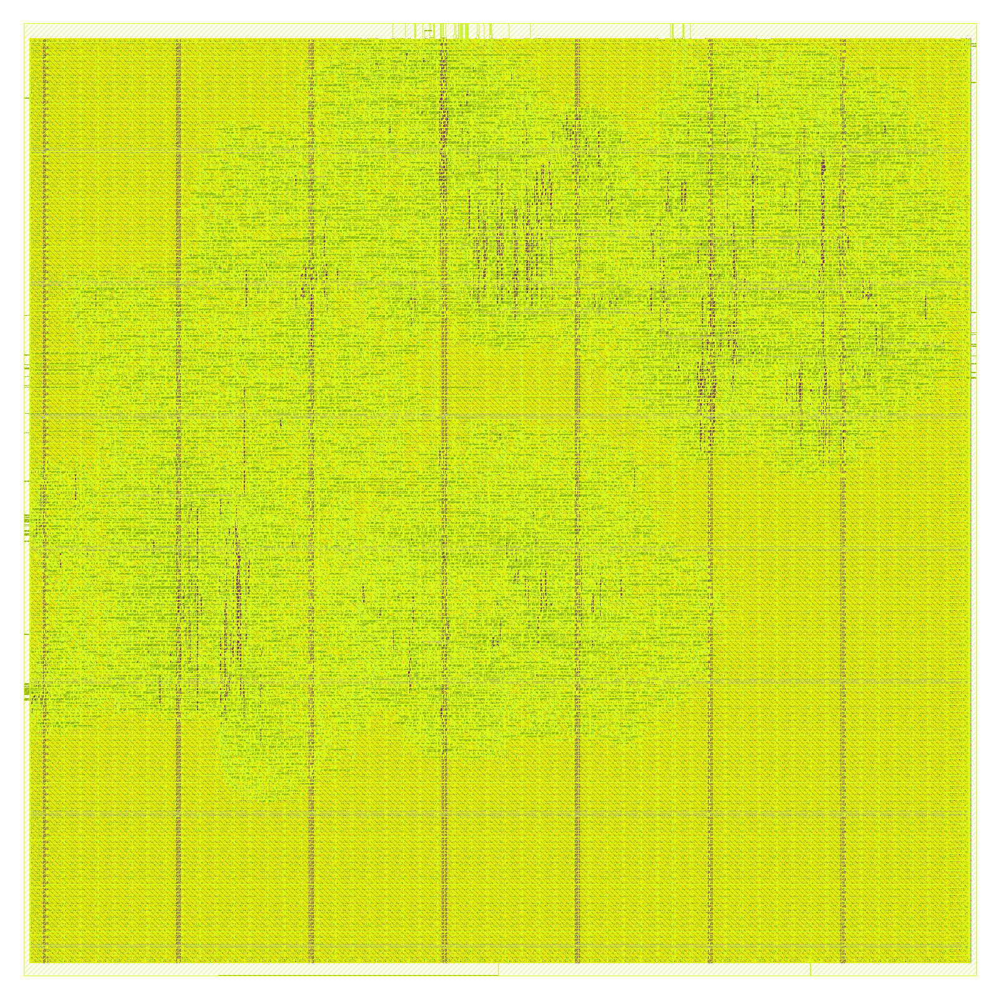
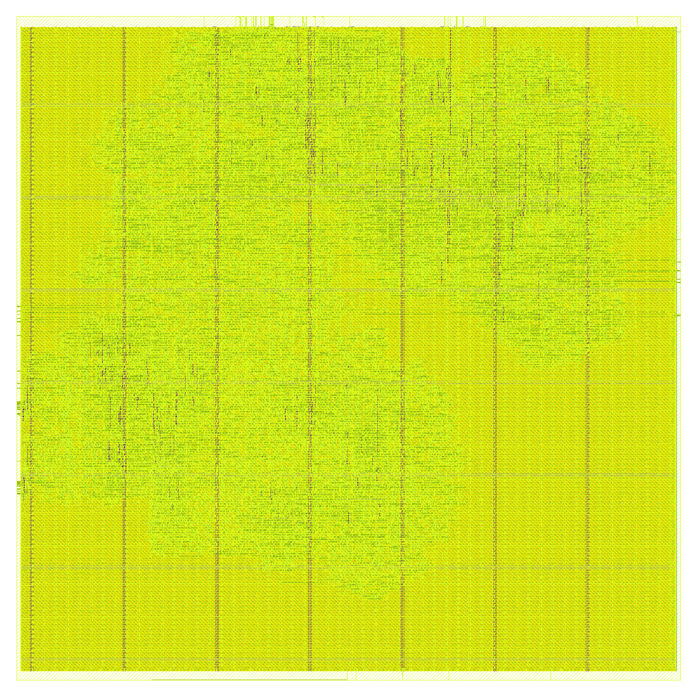
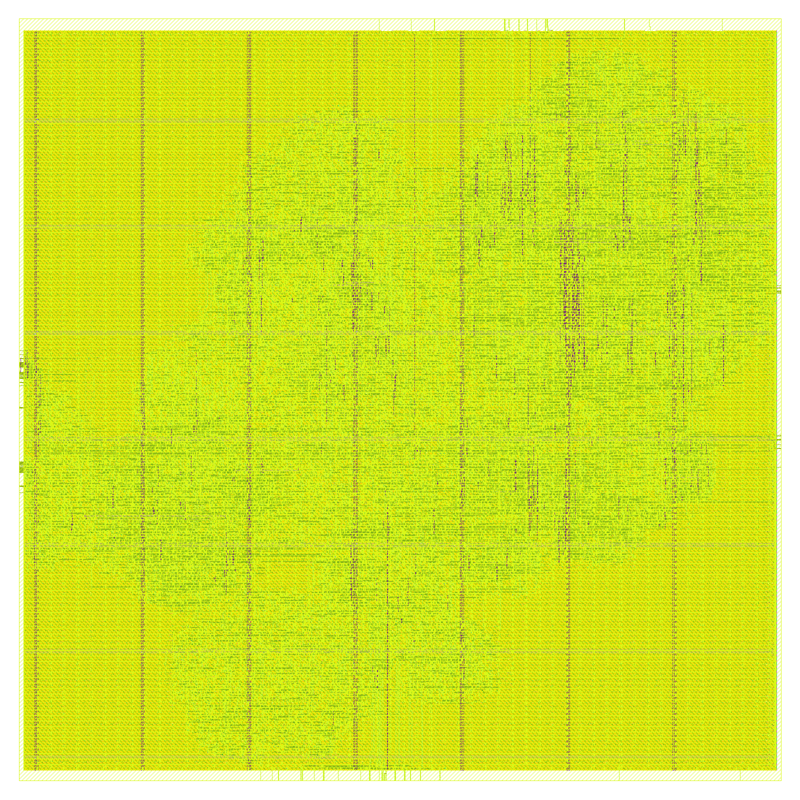
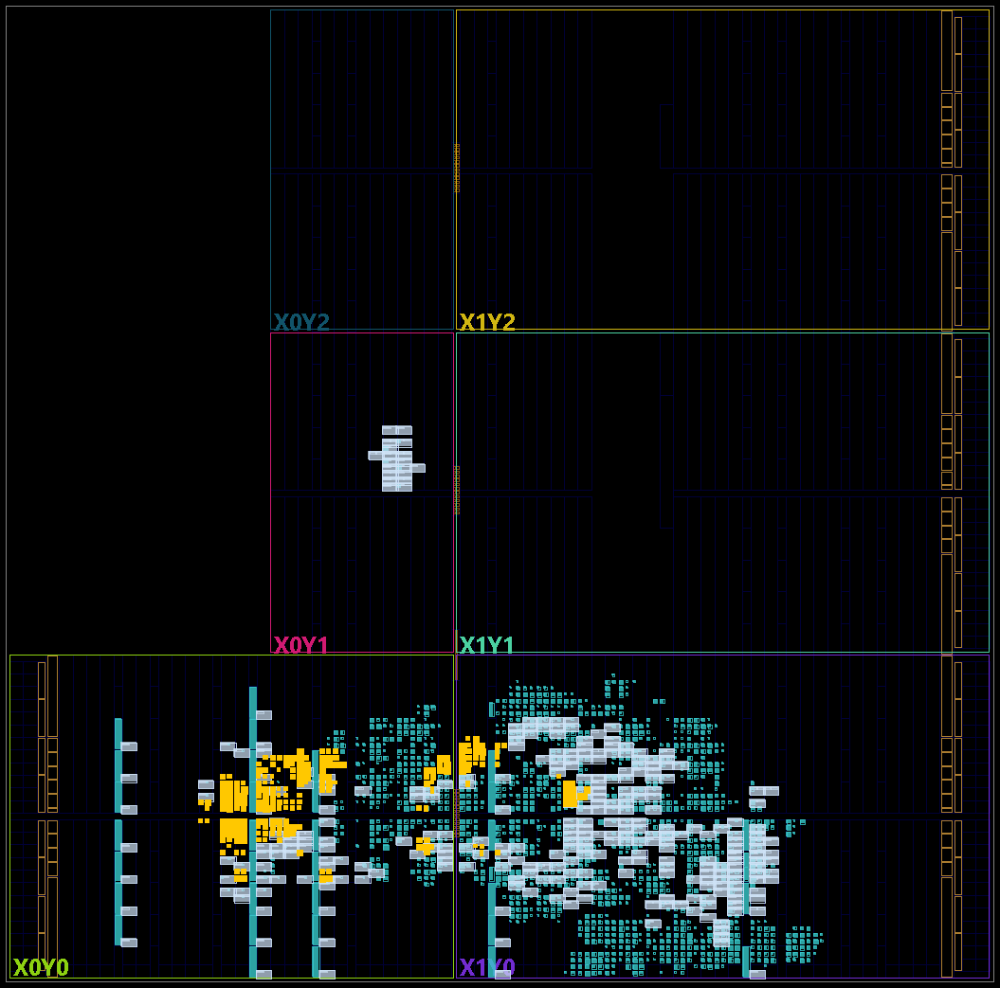
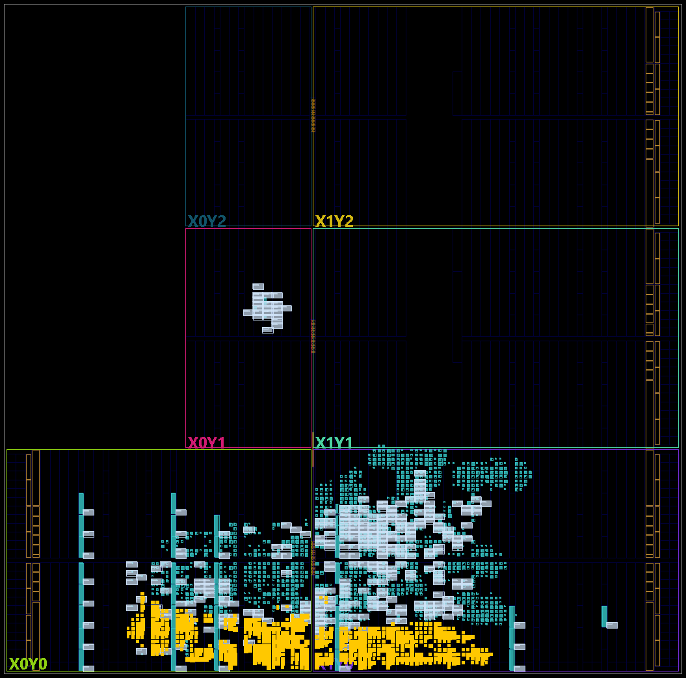
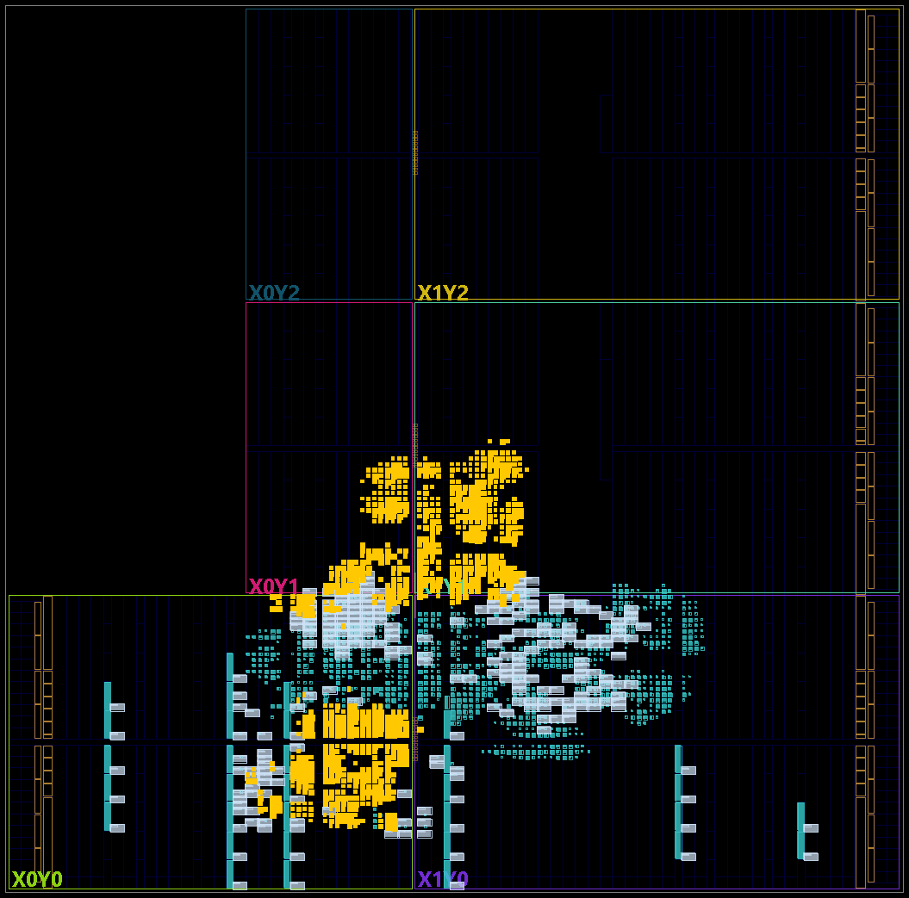
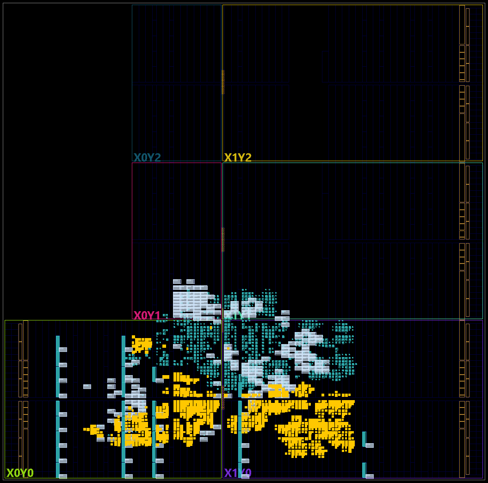
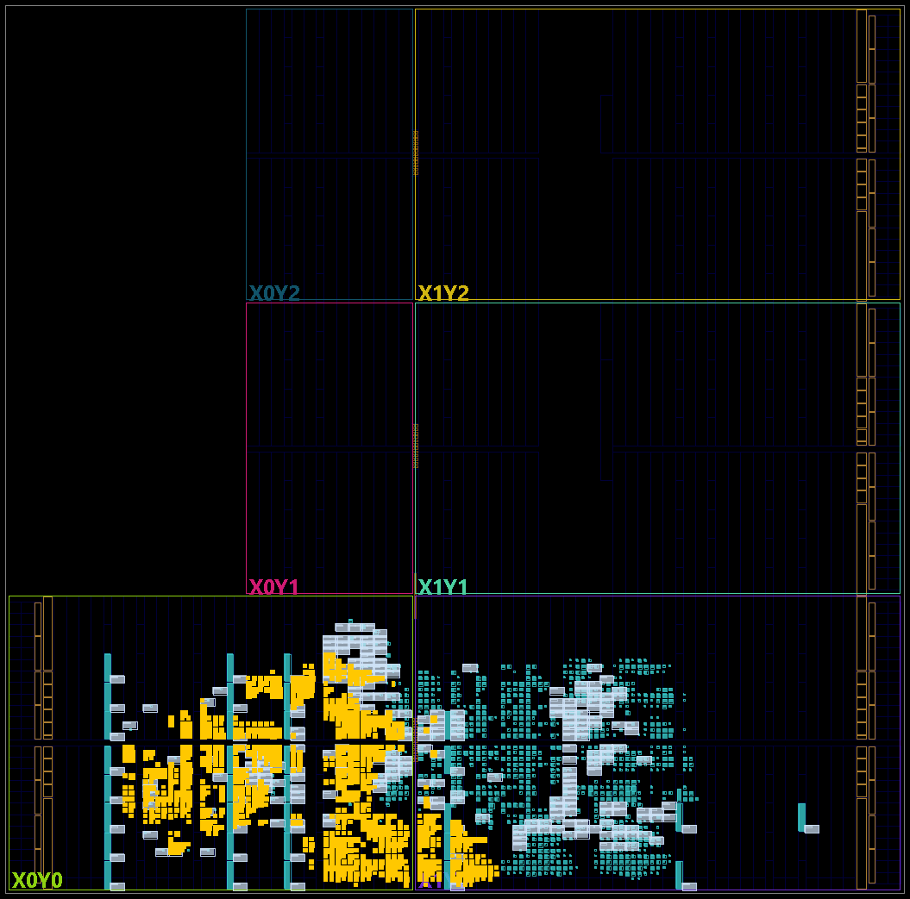

# The senseworks gateway: three receivers with a BCH decoder, side by side

**Project:** BTLE — reconfigurable RISC-V baseband  
**Branches:** `ble-rx-gateway-8`, `ble-rx-gateway-12`, `ble-rx-gateway-18` (one implementation; they differ only in
the default of `RX_BCH_T`)  
**Base:** `ble-rx-2p1c` (`92202d68`), compared here with it and with `ble-rx-micro` (`d67b1070`)  
**Date:** 2026-11-06  
**Author:** Miguel Simões  
**Status:** run `rx-gw`. Every number below is measured or computed from a measurement, and its evidence is
committed (§ 13): the RTL in simulation against an integer model and against the two receivers, area and timing
in 45 nm, layouts in GF180MCU, the controller placed and routed on the Zynq's FPGA (out of context, § 10).
**Not done:** the board's bitstream and any test on a board; the firmware's gateway mode is tested on a host and
in simulation through the registers, not on a board (§ 11). Not a tape-out (`docs/Validation/ASIC_READINESS.md`:
NOT READY, as on every branch).

---

## How to read this document

The senseworks system has two ends. The **tag** has only a transmitter and sends a short standard advertising
packet with BCH parity after its two sensor bytes (branches `ble-tx-tag-8/12/18`, `TX_TAG_COMPARISON.md` on those
branches). The **gateway** has only a receiver. Its job is to hear the tag from as far as possible.

These branches measure, in the RTL, what that document could only simulate. Three changes in the front end get
the packet out of the noise (a channel filter, the frequency offset corrected, the Access Address accepted with
up to 3 wrong bits). The hardware then keeps up to 3 candidate copies of the packet, and the software decodes them
with the BCH code. The main result: the gateway needs **9 to 14 dB less SNR than `ble-rx-2p1c` up to 30 ppm and
20 dB less at 50 ppm**, for +54 to +67 % of the receiver's area.

The three branches use the tag's three codes: each corrects up to t wrong bits, t = 8, 12 or 18. The receiver must
match the tag's t. § 1 gives the comparison; §§ 2–3 the design and the rule of acceptance; §§ 4–5 the evidence
and the packet loss; § 6 the false accepts; §§ 7–10 area, timing, layout and FPGA; § 12 the choice.

## 1. The three gateways, `ble-rx-micro` and `ble-rx-2p1c`, in one table

3 kept phases on the gateways. The SNR is at a packet error rate of 10 %, at 0 / 20 / −30 / 50 ppm, on the tag's
own packets of each t: the two rows of the existing receivers show the range across the three.

| | `ble-rx-micro` | `ble-rx-2p1c` | **`ble-rx-gateway-8`** | **`ble-rx-gateway-12`** | **`ble-rx-gateway-18`** |
|---|---|---|---|---|---|
| What it has | 1 phase, CRC exact | 2 phases, CRC + 1 bit | filter, CFO correction, AA within 3 bits, 3 phases, BCH in software | the same | the same |
| Transmitter | yes | yes | **none** | none | none |
| SNR, t = 8 packet (dB) | 10.25 / 13.17 / 15.30 / 26.53 | 8.26 / 10.22 / 12.16 / 22.38 | **−0.66 / −0.54 / −0.34 / 2.26** | | |
| SNR, t = 12 packet (dB) | 10.54 / 13.36 / 15.68 / 26.88 | 8.40 / 10.35 / 12.74 / 22.70 | | **−0.98 / −0.71 / −0.76 / 2.44** | |
| SNR, t = 18 packet (dB) | 10.63 / 13.38 / 15.80 / 26.89 | 8.59 / 10.64 / 12.71 / 22.87 | | | **−1.44 / −1.04 / −0.97 / 2.42** |
| Wrong packets accepted, the whole campaign (§ 5) | 0 | 1 | 0 | 0 | 0 |
| `btle_rx`, 45 nm (µm²) | 6 976.1 | 12 461.8 | 19 190.3 (+54.0 %) | 20 070.2 (+61.1 %) | 20 829.4 (+67.1 %) |
| `btle_rx`, logic leakage, 45 nm (µW) | 138.51 | 248.26 | 391.63 | 408.59 | 421.25 |
| `btle_rx`, min period, pre-layout (ns) | — | 1.506 | 2.159 | 2.121 | 1.976 |
| GF180MCU-D, placed cells (µm²) | 144 817.0 | 242 936.0 | 387 426.0 | 398 276.0 | 414 655.0 |
| GF180MCU-D, worst setup, 9 corners (ns) | +2.266 | +1.099 | +0.451 | +0.276 | +0.208 |
| xc7z020, `btle_rx` LUTs / flip-flops | 482 / 435 | 1 252 / 1 304 | 1 803 / 1 507 | 1 870 / 1 603 | 1 918 / 1 702 |
| Tag's time on the air, one packet | | | 240 µs | 272 µs | 304 µs |
| False accept, noise alone at 10.7 triggers/s (§ 6, computed) | | | one in 15 years | one in 4 800 years | one in 290 000 years |
| Validation (§ 4) | its own documents | its own documents | **all pass** | all pass | all pass |

The percentages are against `ble-rx-2p1c`. A negative SNR is not a mistake: it is upstream's definition (`btlelib.add_noise`), the
signal's peak power against all the noise of the samples, at 8 samples per symbol, wider than the signal, as in every
earlier campaign of this project. It is not a link budget; differences between rows are what this document uses.

## 2. What the branches contain

| Part | File | |
|---|---|---|
| The channel filter: the moving sum of the last 4 samples of I and Q | `verilog/rx_channel_filter.v` (`RX_FILTER = 1`) | new |
| The demodulator with the frequency offset corrected. While searching, a running mean of z_i (2^7 samples) is removed; every phase accumulates its reference. Once the Access Address is found, the references stop and the decision is a rotation by the reference | `verilog/gfsk_demodulation_cfo.v` (`RX_CFO = 1`) | new; two multipliers, a sample every other clock, as `gfsk_demodulation_shared` |
| The Access Address within 3 wrong bits | `search_unique_bit_sequence_shared.v` (`RX_AA_TOL = 3`) | |
| The packet's length known; each kept phase can be read | `rx_k_phase.v`, `rx_decoder_shared.v` (`FIXED_LEN`, `READ_RANKS`), `btle_ll.v` | `ble-rx-2p1c`'s structure, with the 1-bit CRC correction off |
| The phases kept: 1, 2 or 3, fixed when the receiver is built; the area is measured for each (§ 7). The software reads them all and chooses among them (§ 3) | `RX_AA_PHASES`, default 3 | |
| The BCH decoder (syndromes, Berlekamp–Massey, Chien) and the rule of § 3 | `firmware/gw_bch.h`, `firmware/btle_ll.c` option `-G` | in C; `scripts/senseworks/tag_bch.py` is the reference |
| **No transmitter** | `btle_phy.v`; `btle_tx.v`, `gfsk_modulation.v`, `gauss_filter.v`, `vco.v`, `crc24.v`, `scramble.v`, `bit_repeat_upsample.v` and their testbenches removed; `btle_controller.tcl` without them | the TX ports stay (the controller's interface), reviewed in the Vivado gate |
| The models and campaigns | `scripts/senseworks/gw_model.py`, `fec_sim.py`, `gw_false_accept.c`, `run_gateway_per.py`, `gw_summary.py` | |

The three branches differ in one default, `RX_BCH_T`, in `btle_rx.v`, `btle_phy.v` and `btle_controller.v`.

**The hardware model.** `gw_model.py` compared integer approximations before any RTL was written, each with its loss
against the ideal receiver, the same samples for all. The configuration chosen, `c3`: the mean of the search one
register (2^7 samples), the reference leaking over 2^4 symbols, products kept to 12 bits, the reference to 5 bits
in the rotation. The limit asked of it was a loss of at most 1 dB at each point:

| Loss of `c3` against the ideal receiver (dB), worst of 0 / 20 / −30 / 50 ppm, 5 000 packets a point | 1 phase | 2 phases | 3 phases |
|---|---:|---:|---:|
| t = 8 | +0.13 | +0.18 | +0.18 |
| t = 12 | +0.09 | +0.17 | +0.17 |
| t = 18 | +0.21 | +0.21 | +0.19 |

Replacing the rotation by a threshold, which would save the second product, costs 1.3 to 1.4 dB at t = 8 (`exp7_thr`,
`blk64_thr`, 1 000 packets), over the limit. At 50 ppm `c3` is about 0.5 to 0.6 dB *better* than the "ideal" model: that
model is a reference for the losses, not a bound on what a receiver can do.

**A condition this design adds: the input level.** The model divides the input by a gain before the 8-bit saturation,
signal and noise together; at 1/1 the signal reaches the full 8-bit scale.

| Worst loss of `c3` against the ideal receiver at full scale (dB), 3 phases | t = 8 | t = 12 | t = 18 |
|---|---:|---:|---:|
| input at 1/4 of full scale | −0.04 | −0.08 | −0.04 |
| input at 1/8 | +0.48 | +0.38 | +0.40 |

At 1/16 (t = 8, 1 000 packets) `c3` no longer reaches PER 10 % at 0 ppm within the range run, and loses 3.70 dB at
50 ppm. So **the AGC must keep the signal within 1/8 of the 8-bit scale**. This was simulated, not tried with a real AGC.

## 3. The rule of acceptance

For the kept phases in priority order (the phase `rx_k_phase` takes, the middle of those that find the Access Address
within one symbol, comes first):

1. force the known bytes: the header, the AD structure's header, the Company ID;
2. BCH: correct AdvA, the sensor and the parity, at most t bits;
3. the CRC-24 of the PDU this gives may differ from the 24 bits received in at most 4 / 5 / 6 bits (t = 8 / 12 / 18).

The first phase that passes gives the packet, with its right CRC. If none passes, there is no packet. The rule lives
in `firmware/gw_bch.h`; `tag_bch.gateway_accept` is its reference, and `tests/test_gateway_software.py` checks that
they agree.

## 4. Validation

Run `rx-gw`: `scripts/senseworks/run_gateway_validation.sh` on each branch (`results/validation/rx-gw-<t>-validation/`,
`dirty=0` in each `provenance.txt`). Each branch's run covers the three codes: **all pass on all three**.

| Check | What it shows | Result (each branch) |
|---|---|---|
| `tag_bch.py --self-test` | the code's properties; encoder and decoder, each t | 1 000 words with 1..t errors all corrected; of 1 000 with t+1..3t, all detected, none decoded to another codeword |
| `tests/test_gateway_software.py` | `firmware/gw_bch.h` against `tag_bch.py`, 5 000 packets | **C = Python** on all: 2 622 accepted (first, second, third phase: 1 662, 719, 241), 2 378 rejected |
| `tests/test_gateway_rx.py --mutants` | every stored bit of every kept phase against `gw_model.py` (`c3`); t = 8, 12, 18, 1–3 phases, points around the limit and the offsets; `decode_end`, its `crc_ok`, and which packets end without one | **2 880 segments, 2 778 packets decoded, 3 558 kept phases compared bit for bit, no difference**; **16/16 mutants caught** |
| `tests/test_gateway_base.py` | with the gateway's parameters off, `btle_rx` against `ble-rx-2p1c`, every output on every clock, 8 of the receiver's own configurations | **SAME** on all 8 |
| `tests/test_gateway_controller.py` | end to end: packets and noise at the controller's RF port, read through its AXI registers as the firmware reads them, decided by the rule's Python reference; 1 and 3 phases | at SNR 20 dB, 30/30 right with 0 corrections; at SNR 1 dB, 27–30 of 30 accepted, 0 wrong |
| `tests/test_gateway_campaign.py` | `run_gateway_per.py`'s reader must refuse failed and incomplete simulations and never decide on unknown bits; the traffic test's seed must not depend on the process | **PASS**: 16 runs refused or read as they must |
| `tests/test_gateway_short.py` (run by itself, not in this script: `rx-gw-campaigns/short_test.txt`) | the short-packet campaign's stimulus (§ 6) must be where it says, and the RTL must show both outcomes: a tag's packet lost within the read past a short one and received far from it | **PASS** |
| `firmware/btle_ll.c` | with the option `-G`: gcc's exit code judged, and a compiler that fails must fail this check | compiles. Syntax only: no link, no ARM build, not run |
| `run_lint.py` (Verilator 5.020, warnings fatal) | | **PASS 352/352** configurations, 11 reviewed exceptions |

**A test that first gave a false result.** The first noise campaign reported 0 triggers: its 8 M samples were beyond the
4 M the testbench read, so the inputs were X and the receiver saw nothing. `tb_gateway_rx.v` now holds them, and a
stimulus too long stops the test. Only the corrected run is reported (§ 6). The RTL did not change: `verilog/` is the
same tree from the first gateway commit to the commits measured.

**The verifiers, corrected after an independent review.** A review found that three of them could pass what they should
not, and reproduced each; it showed no defect in the RTL. `run_gateway_per.py` only looked for its end marker, so a failed or
unfinished simulation could count as lost packets, and it read unknown bits (X) as 0, so a decision could use bits that did not
exist. The firmware's check searched for the word `error` instead of judging the compiler's exit code. And the traffic test's
noise seed came from Python's hash of a string, which changes per process. Now a simulation counts only when it exits 0,
prints nothing but its records and accounts for every segment and rank; a phase holding unknown bits stops the decision unless a
phase before it already passed, and is counted in `unknown`; `test_gateway_base.py` and `test_gateway_controller.py` judge the
exit code too. The first campaigns kept only counts, so they could not be judged again: **all three were run again** with the
new reader, 453 + 42 + 18 points, every simulation exit 0, `unknown` = 0. **The packet-loss campaign and the noise campaign
are identical to the first run on every point** (`ends`, received, wrong, CRC right, corrections, ranks; triggers, accepted), so the
defects did not change those numbers. The traffic test has a new noise seed; its counts moved by a few (§ 6). The outputs of the
simulations are kept outside the repository and their SHA-256 in each JSON line. The earlier runs are in the commit
history (`a79bc667` on `ble-rx-gateway-8`). The three validations were also run again on the corrected verifiers.

## 5. Packet loss: the model and the RTL

Run `rx-gw-campaigns`: `scripts/senseworks/run_gateway_per.py per`, 1 000 packets a point, the tag's real packets,
upstream's channel model, the same samples for every receiver; a packet is received when its CRC ends right and it is
the one sent. The gateway's packets are decided by the software's rule.

| 3 phases, 0 / 20 / −30 / 50 ppm (dB) | ideal model, 5 000 packets | hardware model (`c3`), 5 000 packets | the RTL |
|---|---|---|---|
| t = 8 | −0.62 / −0.43 / −0.58 / 2.89 | −0.58 / −0.40 / −0.40 / 2.38 | −0.66 / −0.54 / −0.34 / 2.26 |
| t = 12 | −0.99 / −0.75 / −0.88 / 2.98 | −0.93 / −0.72 / −0.72 / 2.34 | −0.98 / −0.71 / −0.76 / 2.44 |
| t = 18 | −1.48 / −1.02 / −1.22 / 2.94 | −1.40 / −1.08 / −1.03 / 2.42 | −1.44 / −1.04 / −0.97 / 2.42 |

**The RTL is within 0.14 dB of its model and at most 0.25 dB worse than the ideal receiver**, under the 1 dB limit at
every point. These are different packets (1 000 and 5 000), so a difference of about 0.1 dB is within their statistics.

| SNR at PER 10 % (dB), 0 / 20 / −30 / 50 ppm | t = 8 | t = 12 | t = 18 |
|---|---|---|---|
| `ble-rx-micro`, its CRC exact, no BCH | 10.25 / 13.17 / 15.30 / 26.53 | 10.54 / 13.36 / 15.68 / 26.88 | 10.63 / 13.38 / 15.80 / 26.89 |
| `ble-rx-2p1c`, its CRC + 1 bit, no BCH | 8.26 / 10.22 / 12.16 / 22.38 | 8.40 / 10.35 / 12.74 / 22.70 | 8.59 / 10.64 / 12.71 / 22.87 |
| gateway, 1 phase | 0.06 / 0.12 / 0.21 / 2.39 | −0.46 / −0.21 / −0.28 / 2.48 | −0.91 / −0.56 / −0.66 / 2.44 |
| gateway, 2 phases | −0.39 / −0.25 / −0.22 / 2.27 | −0.76 / −0.54 / −0.63 / 2.44 | −1.24 / −0.87 / −0.91 / 2.43 |
| **gateway, 3 phases** | −0.66 / −0.54 / −0.34 / 2.26 | −0.98 / −0.71 / −0.76 / 2.44 | −1.44 / −1.04 / −0.97 / 2.42 |

| What the gateway gains, 3 phases (dB), 0 / 20 / −30 / 50 ppm | t = 8 | t = 12 | t = 18 |
|---|---|---|---|
| against `ble-rx-2p1c` | 8.92 / 10.76 / 12.50 / 20.12 | 9.38 / 11.06 / 13.50 / 20.26 | 10.03 / 11.68 / 13.68 / 20.45 |
| against `ble-rx-micro` | 10.91 / 13.71 / 15.64 / 24.27 | 11.52 / 14.07 / 16.44 / 24.44 | 12.07 / 14.42 / 16.77 / 24.47 |
| 3 phases against 1 | 0.72 / 0.66 / 0.55 / 0.13 | 0.52 / 0.50 / 0.48 / 0.04 | 0.53 / 0.48 / 0.31 / 0.02 |
| 3 phases against 2 | 0.27 / 0.29 / 0.12 / 0.01 | 0.22 / 0.17 / 0.13 / 0.00 | 0.20 / 0.17 / 0.06 / 0.01 |

1. **Most of the gain does not need 3 phases.** One phase already gains 8.2–9.5 dB against `ble-rx-2p1c` at 0 ppm. The
   next two add 0.5–0.7 dB there, and nothing at 50 ppm.
2. **A longer code gains less than its name suggests**: from t = 8 to t = 18, 0.50–0.78 dB up to 30 ppm, and at 50 ppm
   t = 8 is 0.16 dB better. At 50 ppm the three are within 0.18 dB and more phases add nothing, which suggests that
   something other than the code limits them there; this run does not isolate what.
3. **The offset no longer costs much up to 30 ppm**: the gateway's loss from 0 to −30 ppm is 0.22–0.47 dB, against
   3.90–4.34 dB on `ble-rx-2p1c`.
4. `TX_TAG_COMPARISON.md`'s simulated row for the improved receiver is close to the gateway's RTL at 1 phase, within
   0.43 dB at every point. Its largest differences are at 50 ppm, where the RTL is better.

**Packets accepted that are not the one sent**, the whole campaign: `ble-rx-2p1c` 1 (t = 8, 20 ppm, SNR 9 dB; its cause
was not analysed); `ble-rx-micro` 0; the gateway 0 with 1, 2 and 3 phases.

## 6. False accepts

A gateway that corrects bits may also "correct" noise or another device's packet into a valid packet. Three
measurements bound it.

**The rule, explicit.** A random word passes one phase with probability P = V(n, t) / 2^deg × V(24, tol) / 2^24, where
V(n, r) is the volume of a Hamming ball; with K phases, at most K × P per trigger.

| | t = 8 | t = 12 | t = 18 |
|---|---:|---:|---:|
| n, deg g, CRC tolerance | 128, 64, 4 | 156, 92, 5 | 188, 124, 6 |
| P(BCH decodes a random word) | 8.29 × 10⁻⁸ | 6.18 × 10⁻¹¹ | 3.05 × 10⁻¹³ |
| P(CRC within the tolerance) | 7.72 × 10⁻⁴ | 3.31 × 10⁻³ | 1.13 × 10⁻² |
| per attempt, 3 phases | 1.92 × 10⁻¹⁰ | 6.13 × 10⁻¹³ | 1.04 × 10⁻¹⁴ |
| at 10.7 triggers/s, without a pause | one in 15.4 years | one in 4 830 years | one in 286 000 years |

These years are a conditional estimate, computed, not observed: noise alone, the CRC's bits independent of the decoding, every
trigger an attempt. They leave out the reads past a short packet's end, measured at the end of this section on far fewer
reads than such years would need. Within those assumptions a larger t
is much safer, even with its larger CRC tolerance.

**The factor of 3 at t = 8: what the evidence supports.** `gw_false_accept.c` applies the rule to 3 words per trial
(`results/senseworks/gw_false_accept/`): on noise, 3 adjacent phases through the integer front end; on a tag's packet, 3 words
with 45 % of their bit errors shared, as a model of adjacent phases:

| t = 8 | trials | decodings, any of K phases: K = 1 / 2 / 3 | K = 3 against K = 1 | CRC within 4 bits: seen, expected |
|---|---:|---|---:|---:|
| noise | 10⁹ | 94 / 186 / 271 | 2.88 | 1, 0.21 |
| the tag's packet, 5 % bit errors | 5 × 10⁸ | 5 / 9 / 14 | 2.80 | 0, 0.011 |
| the tag's packet, 10 % bit errors | 5 × 10⁸ | 35 / 73 / 109 | 3.11 | 0, 0.084 |

This is compatible with a phase counting about as an independent attempt, although adjacent phases are correlated (on noise they
differ in about 68 bits of 200). It does not prove independence, and it was run at t = 8 only. The decoding rate on noise, 8.5–9.4 × 10⁻⁸ per phase, agrees with the
8.29 × 10⁻⁸ computed. The CRC distance of the decodings looks binomial (mean 11.74 against 12.00 on noise). One decoding of 271
on noise fell within the tolerance, against 0.21 expected, about a 1-in-5 event: compatible with the rule, but one event validates no tail.

**The RTL, noise alone.**

| Noise alone, the RTL, 3 phases | seconds | triggers | a second | CRC right | accepted |
|---|---:|---:|---:|---:|---:|
| t = 8 | 6 | 78 | 13.0 | 0 | 0 |
| t = 12 | 6 | 51 | 8.5 | 0 | 0 |
| t = 18 | 6 | 64 | 10.7 | 0 | 0 |

193 triggers in 18 s, 10.7/s, the rate used above. The search for the Access Address does not depend on t, and the spread
between the rows is about what counts this small give; 18 s also says nothing directly about events as rare as § 6's.

**The RTL, other devices' packets** at a high SNR, 300 at each of two SNRs (30 and 6 dB): 0 accepted of any kind.

| Other devices' packets, the RTL, 3 phases (ends of a decode; accepted; phases the BCH decoded) | packets | t = 8 | t = 12 | t = 18 |
|---|---:|---:|---:|---:|
| Eddystone | 600 | 600; 0; 0 | 600; 0; 0 | 600; 0; 0 |
| iBeacon | 600 | 600; 0; 0 | 600; 0; 0 | 600; 0; 0 |
| device name | 600 | 600; 0; 0 | 538; 0; 0 | 403; 0; 0 |
| manufacturer data | 600 | 544; 0; 0 | 451; 0; 0 | 330; 0; 0 |
| all-zero PDU | 600 | 600; 0; 1 800 | 600; 0; 1 797 | 600; 0; 1 800 |
| empty | 600 | 0; 0; 0 | 0; 0; 0 | 0; 0; 0 |
| ADV_SCAN_IND | 600 | 0; 0; 0 | 0; 0; 0 | 0; 0; 0 |

The all-zero packet carries the zero codeword where the code looks, so the BCH decodes nearly every phase, and the CRC rejects
it: this is why the code alone is not enough. **A limit of this test:** the receiver takes the length as known, so a packet
shorter than the tag's reaches no `decode_end` within the test's segment. The empty packets, ADV_SCAN_IND and part of the
other short ones were therefore not decided by the software here, and this table says nothing about them; the next test does.
No phase was left unfinished in the packets that did end (`phases_unfinished` = 0).

**The RTL, short packets read past their end.** `run_gateway_per.py short`, t = 8, 12, 18 with 1 and 3 phases: 228 points of
300 packets, 68 400 in all. Each kind is followed by noise or by exact zeros at the input, at SNR 6 and 30 dB, so 2 400 packets per
kind and t, or by a tag's packet at a known gap, at 30 dB. The kinds: the empty packet, ADV_SCAN_IND, a packet one octet shorter
than the tag's, a short one of all zeros (`zeros_short`), and the tag's own packet cut, without its 3 CRC octets (`tag_cut3`) or
without its last 8 (`tag_cut8`).

| Read past the end, into noise or silence (accepted with the right contents; with wrong ones) | packets per t | t = 8 | t = 12 | t = 18 |
|---|---:|---:|---:|---:|
| one octet short | 2 400 | 0; 0 | 0; 0 | 0; 0 |
| empty | 2 400 | 0; 0 | 0; 0 | 0; 0 |
| ADV_SCAN_IND | 2 400 | 0; 0 | 0; 0 | 0; 0 |
| the tag's, without its CRC | 2 400 | 3; 0 | 16; 0 | 44; 0 |
| the tag's, without its last 8 octets | 2 400 | 0; 0 | 0; 0 | 25; 0 |
| all zeros, short | 2 400 | 0; 0 | 0; 0 | 0; 0 |

| A tag's packet after a short one, received of 600 | gap (µs) | 50 | 100 | 150 | 200 | 300 | 400 | 1 000 |
|---|---|---:|---:|---:|---:|---:|---:|---:|
| empty | t = 8 | 0 | 600 | 600 | 600 | 600 | 600 | 600 |
| empty | t = 12 | 0 | 0 | 600 | 600 | 600 | 600 | 600 |
| empty | t = 18 | 0 | 0 | 0 | 600 | 600 | 600 | 600 |
| one octet short | every t | 600 | 600 | 600 | 600 | 600 | 600 | 600 |

- **The receiver never stays in a read.** Every one of the 68 400 segments ended every read it started, and a tag's packet
  far from a short one is always received, so the search resumes. Each segment starts from a reset, so this shows the
  recovery within a segment, as a tag's packet arrives after a short one, not over a long run of them.
- **Nothing wrong was accepted:** 0 of 90 005 reads, `unknown` = 0, every simulation exit 0. Packets that were not the tag's
  were never accepted. This is too few reads to say anything about events as rare as the years above.
- **The cut packets accepted are right, and the software cannot tell they were cut.** Without its CRC, what is read in its place
  is random and falls within the tolerance of 4, 5 or 6 bits about as often as a computed estimate says: about 4, 16 and 54
  for these tries, assuming the phases independent, against 3, 16 and 44. Without its last 8 octets only t = 18 corrects the
  parity lost. The contents come from the code, so they are the ones sent, and the software returns the CRC it computes, not the
  one received.
- **The blind time after a short packet is the rest of the read.** The receiver reads (2 + length + 3) octets whatever the
  packet holds: after an empty packet, 112, 144 and 176 µs more at t = 8, 12, 18. At the tested gaps a tag's packet is lost well
  inside that time and received after it. At t = 8 the 100 µs gap, just inside the 112, is received, and the grid is too coarse
  to place the edge. A longer t therefore costs more here too.

What this leaves out: gaps at 30 dB only and no frequency offset; packets that overlap; another device's long packet read after a
short one; and the firmware's own time to read the phases, which the testbench reads at once. The last is for the board (§ 11).

## 7. Area and leakage (45 nm)

Run `rx-gw`: `scripts/area/run_area.sh` (Yosys + ABC, Nangate45), `results/area/rx-gw/`. The leakage is
`scripts/power/logic_leakage.py`'s, the liberty's `cell_leakage_power` of every cell (1.10 V typical).

| `btle_rx`, 45 nm | cells | flip-flops | area (µm²) | vs `ble-rx-2p1c` | leakage (µW) |
|---|---:|---:|---:|---:|---:|
| `ble-rx-micro` | 3624 | 787 | 6 976.1 | −44.0 % | 138.51 |
| `ble-rx-2p1c` | 6607 | 1320 | 12 461.8 | +0.0 % | 248.26 |
| gateway t = 8, 1 phase | 8718 | 1298 | 14 099.9 | +13.1 % | 291.77 |
| gateway t = 8, 2 phases | 10016 | 1598 | 16 703.2 | +34.0 % | 343.72 |
| **gateway t = 8, 3 phases** | 11214 | 1899 | 19 190.3 | +54.0 % | 391.63 |
| gateway t = 12, 1 phase | 8852 | 1330 | 14 377.8 | +15.4 % | 297.61 |
| gateway t = 12, 2 phases | 10222 | 1661 | 17 281.8 | +38.7 % | 355.55 |
| **gateway t = 12, 3 phases** | 11627 | 1995 | 20 070.2 | +61.1 % | 408.59 |
| gateway t = 18, 1 phase | 9031 | 1356 | 14 641.4 | +17.5 % | 302.67 |
| gateway t = 18, 2 phases | 10563 | 1732 | 17 843.8 | +43.2 % | 365.94 |
| **gateway t = 18, 3 phases** | 11853 | 2091 | 20 829.4 | +67.1 % | 421.25 |

| t = 8, 3 phases, one piece out | area (µm²) | what the piece costs (µm²) |
|---|---:|---:|
| all the pieces | 19 190.3 | |
| no channel filter | 18 079.0 | 1 111.3 |
| no frequency correction | 14 599.7 | 4 590.6 |
| Access Address exact | 17 736.1 | 1 454.2 |
| none of the three | 11 996.6 | 7 193.7 |

| `btle_controller`, 45 nm | cells | flip-flops | area (µm²) |
|---|---:|---:|---:|
| `ble-rx-micro` (with its transmitter) | 19532 | 3419 | 32 988.5 |
| `ble-rx-2p1c` (with its transmitter) | 22423 | 3952 | 38 315.4 |
| gateway t = 8 | 20823 | 3976 | 36 246.8 |
| gateway t = 12 | 21469 | 4065 | 37 160.7 |
| gateway t = 18 | 21610 | 4162 | 37 871.2 |

1. **Each kept phase costs 2 500–3 200 µm²** (a whole packet in flip-flops): 3 phases against 1 cost +36.1 / +39.6 /
   +42.3 %. **The code costs far less**: from t = 8 to t = 18 at 3 phases, +1 639.1 µm² (+8.5 %), with the decoder in
   software, what grows is the stored packet.
2. **The frequency correction is the largest front-end piece** (4 590.6 µm², 24 % of the receiver). The three pieces together
   cost 7 193.7 µm². § 5 does not separate what each one gains in the RTL.
3. **Without its transmitter the controller still is about the size of `ble-rx-2p1c`'s**: the receiver's growth about
   offsets the transmitter's removal (−5.4 / −3.0 / −1.2 %).

## 8. Timing (pre-layout, 45 nm)

Run `rx-gw`: `scripts/timing/run_sta.sh` with `STA_SET=rx`, against `ble-rx-2p1c` (`results/timing/rx-gw/`): the
mapped netlist cut at the flip-flops, sized by ABC.

| Pre-layout, 45 nm | comb. path (ns) | min period (ns) | slack at 62.5 ns |
|---|---:|---:|---:|
| `ble-rx-2p1c` `btle_controller` | 3.060 | 3.420 | +59.080 ns |
| `ble-rx-2p1c` `btle_rx` | 1.159 | 1.506 | +60.994 ns |
| gateway t = 8 `btle_controller` | 1.690 | 2.050 | +60.450 ns |
| **gateway t = 8 `btle_rx`** | 1.811 | 2.159 | +60.341 ns |
| gateway t = 12 `btle_controller` | 1.811 | 2.171 | +60.329 ns |
| **gateway t = 12 `btle_rx`** | 1.774 | 2.121 | +60.379 ns |
| gateway t = 18 `btle_controller` | 1.696 | 2.056 | +60.444 ns |
| **gateway t = 18 `btle_rx`** | 1.629 | 1.976 | +60.524 ns |

The gateway's `btle_rx` is slower than `ble-rx-2p1c`'s by 0.47–0.65 ns and stays about 30 times faster than its 16 MHz
clock needs. The order among the three is not the code's (t = 18 is the fastest), so this is probably the flow's spread.

## 9. Layout in GF180MCU-D

Run `rx-gw`: `scripts/layout/rx_final_gf180/run.sh <label> HEAD gateway` (LibreLane Classic, GF180MCU-D,
`gf180mcu_fd_sc_mcu7t5v0`, in the eFuse compiler's Nix environment), `btle_rx` of each branch; `clk` 62.5 ns and `clkb`
20 ns, and `ble-rx-2p1c`'s settings, with the changes of note 2. Evidence in `results/layout/rx-gw-<t>-gf180-d1100/`.

| GF180MCU-D (µm²) | `ble-rx-micro` | `ble-rx-2p1c` | **gateway t = 8** | **gateway t = 12** | **gateway t = 18** |
|---|---:|---:|---:|---:|---:|
| Logic: combinational, flip-flops, inverters, ties | 108 008 | 187 467 | 301 830 | 312 047 | 324 291 |
| Timing-repair buffers + clock trees | 19 577 | 31 492 | 50 112 | 50 753 | 54 876 |
| Taps, end caps, antenna diodes | 17 232 | 23 976 | 35 488 | 35 479 | 35 492 |
| **Placed cells** | 144 817.0 | 242 936.0 | 387 426.0 | 398 276.0 | 414 655.0 |
| flip-flops | 787 | 1320 | 1938 | 2034 | 2130 |
| Die (µm) | 760 × 760 | 900 × 900 | 1100 × 1100 | 1100 × 1100 | 1100 × 1100 |

| Signoff | `ble-rx-micro` | `ble-rx-2p1c` | **gateway t = 8** | **gateway t = 12** | **gateway t = 18** |
|---|---:|---:|---:|---:|---:|
| DRC: routing, KLayout, Magic | 0, 0, 0 | 0, 0, 0 | 0, 0, 0 | 0, 0, 0 | 0, 0, 0 |
| LVS errors | 0 | 0 | 0 | 0 | 0 |
| antenna violations | 0 | 0 | 0 | 0 | 0 |
| max slew violations | 0 | 0 | 0 | 0 | 0 |
| max capacitance violations | 0 | 0 | 0 | 0 | 0 |
| max fanout violations | 1 | 12 | 13 | 14 | 15 |
| worst setup / hold slack, 9 corners (ns) | +2.266 / +0.124 | +1.099 / +0.177 | +0.451 / +0.109 | +0.276 / +0.138 | +0.208 / +0.089 |
| IR drop, worst (mV) | 0.67 | 1.01 | 1.54 | 1.56 | 1.29 |
| clock skew, worst (ns) | 0.47 | 0.56 | 0.44 | 0.60 | 0.54 |
| OpenSTA vectorless power, 5 V (mW) | 23.51 | 35.79 | 103.59 | 101.35 | 104.60 |

Every gateway layout passes `synth_warning_gate.py --librelane`, which means 17–18 warnings, all reviewed, 0 unreviewed, and no
`ERROR` (`warning_gate.txt` in each folder), not that there are no warnings. The 13–15 max fanout violations remain, accepted by an
exception. They are clock-tree buffers driving 11–15 sinks for a limit of 10,
as on `ble-rx-2p1c`; none is on a signal net.

1. **The tightest path is the read of a kept phase on `clkb`**: on all three, from `pdu_octet_mem_addr` to the read's
   flip-flops, at the slow corner, with a period of 20 ns. Its slack is small (+0.21 to +0.45 ns, against `ble-rx-2p1c`'s
   +1.10 ns); the memory it reads now holds three packets instead of two. The 20 ns is this flow's constraint, as on
   `ble-rx-2p1c`; `clk` has 21–22 ns of room at 62.5 ns. A slower register interface would have more.
2. **What it took to close them**, each from a run that failed; the failed runs are not committed:
   - 1 150 µm, `ble-rx-2p1c`'s margins: 3 slew violations at t = 12, from one `oai32_1`, and `RSZ-0062` on all three;
   - resizer margins lowered to 0.25 / 0.1 ns: setup negative at ss, worse;
   - margins back, `oai32_1` excluded, the repair after global routing on: t = 8 closed, but t = 12's `rst` input net
     reached 3.40 ns of slew and t = 18's kept-phase read ended at −0.038 ns;
   - the same at 1 100 µm: all three close. The same settings hold for all three.

   That 1 100 µm closes it is measured. That it does so *because* the wires are shorter is likely but not shown, as a
   placement also changes run to run; the slack is thin enough that another run of a modified design could need another look.
3. **`RSZ-0062` is reviewed, not a violation**: the resizer warns that it does not reach its target, which includes its
   own 1 ns margin; the signoff above is what counts.
4. **The OpenSTA power is vectorless** (every input toggling at a default rate), not the gateway's activity. It triples
   against `ble-rx-2p1c`, and is no estimate of what the receiver would draw; this run has no switching-activity measurement.
5. **The layouts' flip-flops are 39 above the 45 nm count on each t** (1 938 against 1 899); `ble-rx-micro` and
   `ble-rx-2p1c` have equal counts in both. The cause was not investigated.

| `ble-rx-gateway-8` | `ble-rx-gateway-12` | `ble-rx-gateway-18` |
|---|---|---|
|  |  |  |

## 10. FPGA: the controller on the xc7z020

Run `xc7z020-gw`: Vivado 2026.1, `scripts/fpga/xc7z020/impl.tcl` in mode `ooc_hd` (synthesis, placement and routing of
`btle_controller` out of context on `xc7z020clg484-1`; `bb_clk` 16 MHz, the AXI clock 100 MHz), then `post.tcl` for the
reports. Evidence in `results/fpga/xc7z020-gw/<configuration>/`.

| xc7z020, routed | `ble-rx-micro` | `ble-rx-2p1c` | **gateway t = 8** | **gateway t = 12** | **gateway t = 18** |
|---|---:|---:|---:|---:|---:|
| `btle_rx`: LUTs / flip-flops | 482 / 435 | 1 252 / 1 304 | 1 803 / 1 507 | 1 870 / 1 603 | 1 918 / 1 702 |
| `btle_rx`: DSP48 / block RAM | 0 / 0 | 0 / 0 | 0 / 0 | 0 / 0 | 0 / 0 |
| `btle_controller`: LUTs (of 53 200) | 2 985 (5.61 %) | 3 751 (7.05 %) | 3 195 (6.01 %) | 3 263 (6.13 %) | 3 315 (6.23 %) |
| `btle_controller`: flip-flops | 3 763 | 4 632 | 4 150 | 4 246 | 4 345 |
| `btle_controller`: DSP48 | 0 | 0 | 0 | 0 | 0 |
| `btle_controller`: RAMB36 / RAMB18 | 32 / 4 | 32 / 4 | 32 / 1 | 32 / 1 | 32 / 1 |
| WNS, `bb_clk` (16 MHz) | +47.558 ns | +46.675 ns | +40.684 ns | +41.359 ns | +40.951 ns |
| WNS, AXI clock (100 MHz) | +3.652 ns | +1.681 ns | +2.016 ns | +1.890 ns | +2.017 ns |
| `btle_rx`'s worst path, slack | +48.900 ns | +46.694 ns | +40.684 ns | +41.359 ns | +40.951 ns |
| power, total / dynamic (vectorless estimate) | 0.192 / 0.087 W | 0.193 / 0.087 W | 0.190 / 0.084 W | 0.190 / 0.084 W | 0.190 / 0.084 W |
| of which `btle_rx`, dynamic | 0.001 W | 0.002 W | 0.004 W | 0.005 W | 0.005 W |
| Vivado's warnings (`synth_warning_gate.py --vivado`) | 0 unreviewed (150 reviewed) | 0 unreviewed (150 reviewed) | 0 unreviewed (447 reviewed) | 0 unreviewed (447 reviewed) | 0 unreviewed (447 reviewed) |

1. **The FPGA says the same as the ASIC, with less growth**: `btle_rx` +44 to +53 % of the LUTs of `ble-rx-2p1c` and +16 to +31 %
   of the flip-flops, as Vivado keeps part of the bits in 65 shift registers (5 on `ble-rx-2p1c`). The block stays below 4 % of the device.
2. **Timing has room**: the receiver's worst path, in the frequency correction (`gfsk_demodulation_cfo`, the reference to
   the bit decided), ends with about 41 ns to spare at 16 MHz. No DSP is used. The tightest clock is the AXI's, +1.9 to +2.0 ns.
3. **The warnings: 0 unreviewed does not mean none.** Each gateway's log has 446 `WARNING`, 1 `CRITICAL WARNING` and 0 `ERROR`, all under
   reviewed exceptions. The rise from 150 is the transmitter's removal: 296 on the TX ports `btle_phy` keeps and 1 on `rf_clk`, which
   now clocks only the TX side of `clock_domain_conversion_iq`. That one is the critical: `[Common 17-69]`, the out-of-context
   constraints' `HD.CLK_SRC` cannot be set on a port without a net. `btle_rx` does not use that clock.
4. **Out of context is not the board's integration.** Each `drc.rpt` has the critical warnings `NSTD-1` and `UCIO-1` (no I/O standards,
   no pin locations) and the warnings `RTSTAT-10` and `ZPS7-1`, and 145 inputs and 103 outputs have no external delay (`timing.rpt`). The WNS above are of the constrained paths; they do not qualify the external interfaces.

The placement of `btle_rx` (orange) in the routed controller, Vivado's Device view (`device_view.ps1 -Instance btle_rx_i`):

| `ble-rx-micro`: 1 076 of 8 329 primitives | `ble-rx-2p1c`: 2 910 of 10 163 | **`ble-rx-gateway-8`: 3 975 of 8 974** |
|---|---|---|
|  |  |  |
| **`ble-rx-gateway-12`: 4 114 of 9 113** | **`ble-rx-gateway-18`: 4 198 of 9 197** | |
|  |  | |

Without a transmitter, the receiver is 44–46 % of the controller's primitives.

## 11. On a board

Nothing here has run on a board. What remains:

1. **The bitstream**: upstream's flow (`fpga/README.md`). `verilog/btle_controller.tcl` no longer lists the transmitter's
   files. The controller alone fits and meets timing (§ 10); the block design with the AD9361's IP is not built here. Set
   `RX_AA_PHASES` before building: the phases are chosen at build time in the bitstream and given to the firmware by `-K`.
2. **The firmware**: `firmware/compile.sh`, then `./btle_ll -G <t> -K <phases> ...`. The t must match both the bitstream
   and the tag. The C decoder was checked on a host against its Python reference, and the register reads in simulation with that reference;
   neither ran on the Zynq's ARM. Its time per packet there has not been measured.
3. **The AGC**: § 2's condition on the input level, to be checked with the AD9361's real AGC.
4. **The link**: a tag branch and a gateway branch, through a cable and attenuators. Every SNR of this document is upstream's
   channel model plus Gaussian noise: no multipath, no interference, no phase noise of a real oscillator.

## 12. The choice

Between the phases: **1 phase unless area is free**. 3 phases add 0.31–0.72 dB up to 30 ppm for +36 to +42 % of `btle_rx`,
and at most 0.13 dB at 50 ppm. Going from t = 8 at 3 phases to t = 18 at 1 phase is *both* smaller (14 641.4 against 19 190.3 µm², −23.7 %)
and more sensitive up to 30 ppm (by 0.25, 0.02 and 0.32 dB; 0.18 dB less at 50 ppm), at the price of the tag's time on the air.

Between the codes, the decision is the system's, not the gateway's alone:

- **`ble-rx-gateway-8` if the tag's energy matters most.** From t = 8 to t = 18 the tag spends +27 % of time on the air
  (+1.03 dB of energy per event at the same power), and the gateway gives back 0.50–0.78 dB up to 30 ppm, less than that, and
  0.16 dB against it at 50 ppm. Its weak point: an estimate of one false accept in 15 years of noise alone, per gateway; whether that is
  acceptable depends on the application and on any check above this one.
- **`ble-rx-gateway-18` if range at a fixed transmit power matters most**, or the false accepts must be as rare as can be:
  the best sensitivity up to 30 ppm (−1.44 / −1.04 / −0.97 dB) and an estimate of one false accept in 286 000 years (§ 6, conditional), for +8.5 % of the
  receiver's area at 3 phases. The thinnest timing margin in GF180 (+0.21 ns), see § 9.
- **`ble-rx-gateway-12`** sits between them in almost every row. Its estimate of 4 830 years is far from t = 8's 15, for about half the extra time on
  the air: **it is the balanced default**, if no single constraint dominates.

The three are one implementation. The choice is a parameter, `RX_BCH_T`, which must equal the tag's `BCH_T`.

## 13. Reproducing

From WSL, at the root of each branch (the tools of `results/validation/rx-gw-<t>-validation/provenance.txt`):

```bash
scripts/senseworks/run_gateway_validation.sh rx-gw-<t>-validation     # § 4, every check
PY=~/venvs/btle/bin/python
$PY scripts/senseworks/run_gateway_per.py --out results/validation/rx-gw-campaigns per --packets 1000 \
  --bases "ble-rx-micro=d67b1070,ble-rx-2p1c=92202d68" --jobs 14 --logs <dir>/per      # § 5
$PY scripts/senseworks/run_gateway_per.py --out results/validation/rx-gw-campaigns traffic --packets 300 --jobs 14 --logs <dir>/traffic   # § 6
$PY scripts/senseworks/run_gateway_per.py --out results/validation/rx-gw-campaigns noise --seconds 1 --segments 6 --jobs 14 --logs <dir>/noise
$PY scripts/senseworks/run_gateway_per.py --out results/validation/rx-gw-campaigns short --packets 300 --jobs 8 --logs <dir>/short     # § 6
$PY tests/test_gateway_short.py
$PY scripts/senseworks/gw_model.py --btlelib python/btlelib.py --tag-bch scripts/senseworks/tag_bch.py \
  --workdir <dir> --out results/senseworks/gw_model/final.json --packets 5000 --jobs 8 --seed 2   # §§ 2, 5
$PY scripts/senseworks/gw_false_accept_report.py                      # § 6, from results/senseworks/gw_false_accept/
RTL_REV=<branch> scripts/area/run_area.sh rx-gw/gw<t>-k3 <tops>       # § 7; AREA_DEFAULTS="btle_rx.v:RX_AA_PHASES=2" for the phases
STA_SET=rx DUT_REV=HEAD scripts/timing/run_sta.sh rx-gw/ble-rx-gateway-<t> 62.5 92202d68   # § 8
scripts/layout/rx_final_gf180/run.sh rx-gw-<t>-gf180-d1100 HEAD gateway                    # § 9 (EFUSE_DIR, docker)
python3 scripts/validation/synth_warning_gate.py --librelane results/layout/rx-gw-<t>-gf180-d1100
$PY scripts/senseworks/gw_summary.py                                  # the tables
```

§ 10, on Windows (Vivado 2026.1), in a folder with a short path: per configuration a copy of `verilog/`, then
`vivado -mode batch -source scripts/fpga/xc7z020/impl.tcl -tclargs <dir> ooc_hd`, then `post.tcl`,
`synth_warning_gate.py --vivado` on each `vivado.log`, and `device_view.ps1 <dir> -Instance btle_rx_i` + `device_crop.py`
for the figures (the GUI: the screen left alone for about 3.5 minutes per figure).

The layouts download LibreLane's flake in their container: start each only after the previous has its `runs/` folder.
Each simulation of the campaigns holds about 1.2 GB of memory, so count them against what the machine has free: 14 of them
beside other work ended in an out-of-memory kill in the short-packet campaign, which is why that one ran with 8, in six parts,
one per t and number of phases, and the seeds make a repeated part give the same numbers. They and the campaigns need room on
the disk that holds WSL's virtual disk: this run's first attempt lost the
Linux file system to read-only, with six layouts at once and C: at 7.8 GB free (the likely cause, not proven).

The measurements were made on these branches' heads at the time; the commits after them changed scripts and documents only.
The `verilog/` tree of each branch is the one in `results/fpga/xc7z020-gw/provenance.txt`. Synthesis, the layouts and the FPGA read
only `verilog/` and were not repeated after the verifiers' correction (§ 4); the campaigns and the validations were. The
short-packet campaign came later, also without changing `verilog/`, and has its commit in `rx-gw-campaigns/provenance.txt`.
