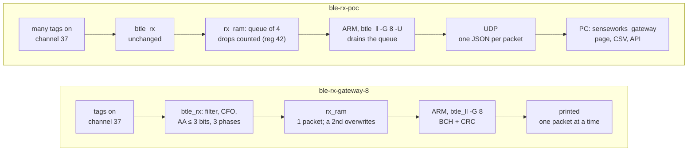
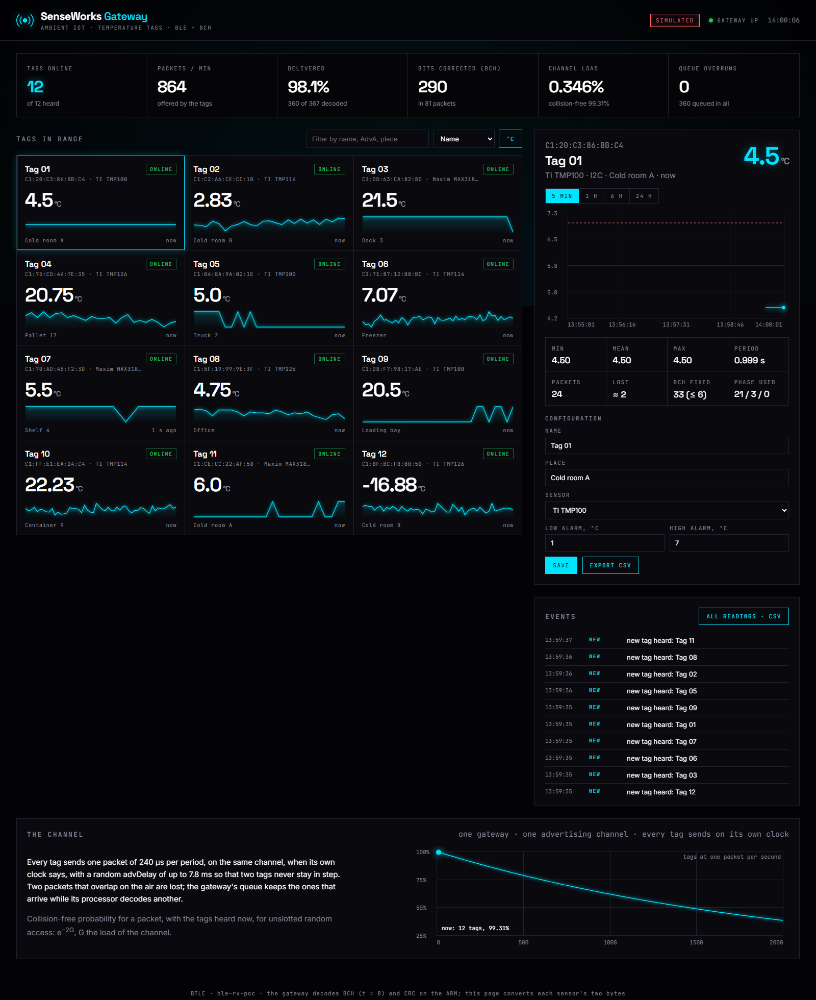
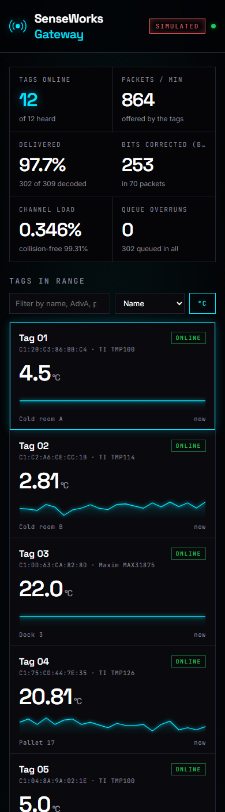

# The gateway of the proof of concept: `ble-rx-poc`

**Project:** BTLE — reconfigurable RISC-V baseband  
**Branch:** `ble-rx-poc`  
**Base:** `ble-rx-gateway-8` (`a49d50d6`); the plan is [`docs/PLANO_PoC.md`](../PLANO_PoC.md), phase 5, revised on 2026-11-07 (its § 0.1)  
**Date:** 2026-11-07  
**Author:** Miguel Simões  
**Status:** run `rx-poc-validation`. The queue in the RTL, the firmware's UDP to the PC, the PC's application, their tests, the path end to end from the two tags' RTL to the degrees on the page, and the controller on the Zynq's FPGA out of context are done, every number below measured, with its evidence committed (§ 9). **Not done:** the board's bitstream (it needs Vivado 2022.2 and ADI's IP) and anything on a board (§ 7). The ARM's time per packet is not measured. **The range is not measured either**; § 7.1 estimates it from the SNR measured on the RTL (a sensitivity of about −99.6 dBm, assumptions stated there).

---

## Purpose

One gateway, many tags. Every temperature tag in range (`ble-tx-poc-tmp100`, `ble-tx-poc-gen`) sends its packet on the same advertising channel, when its own clock says, and the gateway hears all of them, decodes each one and hands it to a PC, where an application shows every tag live. The gateway also powers the tags through an air-core transformer; that part is not this branch's.

It is `ble-rx-gateway-8`'s receiver, unchanged (the BCH t = 8 decoded on the ARM, three kept phases, the Access Address with up to 3 wrong bits), with three additions:

| | What | Why |
|---|---|---|
| RTL | `rx_ram` keeps a **queue** of `RX_QUEUE` packets (4) and counts those it drops | the ARM decodes one packet while others arrive; upstream kept one, and a second overwrote it |
| Firmware | `btle_ll -G 8 -U host:port` drains the queue at each interrupt and sends each packet accepted by **UDP**, one JSON datagram | the PC needs no raw Ethernet, no `ble_fpga_ctl`, no Wireshark |
| PC | `host/senseworks_gateway`, the **application** | a network of tags, not one packet at a time |



**The tags and the gateway need no change for more tags.** A packet carries its tag's AdvA, so the gateway tells them apart; the sensor a tag has is not in the packet, and the application maps each AdvA to its sensor (§ 4).

## 1. Many tags on one channel

Each tag sends one packet of 240 µs (preamble, Access Address, 22 bytes of PDU, CRC: 30 bytes at 1 Mbit/s) per period, on channel 37, at a time no other tag knows. Two packets that overlap are, at worst, both lost. For tags that send at random times, the chance that a packet meets no other is e^(−2G), G the channel's load, the packets per second times 240 µs (unslotted random access, pure ALOHA):

| Tags, one packet per second each | 10 | 100 | 500 | 1 000 | 2 000 |
|---|---:|---:|---:|---:|---:|
| Load G | 0.24 % | 2.4 % | 12 % | 24 % | 48 % |
| Packets without a collision | 99.5 % | 95.3 % | 78.7 % | 61.9 % | 38.3 % |

At a slower rate the load falls with it: 1 000 tags every 8 s are a load of 3 %. This is the pessimistic case. The queue test (§ 5) shows the receiver keeping a packet 12 dB stronger than the one on top of it when it starts first, and tags near the gateway's coil are stronger than those far from it.

**advDelay keeps tags apart, if their AdvAs let it.** Each tag shortens each period by 0 to 7.8 ms from an 8-bit LFSR stepped once per event, XORed with AdvA's first byte (`ble-tx-poc-tmp100`'s § 1). Tags that the gateway's field wakes at the same instant start with the same LFSR state. If their first bytes differ, their delays differ and they drift apart. **If their first bytes are equal, they keep the same delays**, and only the difference between their clocks separates them. So tags deployed together should differ in AdvA's first byte, the one sent first. This is reasoned from the RTL, not simulated with two tags woken together.

**The queue covers the time the ARM takes.** At each interrupt the firmware reads the packet, decodes the BCH and the CRC, and sends it. A packet that arrives meanwhile waits in the next slot. With 4 slots, 4 packets can arrive within one packet's processing. A fifth is dropped and counted (register 42), so a loss on the gateway's side is never silent. The ARM's time per packet is not measured (§ 7); the counters will show it on the board.

## 2. The RTL: `rx_ram`'s queue

`verilog/btle_ll.v` and `verilog/btle_controller.v`, parameter `RX_QUEUE` (2, 4 or 8, default 4). The receiver (`btle_rx` and below) is not touched.

- **The RAM is split.** The 512 words of `rx_ram` (2 KB) become `RX_QUEUE` slots. At decode end, the packet (the gateway's 3 kept phases, 75 bytes) is copied into the next free slot. If none is free, it is not copied and the overrun counter counts it.
- **The ARM reads the oldest.** Register 40 gives the oldest slot's words, as before. Writing register 40 releases that slot and points to the next one.
- **Register 49 describes the oldest packet**, not the last one decoded: its CRC flag and its length, kept per slot.
- **A slot must hold the largest packet a configuration copies:** the gateway's kept phases, 4 × 64 bytes at most, or one ordinary packet of 260 bytes. Eight slots of 256 bytes with the gateway off cannot hold it, and that configuration fails at elaboration. It is checked for t = 8 and t = 0 with 2, 4 and 8 slots: only that one fails.

| Register | Before (`ble-rx-gateway-8`) | `ble-rx-poc` |
|---|---|---|
| 42 | no driver | the packets dropped, the queue full (32 bits) |
| 43 | no driver | the packets queued since reset (32 bits) |
| 49 | [19] hit, [18] decode running, [17] decode end, [16] CRC OK, [15:8] payload length, [7:0] PDU octet | the same, with [16] and [15:8] the **oldest** packet's, and **[31:28] the packets waiting** |
| 40 | read: the next word; write: back to the start | read: the oldest packet's next word; write: **release it**, to the next packet's start |

With one packet waiting, the ARM reads it as upstream did: registers 40 and 49 as before, then one write to 40. `tests/test_gateway_controller.py` is unchanged and passes, with its testbench (`tests/gateway_controller_tb.v`) now draining the queue as the firmware does.

## 3. The firmware

`firmware/btle_ll.c`, with `-G 8` (the gateway's BCH, `firmware/gw_bch.h`, from `ble-rx-gateway-8`) and, new, `-U host:port`:

- **At each interrupt, while [31:28] of register 49 is not 0:** read the oldest packet, decode it, release it. One interrupt can bring several packets.
- **Each packet accepted, one UDP datagram** (`firmware/gw_udp.h`):
  `{"type":"tag","ts":…,"adv":"c10203040506","sensor":"1900","fix":2,"rank":0,"crc":0,"t":8}`.
  - `adv`: AdvA, most significant byte first.
  - `sensor`: the two bytes as the sensor sent them.
  - `fix`: the bits the BCH corrected.
  - `rank`: the kept phase that passed.
  - `crc`: the received CRC's distance in bits.
- **Every second, the counters:**
  `{"type":"stats","packets":…,"accepted":…,"overruns":…,"queued":…,"crc_ok":…,"t":8}`, with `overruns` and `queued` from registers 42 and 43.

The datagrams are plain text, with no authentication. The gateway and the PC belong on their own network, or a cable.

## 4. The application on the PC

`host/senseworks_gateway`, Python 3 with the standard library only (tested with 3.11 on Linux and 3.13 on Windows), so it runs on the PC as it is. It listens for the gateway's datagrams and serves a page:

```bash
cd host
python -m senseworks_gateway --config tags.json --data readings     # UDP 0.0.0.0:5600, page http://127.0.0.1:8080
python -m senseworks_gateway --simulate 12                          # no boards: 12 simulated tags, the page says SIMULATED
```

|  |  |
|---|---|
| Twelve simulated tags, the four sensors (`--simulate 12`): every reading is converted as a gateway's would be, but the tags are not real | the same page at 390 px |

**What it shows:**
- **Every tag in range,** with its last reading, a sparkline, and its status: online, late (3 periods silent), offline (10), alarm, no sensor (`0xFFFF`), invalid (low bits that no reading has).
- **For the tag chosen:** its curve over 5 min to 24 h (each bucket's minimum and maximum kept), its minimum, mean and maximum, its period (the median of its gaps), its lost packets (counted exactly from a test-mode counter, otherwise estimated from the period), the bits the BCH corrected, and the phases used.
- **Its configuration:** name, place, sensor, alarm limits. It is kept in `tags.json`, which the page edits.
- **The gateway's counters, the events, and the channel:** its load and the e^(−2G) curve, with the network on it.

The visual identity is senseworks.ai's: its palette (#030305 to #0a0a0e, cyan #00e5ff, square corners) and its three typefaces. The typefaces are served from the application itself, with their SIL Open Font Licenses (`static/fonts/`), so the page needs no internet access.

**The sensor is a configuration, not in the packet.** What the two bytes mean, from each datasheet:

| Sensor | °C per unit | Bits always 0 | Steps of the tag's profile |
|---|---|---|---|
| TMP100 | 1/256 | the low 7 | 0.5 °C (9 bits) |
| TMP114 | 1/128 | none | 0.0078 °C |
| MAX31875 | 1/256 | the low 7 | 0.5 °C (9 bits) |
| TMP126 | 1/128 | the low 2 | 0.03125 °C |

`0xFFFF` is no sensor, the bus's pull-ups. A TMP114 at exactly −0.0078 °C reads the same and is lost (`TX_POC_GEN.md` § 3). A tag that is not in the configuration shows its raw bytes. `counter` is the test mode.

**What else it does:**
- `--data DIR` writes every reading to a CSV per day, and the page exports one too.
- `--record FILE` keeps every datagram, and `--replay FILE` plays them back.
- `--http 0.0.0.0:8080` serves the page to other machines. By default it is served to this PC only.

**API:**
- `GET /api/state`: every tag, the gateway, the channel, the events.
- `GET /api/tags/<adv>/series?window=s`: one tag's readings.
- `POST /api/tags/<adv>`: one tag's configuration.
- `GET /api/export.csv`: the readings.
- `GET /api/stream`: server-sent events.

## 5. Validation

Run `rx-poc-validation`, `scripts/senseworks/run_gateway_validation.sh` (`results/validation/rx-poc-validation/`), at commit `46dcc779`. The gateway's own checks, unchanged, then this branch's:

| Check | What it shows | Result |
|---|---|---|
| `tag_bch.py --self-test`, `test_gateway_software.py` | the code; `gw_bch.h` against `tag_bch.py`, 5 000 packets | PASS |
| `test_gateway_rx.py --mutants` | the receiver's every stored bit of every kept phase against `gw_model.py` | PASS |
| `test_gateway_base.py` | with the gateway's parameters off, `ble-rx-2p1c` on every clock | PASS |
| `test_gateway_controller.py` | through the registers, as the firmware reads them | PASS |
| `test_gateway_campaign.py` | the campaigns' reader refuses what it must | PASS |
| **`test_gateway_queue.py`**: tags' packets into the controller's RF port, the ARM answering late | a burst of 4, the ARM answering only after all have arrived | **4/4, in order, 0 overruns** |
| | a burst of 7 | **the first 4 delivered in order; 3 overruns counted, 4 queued** |
| | 8 packets far apart | **8/8** |
| | 10 pairs on top of each other, offsets 0 to 200 µs, equal and 12 dB apart | **6 of 20 accepted, none wrong; the 12 dB stronger, starting ≥ 50 µs first: 3/3** |
| **`test_gateway_udp.py`**: `gw_bch.h` and `gw_udp.h` in C, by UDP on this machine, to the application | 1 440 packets of 24 tags (the four sensors), 0 to 12 bits wrong in the code word, missing sensors | **every datagram as `tag_bch.py`; accepted with 0 to 8 wrong 1 167/1 167, with 9 or 12 0/273; every reading the temperature sent** |
| **`test_gateway_app.py`** | the conversions against the datasheets' examples; status, alarms, period, losses counted and estimated, the load; configuration kept and refused when wrong; CSV; replay; records that are not the gateway's counted and ignored; the web API, the fonts, the stream, paths outside the page refused | PASS |
| **`test_rx_poc_e2e.py`**: end to end | the 258 PDUs that the two tags' RTL sent in their validations (`ble-tx-poc-tmp100` 95, `ble-tx-poc-gen` 163), with 0 to 8 bits wrong after the CRC (1 047 in all), on the air at 25 dB, through the controller's RTL, `gw_bch.h`, UDP, to the application | **258/258 accepted, each the PDU sent; every reading on the page the datasheet's formula, computed apart: TMP100 148, TMP114 18, MAX31875 19, TMP126 21; the test mode's counter, nothing lost** |
| `firmware/btle_ll.c` | compiles (syntax only, no ARM build) | PASS |
| `run_lint.py` (Verilator 5.020) | | **352/352** |

The tags' PDUs are in `tests/rx_poc_tx_packets.json`, with the commit of each branch they came from. The end-to-end test checks first that each is the code's own packet for its AdvA and sensor bytes. Its scenarios include a missing sensor, a sensor that stops answering, buses held, the eFuse AdvA, and other first bytes.

**The page:** checked in a headless Chrome at 1 600 px and inside a 390 px frame (the figures above). Nothing is cut and the page never scrolls sideways.

## 6. What it costs

Run `xc7z020-rxpoc`, commit `46dcc779`: Vivado 2026.1, `scripts/fpga/xc7z020/impl.tcl` mode `ooc_hd`, then `post.tcl` (`results/fpga/xc7z020-rxpoc/`). `ble-rx-gateway-8` was implemented again on the same day and gives `xc7z020-gw`'s numbers exactly. `synth_warning_gate.py --vivado`: PASS on both.

| xc7z020, routed | `ble-rx-gateway-8` | **`ble-rx-poc`** | Difference |
|---|---:|---:|---:|
| `btle_controller`: LUTs (of 53 200) | 3 195 (6.01 %) | **3 223 (6.06 %)** | +28 (+0.9 %) |
| `btle_controller`: flip-flops | 4 150 | **4 221** | +71 |
| `btle_controller`: LUTs as memory | 302 | 310 | +8 |
| `btle_controller`: RAMB36, RAMB18 | 32, 1 | 32, 1 | 0 |
| of which `rx_ram`: LUTs, flip-flops | 148, 130 | **172, 201** | +24, +71 |
| of which `btle_rx`: LUTs, flip-flops | 1 803, 1 507 | 1 803, 1 507 | 0 |
| WNS `axi_clk` (100 MHz), `bb_clk` (16 MHz) | +2.016, +40.684 ns | +2.013, +40.689 ns | |
| Power, vectorless (an estimate) | 0.190 W | 0.191 W | |

The 71 flip-flops are the two 32-bit counters (64), the write and read slots (2 + 2), and the count (3). The 8 LUTs as memory are the 4 slots' CRC flag and length. **The queue costs 28 LUTs and no RAM:** it splits the RAM that was there.

**ASIC: nothing changes.** The queue is in the Link Layer, beside the ARM, on the FPGA. The receiver that a gateway chip would carry is `btle_rx`, identical in both columns. Its area, timing and GF180 layout are those of `ble-rx-gateway-8` in `RX_GATEWAY_COMPARISON.md`.

## 7. On the board: what remains

These steps are not done. They need the two boards, Vivado 2022.2 and ADI's IP (the plan's phase 0).

1. **Build the receiver's bitstream** from this branch, as upstream builds `btle_controller` (`fpga/README.md`), with `RX_BCH_T = 8`.
2. **Run the firmware on the receiver's ARM:** `btle_ll -G 8 -U <the PC's address>:5600`. The PC and the board need a network between them (an Ethernet cable).
3. **On the PC:** run `python -m senseworks_gateway --config tags.json --data readings` and open http://127.0.0.1:8080. Allow UDP 5600 through the firewall.
4. **Bring up the tag boards.** For each one, set its AdvA's first byte (§ 1) and its sensor in `tags.json`.
5. **Measure:**
   - the ARM's time per packet (`decode_end_to_host_read_counter`, register 41), against the queue's 4 slots;
   - the PER with and without the BCH, in test mode, against attenuation (the plan's phase 6);
   - two tags woken together.

### 7.1 The range: an estimate, not a measurement

**Nothing below was measured.** No range has been measured on any branch, and no SNR of this project is a sensitivity in dBm. This subsection turns the SNR measured on the RTL into a sensitivity and a distance, under assumptions stated here, so that the board's measurements (step 5) have a number to be compared with. It applies to `ble-tx-poc-tmp100` or `ble-tx-poc-gen` into `ble-rx-poc` and to `ble-tx-tag-8` into `ble-rx-gateway-8` alike: the receiver is the same (§ 2), and so is the packet (a PDU of 22 bytes, 240 µs on the air, BCH t = 8). Only the second pair has a measured curve of packet loss (`RX_GATEWAY_COMPARISON.md` § 5); this branch's end-to-end test runs at 25 dB, far above it.

**From the SNR to a sensitivity.** Upstream's SNR (`btlelib.add_noise`) is the signal's power (a constant envelope of peak 127, so its mean power too) against the noise in the whole band sampled, 8 MS/s for 1 Mbit/s. So E<sub>b</sub>/N<sub>0</sub> = SNR + 10 log<sub>10</sub>(8) = SNR + 9.03 dB, and the sensitivity is S = −174 dBm/Hz + 10 log<sub>10</sub>(1 MHz) + NF + E<sub>b</sub>/N<sub>0</sub> = −114 dBm + NF + E<sub>b</sub>/N<sub>0</sub>. **NF = 6 dB is an assumption**: the AD9361's noise figure, the board's losses before it, and a margin for what the channel model leaves out. A packet counts as received at a PER of 10 %, as in `RX_GATEWAY_COMPARISON.md` (the BLE specification's sensitivity is at a BER of 0.1 %, a different point).

| PER 10 %, 0 / 20 / −30 / 50 ppm | SNR measured (dB) | E<sub>b</sub>/N<sub>0</sub> (dB) | Sensitivity, NF = 6 dB (dBm) |
|---|---|---|---|
| **this gateway** (`ble-rx-gateway-8`'s receiver, 3 phases, BCH t = 8) | −0.66 / −0.54 / −0.34 / 2.26 | 8.4 / 8.5 / 8.7 / 11.3 | **−99.6 / −99.5 / −99.3 / −96.7** |
| `ble-rx-2p1c` (CRC + 1 bit, no BCH), the same packets | 8.26 / 10.22 / 12.16 / 22.38 | 17.3 / 19.3 / 21.2 / 31.4 | −90.7 / −88.7 / −86.8 / −76.6 |

**From a sensitivity to a distance.** Antennas of 0 dBi, channel 37 (2.402 GHz), a margin of 10 dB for fading, and a log-distance path loss, PL(d) = 40.06 dB + 10 n log<sub>10</sub>(d / 1 m): n = 2 is free space, n = 3 a room, n = 3.5 a building with walls. At 0 ppm:

| The tag's power | Free space (n = 2) | Indoor (n = 3) | Indoor, obstacles (n = 3.5) |
|---|---:|---:|---:|
| +5 dBm (the PoC's tag board, an AD9361) | ~535 m | ~66 m | ~36 m |
| 0 dBm | ~300 m | ~45 m | ~26 m |
| −10 dBm (a low-power ASIC tag) | ~95 m | ~21 m | ~14 m |
| *`ble-rx-2p1c`, no BCH, 0 dBm (for comparison)* | *~110 m* | *~23 m* | *~15 m* |

At 50 ppm the gateway loses 2.9 dB: the distances become about 29 % shorter in free space and about 20 % shorter at n = 3. **The 9 dB that the BCH and the three phases give almost double the range indoors** (×1.98 at n = 3, ×2.8 in free space) at the same power.

**What the estimate leaves out:**

- **multipath, interference** (Wi-Fi on the same band), **a real oscillator's phase noise and the AD9361's real AGC**; § 2 of `RX_GATEWAY_COMPARISON.md` asks the AGC to keep the signal within 1/8 of the scale;
- **the final tag's power supply.** The final tags are powered by the gateway's field through the air-core transformer (§ 8). That is likely to limit the distance long before the radio does, to centimetres or about a metre, depending on the coils. The PoC's tags are boards with their own supply, so the PoC does not show this limit.

**How it will be checked:** the plan's phase 6, the PER with and without the BCH in test mode (the counter: every loss counted), through an SMA cable and attenuators. The attenuation at which the PER crosses 10 % gives the sensitivity in dBm and so the real NF of this chain; the distance follows from it.

## 8. What the branch does not do

- **Anything on a board.**
- **A gateway that hears more than one channel.** The tags send on one.
- **Telling two tags with the same AdvA apart.**
- **Authenticating a tag or a datagram.**
- **Powering the tags.** That is the air-core transformer's part, outside this branch.

## 9. Reproducing

From WSL, at the root of the branch:

```bash
export TMPDIR=/dev/shm/rxpoc; mkdir -p $TMPDIR
scripts/senseworks/run_gateway_validation.sh rx-poc-validation        # every check of § 5
python3 tests/test_rx_poc_e2e.py --jobs 6                             # the end-to-end test alone, ~30 s
cd host && python3 -m senseworks_gateway --simulate 12                # the application, without boards
```

From Windows, the FPGA: with this branch's `verilog/` in `<root>/<name>/verilog` and `scripts/fpga/xc7z020/clocks.xdc` in `<root>`, `vivado -mode batch -source scripts/fpga/xc7z020/impl.tcl -tclargs <root>/<name> ooc_hd`, then `vivado -mode batch -source scripts/fpga/xc7z020/post.tcl -tclargs <root> <name>` (`results/fpga/xc7z020-rxpoc/provenance.txt`).
