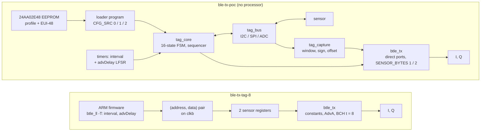
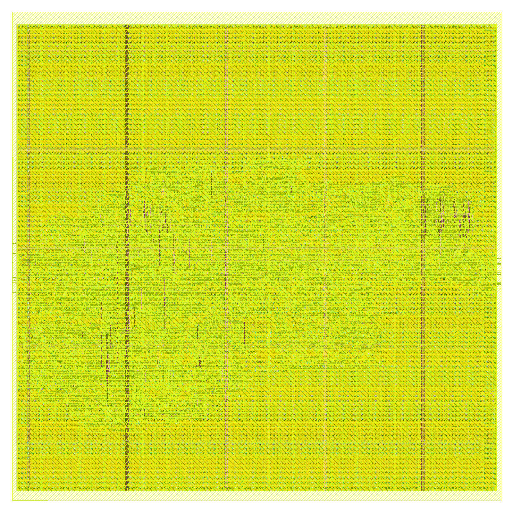
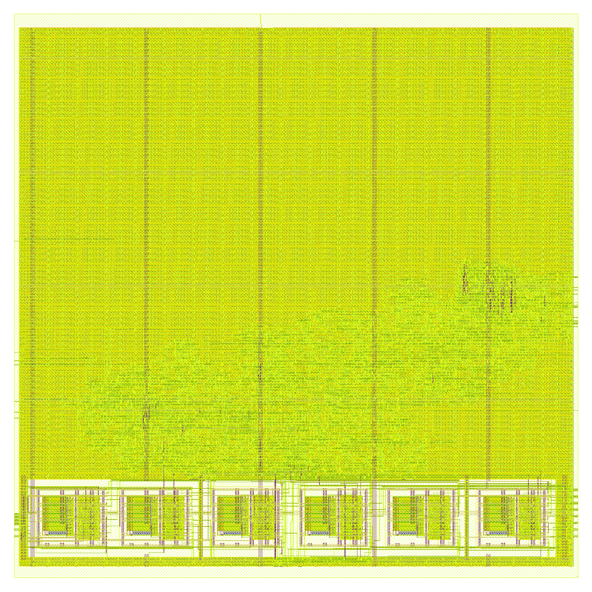

# The tag of the proof of concept: `ble-tx-poc`

**Project:** BTLE — reconfigurable RISC-V baseband  
**Branch:** `ble-tx-poc`  
**Base:** `ble-tx-tag-8` (`86a194a6`); the plan is [`docs/PLANO_PoC.md`](../PLANO_PoC.md)  
**Date:** 2026-11-06  
**Author:** Miguel Simões  
**Status:** run `tx-poc`. Phases 1, 2 and 3 of the plan are done, and every number below is measured, with its evidence committed
(§ 12). Phase 4 is prepared: the RTL in the controller, the board's files, the firmware and the controller placed and routed on the
Zynq's FPGA out of context. **Not done:** the board's bitstream (it needs Vivado 2022.2 and ADI's IP, which this machine does
not have) and any test on a board (§ 9). Not a tape-out. The layouts are blocks, not chips: no pads, ESD, seal ring, clock source (`clk` and `clkb` are input pins), power-on reset or radio (`docs/Final Decisions/CONTROLLERS_MIN.md` § 9.2; its § 9.1: which layouts could be fabricated, by process).

---

## Purpose

The proof of concept shows the thesis's tag working end to end, on real hardware: a state machine with no processor reads a
sensor over I2C and sends its value in a standard Bluetooth LE advertising packet with BCH parity. This document says what
`ble-tx-poc` contains, how it was checked, what it costs, and what remains to be done on the boards. The receiving side is
`ble-rx-poc` (phase 5), a separate branch.

| Plan | State | Where |
|---|---|---|
| Phase 0: boards and tools | not started: the boards are still to be chosen (plan § 7) | § 9 |
| Phase 1: `SENSOR_BYTES` in `btle_tx` | **done** | §§ 1, 5 |
| Phase 2: `tag_core` in simulation | **done** | §§ 2, 3, 4, 5 |
| Phase 3: area and consumption in the ASIC flows | **done**: area and leakage at 45 nm, both layouts in GF180 | § 6 |
| Phase 4: on the TX board | **prepared, not run**: RTL, `antsdr`'s files, firmware, out-of-context implementation | §§ 7, 8, 9 |
| Phases 5, 6 | not this branch; phase 6 needs the boards | |

## 1. What the branch contains



| Part | Files | |
|---|---|---|
| `btle_tx` with `SENSOR_BYTES` (1 or 2) and direct ports for AdvA, TxAdd and the sensor, on the `clk` domain. No `clkb`, no read request, no read register | `verilog/btle_tx.v` | every output on every clock equal to `ble-tx-tag-8`'s (2 bytes) and `ble-tx-tag-1byte`'s (1 byte) |
| `tag_core`: the state machine, timers, profile, sequencer | `verilog/tag_core.v` | § 2 |
| The bit layer: I2C, SPI, an ADC by parameter | `verilog/tag_bus.v` | |
| The capture: window, sign, offset, saturation | `verilog/tag_capture.v` | |
| `tag_chip`: `tag_core` with a chip's pins, the top of the ASIC flows | `verilog/tag_chip.v` | |
| The controller: `tag_core` in `btle_phy`, the sensor bus as ports, its state on registers 42–46 | `verilog/btle_phy.v`, `btle_controller.v`, `btle_ll.v`, `btle_controller.tcl` | [`LL_REGISTER_MAP.md`](../Architecture/LL_REGISTER_MAP.md) |
| The profile: its format, generator, reader, the TMP100's profiles | `scripts/senseworks/tag_profile.py` | § 3 |
| The reference of the packet for one or two bytes, and TxAdd | `scripts/senseworks/tag_bch.py` | |
| The tests and the models of the TMP100, the 24AA02E48, a SPI sensor and the I2C limits of both datasheets | `tests/test_tag_core.py`, `tests/tag_core_tb.v`, `tests/*_model.v`, `tests/i2c_timing_monitor.v`, `tests/test_tag_controller.py`, `tests/test_poc_board_files.py` | § 5 |
| The ASIC flow | `scripts/layout/tag_chip_gf180/`, `STA_SET=poc` in `scripts/timing/run_sta.sh` | § 6 |
| The board | `fpga/antsdr/src/`, `firmware/btle_ll.c` (`-T`), `fpga/helpers/all_gen_and_scp.sh` | §§ 8, 9 |

## 2. `tag_core`

```
              bus_en 64 kHz, tick 32 kHz (BUS_DIV = 250 on 16 MHz; both 1 at BUS_DIV = 1)
                 |
 SCL, SDA  <--> tag_bus  <-- state machine --> timers: interval (32 ticks per unit) + advDelay (LFSR)
 CS_n, MISO      |             |      |
 ADC (ADC_EN)    v             v      +------> btle_tx --> I, Q to the radio
             tag_capture   profile: flip-flops (CFG_SRC 0, 2) or constants (CFG_SRC 1)
```

An event: sleep until the interval has passed, wait advDelay, run the measure program, make the byte, send the packet, sleep.
`T_advEvent` is exactly `32 × interval + 1 + advDelay` ticks, start to start (§ 5), so that two tags in step drift apart, as the Core
wants (Core 6.1, Vol 6 Part B 4.4.2.2). A measurement longer than the interval makes the events follow each other at once; none is lost.

The state machine has 16 states in 4 phases: the loader's program reading the profile, reading the EUI-48, the profile's boot program, its
measure program. The loader is a program too, 12 bytes of constants run by the same sequencer, so reading the EEPROM adds almost no
logic of its own. Where the configuration comes from is a parameter:

| `CFG_SRC` | The profile | AdvA |
|---|---|---|
| **0, EEPROM** (the proof of concept) | Read from address 0x00 of the 24AA02E48 into flip-flops at boot; version, size and CRC-8 checked; `DEFAULT_PROFILE` if they fail | The EUI-48 at 0xFA–0xFF, TxAdd from the profile; `ADV_ADDRESS` and `TX_ADD` if it cannot be read |
| **1, OTP** | `DEFAULT_PROFILE`: constants, no flip-flops | `ADV_ADDRESS`, or six eFuse blocks with `ADV_ADDRESS_OTP = 1` |
| **2, MTP** | As 0, from a byte-wide read port (`mtp_*`); no macro in the open PDK, so checked on a behavioural model only | As 1 |

## 3. The profile

32 bytes with one byte of sensor (`scripts/senseworks/tag_profile.py` documents them, builds them and reads them back):

| Bytes | Content |
|---|---|
| 0, 1 | version (1), size (32) |
| 2, 3 | the interval, units of 32 ticks (1 ms at 32 kHz), so up to 65.5 s |
| 4 | [5:0] channel, [6] TxAdd, [7] test mode |
| 5 | [4:0] where the measure program starts, [5] SPI, [6] SPI's clock idle high (mode 3), [7] ADC |
| 6–9 | the capture: [7] signed and [5:0] bits to skip; [4:0] bits to take; the offset, 16 bits |
| 10–30 | the programs, 21 bytes: `XFER` (`1wwwrrrh`: START, the bytes written, the bytes read, STOP unless h), `WAIT` (`0kkkkkkk`: at least k units), `END` (0) |
| 31 | CRC-8 (x⁸ + x² + x + 1, from 0xFF; 0 over the whole image) |

The default, in `tag_core.v`'s `DEFAULT_PROFILE` (a test checks that it is the generator's), is the plan's § 3.2:

```
$ python3 scripts/senseworks/tag_profile.py --sensor tmp100-9 --output profile.bin
interval 1000 units, channel 37, TxAdd 0, test mode 0
measure program at 6, I2C
capture 0: skip 0, take 9, signed, offset 80
   0: XFER write 90 01 01 read 0       pointer 1, configuration: shutdown, 9 bits
   4: WAIT 77                          a conversion in progress at power-up
   5: END
   6: XFER write 90 01 81 read 0       one-shot
  10: WAIT 77                          the slowest conversion
  11: XFER write 90 00 read 0 hold     pointer 0
  14: XFER write 91 read 2             the register
  16: END
```

N = sat(raw[15:7] + 80) in 0..254, 0xFF when the sensor does not answer; the gateway computes T = −40 + N/2. Changing the step, the interval or
the channel is regraving this image, with the same bitstream: `tmp100-10` is 0.25 °C (config 0xA1, the wait of 150 ms, `raw[15:6]`), `tmp100-12`
0.0625 °C. Other sensors are other images: the tests run one SPI sensor in mode 0 with a skipped first bit, one in mode 3 with a command byte, and an
ADC.

The checks the plan asked for against the official datasheets (TMP100: SBOS231I; 24AA02E48: DS22124D, from a distributor's copy, as Microchip's site
refuses automated downloads):

| The plan says | The datasheet | |
|---|---|---|
| 75 ms at 9 bits (40 typical) | 40 / 75 ms; 80 / 150, 160 / 300, 320 / 600 at 10, 11, 12 bits (§ 6.5, table 10) | confirmed |
| The OS bit read gives the comparator, not the end of a conversion | "Reading the OS/ALERT bit provides information about the Comparator Mode status" (§ 7.5.3.6) | confirmed |
| Pointer, config 0x01, 0x81, 0xA1; `raw[15:7]` is 2·T, signed; address 0x48 | tables 2, 5, 6, 7, 8, 10 | confirmed |
| — | **Writing OS only starts a conversion in shutdown, and the device starts in continuous conversion and shuts down at the end of the current one** (§ 7.5.3.1, 7.5.3.6). So the boot program waits too (the plan's table did not), or the first one-shot could be ignored | added |
| 2.7–5.5 V, 16 kHz is allowed | no minimum SCL printed, no bus timeout stated, no clock stretching stated (§ 6.6) | confirmed |
| EUI-48 at 0xFA–0xFF, OUI first, upper half protected, address 1010xxx | §§ 5.0, 6.3, 9.0; "inhibited" writes to the upper half; three chip-select bits don't care | confirmed |

## 4. What this work decided, or changed from the plan

1. **A bus phase is 64 kHz, not the tick.** A bit is four phases, because SDA must change away from both edges of SCL: at 2 ticks per bit it would
   change with the falling edge, against tHD;DAT. `BUS_DIV = 250` gives bus_en at 64 kHz and tick at 32 kHz from 16 MHz, so **SCL is the plan's 16 kHz on the
   FPGA** (measured: 62.5 µs). With the ASIC's 32.768 kHz as the clock (`BUS_DIV = 1`), SCL is 8.2 kHz: the scenario `asic_clock` runs it.
2. **`WAIT 77`, not 75.** k units last between k and k + 1, and 77 units are ≥ 75 ms at 32 kHz and at 32.768 kHz (`tag_profile.wait_ms`).
3. **The bus clear is a STOP, nine clocks and a STOP.** Found by the test of a reset in the middle of an event: a reset after a write's byte, before its STOP,
   left the TMP100 taking in bytes; nine clocks alone were a byte of 1s, written to its configuration. The first STOP, a START and a STOP with SCL
   high, ends the frame. It also runs after any failure.
4. **A failed event still sends.** A missing acknowledge, or a stalled bus for ~128 ms, gives 0xFF, and the next event tries again. So the tag recovers from a
   sensor that comes back (`sensor_nack`), a stuck line (`scl_stuck`, `sda_stuck`) and even from a bus dead at boot (`scl_stuck_at_boot`).
5. **The state's clock crossing is its own.** Added to the Link Layer's bus, 160 bits more turned that bus from distributed RAM into 9 RAMB36 in
   Vivado, where reading the address being written by the other clock is a collision. In a `clk_cross_bus` of its own, the block RAMs are back to 32 + 1 (§ 6).
6. **The packet and event counters are in the controller, not in `tag_core`**, so that they are not in the ASIC's area. So is the status mux.
7. **One clock, with enables.** The plan's tick is a clock enable. In the ASIC, `clk` would be 32.768 kHz between packets and 16 MHz during them; **that clock
   switch is not designed**: `tag_chip` has one `clk` port, and the flows time it at 16 MHz.
8. **`SENSOR_BYTES = 2`:** a window per byte over the same bits read, in the order read, so one read can give both (`two_sensor_bytes`). With it the default
   profile's second byte reads 0.
9. **SPI: modes 0 and 3, on the same pins.** SCLK on SCL, MOSI on SDA (open-drain), plus CS_n and MISO. SDA never changes with SCL high, so the EEPROM on those wires sees no
   START: checked. Modes 1 and 2 are not supported, no sensor considered needs them.
10. **The test mode does not run the program**: no bus traffic after boot, so it works with no sensor, and at shorter intervals.
11. **advDelay is 0–255 ticks**, 0–8 ms at 32 kHz, within the Core's 0–10 ms. The LFSR has all 256 states (`lfsr[6:0] == 0` joins the sequence), so no seed sticks at 0.

## 5. Validation

Run `tx-poc`: `scripts/senseworks/run_tag_validation.sh tx-poc-validation` (`results/validation/tx-poc-validation/`, `1200c117`). Every check passes.

| Check | What it shows | Result |
|---|---|---|
| `tag_bch.py --self-test`, `check_bch_galois.py` (galois 0.4.11) | the code for t = 8, 12, 18 and n for one and two bytes: generators, parity, both decoders | **equal**; every word within t corrected, none beyond t taken |
| `tests/test_tx_tag.py --mutants`: `btle_tx` against `ble-tx-tag-8` (`SENSOR_BYTES = 2`) and `ble-tx-tag-1byte` (1), **every output on every clock**, on their own pair among random writes; random channel, access address, CRC, preamble, extra `tx_start`, resets; `clkb` of the reference free at six rates; the port and the OTP; two AdvA, TxAdd and Company IDs | direct ports change no output: the phase 1 of the plan | **432/432 runs, no difference; 23/23 mutants caught** |
| `tests/test_tx_tag_packet.py`: upstream's TX testbench, t = 8, 12, 18, both sizes, five channels, five values, TxAdd 0 and 1, both Gaussian filters | I/Q against upstream's Python model; loopback; a codeword; t errors corrected | **300 waveforms, every sample equal** |
| `check_tag_scapy.py` (scapy 2.8.0) on those | an independent parser: CRC, type, TxAdd, AdvA, the AD structure | **300/300** |
| `tests/test_tag_core.py --mutants`: the plan's phase 2, from the sensor's model to upstream's receiver (below) | | **69/69 scenarios; 65/65 (phase, state) and (command, bus phase) reached; 63/63 mutants caught** |
| `check_tag_scapy.py` on the packets `tag_core` sent | the same parser, the EUI-48 as AdvA, TxAdd 0, the temperature's byte | **138/138** |
| `tests/test_tag_controller.py`: in `btle_controller`, the boards' path, **with no write that matters**: what sent a packet on the earlier branches now changes nothing; t = 8, 12, 18, and two bytes | PHY bits and Gaussian output against the model; I/Q; loopback; the samples to the RF transceiver; registers 42–46 | **12/12 packets** |
| `tests/test_poc_board_files.py` | `antsdr`'s files against the RTL, what needs no Vivado (§ 9) | **pass** |
| `run_lint.py` (Verilator 5.020, `--Wall`, warnings fatal): the controller over `BCH_T`, `SENSOR_BYTES`, `CFG_SRC`, `ADC_EN`; `tag_core` with the MTP and `BUS_DIV = 1`; `tag_chip` | | **50/50**, the same 13 reviewed exceptions |

The scenarios of `test_tag_core.py`. For every packet: the sensor byte from what the sensor's model answered, through the profile (in `nominal`, also from the temperature, and back);
the PHY bits against upstream's model for that PDU; **upstream's Python receiver decodes the I/Q with the CRC right; the PDU is a codeword, and t random errors are
corrected back to it**; `T_advEvent` exact in ticks against a model of the LFSR. For every run: no temperature read during a conversion, no one-shot outside shutdown, no write to the
EEPROM, the bus idle while sleeping, each `WAIT` between k and k + 1 units. The I2C monitor holds the bus to the stricter of both datasheets (tLOW, tHIGH, tSU;DAT, tHD;DAT, tSU;STA, tHD;STA, tSU;STO, tBUF).

| Scenarios | What they do |
|---|---|
| `nominal`, `real_time`, `conversion_typical` | the sweep −55 to +125 °C with both saturations, the sign and the truncation, at ten times the speed; 1 s in real time at 16 MHz: **SCL exactly 62.5 µs**; the typical conversion |
| `tmp100_10_bits`, `tmp100_12_bits`, `channel_38`, `channel_39`, `long_boot_program`, `program_full_no_end` | what regraving changes, with the same RTL |
| `sensor_nack`, `sensor_nack_at_boot`, `scl_stuck`, `sda_stuck`, `scl_stuck_at_boot`, `write_interrupted`, `eui_interrupted` | no answer; a line stuck; the pins released; half an EUI-48 not kept; recovery |
| `profile_bit_*` (5), `profile_version`, `profile_size`, `profile_blank`, `profile_zero`, `eeprom_absent` | a corrupted profile: the default one; no EEPROM: the compiled AdvA and TxAdd too |
| `test_mode`, `test_mode_wraps_all_delays`, `adv_delay_255_first`, `interval_0`, `interval_65535`, `interval_shorter_than_measure` | the counter, through 0xFF; **the 256 values of advDelay**; the limits of the interval |
| `reset_*` (23) | a reset in each state of each phase, in several places of a byte: the next packets right, the slave not stuck, its registers not written |
| `stretch_every_bit`, `stretch_long` | clock stretching on every bit and long on the acknowledges; the STARTs and STOPs counted |
| `spi_mode0_read_only`, `spi_mode3_command`, `adc`, `adc_unsigned_16_bits` | **other sensors, the same RTL**; the EEPROM on the same wires sees no START |
| `cfg_otp_rom`, `cfg_otp_efuse`, `cfg_mtp`, `cfg_mtp_corrupted`, `two_sensor_bytes`, `bch_12`, `bch_18`, `asic_clock` | the other parameters; the ASIC's clock |

The 24AA02E48's protected half is in its model but no scenario can exercise it: the tag never writes, which every run checks.

Models are models: the TMP100's and the EEPROM's are written from their datasheets, by the same hands as the RTL, and no part has been on a bus with this RTL (§ 9).

## 6. What it costs

Run `tx-poc`, `results/senseworks/tx_poc_summary.md` (generated by `scripts/senseworks/poc_summary.py`). 45 nm: `scripts/area/run_area.sh` (Yosys + ABC, Nangate45), `AdvA` a ROM in `CFG_SRC = 1`, as in earlier
branches; no ADC. Leakage: `scripts/power/logic_leakage.py`, the liberty's `cell_leakage_power`, 1.10 V typical.

| Nangate45 | cells | flip-flops | cell area (µm²) | leakage (µW) |
|---|---:|---:|---:|---:|
| `ble-tx-tag-8` `btle_tx` (two bytes, on the pair) | 1670 | 295 | 2 921.2 | 59.43 |
| `ble-tx-tag-1byte` `btle_tx` (one byte, on the pair) | 1653 | 287 | 2 874.7 | 58.61 |
| **`ble-tx-poc` `btle_tx`** (one byte, direct ports) | 1619 | 265 | 2 772.3 | 56.79 |
| `tag_bus`: the bus | 162 | 29 | 269.2 | 5.54 |
| `tag_capture`: one capture | 229 | 27 | 350.3 | 7.48 |
| **`tag_chip`, `CFG_SRC = 0`** (EEPROM: the profile and AdvA in flip-flops) | 3921 | 718 | 6 601.9 | 135.25 |
| **`tag_chip`, `CFG_SRC = 1`** (the profile compiled in; AdvA a ROM here) | 2278 | 393 | 3 772.7 | 77.69 |

- **`btle_tx` is smaller than `ble-tx-tag-1byte`'s by 102.4 µm² (−3.6 %)**: 22 flip-flops less (the request toggle, its synchronizers, the read register, the sensor's register, which is now `tag_core`'s). Its transmission has not changed: § 5.
- **The acquisition costs about 1 000 µm² in 45 nm (+36 %)** with the profile compiled in, of which 393 − 265 = 128 flip-flops: state machine and timers, bus, capture.
- **The copy of the profile and of AdvA costs 2.8 times the rest of the acquisition:** `CFG_SRC = 0` has 325 flip-flops more than `CFG_SRC = 1` (304 of profile and AdvA, the CRC, the flags), +2 829 µm², +57.6 µW of leakage. This is why the plan's § 8 wants the configuration in a non-volatile memory in the final tag: flip-flops leak all the time.

The blocks and the controller:

| Nangate45, cell area (µm²) | `btle_tx` | `tag_core` (with the divider) | `btle_phy` | `btle_ll` | `btle_controller` |
|---|---:|---:|---:|---:|---:|
| `ble-tx-poc`, `CFG_SRC = 0` | 2 772.3 | 6 698.4 | 6 712.2 | 16 693.4 | 21 468.1 |
| `ble-tx-poc`, `CFG_SRC = 1` | 2 772.3 | 3 856.5 | 3 878.5 | 16 693.4 | 18 619.5 |
| `ble-tx-tag-1byte` | 2 874.7 | — | 2 878.1 | 16 529.5 | 17 154.6 |

Timing, pre-layout, 45 nm (`STA_SET=poc`, the reference `ble-tx-tag-1byte` with its default `GAUSS_TABLE = 0` for its controller, so its multiplier sets that line):

| Nangate45, pre-layout | comb. path (ns) | min period (ns) | slack at 62.5 ns | Fmax (MHz) |
|---|---:|---:|---:|---:|
| `ble-tx-tag-1byte` `btle_controller` | 3.127 | 3.487 | +59.013 ns | 286.8 |
| `ble-tx-poc` `btle_controller` | 1.190 | 1.549 | +60.951 ns | 645.5 |
| `ble-tx-tag-1byte` `btle_tx` | 0.915 | 1.263 | +61.237 ns | 792.0 |
| **`ble-tx-poc` `btle_tx`** | 0.826 | 1.173 | +61.327 ns | 852.3 |
| **`tag_chip`, `CFG_SRC = 0`** | 0.912 | 1.259 | +61.241 ns | 794.4 |
| **`tag_chip`, `CFG_SRC = 1`** | 0.844 | 1.191 | +61.309 ns | 839.4 |

**Layout in GF180MCU-D**, LibreLane Classic, the settings of the tag's layouts, `clk` 62.5 ns, die 760 × 760 µm (`scripts/layout/tag_chip_gf180/run.sh`, `results/layout/tx-poc-*-gf180/`). The warnings: all reviewed, `synth_warning_gate.py --librelane`, `warning_gate.txt` in each folder.

| GF180MCU-D (µm²) | `ble-tx-tag-8`, `btle_tx` | `ble-tx-tag-1byte`, `btle_tx` | **`tag_chip`, `CFG_SRC = 0`** | **`tag_chip`, `CFG_SRC = 1`** |
|---|---:|---:|---:|---:|
| eFuse blocks (AdvA, OTP) | 48 452.1 | 48 452.1 | 0.0 | 48 452.1 |
| Logic: combinational, flip-flops, inverters, buffers | 48 691.7 | 48 114.4 | 104 296.1 | 60 282.4 |
| Timing-repair buffers + clock trees | 16 209.4 | 14 492.7 | 22 399.8 | 16 617.6 |
| Taps, end caps, antenna diodes | 15 932.8 | 15 924.0 | 17 232.3 | 15 924.0 |
| **Placed cells + macros** | 129 286.0 | 126 983.0 | 143 937.0 | 141 285.0 |
| flip-flops | 303 | 295 | 726 | 401 |

| Signoff | `ble-tx-tag-8`, `btle_tx` | `ble-tx-tag-1byte`, `btle_tx` | **`tag_chip`, `CFG_SRC = 0`** | **`tag_chip`, `CFG_SRC = 1`** |
|---|---:|---:|---:|---:|
| DRC: routing, KLayout, Magic | 0, 0, 0 | 0, 0, 0 | 0, 0, 0 | 0, 0, 0 |
| LVS errors | 0 | 0 | 0 | 0 |
| antenna violations | 0 | 0 | 0 | 0 |
| max slew violations | 0 | 0 | 0 | 0 |
| max capacitance violations | 0 | 0 | 0 | 0 |
| max fanout violations | 4 | 4 | 7 | 0 |
| worst setup / hold slack, 9 corners (ns) | +10.575 / +0.195 | +9.630 / +0.191 | +35.987 / +0.120 | +38.743 / +0.192 |
| IR drop, worst (mV) | 1.82 | 2.41 | 1.53 | 1.49 |
| clock skew, worst (ns) | 0.32 | 0.48 | 0.53 | 0.31 |
| OpenSTA vectorless power, 5 V (mW) | 27.78 | 26.35 | 25.94 | 18.88 |

- **`CFG_SRC = 0`: 143 937 µm²**, +13.4 % against `ble-tx-tag-1byte`'s `btle_tx`, without its 48 452 µm² of eFuse.
- **`CFG_SRC = 1`: 141 285 µm²**, +11.3 %, with the eFuse blocks. The acquisition is what separates it from the transmitter alone: **+14 302 µm²**.
- **The copy in flip-flops costs what the six eFuse blocks cost**: 143 937 − 141 285 = +2 652 µm² between the two, so removing the eFuse (−48 452) and adding the copy (+51 104) nearly cancel. An EEPROM on the chip's bus saves no area, and the flip-flops add the leakage above (the eFuse blocks' own leakage is not characterized here).
- Signoff is clean in both: 0 DRC, LVS, antenna, slew and capacitance violations, as the tags; the fanout violations (7 with `CFG_SRC = 0`, 4 on the tags) are clock-tree buffers (14–18 sinks for a limit of 10, `CTS_SINK_CLUSTERING`), reviewed as on those.

| `CFG_SRC = 0` | `CFG_SRC = 1` |
|---|---|
|  |  |

**The time of an event**, from the scenario `real_time` (16 MHz, `BUS_DIV = 250`, a phase 15.625 µs):

| | Bus phases | Time |
|---|---:|---:|
| Boot: bus clear | 47 | 0.7 ms |
| Boot: the profile, 32 bytes | 1 310 | 20.5 ms |
| Boot: the EUI-48, 6 bytes | 348 | 5.4 ms |
| Boot program: the write, then `WAIT 77` | 121 | 1.9 ms + 77.5 ms |
| **Reset to the first packet**, with the first advDelay of 2.7 ms and the measurement | | **190.8 ms** (measured) |
| An event: the one-shot, `WAIT 77`, pointer and read | 121 + 200 | **82.1 ms** |
| The packet | | 232 µs |

The plan's § 8 estimated ~10 ms of I2C for a boot from the EEPROM: **it is 26.6 ms**, at 16 kHz, with 38 bytes. That strengthens its argument: against 232 µs of radio, a boot's I2C alone is 115 times the packet.

## 7. FPGA: the controller on the xc7z020

Run `xc7z020-poc`: Vivado 2026.1, `scripts/fpga/xc7z020/impl.tcl` mode `ooc_hd` (out of context, `xc7z020clg484-1`, `bb_clk` 16 MHz, the AXI clock 100 MHz), `post.tcl` (`results/fpga/xc7z020-poc/`). `synth_warning_gate.py --vivado`: **0 unreviewed** (the four new exceptions: configuration ports with no load).

| xc7z020, routed | LUTs | flip-flops | RAMB36 | RAMB18 | DSP48 |
|---|---:|---:|---:|---:|---:|
| **`btle_controller`** | 2289 | 3596 | 32 | 1 | 0 |
| of which `tag_core` | 800 | 717 | 0 | 0 | 0 |
| of which `btle_tx` | 458 | 272 | 0 | 0 | 0 |

WNS: `axi_clk` +3.713 ns, `bb_clk` +52.772 ns, `bram_clk` +7.424 ns

Against `ble-tx-tag-1byte` (1 880 LUTs, 3 020 flip-flops, 32 + 1 block RAMs): the acquisition and the state's crossing, +409 LUTs and +576 flip-flops, 0.8 % of the device. Timing has plenty of room at both clocks; `tag_core` is 2 mW of a vectorless estimate. Its Device view was not made (`device_view.ps1` needs the GUI and the screen left alone).

## 8. Files for the board

`fpga/antsdr/src/`: the only board of the repository's three with 3.3 V pins free in its XDC (plan phase 0). `sdrpi` has its `gpio_bd` at 2.5 V and needs a level shifter; `antsdr_e200` has none in its XDC. Porting to `sdrpi` is the same edit of `system.bd`, `system_wrapper.v`, `system_top.v` and the XDC, with another pin list.

| Signal | `system_top.v` | FPGA pin | Device |
|---|---|---|---|
| SCL | `gpio_bd[0]`, IOBUF, I = 0, T = !`tag_scl_oe` | H17 | TMP100 pin 1, 24AA02E48 (SOT-23-5) pin 1; pull-up 4.7 kΩ to 3.3 V |
| SDA | `gpio_bd[1]`, IOBUF, I = 0, T = !`tag_sda_oe` | H15 | TMP100 pin 6, 24AA02E48 pin 3; pull-up 4.7 kΩ to 3.3 V |
| CS_n | `gpio_bd[2]` | L19 | a SPI sensor only |
| MISO | `gpio_bd[3]` | L16 | a SPI sensor only |
| | | | TMP100: pin 2 GND, pins 3 and 5 (ADD1, ADD0) GND: 0x48, pin 4 3.3 V with 100 nF. 24AA02E48: pin 2 GND, pin 4 3.3 V |

`system_no_ila.xdc` places them without internal pull-ups, and with a weak, slow driver, and takes the receiver's false paths out (this branch has no receiver). `system.xdc` adds the state machine and the bus to the ILA (`bb_clk`, 65 536 samples: 4 ms, a transaction). `firmware/btle_ll.c` `-T`: runs `btle_rf_init.sh` and `fir.sh`, sets the TX attenuation and the DAC's data source (`DAC_DDS_SEL = 2`), waits for the tag's first packet (the RF scripts restart the clocks, and `bb_rst` follows the MMCM's lock, so the tag boots again) and sets the TX LO at the channel in the tag's state. So **changing the channel is regraving the profile**.

## 9. On the board: what remains (phases 0, 4 and 6)

These are not done. They need the boards (plan § 7), Vivado 2022.2 and ADI's IP.

1. **The bitstream.** `fpga/build-adi-ip.sh`, `fpga/antsdr/btle.sh`, the bitstream, `fpga/helpers/all_gen_and_scp.sh antsdr` (`fpga/README.md`). `verilog/btle_controller.tcl` lists the new files; the controller's parameters' defaults are the PoC's. **Never built**: `tests/test_poc_board_files.py` checks the block design's ports and nets against the RTL, elaborates the top with stubs and checks the ILA's nets, and that is all that can be done here.
2. **Check against the schematic:** that `gpio_bd[3:0]` reach a header (plan phase 0), at 3.3 V.
3. **The profile:** `python3 scripts/senseworks/tag_profile.py --sensor tmp100-9 --output profile.bin`, written at address 0 with the programmer, the EEPROM off the board (some CH341A boards drive 5 V, which it takes and the FPGA does not). The upper half cannot be overwritten. `--show` reads an image back.
4. **Start:** on the board, `./btle_ll -T 1000 -e 1 -g -10`: it initializes the radio, prints the tag's state and returns; the tag goes on in the PL. Without `-e 1` it reports once a second.
5. **Checks:** registers 42–46 (`btle_ll` prints them): the profile and AdvA read, no failure, packets counted. A phone with a scanner sees the address `00:04:A3:…` with Manufacturer Data: company `0xFFFF`, the first byte N, then the parity. T = −40 + N/2, and it moves when the sensor is warmed. Then Wireshark on the RX board.
6. **A risk to look at first:** `system_top.v` fixes the RF switch to the higher band, with upstream's comment that it passes only 3–6 GHz (`tx1_band_sel_*`). Upstream's RX works at 2.4 GHz through it; **how much the TX path loses there is unmeasured**. If the packets are weak, that is the first place to look, against the board's schematic. The TX path is otherwise untouched from `ble-tx-tag-8`, which itself has never run on a board (`TX_TAG_COMPARISON.md` § 11).
7. **Phase 6:** PER with and without BCH with the test mode (`--test-mode`), the curve, regraving: the gateway's side is `ble-rx-poc`.

## 10. What the branch does not do

- The bitstream and anything on a board (§ 9). Dynamic power: the plan's phase 3 asks for area and leakage, which are here; `scripts/power/run_activity.sh` was not run on `tag_chip`.
- The clock switch between 32.768 kHz and 16 MHz of an ASIC (§ 4, note 7), and the sensor in the chip (plan § 8).
- A gate-level simulation of the laid-out netlist: the layouts are signed off by STA, DRC and LVS, as on the earlier branches.
- The older tests of `tests/` that are not in `run_tag_validation.sh` (`test_tx_min.py`, `test_lint_guards.py`, …) describe earlier branches: `test_control_readback.py`, `test_lint_guards.py` and `test_lint_recovery.py` fail the same way on `ble-tx-tag-8`, not because of this branch.

## 11. Revision history

| Date | Change |
|---|---|
| 2026-11-06 | First version, run `tx-poc`. |

## 12. Reproducing

From WSL, at the root of the branch (the tools of `results/validation/tx-poc-validation/provenance.txt`; galois and scapy in an interpreter of their own, `GALOIS_PY`). `TMPDIR` on a RAM disk keeps the simulations' files off the virtual disk:

```bash
export TMPDIR=/dev/shm/poc; mkdir -p $TMPDIR
scripts/senseworks/run_tag_validation.sh tx-poc-validation                                # § 5
TOPS="tag_capture tag_bus crc24 scramble bit_repeat_upsample gauss_filter vco gfsk_modulation btle_tx tag_core tag_chip btle_phy clock_domain_conversion_iq auxiliary_daemon btle_ll btle_controller"
AREA_PARAMS="GAUSS_TABLE=1 CFG_SRC=0" scripts/area/run_area.sh tx-poc/eeprom $TOPS        # § 6
AREA_PARAMS="GAUSS_TABLE=1 CFG_SRC=1" scripts/area/run_area.sh tx-poc/otp $TOPS
STA_SET=poc DUT_REV=HEAD scripts/timing/run_sta.sh tx-poc 62.5 7fb89713
scripts/layout/tag_chip_gf180/run.sh tx-poc-eeprom-gf180 eeprom HEAD                      # (EFUSE_DIR, docker)
scripts/layout/tag_chip_gf180/run.sh tx-poc-otp-gf180 otp HEAD
python3 scripts/senseworks/poc_summary.py > results/senseworks/tx_poc_summary.md           # the tables
```

§ 7, on Windows (Vivado 2026.1), in a folder with a short path: a copy of `verilog/` in `<root>/poc/verilog`, `scripts/fpga/xc7z020/clocks.xdc` in `<root>`, then `vivado -mode batch -source scripts/fpga/xc7z020/impl.tcl -tclargs <root>/poc ooc_hd` and `vivado -mode batch -source scripts/fpga/xc7z020/post.tcl -tclargs <root> poc`.
