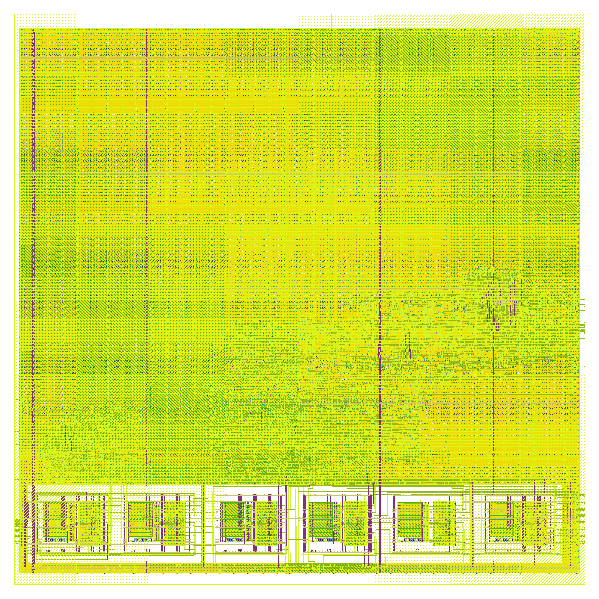
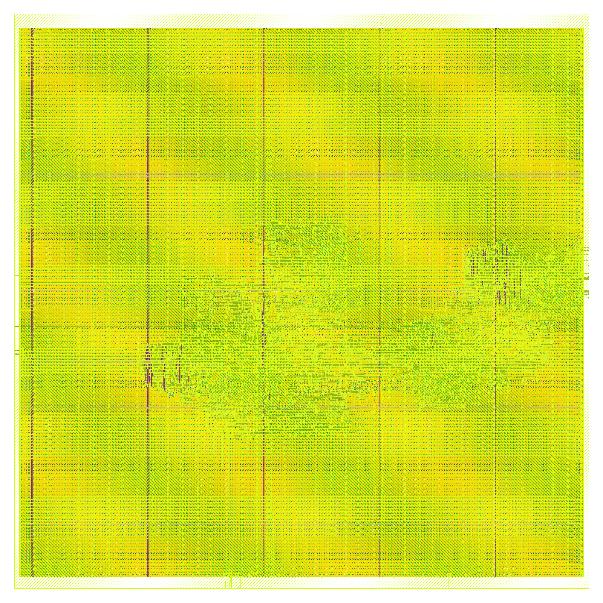

# The tag for several sensors: `ble-tx-poc-gen`

**Project:** BTLE — reconfigurable RISC-V baseband  
**Branch:** `ble-tx-poc-gen`  
**Base:** `ble-tx-tag-8` (`86a194a6`); the plan is [`docs/PLANO_PoC.md`](../PLANO_PoC.md), revised on 2026-11-06 (its first section)  
**Date:** 2026-11-06  
**Author:** Miguel Simões  
**Status:** run `tx-poc-gen`. The RTL, its simulation against models of the four sensors, the area and leakage at 45 nm, the GF180 layouts and the controller on the Zynq's FPGA out of context are done, every number below measured, with its evidence committed (§ 10). **Not done:** the board's bitstream (it needs Vivado 2022.2 and ADI's IP) and any test on a board or with a real sensor (§ 8). Not a tape-out.

---

## Purpose

One small link layer for several sensors, I2C and SPI, between the sensor and the AdvData of `ble-tx-tag-8`'s packet, with no memory: fixed profiles chosen by pins, and the sampling rate chosen by pins, so both can change after silicon without a processor or a non-volatile memory. Its sibling, `ble-tx-poc-tmp100`, is the smallest tag for the TMP100 alone.

**This is not "any sensor works".** The chip runs only the profiles compiled into it. A new sensor is a new table, and so a new bitstream or a new chip. A profile in registers, loaded through an interface, would serve new sensors after silicon, and lose them with the power: left out.

## 1. What it is

`verilog/tag_fsm.v` and the constants of `verilog/tag_profiles.v`, generated by `scripts/senseworks/tag_profile.py`. **All the state is one counter of ticks**, `t`, 18 flip-flops at 32.768 kHz. The last 2^12 ticks of a period run the table of the profile the pins `sel` choose: 1024 slots of 4 ticks, one bit on the bus per slot, SCL at 8.2 kHz. The wrap is `tx_start`. What a slot does:

| Code | |
|---|---|
| 000 | nothing: the waits are slots of this |
| 001, 010 | START (with SPI: CS_n falls), STOP (CS_n rises) |
| 100, 101 | a bit: SDA released, SDA low |
| 110 | a bit: SDA released, read into the packet's 16-bit register |

Synthesis folds the tables, so the logic is what these four sequences use. The waveform of I2C is that of the TMP126's SPI (figure 7-1: SCLK high at rest, data changing with it low), so **one bit engine serves both**, with CS_n added. The flip-flops beyond the transmitter: the counter 18, advDelay's LFSR 8, the register 16, SCL, SDA and CS_n 3.

Nothing waits for the bus, so nothing can hang on it. The period, start to start, is exact in ticks; advDelay, the gateway's conversion and the reset's recovery are those of `ble-tx-poc-tmp100` (its § 1).

## 2. The pins

| Pins | Codes | On the chip | On the FPGA |
|---|---|---|---|
| `rate[2:0]` | 0 off, 1..7: 125 ms, 250 ms, 500 ms, 1 s, 2 s, 4 s, 8 s | tied to GND or supply on the flexible board: they hold without power; changing them means changing those connections, not the radio | register 7 of the Link Layer, [2:0], written by the ARM at start; 1 s by default in the firmware; 0 at reset, so the tag starts when the radio is ready |
| `sel[1:0]` | 0 TMP100, 1 TMP114, 2 MAX31875, 3 TMP126 | as above | register 7, [5:4] |

The interval counts from the start of a measurement to the start of the next, the conversion within it. The shortest, 125 ms, leaves 2^12 ticks, more than the longest profile takes (TMP100, 84.8 ms).

| Pads beyond SCL, SDA, clock, reset and the radio's | Pads | GF180MCU-D, cell area of the pads (µm²) |
|---|---:|---:|
| `rate[2:0]` | 3 | 78 750 |
| `sel[1:0]` | 2 | 52 500 |
| `cs_n` | 1 | 26 250 |

Those pads are the real cost of the two choices, and are not in the layouts below, as on every earlier branch: six more than a chip with neither, 157 500 µm² of pad cells at 26 250 µm² each, against 127 247 µm² of placed cells with the eFuse blocks. Three bits of rate are cheap in logic, not in pads. A chip for one sensor saves the two of `sel` and `cs_n` if it is I2C; a table compiled for that sensor alone folds to about the size of `ble-tx-poc-tmp100`.

## 3. The four profiles

From each sensor's datasheet. Each event configures the sensor again, so a reset cannot leave it wrong for long.

| | TMP100 | TMP114 (A) | MAX31875 (R0) | TMP126 |
|---|---|---|---|---|
| Role (the plan's revision) | the bench's reference and physical test | first candidate for a thin sticker | very small alternative | compact SPI |
| Package | 2.9 × 2.8 mm | 0.76 × 0.76 mm, 0.15 mm high | 0.84 × 0.84 mm, 0.35 mm high | 2 × 2.1 mm |
| Supply | 2.7–5.5 V | **1.08–1.98 V** | 1.6–3.6 V | 1.62–5.5 V |
| Bus | I2C 0x48 | I2C 0x48 | I2C 0x48 | SPI, three wires, SIO |
| Configure | `0x01 0x81`: 9 bits, SD, OS | `0x03 0x00 0x1C`: Mode = shutdown, OS | `0x01 0x01 0x21`: 9 bits, SD, D0 | `0x0003 0x001E`: Mode = shutdown, One_Shot |
| Wait (maximum) | 75 ms | 7.5 ms | 25 ms (50 ms at 10 bits, halved per bit) | 7.5 ms |
| Read | pointer `0x00`, STOP, START, 2 bytes | pointer `0x00`, repeated START, 2 bytes | pointer `0x00` ("must be written for each I2C transaction"), repeated START, 2 bytes | `0x0100`, 16 bits |
| In the packet | 1/256 °C per unit, low 7 bits 0 | 1/128 °C per unit, all 16 bits | 1/256 °C per unit, low 7 bits 0 | 1/128 °C per unit, low 2 bits 0 |
| First packet | the last continuous conversion: OS has no effect outside shutdown | the first one-shot | the last automatic conversion: D0 has no effect outside shutdown | the first one-shot |
| Slots of the table | 695, 78 on the bus | 149, 86 | 292, 86 | 131, 68 |

**Confirmed before freezing them, as the revision asked:**

- **The TMP114 cannot share a 3.3 V bus.** SDA and SCL have an absolute maximum of 2.1 V and a recommended maximum of 1.98 V. Its thresholds are fixed, VIH 0.84 V, VIL 0.35 V, so it works on a 1.2 V or 1.8 V bus; the FPGA's `gpio_bd` are LVCMOS33 and the GF180 I/O library's corners start at 2.25 V. Its profile is right, and it needs a level shifter, or an ASIC whose pads run at 1.8 V, which is not this PDK's. **On the boards it would need one too.**
- **`0xFFFF` is not impossible for the TMP114:** all 16 bits count, and it reads −0.0078 °C. A missing TMP114 and that temperature are the same packet; the other three have low bits at 0. The gateway should read `0xFFFF` as no sensor, and a TMP114 at that exact code loses one reading.
- **The TMP126's SIO is bidirectional:** after a read command it drives from the falling edge after the 16th rising one. The pin is open-drain, released once SCLK has risen, before that fall, so the two never fight: the model fails on the unknown value it would make. It needs a pull-up to its own VDD (SIO's absolute maximum is VDD + 0.2 V). No MISO pin, so one pad less. The same pin serves a four-wire sensor with MOSI and MISO joined.
- **The MAX31875 and the TMP100 ignore their one-shot bit outside shutdown:** in both the first event's write only sets shutdown, and the configuration is written whole each time.
- **MAX31875's datasheet was read in a distributor's copy** (the manufacturer's site timed out); its 9-bit maximum, 25 ms, is derived from the "doubles with every bit" of the text and the table's 50 ms at 10 bits, not stated by itself.
- **The TMP114 and the MAX31875 have a bus timeout, 30 ms:** SCL low for that long resets their interface. A bit here takes 122 µs: far from it.

Past the four, the generality: a scenario builds another table in the fourth place, SPI mode 0 with no command, on `tests/spi_sensor_model.v`, on the same RTL. **What a table cannot serve:** a sensor that must stretch the clock, that must be polled for the end of a conversion, or a one-wire protocol; and a packet carries two bytes.

## 4. Validation

Run `tx-poc-gen-validation`, `scripts/senseworks/run_tag_validation.sh` (`results/validation/tx-poc-gen-validation/`), at commit `0e0d1808`.

| Check | What it shows | Result |
|---|---|---|
| `tag_bch.py --self-test`, `check_bch_galois.py` | the code, against the galois library | PASS |
| `tests/test_tx_tag.py --mutants`: `btle_tx` against `ble-tx-tag-8` and `ble-tx-tag-1byte`, every output on every clock | the direct port changes no output | **432/432 runs, no difference; 23/23 mutants caught** |
| `tests/test_tx_tag_packet.py`, `check_tag_scapy.py` | the waveforms against upstream's model, loopback, scapy | **300 packets** |
| `tests/test_tag_fsm.py`: from each sensor's model to upstream's receiver | as `ble-tx-poc-tmp100`, per sensor | **174/174 scenarios; coverage 318/318 of the tables' slots on the bus; 48/48 mutants caught, in the RTL and in the generator** |
| `check_tag_scapy.py` on those packets | a Bluetooth LE ADV_NONCONN_IND with the reading in it | **163 packets** |
| `tag_profile.py --check` | the tables are what the generator makes | PASS |
| `tests/test_tag_controller.py` | in the controller, off until the ARM's one write | **9/9 packets** |
| `tests/test_poc_board_files.py` | the board's files against the RTL | PASS |
| `run_lint.py` (Verilator 5.020, `--Wall`, warnings fatal) | | **6/6** |

For each of the four: the temperature's range, a period of 1 s, the typical conversion time, no sensor, a sensor that stops and comes back, a reset in 16 places of its frames at two phases and in the packet. Then: every rate, off and on, the test mode with all 256 delays, the lines stuck, the eFuse blocks, the clock of the ASIC on both buses.

**The models are written from the datasheets, not real parts**, and only the TMP100 is planned for the bench.

## 5. What it costs

| Nangate45, AdvA a constant | cells | flip-flops | cell area (µm²) | leakage (µW) |
|---|---:|---:|---:|---:|
| `ble-tx-tag-8` `btle_tx`, on its pair, config ports free | 1670 | 295 | 2 921.2 | 59.43 |
| `btle_tx` with the direct port, two bytes, config ports free | 1613 | 265 | 2 760.8 | 56.58 |
| `ble-tx-poc` `tag_chip`, compiled profile (the generic core) | 2278 | 393 | 3 772.7 | 77.69 |
| `ble-tx-poc` `tag_chip`, EEPROM | 3921 | 718 | 6 601.9 | 135.25 |
| **`tag_chip`**: this branch's chip | 1920 | 308 | 3 123.1 | 64.62 |

- **`tag_chip` is 3 123.1 µm², -17.2 % against the generic core of `ble-tx-poc` with its profile compiled in (3 772.7 µm²). Against `ble-tx-tag-8`'s transmitter alone, 2 921.2 µm², it is +6.9 %, with the whole acquisition: the direct port removes 30 of that transmitter's flip-flops, 16 of them now the sensor's register here, and tying its configuration ports to constants folds logic. Differences of about 25 µm² between similar builds are the synthesis's noise, not the design's.**

| Nangate45, pre-layout | comb. path (ns) | min period (ns) | slack at 62.5 ns | Fmax (MHz) |
|---|---:|---:|---:|---:|
| `ble-tx-tag-1byte` `btle_controller` | 3.127 | 3.487 | +59.013 ns | 286.8 |
| this branch's `btle_controller` | 1.190 | 1.549 | +60.951 ns | 645.5 |
| `ble-tx-tag-1byte` `btle_tx` | 0.915 | 1.263 | +61.237 ns | 792.0 |
| `btle_tx`, direct port | 0.822 | 1.169 | +61.331 ns | 855.1 |
| **`tag_chip`** | 0.862 | 1.209 | +61.291 ns | 826.9 |

**Layout in GF180MCU-D**, LibreLane Classic, the settings of the tag's layouts, `clk` 62.5 ns, die 760 × 760 µm (`scripts/layout/tag_chip_gf180/run.sh`, `results/layout/tx-poc-gen-*-gf180/`).

| GF180MCU-D (µm²) | `ble-tx-tag-8`, `btle_tx` | `ble-tx-poc`, compiled profile | **`tag_chip`, eFuse** | **`tag_chip`, no eFuse** |
|---|---:|---:|---:|---:|
| eFuse blocks (AdvA, OTP) | 48 452.1 | 48 452.1 | 48 452.1 | 0.0 |
| Logic: combinational, flip-flops, inverters, buffers | 48 691.7 | 60 282.4 | 50 199.9 | 49 442.5 |
| Timing-repair buffers + clock trees | 16 209.4 | 16 617.6 | 12 670.7 | 11 761.9 |
| Taps, end caps, antenna diodes | 15 932.8 | 15 924.0 | 15 924.0 | 17 236.7 |
| **Placed cells + macros** | 129 286.0 | 141 285.0 | 127 247.0 | 78 450.0 |
| flip-flops | 303 | 401 | 316 | 316 |

| Signoff | `ble-tx-tag-8`, `btle_tx` | `ble-tx-poc`, compiled profile | **`tag_chip`, eFuse** | **`tag_chip`, no eFuse** |
|---|---:|---:|---:|---:|
| DRC: routing, KLayout, Magic | 0, 0, 0 | 0, 0, 0 | 0, 0, 0 | 0, 0, 0 |
| LVS errors | 0 | 0 | 0 | 0 |
| antenna violations | 0 | 0 | 0 | 0 |
| max slew violations | 0 | 0 | 0 | 0 |
| max capacitance violations | 0 | 0 | 0 | 0 |
| max fanout violations | 4 | 0 | 3 | 3 |
| worst setup / hold slack, 9 corners (ns) | +10.575 / +0.195 | +38.743 / +0.192 | +34.167 / +0.210 | +34.817 / +0.184 |

- **With eFuse: 127 247 µm²**, -1.6 % against `ble-tx-tag-8`'s `btle_tx` (129 286 µm²), -9.9 % against `ble-tx-poc`'s generic core (141 285 µm²).
- **Without eFuse: 78 450 µm²**, the minimum, but every chip with the same AdvA: the six blocks are 48 797 µm², the largest thing on the die.
- Signoff is clean in both: 0 DRC, LVS, antenna, slew and capacitance violations; the fanout violations are clock-tree buffers, reviewed as on the earlier layouts (`warning_gate.txt` in each folder).

| eFuse | no eFuse |
|---|---|
|  |  |

## 6. The architecture: a table, against a sequencer

The architecture first proposed was one sequencer FSM executing operations, with small I2C and SPI controllers, and the request was to measure. `scripts/area/gen_architecture/tag_chip_sequencer.v` is that, with the same four profiles and the same pins, by the same recipe (`compare.sh`, `results/area/tx-poc-gen/architecture.txt`):

| Nangate45, four profiles, two pins for the sensor, three for the rate | Cell area (µm²) | Flip-flops |
|---|---:|---:|
| **The table** (`tag_chip`) | 3 123.1 | 308 |
| The sequencer, a sketch | 3 504.3 | 346 |

The table is 381.2 µm² smaller (10.9 %).

The table is smaller: the sequencer needs its own state, program counter, byte and bit counters and wait counter, which the table reads from `t`. **The sketch was only synthesized, not simulated**, so this is a comparison of sizes, and a careful sequencer might come closer; it would still carry those registers. The table keeps the request's substance: one common machine, the shared operations, only the sequence changing.

## 7. FPGA: the controller on the xc7z020

Run `xc7z020-gen`: Vivado 2026.1, `scripts/fpga/xc7z020/impl.tcl` mode `ooc_hd`, `post.tcl` (`results/fpga/xc7z020-gen/`). `synth_warning_gate.py --vivado`: PASS.

| xc7z020, routed | LUTs | flip-flops | RAMB36 | RAMB18 | DSP48 |
|---|---:|---:|---:|---:|---:|
| **`btle_controller`** | 2101 | 3211 | 32 | 1 | 0 |
| of which `tag_fsm` | 589 | 326 | 0 | 0 | 0 |
| of which `btle_tx` | 491 | 272 | 0 | 0 | 0 |

WNS: `axi_clk` +3.564 ns, `bb_clk` +52.278 ns, `bram_clk` +7.424 ns

`firmware/btle_ll.c`: `-T` the report's period, `-r` the rate (default 4, 1 s), `-s` the sensor (default 0), `-k 1` the test mode.

## 8. On the board: what remains

These are not done. They need the boards, Vivado 2022.2 and ADI's IP; the steps are those of `ble-tx-poc-tmp100` (its § 7), with `gpio_bd[2]`, FPGA pin L19, for CS_n, and `-s` for the sensor.

| Sensor | On the 3.3 V pins of `antsdr` |
|---|---|
| TMP100, MAX31875 | directly, with pull-ups to 3.3 V |
| TMP126 | directly, with SIO's pull-up to its VDD, 3.3 V |
| TMP114 | **only through a level shifter**, at 1.8 V on its side |

## 9. What the branch does not do

- Anything on a board. Dynamic power. The clock switch between 32.768 kHz and 16 MHz of an ASIC.
- New sensors after silicon (see the Purpose). A sensor inside the die, or in the same package: that is a project of assembly, not of RTL.
- A gate-level simulation of the laid-out netlist.

## 10. Reproducing

From WSL, at the root of the branch, as `ble-tx-poc-tmp100`'s § 9, with:

```bash
export TMPDIR=/dev/shm/poc; mkdir -p $TMPDIR
python3 scripts/senseworks/tag_profile.py --output verilog/tag_profiles.v         # after a change of a sensor
scripts/senseworks/run_tag_validation.sh tx-poc-gen-validation
AREA_PARAMS="GAUSS_TABLE=1 SENSOR_BYTES=2" scripts/area/run_area.sh tx-poc-gen btle_tx tag_fsm tag_chip btle_phy btle_ll btle_controller
scripts/area/gen_architecture/compare.sh results/area/tx-poc-gen/architecture.txt
STA_SET=poc DUT_REV=HEAD scripts/timing/run_sta.sh tx-poc-gen 62.5 7fb89713
scripts/layout/tag_chip_gf180/run.sh tx-poc-gen-efuse-gf180 efuse HEAD
scripts/layout/tag_chip_gf180/run.sh tx-poc-gen-rom-gf180 rom HEAD
python3 scripts/senseworks/poc_summary.py > results/senseworks/tx_poc_gen_summary.md
```

## 11. Sources

[TMP100, TI](https://www.ti.com/lit/ds/symlink/tmp100.pdf) (SBOS231I); [TMP114, TI](https://www.ti.com/lit/ds/symlink/tmp114.pdf) (SNIS214E); [TMP126, TI](https://www.ti.com/lit/ds/symlink/tmp126.pdf) (SNIS209C); [MAX31875, distributor's copy](https://datasheet.chipsmall.com/MAX31875R0TZS/550713.pdf), [product page](https://www.analog.com/en/products/MAX31875.html). Pad sizes: the LEF of the GF180MCU I/O library.
