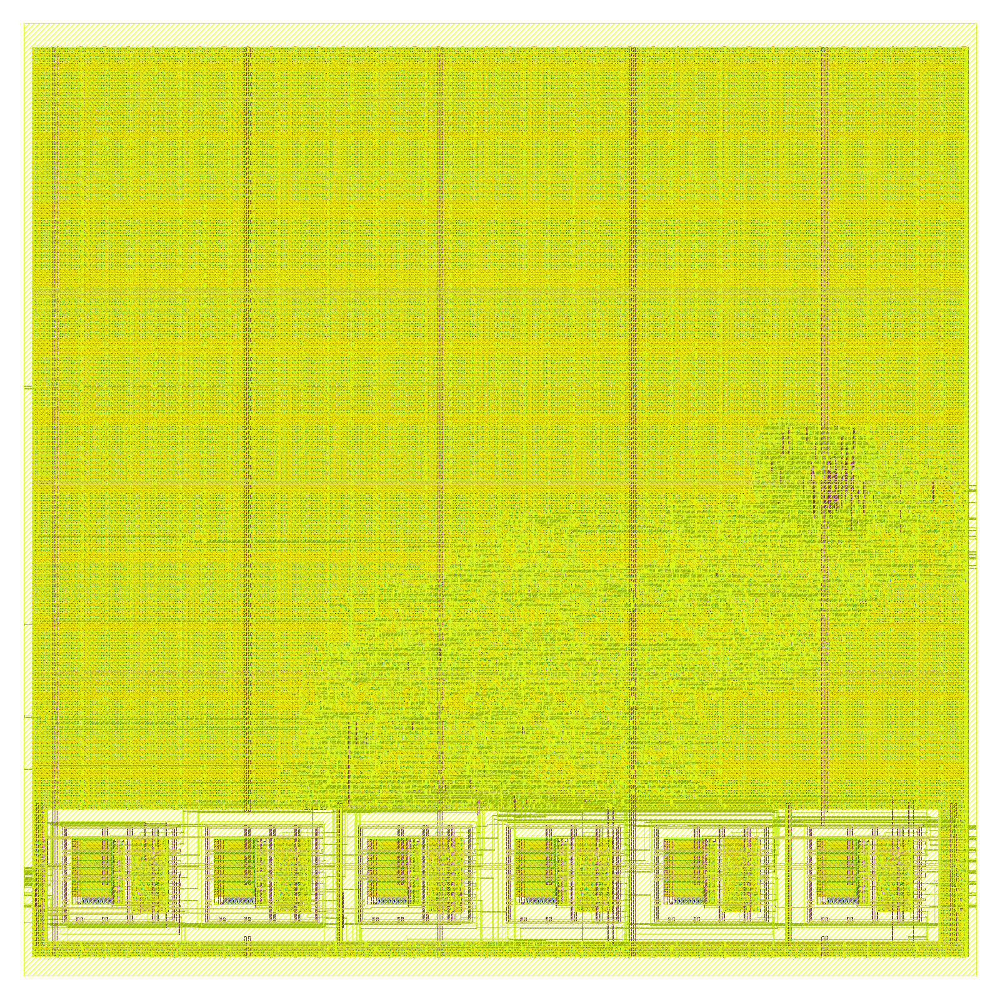
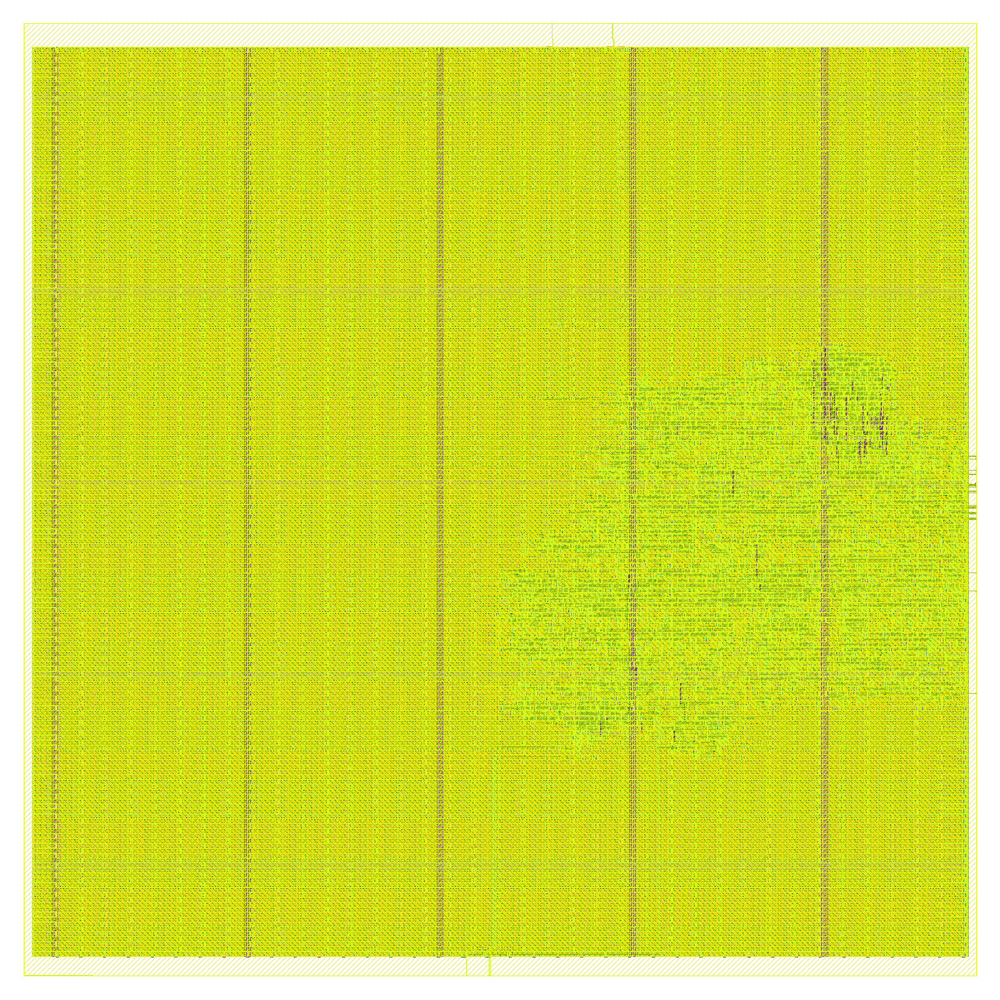

# The tag for the TMP100: `ble-tx-poc-tmp100`

**Project:** BTLE — reconfigurable RISC-V baseband  
**Branch:** `ble-tx-poc-tmp100`  
**Base:** `ble-tx-tag-8` (`86a194a6`); the plan is [`docs/PLANO_PoC.md`](../PLANO_PoC.md), revised on 2026-11-06 (its first section)  
**Date:** 2026-11-06  
**Author:** Miguel Simões  
**Status:** run `tx-poc-tmp100`. The RTL, its simulation, the area and leakage at 45 nm, the GF180 layouts and the controller on the Zynq's FPGA out of context are done, every number below measured, with its evidence committed (§ 9). **Not done:** the board's bitstream (it needs Vivado 2022.2 and ADI's IP, which this machine does not have) and any test on a board or with a real TMP100 (§ 7). Not a tape-out.

---

## Purpose

The smallest tag for one sensor: a state machine with no processor, no memory and no choice of sensor, between a TI TMP100 and the AdvData of `ble-tx-tag-8`'s packet. Its sibling, `ble-tx-poc-gen`, serves several sensors. This document says what the branch contains, how it was checked and what it costs.

The requirements, from the plan's revision: the least area; the transmitter of `ble-tx-tag-8`, with a direct port; no EEPROM; the TMP100 in one-shot at 9 bits, one measurement per second, in shutdown between measurements; the sampling rate fixed only if that saves a large area. Two FPGA boards, the sensor and the PC.

## 1. What it is

`verilog/tag_fsm.v`. **All the state is one counter of ticks**, `t`: 15 flip-flops at 32.768 kHz, with the last 2^12 ticks of a period divided into 32 windows of 32 slots, one bit of I2C per slot of 4 ticks, so SCL is 8.2 kHz.

| `t` | The bus | |
|---|---|---|
| window 8 | START `0x90` ACK `0x01` ACK `0x81` ACK STOP | the configuration: SD = 1, OS = 1, 9 bits: one conversion |
| window 30 | START `0x90` ACK `0x00` ACK STOP | 82.4 ms later: the 75 ms maximum is over; the pointer on the temperature |
| window 31 | START `0x91` ACK read ACK read NACK STOP | the temperature, into a 16-bit register |
| the wrap | | `tx_start`: the packet, those two bytes as read, first byte first |

Nothing waits for the bus, so nothing can hang on it. The flip-flops beyond the transmitter: the counter 15, advDelay's LFSR 8, the sensor's register 16, SCL and SDA 2.

| Behaviour | How, and at what cost |
|---|---|
| **The period** | start to start, exact in ticks: 2^15 (1 s) less advDelay, 0 to 255 ticks (0 to 7.8 ms, within the Core's 0 to 10 ms, Core 6.1, Vol 6 Part B 4.4.2.2). The measurement is inside the period, so it does not stretch it |
| **advDelay** | an 8-bit LFSR, 256 states, stepped once per event, XOR AdvA's first byte, so tags powered together drift apart |
| **Power-up** | the TMP100 starts in continuous conversion, and OS has no effect outside shutdown (SBOS231I 7.5.3.6): the first event's write only puts it in shutdown, and the first packet carries the last of those conversions; from the second on, one conversion per event |
| **No sensor** | SDA stays at the pull-up: the register reads `0xFFFF`, which no reading can be (the register's low 4 bits are 0). No flag and no ACK check are needed. SDA stuck low reads `0x0000`, 0 °C: the limit of this choice (§ 3) |
| **A reset in a frame** | no bus clear: every event writes the configuration again, and the next frames recover the bus, a slave holding SDA getting their clocks and, on one of them, a NACK. **At most one wrong packet, then right**, in every place tried (§ 3) |
| **The gateway** | T = int16 / 256 °C. The low 7 bits of a reading are 0, so most wrong packets after a reset are recognizable |
| **AdvA** | `ADV_ADDRESS`, a random static address (TxAdd = 1), as `ble-tx-tag-8`; six eFuse blocks with `ADV_ADDRESS_OTP = 1` in the ASIC |

**`btle_tx`** has `ble-tx-tag-8`'s outputs on every clock (§ 3), with direct ports instead of its (address, data) pair on `clkb`: no `clkb`, no request toggle, no synchronizers, no read register. It is the file of `ble-tx-poc`, unchanged, instantiated with `SENSOR_BYTES = 2`.

## 2. The rate: fixed, with the pads counted

The requirement: fixed only if that saves a large area. Three pins for the rate cost 3 flip-flops and a little logic, and three pads:

| Pads beyond SCL, SDA, clock, reset and the radio's | Pads | GF180MCU-D, cell area of the pads (µm²) |
|---|---:|---:|
| `rate[2:0]`, had the chip kept the rate | 3 | 78 750 |

In logic, at 45 nm: 2 966.2 µm² fixed, 3 013.8 µm² on pins, +47.6 µm² (+1.6 %), about the synthesis's noise. With the pads: 78 750 µm² in GF180, 63 % of the 125 752 µm² of placed cells with eFuse (the I/O library's input pad is 75 × 350 µm, ESD protection included; the pads are not in the layouts). That is a large saving: the logic alone would not have justified it, the pads do. It is one parameter to reverse.

So **the chip's period is fixed at 1 s** (`tag_chip.v`), by that rule. `tag_chip_rate.v` keeps the variant with the pins, measured, one parameter away. On the FPGA nothing is paid for it, so the controller has the rate and the test mode in a register the ARM writes (`RATE_EN = 1`, § 6): 125 ms to 8 s, or off.

## 3. Validation

Run `tx-poc-tmp100-validation`, `scripts/senseworks/run_tag_validation.sh` (`results/validation/tx-poc-tmp100-validation/`), at commit `51cb5230`.

| Check | What it shows | Result |
|---|---|---|
| `tag_bch.py --self-test`, `check_bch_galois.py` | the code, against the galois library | PASS |
| `tests/test_tx_tag.py --mutants`: `btle_tx` against `ble-tx-tag-8` (`SENSOR_BYTES = 2`) and `ble-tx-tag-1byte` (1), every output on every clock | the direct port changes no output | **432/432 runs, no difference; 23/23 mutants caught** |
| `tests/test_tx_tag_packet.py`, `check_tag_scapy.py` | the waveforms against upstream's model, loopback, scapy | **300 packets** |
| `tests/test_tag_fsm.py`: from the TMP100's model to upstream's receiver | below | **85/85 scenarios; coverage 96/96 of the frames' (window, slot); 41/41 mutants caught** |
| `check_tag_scapy.py` on those packets | a Bluetooth LE ADV_NONCONN_IND with the reading in it | **95 packets** |
| `tests/test_tag_controller.py` | in the controller: off until the ARM's one write, then the packets, against upstream's model, and the registers | **9/9 packets** |
| `tests/test_poc_board_files.py` | the board's files against the RTL | PASS |
| `run_lint.py` (Verilator 5.020, `--Wall`, warnings fatal) | | **9/9** |

Every packet of a scenario is checked against what the sensor's model answered, the PHY bits against `python/btlelib.py`, upstream's receiver decoding it with the CRC right, the BCH correcting t errors at random, T_advEvent exact in ticks and in nanoseconds; and the TMP100 in shutdown at the packet, no read during a conversion, the I2C bus within the datasheet's timing.

| Scenarios | |
|---|---|
| `nominal`, `real_time`, `asic_clock` | the temperature's range, the sign, the 9 bits; a second in real time at 16 MHz; at 32.768 kHz, a tick per clock |
| `sensor_absent`, `sensor_nack*`, `scl_stuck`, `sda_stuck` | `0xFFFF`, the packets go on, nothing hangs, it comes back; SDA stuck reads 0 |
| `reset_*` (59) | a reset in 29 places of the three frames, at two phases each, and in the packet: at most one packet wrong, then right, the configuration `0x81` |
| `rate_*`, `test_mode*` | the controller's register: every rate exact, off and on; all 256 delays |
| `adv_*`, `channel_*`, `bch_*` | the eFuse blocks, AdvA's first byte, the parameters |

**The models are written from the datasheet, not real parts.** What the datasheet (SBOS231I) does not say, and the design relies on: that the device does not stretch the clock (it mentions none, and the timing table has no such parameter); a bus timeout it has none of, which the frames' recovery does not need.

## 4. What it costs

| Nangate45, AdvA a constant | cells | flip-flops | cell area (µm²) | leakage (µW) |
|---|---:|---:|---:|---:|
| `ble-tx-tag-8` `btle_tx`, on its pair, config ports free | 1670 | 295 | 2 921.2 | 59.43 |
| `btle_tx` with the direct port, two bytes, config ports free | 1613 | 265 | 2 760.8 | 56.58 |
| `ble-tx-poc` `tag_chip`, compiled profile (the generic core) | 2278 | 393 | 3 772.7 | 77.69 |
| `ble-tx-poc` `tag_chip`, EEPROM | 3921 | 718 | 6 601.9 | 135.25 |
| `tag_chip_rate`: the period on three pins | 1829 | 307 | 3 013.8 | 62.38 |
| **`tag_chip`**: this branch's chip | 1771 | 304 | 2 966.2 | 60.95 |

- **`tag_chip` is 2 966.2 µm², -21.4 % against the generic core of `ble-tx-poc` with its profile compiled in (3 772.7 µm²). Against `ble-tx-tag-8`'s transmitter alone, 2 921.2 µm², it is +1.5 %, with the whole acquisition: the direct port removes 30 of that transmitter's flip-flops, 16 of them now the sensor's register here, and tying its configuration ports to constants folds logic. Differences of about 25 µm² between similar builds are the synthesis's noise, not the design's.**

| Nangate45, pre-layout | comb. path (ns) | min period (ns) | slack at 62.5 ns | Fmax (MHz) |
|---|---:|---:|---:|---:|
| `ble-tx-tag-1byte` `btle_controller` | 3.127 | 3.487 | +59.013 ns | 286.8 |
| this branch's `btle_controller` | 1.190 | 1.549 | +60.951 ns | 645.5 |
| `ble-tx-tag-1byte` `btle_tx` | 0.915 | 1.263 | +61.237 ns | 792.0 |
| `btle_tx`, direct port | 0.889 | 1.236 | +61.264 ns | 809.3 |
| **`tag_chip`** | 0.912 | 1.260 | +61.240 ns | 793.9 |
| `tag_chip_rate`, the period on pins | 0.789 | 1.136 | +61.364 ns | 880.0 |

**Layout in GF180MCU-D**, LibreLane Classic, the settings of the tag's layouts, `clk` 62.5 ns, die 760 × 760 µm (`scripts/layout/tag_chip_gf180/run.sh`, `results/layout/tx-poc-tmp100-*-gf180/`). The pads are not in these layouts, as on every earlier branch.

| GF180MCU-D (µm²) | `ble-tx-tag-8`, `btle_tx` | `ble-tx-poc`, compiled profile | **`tag_chip`, eFuse** | **`tag_chip`, no eFuse** |
|---|---:|---:|---:|---:|
| eFuse blocks (AdvA, OTP) | 48 452.1 | 48 452.1 | 48 452.1 | 0.0 |
| Logic: combinational, flip-flops, inverters, buffers | 48 691.7 | 60 282.4 | 48 445.9 | 46 828.0 |
| Timing-repair buffers + clock trees | 16 209.4 | 16 617.6 | 12 929.7 | 10 686.2 |
| Taps, end caps, antenna diodes | 15 932.8 | 15 924.0 | 15 924.0 | 17 232.3 |
| **Placed cells + macros** | 129 286.0 | 141 285.0 | 125 752.0 | 74 755.0 |
| flip-flops | 303 | 401 | 312 | 312 |

| Signoff | `ble-tx-tag-8`, `btle_tx` | `ble-tx-poc`, compiled profile | **`tag_chip`, eFuse** | **`tag_chip`, no eFuse** |
|---|---:|---:|---:|---:|
| DRC: routing, KLayout, Magic | 0, 0, 0 | 0, 0, 0 | 0, 0, 0 | 0, 0, 0 |
| LVS errors | 0 | 0 | 0 | 0 |
| antenna violations | 0 | 0 | 0 | 0 |
| max slew violations | 0 | 0 | 0 | 0 |
| max capacitance violations | 0 | 0 | 0 | 0 |
| max fanout violations | 4 | 0 | 4 | 3 |
| worst setup / hold slack, 9 corners (ns) | +10.575 / +0.195 | +38.743 / +0.192 | +37.501 / +0.213 | +40.054 / +0.208 |

- **With eFuse: 125 752 µm²**, -2.7 % against `ble-tx-tag-8`'s `btle_tx` (129 286 µm²), -11.0 % against `ble-tx-poc`'s generic core (141 285 µm²).
- **Without eFuse: 74 755 µm²**, the minimum, but every chip with the same AdvA: the six blocks are 50 997 µm², the largest thing on the die.
- Signoff is clean in both: 0 DRC, LVS, antenna, slew and capacitance violations; the fanout violations are clock-tree buffers, reviewed as on the earlier layouts (`warning_gate.txt` in each folder).

| eFuse | no eFuse |
|---|---|
|  |  |

## 5. The sensor's energy

From the datasheet, not measured: the TMP100 takes 45 µA typical while converting, 40 ms typical, and 0.1 µA in shutdown. One conversion per second: about (45 × 0.04) + 0.1 ≈ 1.9 µA on average, against 45 µA in continuous conversion, for about 30 to 40 µm² at 45 nm. The sensor is external and the largest consumer of the acquisition; the plan's § 8 still wants one inside the chip.

## 6. FPGA: the controller on the xc7z020

Run `xc7z020-tmp100`: Vivado 2026.1, `scripts/fpga/xc7z020/impl.tcl` mode `ooc_hd` (out of context, `bb_clk` 16 MHz, the AXI clock 100 MHz), `post.tcl` (`results/fpga/xc7z020-tmp100/`). `synth_warning_gate.py --vivado`: PASS.

| xc7z020, routed | LUTs | flip-flops | RAMB36 | RAMB18 | DSP48 |
|---|---:|---:|---:|---:|---:|
| **`btle_controller`** | 2072 | 3208 | 32 | 1 | 0 |
| of which `tag_fsm` | 560 | 325 | 0 | 0 | 0 |
| of which `btle_tx` | 491 | 272 | 0 | 0 | 0 |

WNS: `axi_clk` +3.452 ns, `bb_clk` +52.652 ns, `bram_clk` +7.424 ns

`TAG_TICK_DIV = 488`: 16 MHz / 488 = 32.787 kHz, SCL 8.2 kHz, the same bus as the chip; a second is 999.4 ms. Register 7 of the Link Layer: [2:0] the rate, 0 off at reset, so the tag starts when the ARM has the radio ready; [3] the test mode. `firmware/btle_ll.c`: `-T` the report's period, `-r` the rate (default 4, 1 s), `-k 1` the test mode.

## 7. On the board: what remains

These are not done. They need the boards (the plan's § 7), Vivado 2022.2 and ADI's IP.

| Signal | `system_top.v` | FPGA pin | TMP100 |
|---|---|---|---|
| SCL | `gpio_bd[0]`, IOBUF, I = 0, T = !`tag_scl_oe` | H17 | pin 1; pull-up 4.7 kΩ to 3.3 V |
| SDA | `gpio_bd[1]`, IOBUF, I = 0, T = !`tag_sda_oe` | H15 | pin 6; pull-up 4.7 kΩ to 3.3 V |
| | | | pin 2 GND, pins 3 and 5 (ADD1, ADD0) GND: 0x48, pin 4 3.3 V with 100 nF |

1. **The bitstream.** `fpga/build-adi-ip.sh`, `fpga/antsdr/btle.sh`, `fpga/helpers/all_gen_and_scp.sh antsdr` (`fpga/README.md`).
2. **Check against the schematic** that `gpio_bd[1:0]` reach a header, at 3.3 V.
3. **Start:** `./btle_ll -T 1000 -g -10`: it initializes the radio, sets the LO, starts the tag and reports.
4. **Power-cycle the sensor** when another design has written to it: a plain reset of the FPGA does not reset the TMP100.
5. **Look first at:** the ILA on SCL and SDA, that the TMP100 does not stretch the clock and answers at 8.2 kHz (§ 3); `system_top.v` fixes the RF switch to the higher band, with upstream's comment that it passes only 3–6 GHz: how much the TX path loses at 2.4 GHz has not been measured.

## 8. What the branch does not do

- Anything on a board (§ 7). Dynamic power.
- The rate on the chip: fixed (§ 2). Another sensor: `ble-tx-poc-gen`.
- The clock switch between 32.768 kHz and 16 MHz of an ASIC. The counter would have to stop for the packet, and that is not designed.
- A gate-level simulation of the laid-out netlist. The older tests of `tests/` that are not in `run_tag_validation.sh` describe earlier branches.

## 9. Reproducing

From WSL, at the root of the branch. `TMPDIR` on a RAM disk keeps the simulations' files off the virtual disk; `JOBS` keeps the shared memory in hand; `TAG_FSM_RESUME` makes the longest check survive a restart of WSL.

```bash
export TMPDIR=/dev/shm/poc; mkdir -p $TMPDIR
scripts/senseworks/run_tag_validation.sh tx-poc-tmp100-validation
AREA_PARAMS="GAUSS_TABLE=1 SENSOR_BYTES=2" scripts/area/run_area.sh tx-poc-tmp100 btle_tx tag_fsm tag_chip tag_chip_rate btle_phy btle_ll btle_controller
STA_SET=poc DUT_REV=HEAD scripts/timing/run_sta.sh tx-poc-tmp100 62.5 7fb89713
scripts/layout/tag_chip_gf180/run.sh tx-poc-tmp100-efuse-gf180 efuse HEAD     # (EFUSE_DIR, docker)
scripts/layout/tag_chip_gf180/run.sh tx-poc-tmp100-rom-gf180 rom HEAD
python3 scripts/senseworks/poc_summary.py > results/senseworks/tx_poc_tmp100_summary.md
```

§ 6, on Windows (Vivado 2026.1), in a folder with a short path: a copy of `verilog/` in `<root>/tmp100/verilog`, `scripts/fpga/xc7z020/clocks.xdc` in `<root>`, then `vivado -mode batch -source scripts/fpga/xc7z020/impl.tcl -tclargs <root>/tmp100 ooc_hd` and `post.tcl`.

## 10. Sources

[TMP100 datasheet, TI](https://www.ti.com/lit/ds/symlink/tmp100.pdf), SBOS231I. Pad sizes: the LEF of the GF180MCU I/O library.
