# The IoT tag: `ble-tx-iot` and `ble-iot-1byte`, every result of the final transmitter

**Project:** BTLE — reconfigurable RISC-V baseband  
**Branches:** `ble-tx-iot` (two bytes of sensor) and `ble-iot-1byte` (one byte), both cut from `ble-tx-tag-8` without its BCH code  
**Base:** tag `upstream-baseline` (`8540186`), forked from github.com/JiaoXianjun/BTLE  
**Reference document:** [`TX_FINAL_DECISIONS.md`](../Final%20Decisions/TX_FINAL_DECISIONS.md), whose measurements this one repeats section by section  
**Date:** 2026-11-05; § 8.2 (the layouts in 55 nm) 2026-11-09  
**Author:** Miguel Simões  
**Status:** every number below is measured and its evidence is committed (§ 12). Cell area in 45 nm
(Nangate45, pre-layout), a routed FPGA implementation, and signoff-clean layouts in the open 180 nm PDK; **the
synthesis (Vivado, Yosys) and the layout (LibreLane) of both branches end with no warning that is not a reviewed
exception** (§ 8.1). The same RTL is also laid out in the open 55 nm PDK, ICsprout55 (§ 8.2): routed with no DRC
on the tech LEF's rules, timing met at three corners, and its netlist equal to `ble-tx-min` clock by clock with the
layout's delays; the PDK's foundry DRC and LVS are Calibre decks and were not run. Not a tape-out
(`docs/Validation/ASIC_READINESS.md`: NOT READY, as on every branch).

---

## How to read this document

A tag that only announces a sensor value does not need the whole of Legacy Advertising. It has no receiver and
sends one packet format, fixed in the hardware. `ble-tx-tag-8` did this and added a BCH code; these two branches
remove the code, so the packet holds only what a standard advertising packet requires and the reading itself.
This document measures them on everything `TX_FINAL_DECISIONS.md` measures for `ble-tx-min`, in the same order.
§ 10 records the decisions.

| Name | What it is | RTL |
|---|---|---|
| **upstream** | the upstream design this repository forked | `upstream-baseline` (`8540186`) |
| **corrected master** | upstream with the product audit's corrections: the reference of the controller's activity (§ 7) | `master` (`fca6ac6`) |
| `ble-tx-min` | the final Legacy Advertising transmitter, with a receiver: the reference of the clock-by-clock checks (§ 3.5) | `be5d9774`; its numbers are `TX_FINAL_DECISIONS.md`'s |
| `ble-tx-tag-8` | the senseworks tag with 8 bytes of BCH parity | `TX_TAG_COMPARISON.md` |
| **`ble-tx-iot`** | this document: AdvA, Company ID, **two** sensor bytes; no receiver | branch `ble-tx-iot` |
| **`ble-iot-1byte`** | this document: AdvA, Company ID, **one** sensor byte; no receiver | branch `ble-iot-1byte` |

## 1. Summary

| | upstream | `ble-tx-min` | `ble-tx-tag-8` | **`ble-tx-iot`** | **`ble-iot-1byte`** | Evidence |
|---|---:|---:|---:|---:|---:|---|
| PDUs it can send | any, 2–257 bytes | Legacy Advertising, ≤ 39 bytes | one format, 22 bytes | **one format, 14 bytes** | **one format, 13 bytes** | § 2 |
| Time on the air, one packet | any length | 376 µs (39-byte PDU) | 240 µs | **176 µs** | **168 µs** | § 2 |
| Same outputs as `ble-tx-min` given the same PDU, every clock | — | reference | yes | **yes**: 72/72 runs, 13/13 faults | **yes**: 72/72 runs, 13/13 faults | § 3.5 |
| **TX cell area, 45 nm** (µm²) | 167 731.4 | 5 018.5 | 2 921.2 | **2 402.5 (−98.6 %)** | **2 346.9 (−98.6 %)** | § 4 |
| SRAM bits in the TX | 36 864 | 256 | 0 | **0** | **0** | § 4 |
| Flip-flops in the TX, 45 nm | 404 | 239 | 295 | **230** | **222** | § 4 |
| TX on the xc7z020: LUTs / flip-flops / RAMB18 | 680 / 401 / 3 | 387 / 254 / 0 | 422 / 302 / 0 | **349 / 237 / 0** | **346 / 229 / 0** | § 6 |
| `btle_tx` min period, 45 nm (target 62.5 ns) | — | 1.199 ns | 1.209 ns | **1.178 ns** | **1.199 ns** | § 5 |
| TX logic leakage, 45 nm (µW) | 112.61 | 51.71 + 16.41 of SRAM | 59.43 | **49.15** | **47.81** | § 7 |
| BER 0.1 % at 50 / −30 ppm, the mean of 20 noise draws | 25.2 / 14.0 dB (39-byte PDU) | the same | — | **25.1 / 13.4 dB** | **25.2 / 13.7 dB** | § 3.3 |
| **GF180MCU layout, placed cells + macros** (µm²) | not closed | 160 784.9 (flip-flops) | 129 286.0 | **100 307.1** | **98 445.6** | § 8 |
| **GF180MCU die** (µm²) | — | 577 600 | 577 600 | **174 800 (760 × 230)** | **171 000 (760 × 225)** | § 8 |
| Signoff: DRC, LVS, antenna, slew, capacitance, setup, hold | — | clean | clean | **clean** | **clean** | § 8 |
| **ICsprout55 (55 nm) layout, placed cells** (µm²; AdvA in the ROM) | — | — | — | **4 969.4** | **4 776.0** | § 8.2 |
| **ICsprout55 die** (µm²) | — | — | — | **6 724 (82 × 82)** | **6 724 (82 × 82)** | § 8.2 |
| ICsprout55: routing DRC, slew, capacitance, setup, hold; netlist against `ble-tx-min` with the layout's delays | — | — | — | **clean; 54/54 runs, 12/12 faults** | **clean; 54/54 runs, 12/12 faults** | § 8.2 |
| Warnings of synthesis and layout | 207 unreviewed (Vivado synthesis) | 0 unreviewed | 0 unreviewed | **0 unreviewed** | **0 unreviewed** | § 8.1 |

**In one sentence:** both branches send a standard advertising packet exactly as upstream's transmitter sends the
same PDU, sample for sample, in 1.4 % of upstream's transmitter cell area (45 nm) and less than half of
`ble-tx-min`'s, on a GF180MCU die 70 % smaller; their price is one fixed packet, no receiver and no error
correction, and the second branch's single byte saves only 2.3 % more. **In 55 nm (ICsprout55) the same transmitter
is an 82 × 82 µm block, a die 26 times smaller than in GF180MCU**; without the eFuse blocks, which 55 nm has no
open equivalent of, its placed cells take 10.4 times less area, near the node's (180 / 55)² = 10.7 (§ 8.2).

**Against each other:** one byte fewer of sensor removes 8 flip-flops: −55.6 µm² in 45 nm (−2.3 %), −1 861.5 µm²
placed in GF180MCU (−1.9 %) and 8 µs per packet (−4.5 %), for half the bits of reading. § 10 keeps two bytes unless
the reading fits in 8 bits.

## 2. What changed, block by block

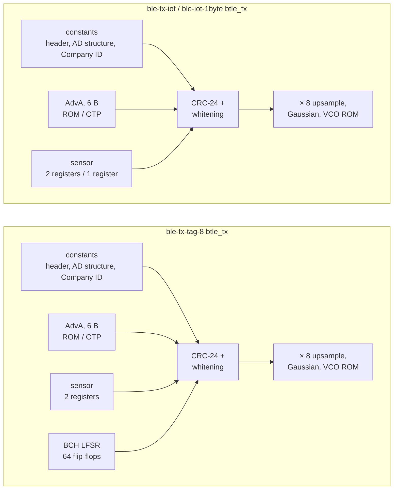

| Block | `ble-tx-min` | `ble-tx-tag-8` | **`ble-tx-iot`** | **`ble-iot-1byte`** |
|---|---|---|---|---|
| Header, AD structure, Company ID | header in registers, AdvData written | constants | constants | constants |
| Sensor / AdvData store | 31 bytes (SRAM or flip-flops) | 2 registers | **2 registers** | **1 register** |
| Error correction | none | BCH t = 8, 64-bit LFSR | **none** | **none** |
| PDU bit counter / byte address | 9 / 6 bits | 8 / 5 bits | **7 / 4 bits** | **7 / 4 bits** |
| AdvA | ROM or six eFuse blocks | the same | the same | the same |
| Gaussian filter, VCO ROM, CRC-24, whitening | fixed taps, ROM | the same | the same | the same |
| Receiver | yes | no | **no** | **no** |

**The packet** (`scripts/senseworks/tag_packet.py`, one in each branch):

| PDU bytes | Field | `ble-tx-iot` | `ble-iot-1byte` | Where it comes from |
|---|---|---:|---:|---|
| 0 | header byte 0, `ADV_NONCONN_IND`, TxAdd 1 | `0x42` | `0x42` | constant |
| 1 | header byte 1, the payload length | 12 | 11 | constant |
| 2–7 | AdvA, least significant byte first | the chip's | the chip's | ROM or OTP |
| 8 | AD structure: length | 5 | 4 | constant |
| 9 | AD structure: type, Manufacturer Specific Data | `0xFF` | `0xFF` | constant |
| 10–11 | Company ID | `0xFFFF` by default | `0xFFFF` by default | constant (`COMPANY_ID`) |
| 12 | sensor d0 | written | written | register on `clkb` |
| 13 | sensor d1 | written | — | register on `clkb` |
| then | CRC-24 | | | `crc24` (unchanged) |

| Packet | PDU (bytes) | On the air (bytes) | Time | One event (3 channels) | vs `ble-tx-min`'s 39-byte PDU |
|---|---:|---:|---:|---:|---:|
| `ble-tx-min`, 39-byte PDU | 39 | 47 | 376 µs | 1 128 µs | — |
| `ble-tx-tag-8` | 22 | 30 | 240 µs | 720 µs | −36.2 % |
| **`ble-tx-iot`** | 14 | 22 | **176 µs** | **528 µs** | **−53.2 %** |
| **`ble-iot-1byte`** | 13 | 21 | **168 µs** | **504 µs** | **−55.3 %** |

**Why it is standard.** The arguments of `TX_TAG_COMPARISON.md` § 2 hold for both: non-connectable advertising needs
no receiver and no Flags structure, AdvData may hold fewer than 31 bytes, and Manufacturer Specific Data starts with
a Company ID. `0xFFFF` is the value for tests: **a product needs its own Company ID, assigned by the Bluetooth SIG**.
An independent dissector reads every packet the RTL sent as such (§ 3.5).

**The contract.** The sensor's bytes are written before `tx_start`, never while the packet is sent; `clkb` at 8 MHz
or faster. Pairs to any other address are dropped.

## 3. Function: the signals, the receiver and the bit error rate

### 3.1 Signals in the transmitter (upstream's `py-fig3.png`)

| upstream (Python model, its example 2) | `ble-tx-iot` (RTL, Icarus) | `ble-iot-1byte` (RTL, Icarus) |
|---|---|---|
|  | 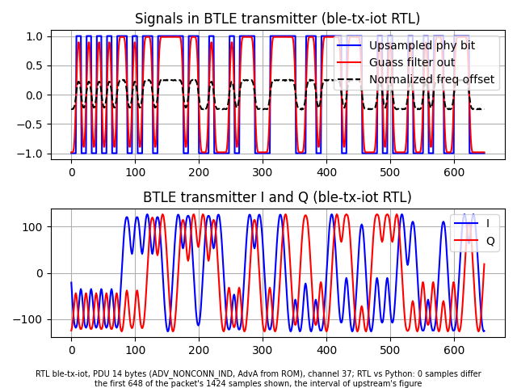 | 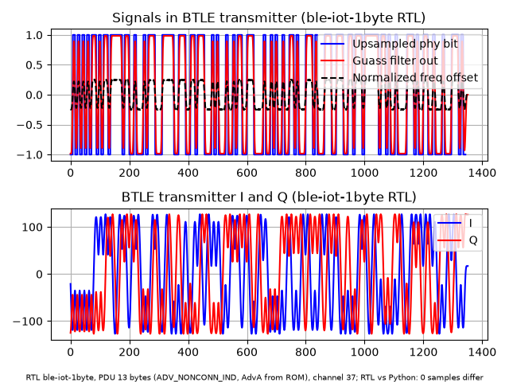 |

Upstream's figure is a 2-byte data PDU, which these transmitters cannot send, so the columns show the form of the
signal and not the same packet. The two others are each tag's whole packet on channel 37, with the RTL's actual
output against the Python model on every sample: **0 samples differ** in both (1 424 samples, 176 PHY bits; 1 360
samples, 168 PHY bits; `tx_iot_figures_tx.json`, `iot_1byte_figures_tx.json`).

### 3.2 The receiver's decision (upstream's `py-fig4.png`)

| upstream | `ble-tx-iot` | `ble-iot-1byte` |
|---|---|---|
|  | 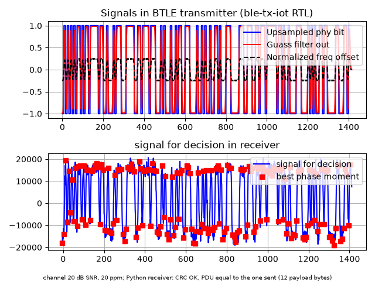 | 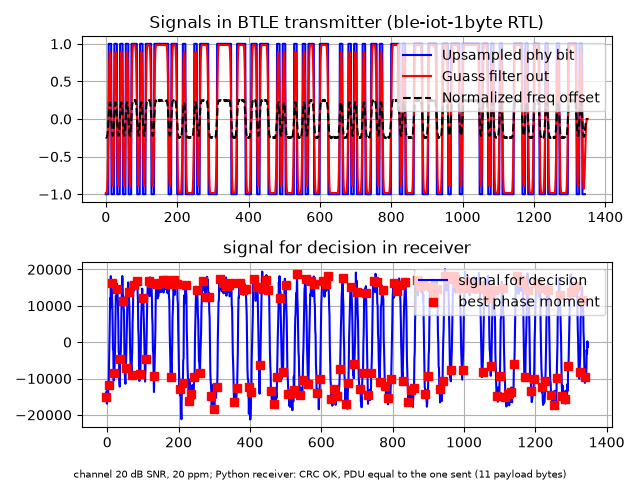 |

After 20 dB SNR and 20 ppm, demodulated by upstream's receiver model: CRC OK and the PDU received equal to the one
sent, on both.

### 3.3 Bit error rate (upstream's `open_btle_baseband_chip_21_1.png`, `_23_1.png`)

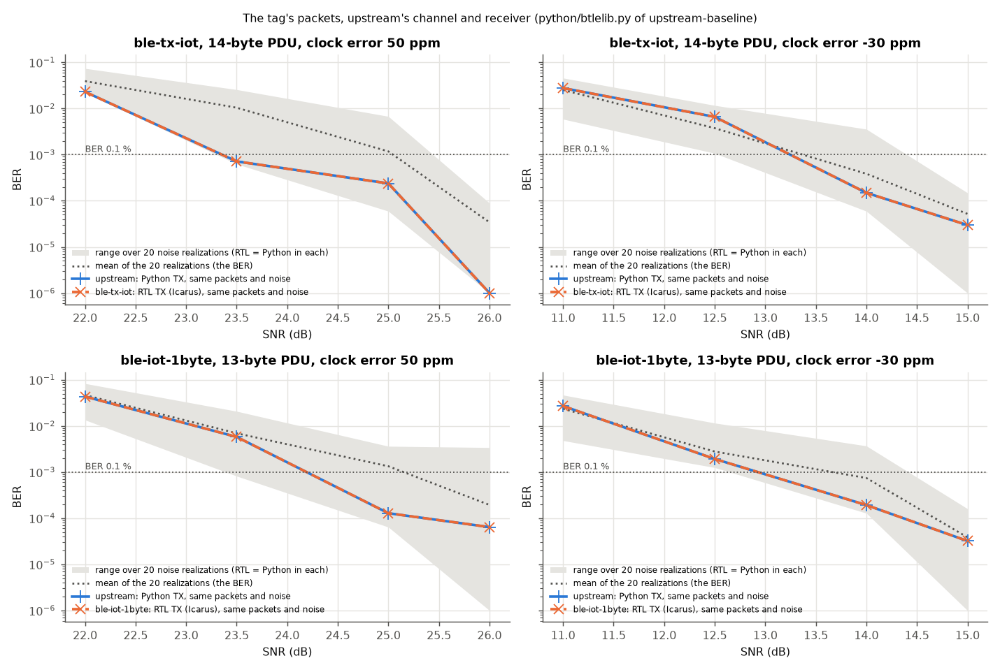

The method is `TX_FINAL_DECISIONS.md` § 3.3: each tag's own PDU with random sensor bytes, 100 / 200 / 300 / 300 packets
at the four SNR points, a clock error that also shifts the carrier, AWGN, upstream's receiver, a fixed seed. The
transmitter is the RTL, 300 packets, each compared with upstream's Python transmitter (0 samples differ). Each packet
goes through the channel once per noise draw, with the same noise for both transmitters: **in all 20 draws, at every
point, in both branches, the RTL and the Python transmitter give the same errors.** A point at 0 errors is drawn at
10⁻⁶, the bottom of the axis.

`ble-tx-iot` (11 200 to 33 600 bits per point):

| SNR (dB) | upstream TX, same noise | **RTL, same noise** | 20 draws: min – median – max | **20 draws: mean** |
|---:|---:|---:|---:|---:|
| **50 ppm** | | | | |
| 22.0 | 2.30 × 10⁻² | **2.30 × 10⁻²** | 2.2 × 10⁻² – 3.4 × 10⁻² – 7.4 × 10⁻² | **3.93 × 10⁻²** |
| 23.5 | 7.14 × 10⁻⁴ | **7.14 × 10⁻⁴** | 6.3 × 10⁻⁴ – 1.1 × 10⁻² – 2.6 × 10⁻² | **1.04 × 10⁻²** |
| 25.0 | 2.38 × 10⁻⁴ | **2.38 × 10⁻⁴** | 6.0 × 10⁻⁵ – 2.1 × 10⁻⁴ – 6.8 × 10⁻³ | **1.18 × 10⁻³** |
| 26.0 | 0 | **0** | 0 – 3.0 × 10⁻⁵ – 8.9 × 10⁻⁵ | **3.42 × 10⁻⁵** |
| BER 0.1 % at | 23.4 dB | **23.4 dB** | one draw: 23.3 – 25.3 dB | **25.1 dB** |
| **−30 ppm** | | | | |
| 11.0 | 2.78 × 10⁻² | **2.78 × 10⁻²** | 5.9 × 10⁻³ – 2.7 × 10⁻² – 4.6 × 10⁻² | **2.52 × 10⁻²** |
| 12.5 | 6.61 × 10⁻³ | **6.61 × 10⁻³** | 1.1 × 10⁻³ – 2.3 × 10⁻³ – 1.2 × 10⁻² | **3.75 × 10⁻³** |
| 14.0 | 1.49 × 10⁻⁴ | **1.49 × 10⁻⁴** | 6.0 × 10⁻⁵ – 2.1 × 10⁻⁴ – 3.6 × 10⁻³ | **3.85 × 10⁻⁴** |
| 15.0 | 2.98 × 10⁻⁵ | **2.98 × 10⁻⁵** | 0 – 4.5 × 10⁻⁵ – 1.5 × 10⁻⁴ | **5.21 × 10⁻⁵** |
| BER 0.1 % at | 13.3 dB | **13.3 dB** | one draw: 12.6 – 14.3 dB | **13.4 dB** |

`ble-iot-1byte` (10 400 to 31 200 bits per point):

| SNR (dB) | upstream TX, same noise | **RTL, same noise** | 20 draws: min – median – max | **20 draws: mean** |
|---:|---:|---:|---:|---:|
| **50 ppm** | | | | |
| 22.0 | 4.34 × 10⁻² | **4.34 × 10⁻²** | 1.4 × 10⁻² – 4.3 × 10⁻² – 8.3 × 10⁻² | **4.66 × 10⁻²** |
| 23.5 | 5.77 × 10⁻³ | **5.77 × 10⁻³** | 8.2 × 10⁻⁴ – 5.8 × 10⁻³ – 2.1 × 10⁻² | **6.92 × 10⁻³** |
| 25.0 | 1.28 × 10⁻⁴ | **1.28 × 10⁻⁴** | 6.4 × 10⁻⁵ – 2.2 × 10⁻⁴ – 3.6 × 10⁻³ | **1.33 × 10⁻³** |
| 26.0 | 6.41 × 10⁻⁵ | **6.41 × 10⁻⁵** | 0 – 3.2 × 10⁻⁵ – 3.4 × 10⁻³ | **1.94 × 10⁻⁴** |
| BER 0.1 % at | 24.2 dB | **24.2 dB** | one draw: 23.5 – 26.0 dB | **25.2 dB** |
| **−30 ppm** | | | | |
| 11.0 | 2.70 × 10⁻² | **2.70 × 10⁻²** | 4.8 × 10⁻³ – 2.6 × 10⁻² – 4.7 × 10⁻² | **2.35 × 10⁻²** |
| 12.5 | 1.92 × 10⁻³ | **1.92 × 10⁻³** | 1.3 × 10⁻³ – 1.9 × 10⁻³ – 1.2 × 10⁻² | **2.79 × 10⁻³** |
| 14.0 | 1.92 × 10⁻⁴ | **1.92 × 10⁻⁴** | 1.3 × 10⁻⁴ – 2.9 × 10⁻⁴ – 3.7 × 10⁻³ | **7.44 × 10⁻⁴** |
| 15.0 | 3.21 × 10⁻⁵ | **3.21 × 10⁻⁵** | 0 – 3.2 × 10⁻⁵ – 1.6 × 10⁻⁴ | **3.85 × 10⁻⁵** |
| BER 0.1 % at | 12.9 dB | **12.9 dB** | one draw: 12.7 – 14.3 dB | **13.7 dB** |

- **The transmitter changes nothing**: with the same packets and noise, upstream's transmitter and the RTL give the
  same errors, at every point of every draw.
- **The packet length does not move the 0.1 % point beyond the draws' spread**: 25.1 and 25.2 dB at 50 ppm against
  `ble-tx-min`'s 25.2 dB, 13.4 and 13.7 dB at −30 ppm against its 14.0 dB, all inside the range one draw spans. A
  lost packet costs a fixed share of the bits at any length, and these rates are ruled by such losses. A difference
  of a few tenths of a dB is beyond what these packet counts can resolve.
- **The two branches are not told apart either**: their difference in the means (0.1 and 0.3 dB) is less than the
  spread of one draw (about 2 dB).
- **What a shorter packet does buy, a model says.** With the simulator of the FEC study, the minimal two-byte packet
  needs 8.88 / 10.86 / 12.94 / 25.00 dB at PER 10 % and 0 / 20 / −30 / 50 ppm, against 9.85 / 12.31 / 14.34 / 26.73 dB
  for the 39-byte PDU (`TX_TAG_COMPARISON.md` § 10; a model, not a measurement of these branches). `ble-tx-tag-8`'s
  code reaches 6.54 / 8.07 / 9.82 / 20.56 dB: **this is what removing the BCH code gives up, 2.3 to 4.4 dB**. The
  one-byte packet was not simulated.

### 3.4 Alignment with the SDR program (upstream's `py-fig0.png`, `py-fig1.png`)

Not repeated, as in `TX_FINAL_DECISIONS.md` § 3.4: those figures compare upstream's Python model with the C program of
the SDR project. The RTL produces the Python model's samples exactly for these packets (§ 3.5).

### 3.5 Verification

Upstream's testbenches that exercise a receiver (the 270-run matrix of `ble-tx-min`) cannot run: there is no receiver.
The evidence is instead a chain: **each branch against `ble-tx-min` (`be5d9774`), every output on every clock**, and
`ble-tx-min` against corrected master (`TX_MIN_VALIDATION.md`), plus direct checks against upstream's model.
`scripts/senseworks/run_tag_validation.sh`, each branch's own run.

| Check | What it shows | `ble-tx-iot` | `ble-iot-1byte` |
|---|---|---:|---:|
| `tests/test_tx_tag.py`: against `ble-tx-min`'s `btle_tx` given the whole PDU, every output on every clock; random channel, access address, CRC init, preamble, extra `tx_start`, resets that abort packets; 6 clocks on `clkb`; ROM and OTP; 2 AdvA and Company IDs | the tag sends, bit for bit, the PDU defined | **72/72 runs** | **72/72 runs** |
| The same with deliberate faults | each makes a run fail with a concrete mismatch | **13/13 caught** | **13/13 caught** |
| `tests/test_tx_tag_packet.py`: upstream's TX testbench, channels 37, 38, 39, 0, 10, five sensor values, both Gaussian filters | the I/Q against upstream's Python model, every sample; its receiver decodes the PDU | **50/50** | **50/50** |
| `check_tag_scapy.py` (scapy's BLE dissector) on those packets | an independent parser: CRC, PDU type, TxAdd, AdvA, one Manufacturer Specific Data structure, the sensor and nothing after it | **50/50** | **50/50** |
| `tests/test_tag_controller.py`: `btle_controller` through its AXI registers, as the firmware writes them; three readings × channels 37, 38, 39 back to back, both filters | PHY bits, Gaussian output, I/Q (turned, below), loopback, samples to the RF transceiver; one packet per pulse | **18/18 packets** | **18/18 packets** |
| Gate-level netlists (Nangate45) of the controller side by side with corrected master, sending this tag's PDU, 3 scenarios (§ 7.1) | every output but the receiver's, on every clock | **0 mismatches** | **0 mismatches** |
| `run_lint.py` (Verilator 5.020, warnings fatal), `GAUSS_TABLE` 0 and 1 | | **PASS 2/2**, 13 exceptions | **PASS 2/2**, 13 exceptions |

The three behaviours `TX_TAG_COMPARISON.md` § 5 reports hold here, none new and all inherited: the VCO's phase
carries over between packets (widest spread of the turn 0.0127 and 0.0148 rad), the window of valid samples to the
RF transceiver lags one sample depending on the 2:1 phase (10 of 18 and 6 of 18 packets), and `tx_start` through the
registers is a level that the firmware pulses.

## 4. Area in 45 nm (Nangate45 cells)

Yosys + ABC with the Nangate45 library, `GAUSS_TABLE = 1`, AdvA in the ROM (`results/area/tx-iot/<branch>/`). Neither
branch has a memory, so the cell area is the total.

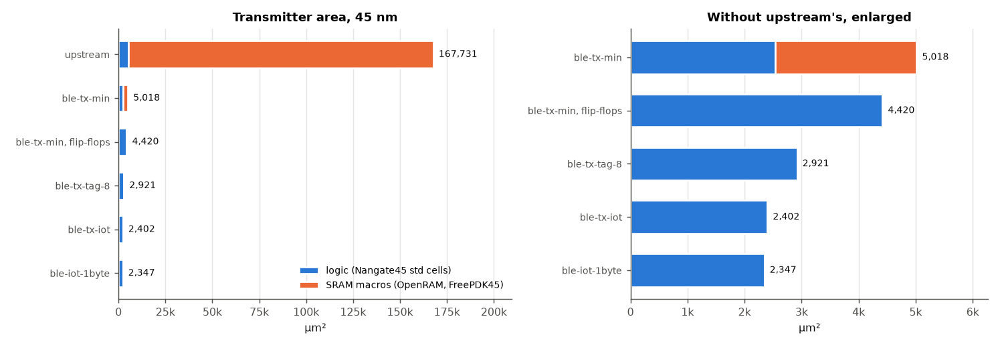

| `btle_tx` | cells | flip-flops | logic (µm²) | SRAM macros (µm²) | **TX total (µm²)** | vs upstream | vs corrected master | vs `ble-tx-min` | vs `ble-tx-tag-8` |
|---|---:|---:|---:|---:|---:|---:|---:|---:|---:|
| upstream | 3 409 | 404 | 5 322.9 | 162 408.5 | **167 731.4** | — | −1.9 % | | |
| corrected master | 5 823 | 547 | 8 559.1 | 162 408.5 | **170 967.6** | +1.9 % | — | | |
| `ble-tx-min` | 1 488 | 239 | 2 542.7 | 2 475.8 | **5 018.5** | −97.0 % | −97.1 % | — | |
| `ble-tx-min`, flip-flops | 2 234 | 486 | 4 420.4 | 0 | **4 420.4** | −97.4 % | −97.4 % | −11.9 % | |
| `ble-tx-tag-8` | 1 670 | 295 | 2 921.2 | 0 | **2 921.2** | −98.3 % | −98.3 % | −41.8 % | — |
| **`ble-tx-iot`** | **1 413** | **230** | **2 402.5** | **0** | **2 402.5** | **−98.6 %** | **−98.6 %** | **−52.1 %** | **−17.8 %** |
| **`ble-iot-1byte`** | **1 354** | **222** | **2 346.9** | **0** | **2 346.9** | **−98.6 %** | **−98.6 %** | **−53.2 %** | **−19.7 %** |

| Inside `btle_tx` (µm²) | upstream | `ble-tx-min` | **`ble-tx-iot`** | **`ble-iot-1byte`** |
|---|---:|---:|---:|---:|
| Gaussian filter (`gauss_filter`) | 3 366.0 | 256.7 | **256.7** | **256.7** |
| VCO logic (`vco`) | 150.0 | 593.2 (the ROM) | **593.2** | **593.2** |
| VCO macros | 138 700.5 | 0 | **0** | **0** |
| Packet buffer macro | 23 708.0 | 2 475.8 | **0** | **0** |
| `crc24` | — | 353.8 | **353.8** | **353.8** |
| `scramble` | — | 147.9 | **147.9** | **147.9** |
| `gfsk_modulation` (with the filter and the VCO) | — | 1 115.9 | **1 108.2** | **1 108.2** |

1. **`ble-tx-iot` is 69.8 times smaller than upstream's transmitter, `ble-iot-1byte` 71.5 times**, and both less than
   half of `ble-tx-min` with its SRAM.
2. **Removing the code saves 518.7 µm²** against `ble-tx-tag-8` (64 LFSR flip-flops and their logic, one counter bit).
3. **The modulator is now the transmitter**: `gfsk_modulation`, `crc24` and `scramble` are 1 609.9 µm² of 2 402.5 (67 %),
   untouched. What this packet's definition could still remove is small; further reductions would have to come from
   fixing what software still writes (§ 10.4).
4. `gfsk_modulation` differs from `ble-tx-min`'s by 0.7 %, the same RTL: ABC's mapping moves with the set of files read
   (`TX_TAG_COMPARISON.md` § 6).

The whole controller (no receiver; the Link Layer and the FPGA platform's IQ-capture RAM remain, which a tag chip would
not carry):

| `btle_controller` | cells | flip-flops | cell area (µm²) | SRAM bits |
|---|---:|---:|---:|---:|
| upstream | 50 295 | 4 578 | 71 706.4 | 1 136 070 |
| corrected master | 52 357 | 4 722 | 74 684.8 | 1 136 070 |
| `ble-tx-min` | 47 971 | 4 392 | 68 470.0 | 1 099 462 |
| `ble-tx-tag-8` | 10 019 | 1 995 | 17 228.3 | 1 066 438 |
| **`ble-tx-iot`** | **9 735** | **1 930** | **16 691.8** | 1 066 438 |
| **`ble-iot-1byte`** | **9 625** | **1 922** | **16 612.0** | 1 066 438 |

## 5. Timing

### 5.1 Static timing in 45 nm

`scripts/timing/run_sta.sh`, `STA_SET=tx` (`results/timing/tx-iot/<branch>/`): the mapped netlist cut at the flip-flops,
sized by ABC, worst path + clock-to-Q + setup (Nangate45 typical, no wires); target 62.5 ns (the 16 MHz baseband clock).

| | comb. path | **min period** | slack at 62.5 ns | Fmax |
|---|---:|---:|---:|---:|
| `btle_controller`, upstream | 1.631 ns | 1.991 ns | +60.509 ns | 502 MHz |
| `btle_controller`, **`ble-tx-iot`** | 1.190 ns | **1.549 ns** | +60.951 ns | 645.5 MHz |
| `btle_controller`, **`ble-iot-1byte`** | 1.190 ns | **1.549 ns** | +60.951 ns | 645.5 MHz |
| `btle_tx`, `ble-tx-min` (`GAUSS_TABLE = 1`) | 0.852 ns | 1.199 ns | +61.301 ns | 833.7 MHz |
| `btle_tx`, **`ble-tx-iot`** | 0.831 ns | **1.178 ns** | +61.322 ns | 848.7 MHz |
| `btle_tx`, **`ble-iot-1byte`** | 0.852 ns | **1.199 ns** | +61.301 ns | 834.1 MHz |

With no receiver the controller's worst path moves from the demodulator's multiplier to the Link Layer's clock crossing
(`clk_cross_bus_bb_to_s_axi_i`), which neither branch touches. The transmitter's period is the same within the flow's
noise, about 50 times faster than the 16 MHz clock needs.

### 5.2 In the FPGA and in GF180MCU

Every clock and every corner meets timing with room: on the xc7z020 +53.6 ns or more at 62.5 ns (§ 6), in GF180MCU +10.7 ns or
more of setup slack in the worst of 9 corners (§ 8), in ICsprout55 +13.9 ns or more in the worst of 3 (§ 8.2; on `clkb`'s 20 ns,
+43.8 ns on `clk`'s 62.5 ns).

## 6. FPGA: the xc7z020 of upstream's report

Vivado 2026.1, `xc7z020clg484-1`, default strategies, `scripts/fpga/xc7z020/impl.tcl` in mode `ooc_hd`, then `post.tcl`
(`results/fpga/xc7z020-iot/<configuration>/`), `GAUSS_TABLE = 1`. The calibration of the flow against upstream's published
table is `TX_FINAL_DECISIONS.md` § 6 (LUTs within 0.2 %, registers identical).

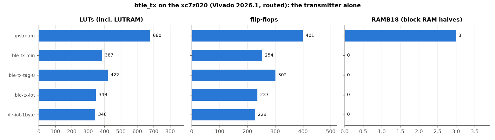

| Routed, xc7z020 | upstream | `ble-tx-min` | `ble-tx-tag-8` | **`ble-tx-iot`** | **`ble-iot-1byte`** |
|---|---:|---:|---:|---:|---:|
| **`btle_tx`**: LUTs | 680 | 387 | 422 | **349** | **346** |
| **`btle_tx`**: flip-flops | 401 | 254 | 302 | **237** | **229** |
| **`btle_tx`**: RAMB18 | 3 | 0 | 0 | **0** | **0** |
| `btle_tx`: dynamic power (vectorless) | 3 mW | 1 mW | 1 mW | 1 mW | 1 mW |
| Controller: LUTs / flip-flops | 4 458 / 5 756 | 3 871 / 5 552 | 1 881 / 3 028 | **1 819 / 2 963** | **1 809 / 2 955** |
| Controller: block RAM tiles / DSPs | 38 / 48 | 36.5 / 48 | 32.5 / 0 | **32.5 / 0** | **32.5 / 0** |
| WNS `bb_clk` (62.5 ns) / AXI (10 ns) | 42.058 / 2.858 ns | 46.041 / 2.475 ns | 54.130 / 3.323 ns | **53.921 / 3.678 ns** | **53.662 / 3.682 ns** |
| `btle_tx`'s worst path, slack | — | +5.901 ns | +7.002 ns | **+7.435 ns** | **+7.613 ns** |
| Total on-chip power (vectorless) | 0.211 W | 0.208 W | 0.188 W | **0.188 W** | **0.188 W** |
| Vivado's warnings in the whole log / unreviewed (§ 8.1) | 419 / 415 | 243 / 0 | 450 / 0 | **450 / 0** | **450 / 0** |

- **Here, unlike `ble-tx-tag-8`, the tag is smaller than `ble-tx-min` on the FPGA too**: the 64-bit LFSR was flip-flops
  either way, and without it the block is below `ble-tx-min`'s, whose 31 bytes cost only 8 LUTs of distributed RAM.
- **The 450 warnings are more, not worse**: 208 of them are the one exception for the receiver's ports, which the
  controller's interface keeps.
- The 32 RAMB36 are the FPGA platform's IQ-capture RAM; 0.106 W of the power is the device's static power. Vivado's
  power is an estimate and rounds to 1 mW.

Vivado's Device view (`device_view.ps1`), `btle_tx` in orange; upstream's own image is
[`btle_controller_xilinx_7z020.jpg`](../../open_btle_baseband_chip/btle_controller_xilinx_7z020.jpg):

| `ble-tx-iot`: 695 of 5 931 primitives | `ble-iot-1byte`: 681 of 5 917 |
|---|---|
| 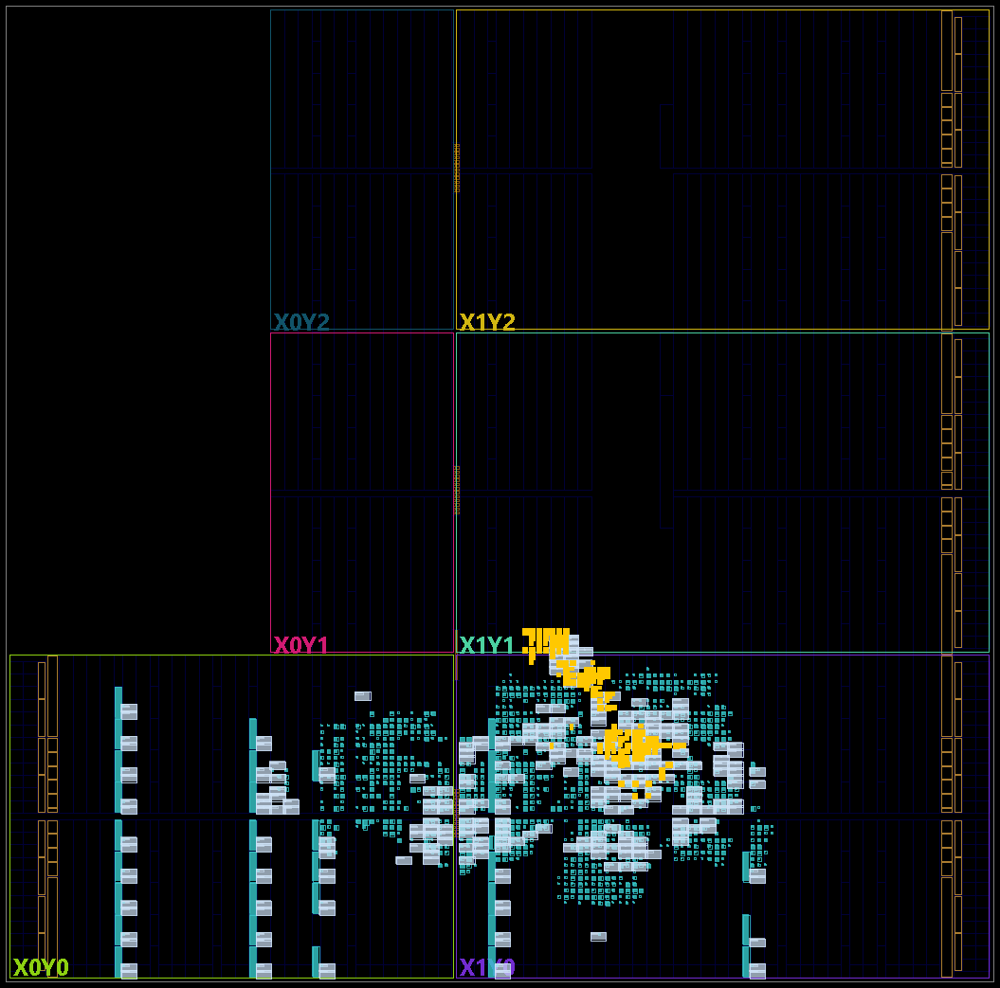 | 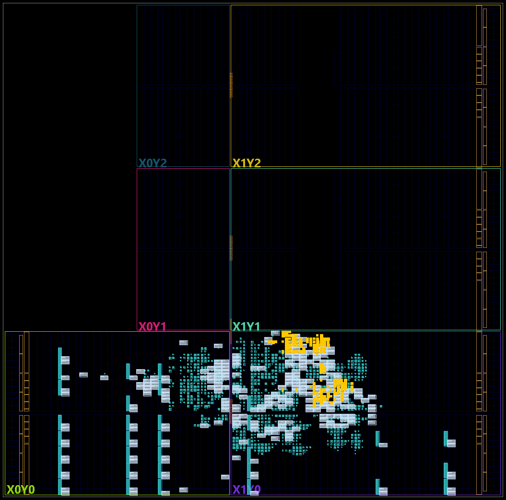 |

Out of context, where the block lands means nothing (`TX_FINAL_DECISIONS.md` § 6); its share does: 11.7 % and 11.5 % of a
controller that has lost its receiver, against `ble-tx-min`'s 767 of 11 346 (6.8 %), in about half the primitives.

## 7. Power

Three measures; none is a silicon measurement.

**7.1 Switching activity of the controller.** Gate-level netlists (Nangate45) of each branch and of corrected master, in
one Verilator simulation per scenario, 100 000 baseband clocks, Σ toggles × pin capacitance of data pins and flip-flop
clock pins (`results/power/tx-iot/<branch>/`). **Both send this tag's own PDU**, so the numbers are compared within a
run, not with `TX_FINAL_DECISIONS.md` § 7.1's (another packet). The scenarios `rx` and `mixed` need a receiver and do not
run; in the others, every output but the receiver's is compared on every clock: 0 mismatches.

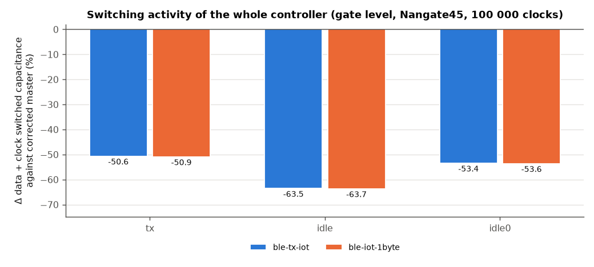

| Data + clock switched capacitance | `tx` | `idle` | `idle0` |
|---|---:|---:|---:|
| corrected master, with this tag's PDU (fF·toggles) | 1.041 × 10⁹ | 1.290 × 10⁹ | 0.975 × 10⁹ |
| **`ble-tx-iot`** | **−50.63 %** | **−63.54 %** | **−53.44 %** |
| corrected master, with the one-byte PDU (fF·toggles) | 1.042 × 10⁹ | 1.290 × 10⁹ | 0.975 × 10⁹ |
| **`ble-iot-1byte`** | **−50.90 %** | **−63.66 %** | **−53.59 %** |
| Of which the transmitter's blocks alone, `ble-tx-iot` | −39.8 % | −58.0 % | −58.0 % |
| Of which the transmitter's blocks alone, `ble-iot-1byte` | −41.4 % | −59.4 % | −59.4 % |

Most of the saving is the receiver's clock load (4.56 × 10⁸ fF·toggles at rest, which the noise of `idle` raises to
7.55 × 10⁸), then the transmitter's. What remains is 76–86 % the Link Layer (3.9 × 10⁸ fF·toggles), which a tag chip would
reduce: this controller keeps the FPGA platform's registers.

**7.2 The SRAMs' energy (SPICE).** Neither branch has an SRAM, so there is nothing to characterize, against
`ble-tx-min`'s 2.92–10.51 µW dynamic and 16.41 µW of leakage (`TX_FINAL_DECISIONS.md` § 7.2).

**7.3 Leakage of the transmitter's logic** (`scripts/power/logic_leakage.py`, the Nangate45 liberty's `cell_leakage_power`
of every cell, 1.10 V typical; `results/power/tx-iot/leakage.md`):

| `btle_tx` | logic leakage | of which flip-flops | + SRAM leakage | **TX static** |
|---|---:|---:|---:|---:|
| upstream | 112.61 µW | 31.96 µW | not characterized | > 112.61 µW |
| `ble-tx-min` | 51.71 µW | 18.91 µW | 16.41 µW | 68.12 µW |
| `ble-tx-min`, flip-flops | 87.84 µW | 38.45 µW | — | 87.84 µW |
| `ble-tx-tag-8` | 59.43 µW | | — | 59.43 µW |
| **`ble-tx-iot`** | **49.15 µW** | **18.20 µW** | — | **49.15 µW (−27.8 % against `ble-tx-min`)** |
| **`ble-iot-1byte`** | **47.81 µW** | **17.56 µW** | — | **47.81 µW (−29.8 %)** |

**7.4 In GF180MCU** (§ 8), OpenSTA's vectorless estimate at 5 V, the default activity of every net: 23.73 mW for
`ble-tx-iot` and 22.84 mW for `ble-iot-1byte` (leakage 0.53 and 0.50 µW), against 43.28 mW for `ble-tx-min` with flip-flops
and 27.78 mW for `ble-tx-tag-8`. An estimate of the order of magnitude, not of the difference. The compact die costs nothing
here: the same `ble-tx-iot` on the 760 × 760 µm die gives 26.70 mW and 1.16 µW. **In ICsprout55** (§ 8.2), the same estimate at
1.2 V (tt, 25 °C) gives 0.303 mW for `ble-tx-iot` and 0.246 mW for `ble-iot-1byte`, 78 and 93 times less than at 5 V in GF180MCU,
mostly the supply (dynamic power goes with V², (5 / 1.2)² = 17) and the capacitance. Its leakage is higher, not lower: 1.66 and
1.47 µW at 25 °C, 6.46 and 6.22 µW at 125 °C (ss), against 0.53 and 0.50 µW in GF180MCU, the thin oxide and short channels of 55 nm.

## 8. Layout in open PDKs (GF180MCU-D; ICsprout55 in § 8.2)

LibreLane Classic, GF180MCU-D, `gf180mcu_fd_sc_mcu7t5v0`, in the eFuse compiler's Nix environment
(`scripts/layout/tx_min_gf180/run.sh`), `btle_tx` with `GAUSS_TABLE = 1` and `ADV_ADDRESS_OTP = 1` (AdvA in six eFuse blocks,
§ 9), `clk` at 16 MHz and `clkb` at 50 MHz, 9 corners (ss 125 °C 4.5 V, tt 25 °C 5 V, ff −40 °C 5.5 V × three RC).

| `ble-tx-iot`, 760 × 230 µm | `ble-iot-1byte`, 760 × 225 µm |
|---|---|
| 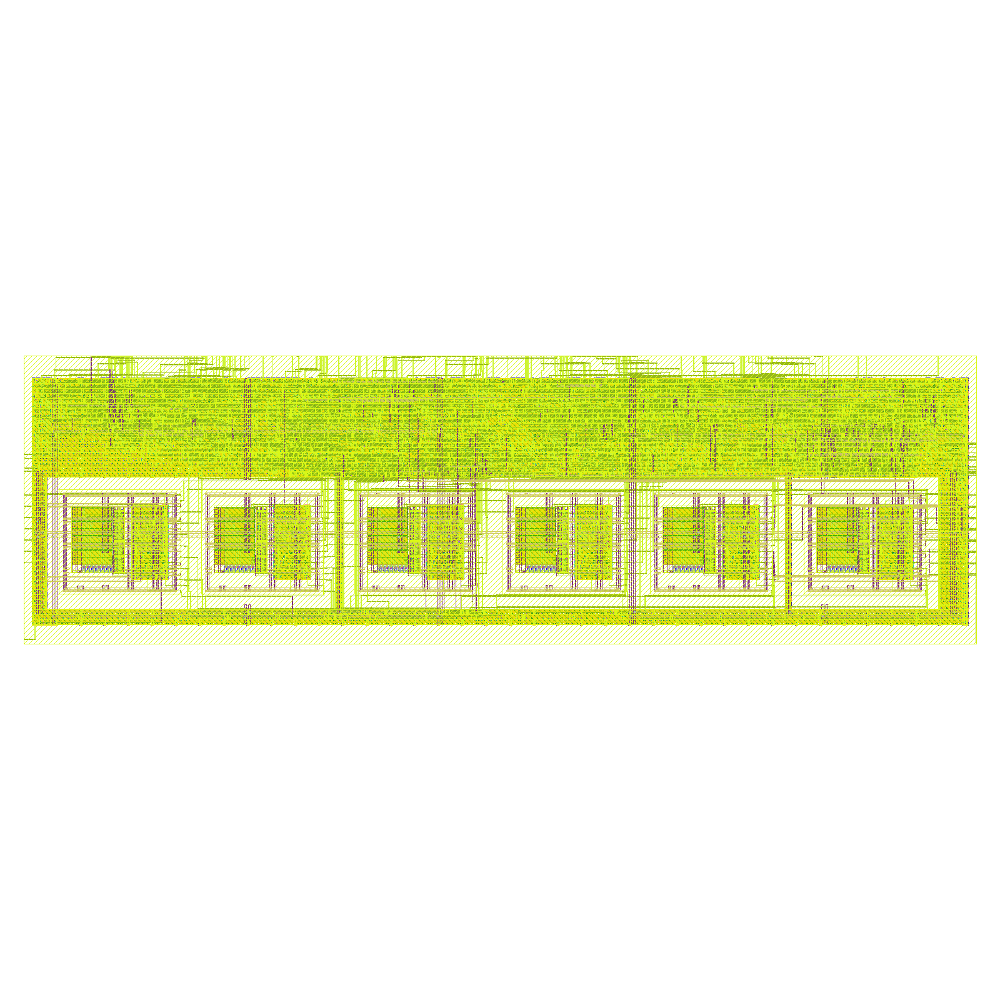 | 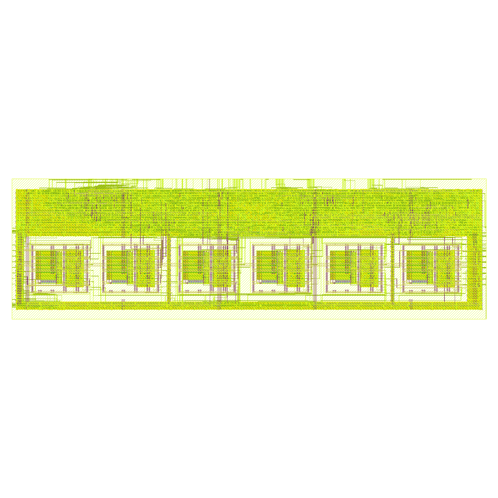 |
| logic above, the six eFuse blocks in a row at the bottom | the same |

| Signoff | **`ble-tx-iot`** (`tx-iot-gf180`) | **`ble-iot-1byte`** (`iot-1byte-gf180`) |
|---|---|---|
| DRC, KLayout (the foundry's deck, whole GDS) | **0** | **0** |
| DRC, Magic / routing DRC | 0 / 0 | 0 / 0 |
| LVS (Netgen) / antenna | clean / 0 | clean / 0 |
| Worst setup slack: ss / tt / ff | +10.888 / +13.166 / +14.157 ns | +10.740 / +13.117 / +14.150 ns |
| Worst hold slack: ff / tt / ss | +0.211 / +0.497 / +1.146 ns | +0.198 / +0.477 / +1.109 ns |
| Max slew / max capacitance violations | 0 / 0 | 0 / 0 |
| Max fanout (10, LibreLane's for the PDK; the liberty sets none) | **0** | every data net within it; 1 clock-tree buffer above it |
| IR drop (worst) / clock skew | 3.65 mV / 0.47 ns | 3.71 mV / 0.45 ns |
| Flow warnings / unreviewed (§ 8.1) | 31 / **0** | 31 / **0** |

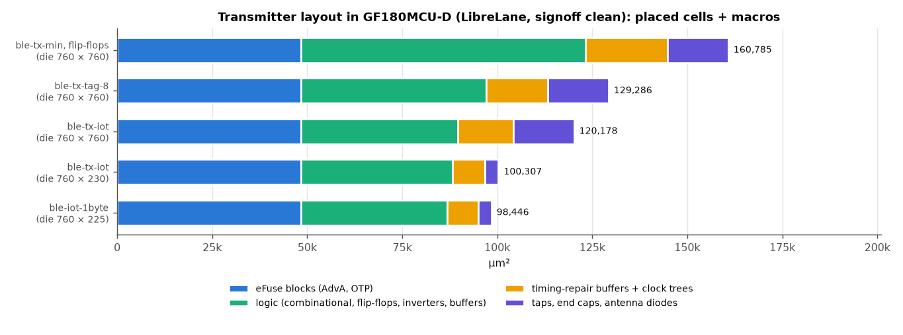

| GF180MCU-D (µm²) | `ble-tx-min`, flip-flops | `ble-tx-tag-8` | `ble-tx-iot`, the old die | **`ble-tx-iot`** | **`ble-iot-1byte`** |
|---|---:|---:|---:|---:|---:|
| Die (µm) | 760 × 760 | 760 × 760 | 760 × 760 | **760 × 230** | **760 × 225** |
| eFuse blocks (AdvA, OTP) | 48 452.1 | 48 452.1 | 48 452.1 | 48 452.1 | 48 452.1 |
| Logic: combinational, flip-flops, inverters, buffers | 74 685.1 | 48 691.7 | 41 199.6 | **39 856.1** | **38 402.8** |
| Timing-repair buffers + clock trees | 21 719.3 | 16 209.4 | 14 602.5 | **8 517.4** | **8 205.7** |
| Taps, end caps, antenna diodes | 15 928.4 | 15 932.8 | 15 924.0 | **3 481.6** | **3 385.0** |
| **Placed cells + macros** | 160 784.9 | 129 286.0 | 120 178.1 | **100 307.1** | **98 445.6** |
| vs `ble-tx-min`, flip-flops | — | −19.6 % | −25.3 % | **−37.6 %** | **−38.8 %** |
| vs `ble-tx-tag-8` | | — | −7.0 % | **−22.4 %** | **−23.9 %** |
| Flip-flops | 502 | 303 | 238 | **238** | **230** |
| **Die area** | 577 600 | 577 600 | 577 600 | **174 800 (−69.7 %)** | **171 000 (−70.4 %)** |
| Utilization of the core | 29.7 % | 23.9 % | 22.2 % | **68.6 %** | **68.7 %** |

### 8.0 Why 180 nm costs more than the node's 16 times, and what was conservative

Scaling alone predicts (180 / 45)² = 16. The libraries agree: GF180MCU's 7-track cells against Nangate45's are 14.1 times
for a flip-flop (63.66 / 4.522 µm²), 13.8 for a NAND2, 15.3 for a MUX2 and 16.5 for a NOR2, an XOR2 and an inverter. The whole
layout divided by the 45 nm figure gives more, and the division mixes different things:

| Against the 45 nm cell area | `ble-tx-iot`, old die | **`ble-tx-iot`** | **`ble-iot-1byte`** | In the 45 nm figure? |
|---|---:|---:|---:|---|
| Logic | 17.1 × | **16.6 ×** | **16.4 ×** | yes |
| eFuse blocks | 20.2 × | **20.2 ×** | **20.6 ×** | no: 45 nm has AdvA in the ROM, and no OTP exists there |
| Timing-repair buffers + clock trees | 6.1 × | **3.5 ×** | **3.5 ×** | no: pre-layout, no wires, no clock tree |
| Taps, end caps, diodes | 6.6 × | **1.4 ×** | **1.4 ×** | no: physical cells |
| **Placed cells + macros** | 50.0 × | **41.8 ×** | **41.9 ×** | |
| The same without the eFuse blocks | 29.9 × | **21.6 ×** | **21.3 ×** | |
| **Die** | 240 × | **72.8 ×** | **72.9 ×** | |

1. **The logic is at the node's ratio** (16.4–17.1 times): nothing is lost in the cells or in the mapping.
2. **What was conservative was the die, not the cells.** The 760 × 760 µm die was `ble-tx-min`'s, which also holds its SRAM
   variant; at 22 % utilization it held 395 237 µm² of filler. The taps follow the die's area (13 588 µm² against 2 327 µm²), and its
   long wires asked for buffers.
3. **The repair's margin was conservative too.** At 60 % on the slew and 30 % on the capacitance, set for `ble-tx-min`, it placed
   11 894 µm² of timing-repair buffers on 760 × 240 µm; at 10 %, 5 396 µm², with no violation.
4. **The eFuse blocks now weigh about half of the placed area** (48 %), and are the one large item left: each 8-bit block
   carries its own sense amplifiers, latches and ring (§ 9). They are not a logic cost: on any comparison of logic, leave
   them out.
5. **No layout can reach 16 times in total**, in this or any process: a 45 nm layout would also add a clock tree, buffers and
   taps. The fair comparison of the two nodes needs a 45 nm layout, which is not in this document.

### 8.0.1 The die sweep

The eFuse blocks stay in a row, at the x positions § 8.1 of `TX_FINAL_DECISIONS.md` found (their power pins under the core's
straps), and the die gets lower (`results/layout/die-sweep/<branch>.tsv`). "Gate": `synth_warning_gate.py --librelane`. Where a
run fails before signoff, no area is given. Density: `PL_TARGET_DENSITY_PCT`; margin: the repair's on slew / capacitance.

`ble-tx-iot`:

| Die (µm) | Density | Margin | Result | Placed (µm²) | Slew violations |
|---|---:|---|---|---:|---:|
| 760 × 400, 340, 300, 260 | 50 | 60 / 30 % | gate passes | 111 101, 109 681, 108 721, 108 118 | 0 |
| 760 × 240 | 50 | 60 / 30 % | signoff clean, gate fails: `GPL-0302` (density too low) | 108 853 | 0 |
| 760 × 240 | 72 | 60 / 30 % | fails: routing congestion (`GRT-0116`) | — | — |
| 760 × 240 | 72 | 30 / 30 % | gate passes | 101 236 | 0 |
| 760 × 240 | 72 | 10 / 10 % | gate passes | 100 487 | 0 |
| **760 × 230** | **74** | **10 / 10 %** | **gate passes: chosen** | **100 307** | **0** |
| 760 × 225 | 76 | 10 / 10 % | gate fails | 100 276 | 3 |
| 760 × 220 | 76 | 10 / 10 % | gate fails | 100 162 | 47 |
| 760 × 230, 220 | 76, 80 | 60 / 30 % | fails: detailed placement | — | — |
| 760 × 220, 200 | 50 | 60 / 30 % | fails: detailed placement | — | — |
| 760 × 210, 200 | 80, 84 | 10 / 10 % | fails: detailed placement | — | — |
| 480 × 480, 440 × 440: blocks in 2 × 3 | 50 | 60 / 30 % | fails: power grid not connected (`PSM-0069`) | — | — |
| 400 × 400: blocks in 2 × 3 | 50 | 60 / 30 % | fails: detailed placement | — | — |

`ble-iot-1byte` (margins 10 / 10 %):

| Die (µm) | Density | Result | Placed (µm²) | Slew violations |
|---|---:|---|---:|---:|
| 760 × 240 | 72 | gate fails | 98 740 | 25 |
| 760 × 235 | 72 | gate fails | 98 569 | 10 |
| 760 × 230 | 72 | gate fails | 98 617 | 26 |
| 760 × 230 | 74 | gate fails | 98 503 | 34 |
| 760 × 230 | 76 | gate passes | 98 459 | 0 |
| 760 × 230 | 78 | gate fails | 98 432 | 16 |
| **760 × 225** | **76** | **gate passes: chosen** | **98 446** | **0** |

**The slew at ss is not monotonic in the die or the density**: with a tenth of the margin, these die sizes sit at the edge,
and small changes of the placement cross it (the setting that closes `ble-tx-iot` does not close `ble-iot-1byte`, with 8
flip-flops fewer). Each committed layout is deterministic and clean; a change of RTL needs this sweep again. Which nets violate
was not traced. These 2.2 % of die between the branches are the sweep's luck, not the byte's. Against 760 × 760 µm, the arrangement
in 2 × 3 would save no area over the row (it is the placed area that limits the die) and it failed: it was not pursued. The die's
aspect ratio, 3.3 : 1, is the row's: a chip would choose its own.

### 8.1 Synthesis and layout without unreviewed warnings

The gate of `TX_FINAL_DECISIONS.md` § 8.1 (`scripts/validation/synth_warning_gate.py`, `synth_warning_exceptions.tsv`) passes
on both: no exception was added to the list.

| Warnings | upstream | `ble-tx-min` | **`ble-tx-iot`** | **`ble-iot-1byte`** |
|---|---:|---:|---:|---:|
| Vivado synthesis (its count) | 207 | 109 | **213** | **213** |
| Vivado, the whole log | 419 | 243, all reviewed | **450, all reviewed** | **450, all reviewed** |
| Yosys, every top of the area flow | — | 0 | **0** | **0** |
| LibreLane (`warning.log`) | — | 29 (flip-flops) | **31** | **31** |
| **Unreviewed, after the gate** | 415 (Vivado) | **0** | **0** | **0** |

The exceptions are those of `TX_FINAL_DECISIONS.md` § 8.1 and of the tag: the receiver's ports that the controller's interface
keeps (`Synth 8-7129`, 208), the AXI and BRAM ports, the Gaussian tap and `otp_prog` configuration ports, the tool's own messages.
The layout adds to `ble-tx-min`'s settings the three of `ble-tx-tag-8` (`RUN_POST_GRT_DESIGN_REPAIR`, `aoi221_1` excluded,
`IO_EXCLUDE_PIN_REGION bottom:*`) and those of § 8.0.1. `ble-iot-1byte`'s one fanout violation is a clock-tree buffer, the reviewed
case: every data net meets the limit.

### 8.2 The same transmitter in 55 nm: ICsprout55

**The process.** ICsprout55 (ICS55) is the open 55 nm PDK of ICsprout, a foundry, and of the ECOS team (ICT, Chinese Academy of
Sciences), github.com/openecos-projects/icsprout55-pdk, Apache 2.0. ECOS reported chips of its first ICS55 shuttle brought up on
2026-09-22 (openecos.com/en/news/20260922_1st_55nm_tapeout_results: most functions working, some faults, on designs of ECOS and of
community users). That shows it can be fabricated, not that it is qualified: its README calls it a preview release, forbids mass
production and lists SPICE models, extraction rules and memories as still to come. What the PDK publishes, and what this section
could therefore do:

| In the PDK (commit `e0b1122`, release V1p10C100) | Used here |
|---|---|
| Tech LEF (`N551P6M_ecos.lef`: MET1–MET5, two thick metals; resistance and capacitance per layer) | yes: routing on MET2–MET5, its RC for the parasitics |
| Three 7-track libraries (`ics55_LLSC_H7CR/L/H`, RVT/LVT/HVT): LEF, GDS, Verilog, liberty at 7 corners | **RVT** (`H7CR`): ss 1.08 V 125 °C rcworst, tt 1.2 V 25 °C, ff 1.32 V −40 °C rcbest |
| DRC, antenna and LVS decks | **no: Calibre's only**; none for KLayout, Magic or Netgen |
| SPICE models, RC extraction rules | not published (README, "Todo") |
| OTP / eFuse block | none public: **AdvA in the ROM** (`ADV_ADDRESS_OTP = 0`) |
| SRAM and ROM | online compilers (not needed: this transmitter has no memory) |

**The flow.** LibreLane has no ICS55 PDK, and ECOS's own flow (ECC) runs through an installer that was not run here, so the steps of
LibreLane Classic are scripted directly (`scripts/layout/tx_iot_ics55/`) on the same binaries as the GF180MCU runs (the eFuse compiler's
Nix environment: Yosys 0.54, OpenROAD `4534556`, KLayout 0.30.4), with the PDK settings of ECC (`chipcompiler/data/pdk.py`: site `core7`,
`FILLTAPH7R` taps every 58 µm, MET1 rails and MET4/MET5 straps, its excluded cells). Same RTL as § 8 (`GAUSS_TABLE = 1`), same clocks
(`clk` 16 MHz, `clkb` 50 MHz), same SDC, output load and slew/capacitance margins. What differs, and why:

| | GF180MCU (§ 8) | ICsprout55 | Why |
|---|---|---|---|
| AdvA | six eFuse blocks | ROM | no open OTP in 55 nm |
| Hold: clock uncertainty / repair margin | 0.25 / 0.1 then 0.05 ns | 0.10 / 0.04 ns (ECC's) | with 0.25 ns, about every flip-flop pair failed hold at ff by 0.2 ns (a clock-to-Q of tens of ps) and the repair hit OpenROAD's buffer cap: GF180's margin, not this process's need |
| Delay cells | excluded | allowed in the hold repair only | the hold repair needs them (261 and 256 `DLY4X2` placed) |
| After the global route | repair, then a new route | repair, then the route again where it changed (incremental) | the new route moved nets over the limits the repair had met |
| Signoff parasitics | OpenRCX on the PDK's rules | the global route's, from the tech LEF's RC | no extraction rules |
| Die | 760 × 230 / 225 µm, set by the eFuse row | **82 × 82 µm**, square, the smallest that passes (§ 8.2.1) | |

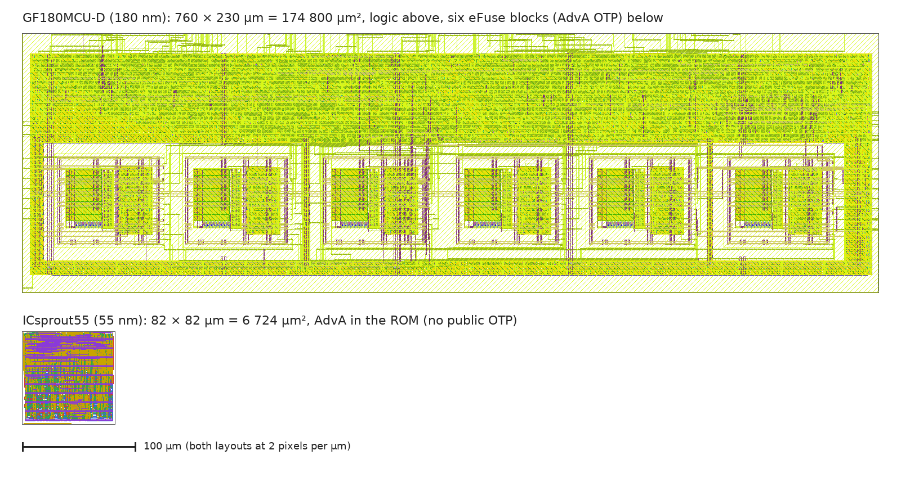

| `ble-tx-iot`, ICsprout55, 82 × 82 µm | `ble-iot-1byte`, ICsprout55, 82 × 82 µm |
|---|---|
| 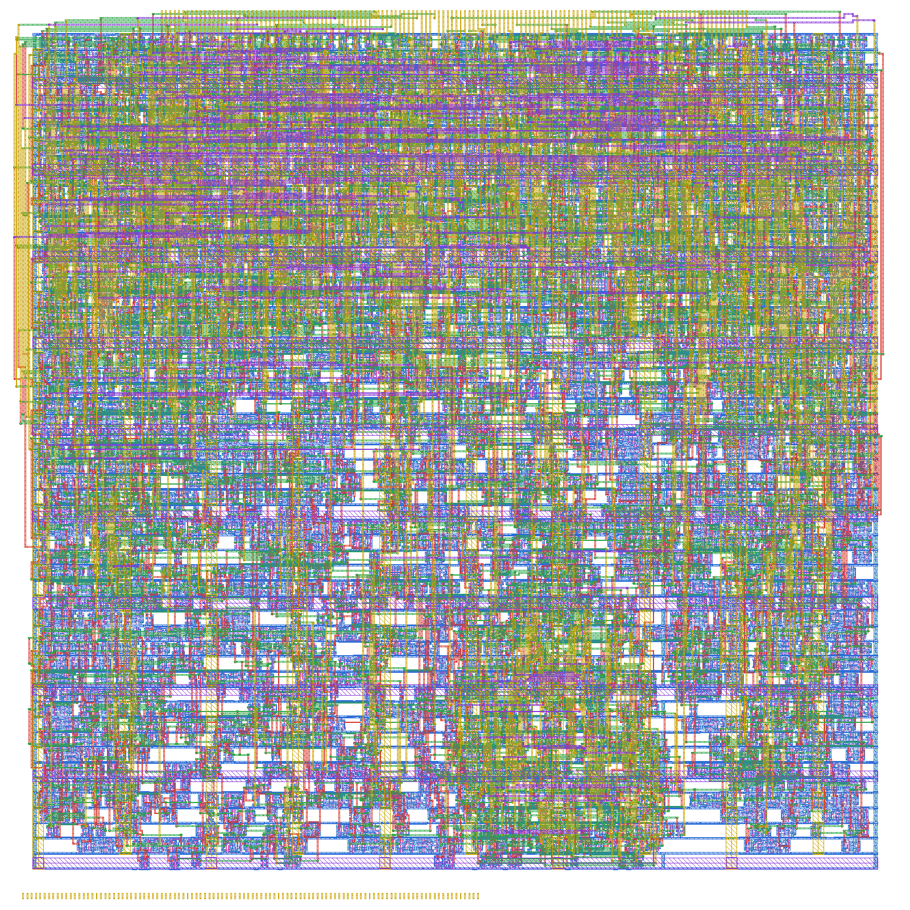 | 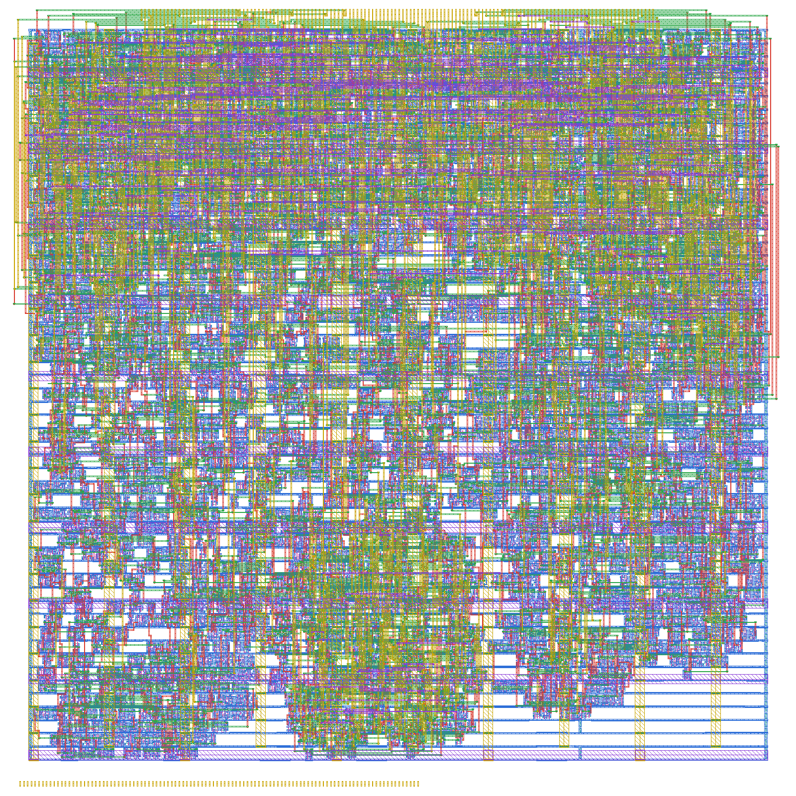 |
| MET1 blue, MET2 red, MET3 green, MET4 yellow, MET5 violet; pins on the top and bottom edges | the same |

| Checks | **`ble-tx-iot`** (`tx-iot-ics55`) | **`ble-iot-1byte`** (`iot-1byte-ics55`) |
|---|---|---|
| Routing DRC (OpenROAD, the tech LEF's rules) | **0** | **0** |
| The rule the router skips (`DRT-0349`: VIA4's enclosure by MET4), checked on the GDS (`via4_enclosure.py`) | **1 666 / 1 666 cuts** | **1 591 / 1 591 cuts** |
| GDS: every placed cell the library's own layout (`gds.py`) | 90 cells, none missing | 85 cells, none missing |
| Placement check, unplaced or overlapping cells | 0 | 0 |
| Worst setup slack: ss / tt / ff | +13.887 / +14.839 / +15.199 ns | +14.021 / +14.916 / +15.256 ns |
| Worst hold slack: ff / tt / ss | +0.056 / +0.145 / +0.361 ns | +0.058 / +0.147 / +0.357 ns |
| Max slew / max capacitance violations | 0 / 0 | 0 / 0 |
| Max fanout (10, as GF180) | **0** | every data net within it; 1 clock-tree buffer above it (`clkb`, 12), the reviewed case of § 8.1 |
| Clock skew, `clk` / `clkb` | 0.34 / 0.27 ns | 0.32 / 0.27 ns |
| **Gate level against `ble-tx-min`, every output on every clock, with the layout's delays** (`gls.py`; SDF of ss, tt, ff) | **54/54 runs (18 per corner)** | **54/54 runs** |
| The same with faults in the netlist (an XOR made XNOR, a NAND made AND, a NOR made OR, an inverter made a buffer) | **12/12 caught** | **12/12 caught** |
| Flow warnings / unreviewed | Yosys 0; OpenROAD 6 / **0** | Yosys 0; OpenROAD 6 / **0** |
| Foundry DRC, antenna, LVS (Calibre decks) | **not run** | **not run** |

The six OpenROAD warnings: the core's corner snapped to the 1.4 µm row grid (`IFP-0028`), and `DRT-0349` on CT, VIA4, T4V2 and RV.
CT is inside the library's cells, T4V2 and RV are above MET5 and not routed; VIA4's rule is checked on the GDS (above).

**The gate-level check stands for LVS here.** `gls.py` runs `tests/test_tx_tag.py`'s own testbench, stimulus, reference and verdicts
(imported, not copied) on the routed netlist, the PDK's cell models and the layout's SDF (OpenSTA's, in the subset Icarus reads: the
conditional arcs that have an unconditional twin and the timing checks left out, the late delay as the typical one). The netlist's
AdvA and Company ID are fixed by synthesis, so one AdvA and the ROM run, against the RTL's 72 runs of two AdvA and two stores (§ 3.5);
every `clkb` frequency runs. Two adaptations: the inputs reach the netlist 2 ns after the clock edge (the testbench changes them on the
edge, which a netlist behind its clock tree would take a clock early; the SDC's input delay is 12.5 ns), and the length check does not
read the DUT's state register (a netlist does not keep its name; the PHY bits counted on the outputs stay). It shows that the netlist the
layout was routed from sends what the RTL sends, sample for sample, with real delays; it does not show that the GDS is that netlist,
which only an extraction and LVS would.

**The area, the three that § 8.0 separates** (the categories of the GF180 table; port and hold buffers are timing repair there too):

| µm² | `ble-tx-iot`, GF180MCU | **`ble-tx-iot`, ICS55** | GF180 / ICS55 | `ble-iot-1byte`, GF180MCU | **`ble-iot-1byte`, ICS55** | GF180 / ICS55 |
|---|---:|---:|---:|---:|---:|---:|
| **1. Cells after synthesis** (pre-layout; Nangate45 in § 4: 2 402.5 and 2 346.9) | — | **3 506.2** (1 450 cells) | | — | **3 377.4** (1 395 cells) | |
| Logic: combinational, flip-flops, inverters, buffers | 39 856.1 | **3 515.7** | **11.3 ×** | 38 402.8 | **3 384.6** | **11.3 ×** |
| of which flip-flops | 238 | 238 (1 466.1 µm²) | | 230 | 230 (1 416.8 µm²) | |
| Timing-repair buffers + clock trees | 8 517.4 | **1 376.5** | 6.2 × | 8 205.7 | **1 314.0** | 6.2 × |
| of which hold buffers | | 730.8 (261) | | | 716.8 (256) | |
| Taps, end caps, antenna diodes | 3 481.6 | **77.3** | 45 × | 3 385.0 | **77.3** | 44 × |
| eFuse blocks (AdvA, OTP) | 48 452.1 | — (ROM) | | 48 452.1 | — (ROM) | |
| **2. Placed cells (the routed block)** | 100 307.1 | **4 969.4** | 20.2 × | 98 445.6 | **4 776.0** | 20.6 × |
| The same without the eFuse blocks | 51 855.0 | **4 969.4** | **10.4 ×** | 49 993.5 | **4 776.0** | **10.5 ×** |
| **3. Die** (the transmitter as a macro: no pads, no seal ring) | 174 800 | **6 724** | **26.0 ×** | 171 000 | **6 724** | **25.4 ×** |
| Utilization of the core | 68.6 % | 82.7 % (of 6 006) | | 68.7 % | 79.5 % | |

1. **The logic is at the node's ratio in both directions.** (180 / 55)² = 10.7 and the logic is 11.3 times smaller; (55 / 45)² = 1.49 and
   it is 1.46 and 1.44 times Nangate45's (synthesis and layout agree). Cell for cell, ICS55's are 1.36 (flip-flop, 6.16 against 4.522 µm²)
   to 1.75 times (XOR2) Nangate45's: an industrial library, not a predictive one, at about the scaling.
2. **The repair is the share that does not scale**: 28 % of the placed cells in 55 nm against 16 % in 180 nm (of the placed cells
   without the eFuse blocks), half of it hold buffers. Fast cells need delay to meet hold (the flow's table above), where GF180's slow
   ones needed little; with GF180's 0.25 ns of uncertainty on hold the share would be larger still.
3. **The die is smaller than the node predicts** (26 against 10.7) **only because 55 nm has no eFuse row**: half of GF180's placed area
   is the six blocks (§ 9), which here are a ROM, and the eFuse row also fixed GF180's aspect ratio. Without them, the placed area is at the
   node's ratio (10.4, 10.5). A product in 55 nm would still need a non-volatile AdvA per chip (ICsprout runs a 55 nm embedded-Flash
   process, its README says; nothing of it is in this PDK), so **26 × is the ROM's figure, 10.4 × the logic's**.
4. **This is the transmitter's digital block, not the chip.** Pads, ESD, the clock source and the radio are outside it; they do not
   shrink with the node as logic does, and on a chip of this size they would dominate. The 6 724 µm² is the area of the block, not of a
   transmitter chip.
5. **The two branches differ by 193.5 µm² placed (−3.9 %)**, 131.0 µm² of logic (−3.7 %: 8 flip-flops and their multiplexers),
   more in share than in 45 nm (−2.3 %) and GF180 (−1.9 %), and on the same die: the sweep's limit is the same for both. A byte is
   still a small part of a transmitter whose size is the modulator's; § 10.3's recommendation stands.

#### 8.2.1 The die sweep

Square dies, the placement's target density raised as the die shrinks, the clock tree's clustering as GF180's (7 flip-flops over
150 µm) unless stated (`results/layout/die-sweep-ics55/<branch>.tsv`). "Clean": the gate of `run.sh` (no routing DRC, no slew or
capacitance violation, no data net over the max fanout, every slack positive).

| Die (µm) | Density | `ble-tx-iot` | `ble-iot-1byte` |
|---|---:|---|---|
| 100, 90, 85 | 0.55, 0.65, 0.70 | clean; 5 025, 4 967, 4 995 µm² placed | clean, the `clkb` buffer at 12 |
| 83 | 0.72 | clean (5 000 µm²) | clean, the `clkb` buffer at 12 (clustering 30 µm) |
| **82** | **0.74** | **clean: chosen** (4 969 µm²) | **clean, the `clkb` buffer at 12: chosen** (4 776 µm²) |
| 81 | 0.76 | 6 slew, 4 capacitance violations at ss | — |
| 80 | 0.75, 0.78 | 2 slew, 4 capacitance | 3 slew, 1 capacitance; at 0.78 (clustering 5), routing fails |
| 76, 74, 72, 70 | 0.80–0.88 | the cells do not fit (detailed placement) | the same, or routing congestion |

The clock tree's clustering does not remove `ble-iot-1byte`'s `clkb` buffer: 5, 6, 8 or 10 flip-flops, or 20, 30 or 50 µm, leave it at
12 and add `clk` buffers above 10 (`ble-tx-iot` gets them too). This CTS has no fanout limit. At 82 µm the core is 80–83 % full;
what is left is fillers and the room the repair needs.

## 9. The AdvA OTP (GF180MCU eFuse)

The same blocks and the same characterization as `TX_FINAL_DECISIONS.md` § 9: six `efuse_async_mem_1x8` of the open GF180MCU eFuse
compiler, 97.27 × 83.02 µm each, DRC and LVS clean, 4 programming and 4 reading tests in Xyce on the extracted netlist.

| | Result |
|---|---|
| Area: one block / six (AdvA, 48 bits) | 8 075.4 µm² / **48 452.1 µm²** (arrays alone: 2 241.2 / 13 447 µm²) |
| Share of the placed area | **48.3 %** in `ble-tx-iot`, **49.2 %** in `ble-iot-1byte` |
| Programming | a 1 held ≥ 50 µs on `prog[i]` blows fuse i, read as 1 from the next reset on |
| In the RTL | `ADV_ADDRESS_OTP = 1`; checked with a model of the block: the unprogrammed chip reads 0, AdvA is programmed once, the transmitter then sends it (§ 3.5) |

The blocks are about half of the placed area. The ROM (`ADV_ADDRESS`, the default) costs nothing but gives every
chip one address, which a product cannot have. A single 48-bit block would share the periphery, but the compiler's asynchronous
blocks are 8 bits wide. The programming port must reach a production test interface, which this controller does not have.

## 10. The decisions

| # | Block | upstream | Decision | Alternatives measured (µm², 45 nm unless stated) | Status |
|---|---|---|---|---|---|
| 10.1 | Packet scope | any PDU ≤ 257 B | **one fixed `ADV_NONCONN_IND`** | Legacy Advertising ≤ 39 B: 5 018.5 (`ble-tx-min`) | decided |
| 10.2 | Error correction | none | **none** | BCH t = 8, 12, 18: 2 921.2, 3 141.2, 3 398.9 (`TX_TAG_COMPARISON.md`): 2.3–4.4 dB in a model | decided here; the tags keep it |
| 10.3 | Sensor bytes | — | **two, unless the reading fits in 8 bits** (below) | one: 2 346.9; two: 2 402.5 | open: a recommendation |
| 10.4 | Access address, preamble, CRC init | written by software | **kept as they are**, as the tag | constants for advertising (0x8E89BED6, 0xAA, 0x555555): 40 + 24-bit load logic less; **not built** | open |
| 10.5 | AdvA | written with the packet | **OTP**, as `ble-tx-min` | ROM: no area, one address for all | decided (supervisor) |
| 10.6 | GF180MCU die | — | **760 × 230, 760 × 225 µm** | § 8.0.1 | decided |
| 10.7 | ICsprout55 die (AdvA in the ROM) | — | **82 × 82 µm, both** | § 8.2.1 | decided for this study; a product needs a non-volatile AdvA, which the PDK does not have |

**10.3, the choice between the two.** Both are equally exact, built and validated.

| | `ble-tx-iot` | `ble-iot-1byte` | One byte saves |
|---|---:|---:|---:|
| Reading | 65 536 values | 256 values | **half of the bits** |
| 45 nm cell area | 2 402.5 µm² | 2 346.9 µm² | 55.6 µm² (2.3 %) |
| 45 nm leakage | 49.15 µW | 47.81 µW | 1.34 µW (2.7 %) |
| GF180MCU, placed | 100 307.1 µm² | 98 445.6 µm² | 1 861.5 µm² (1.9 %) |
| xc7z020: LUTs / flip-flops | 349 / 237 | 346 / 229 | 3 / 8 |
| Time on the air, one event | 528 µs | 504 µs | 24 µs (4.5 %) |

**Recommendation: keep two bytes**, unless the reading certainly fits in 8 bits (a coarse temperature, a state, a count): the area
differs by little, because the sensor's register is a small part of a transmitter whose size is the modulator's, and the time on the air,
the first-order energy of a tag, by 4.5 %. A reading of more than 8 bits on the one-byte tag would have to be split over packets, which
costs far more than it saves.

**10.4, the largest saving left.** On the advertising channels the access address, its preamble and the CRC init are constants of the
Core specification, and this tag sends nothing else; building them in removes the 40-bit shift register's load and the CRC's load, which are
not small against 2 402.5 µm². It changes the interface (channels other than the advertising ones could not be sent) and the checks of
§ 3.5, which now randomize these inputs, so it is left open and not measured.

## 11. What these transmitters give up, and what this does not claim

**Give up** (against `ble-tx-min`): any other packet (another sensor size or AD structure is an RTL change); a receiver (no scan
response, no connection: not needed for `ADV_NONCONN_IND`); AdvData of up to 31 bytes. Against `ble-tx-tag-8`: **the error correction**.
And what `ble-tx-min` gives up already (a changeable AdvA, the runtime Gaussian taps and tables, an AXI clock below 8 MHz).

**Does not claim:**
- The 45 nm figures are pre-layout (no wires, no clock tree), in an academic library; they are not comparable as such with a layout (§ 8.0).
- The signoff layouts are in 180 nm, the node of the open PDK that has an OTP and is fabricable. The 55 nm layouts (§ 8.2) are in a PDK
  that has been fabricated but is a preview release, and they are **not signed off**: its DRC, antenna and LVS decks are Calibre's and
  were not run (the routing DRC is the tech LEF's, the gate-level check stands for LVS without being one); its timing uses the global
  route's parasitics from the tech LEF's RC, as it has no extraction rules; there is no IR-drop analysis; AdvA is in the ROM, as the PDK
  has no OTP. Its area is the transmitter's digital block, not a chip's: no pads, ESD, clock source or radio, which would not shrink
  with the node. Fabricating in it would need ECOS's accepted PDK version, its checks and its terms of access, which were not asked.
- The BER's comparison with `ble-tx-min` is of different packets; the differences are within the draws' spread (§ 3.3). The SNR at PER 10 % is a
  model's, and does not cover the one-byte packet.
- The GF180MCU layouts are the transmitter as a macro (no pads, no seal ring, no chip-level integration, no parasitic-annotated simulation);
  their power is vectorless. The die sizes sit at the edge of the slew limit (§ 8.0.1).
- The activity's comparison holds three scenarios, with the receiver's outputs left out of the check (§ 7.1).
- The FPGA results are out of context (no pins), with vectorless power.
- The firmware's tag mode follows the registers the controller test checks; **it was not run on a board**.
- The eFuse compiler's IP is "not ASIC-proven yet" (its documentation); the Xyce results are simulation.
- `py-fig0.png` and `py-fig1.png` are not repeated (§ 3.4).

## 12. Evidence and reproduction

The results of both branches are committed in both. Below, `<branch>` is `ble-tx-iot` or `ble-iot-1byte`, each command at the root of that
branch's clone under WSL (a Windows worktree's git does not run there), and `<label>` is `tx-iot` or `iot-1byte`.

| Result | Evidence | Command |
|---|---|---|
| Validation | `results/validation/tx-iot-validation/`, `iot-1byte-validation/` | `scripts/senseworks/run_tag_validation.sh <label>-validation` |
| Area, 45 nm | `results/area/tx-iot/<branch>/` (and its `warning_gate.txt`) | `AREA_PARAMS=GAUSS_TABLE=1 RTL_REV=HEAD scripts/area/run_area.sh tx-iot/<branch> crc24 scramble bit_repeat_upsample gauss_filter vco gfsk_modulation btle_tx btle_phy clock_domain_conversion_iq auxiliary_daemon btle_ll btle_controller` |
| Timing, 45 nm | `results/timing/tx-iot/<branch>/` | `STA_SET=tx DUT_REV=HEAD DUT_PARAMS=GAUSS_TABLE=1 scripts/timing/run_sta.sh tx-iot/<branch> 62.5 be5d9774` |
| Activity | `results/power/tx-iot/<branch>/` | `DUT_REV=HEAD DUT_PARAMS=GAUSS_TABLE=1 VEC_DIR=<vectors> scripts/power/run_activity.sh tx-iot/<branch> 100000 1 fca6ac6`; `<vectors>`: `python/test_vector_for_btle_verilog.py 0 20 20 0` of `fca6ac6` (`MPLBACKEND=Agg`), with `btle_tx_test_input.txt` replaced by the tag's PDU |
| Logic leakage | `results/power/tx-iot/leakage.md` | `python3 scripts/power/logic_leakage.py <liberty> <branch>=<stat.json> ...` |
| FPGA | `results/fpga/xc7z020-iot/<iot, iot1b>/`, `provenance.txt` | Windows: `vivado -mode batch -source scripts/fpga/xc7z020/impl.tcl -tclargs <dir> ooc_hd`, then `post.tcl <root> <name>`, with `GAUSS_TABLE = 1` in the copy of `btle_controller.v` |
| FPGA Device view | `results/fpga/xc7z020-iot/<iot, iot1b>/device.png`, `device.txt` | `device_view.ps1 <dir>`, then `device_crop.py` |
| Layout and warnings | `results/layout/tx-iot-gf180/`, `iot-1byte-gf180/`, `tx-iot-gf180-die760/`, and each `warning_gate.txt` | `scripts/layout/tx_min_gf180/run.sh <label>-gf180 HEAD`; the old die: `CONFIG_OVERRIDES` as in § 8.0.1 |
| Die sweep | `results/layout/die-sweep/<branch>.tsv` | `CONFIG_OVERRIDES='{"DIE_AREA":[0,0,760,<h>],"PL_TARGET_DENSITY_PCT":<d>}' scripts/layout/tx_min_gf180/run.sh <name> HEAD` |
| Layout in ICsprout55 (§ 8.2) | `results/layout/tx-iot-ics55/`, `iot-1byte-ics55/` (`gate.txt`, `summary.txt`, `area.*.txt`, `sta.*.txt.gz`, `power.*.txt`, the GDS, netlist and SDFs) | `scripts/layout/tx_iot_ics55/run.sh <label>-ics55 <branch>` (PDK: `icsprout55-pdk` `e0b1122` after its `make unzip`, in `ICS55_DIR`) |
| ICsprout55 gate level | `results/layout/<label>-ics55/gls.{ss,tt,ff}.log` | `python3 scripts/layout/tx_iot_ics55/gls.py <netlist> <sdf> <PDK>/IP/STD_cell/ics55_LLSC_H7C_V1p10C100/ics55_LLSC_H7CR/verilog/ics55_LLSC_H7CR.v` |
| ICsprout55 VIA4 enclosure | `results/layout/<label>-ics55/via4_enclosure.txt` | `python3 scripts/layout/tx_iot_ics55/via4_enclosure.py <gds>` (KLayout) |
| ICsprout55 die sweep | `results/layout/die-sweep-ics55/<branch>.tsv` | `DIE_W=<w> DIE_H=<w> DENSITY=<d> [CTS_SIZE=<n> CTS_DIAM=<um>] KEEP=0 scripts/layout/tx_iot_ics55/run.sh <name> <branch>` |
| Same-scale figure | `results/figures/tx-iot/tx_iot_gf180_vs_ics55.png` | both GDS rendered at 2 px/µm (`scripts/layout/tx_iot_ics55/scale_render.py`, KLayout), then composed (`scale_figure.py`) |
| OTP | `results/otp/gf180-efuse/` | `TX_MIN_VALIDATION.md` § 10 |
| Figures of §§ 3–8 | `results/figures/tx-iot/`, `results/figures/iot-1byte/` (`tx-iot/data.json` names the source of every number) | `python3 scripts/figures/tx_min_figures.py tx\|ber <dir>`; `python3 scripts/figures/tx_iot_figures.py results/figures/tx-iot/data.json results/figures/tx-iot` |

Related reports: `docs/Final Decisions/TX_FINAL_DECISIONS.md` (the final transmitter), `docs/Senseworks/TX_TAG_COMPARISON.md` (the tags with
the BCH code, the FEC study), `docs/Validation/TX_MIN_VALIDATION.md` (the reference of § 3.5).
