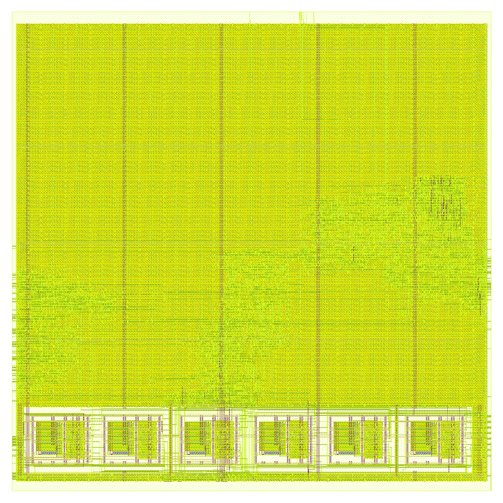
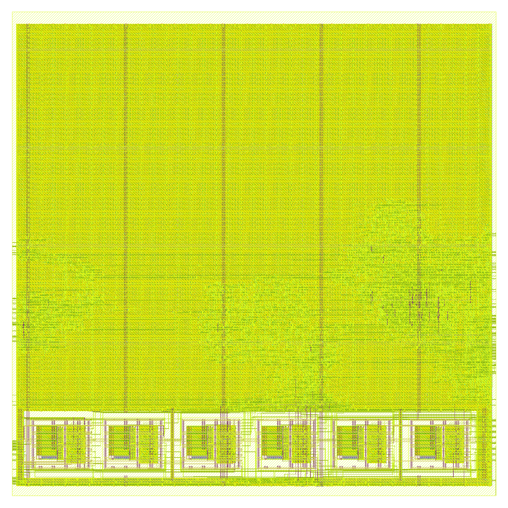
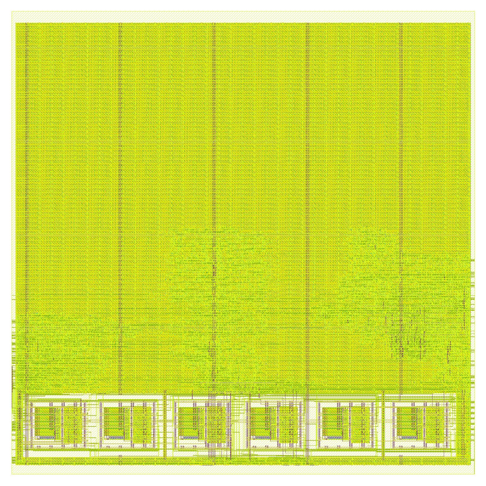
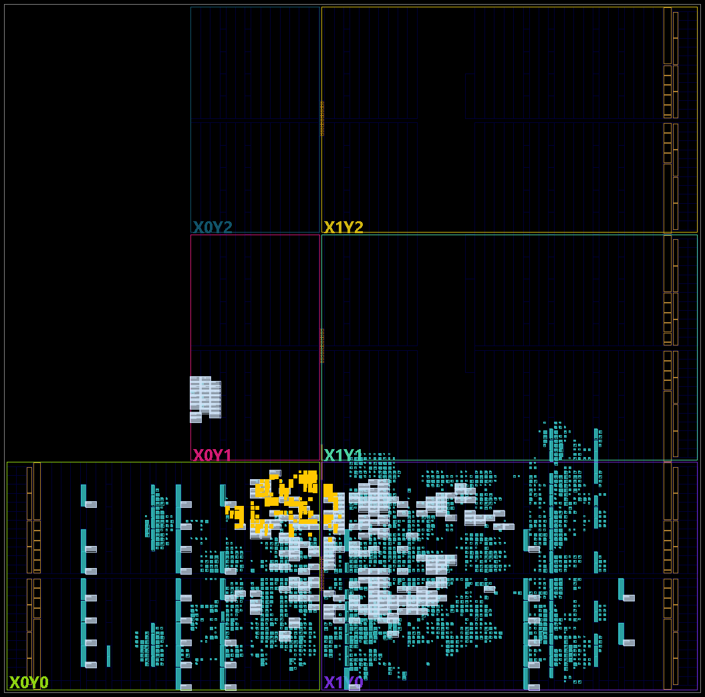
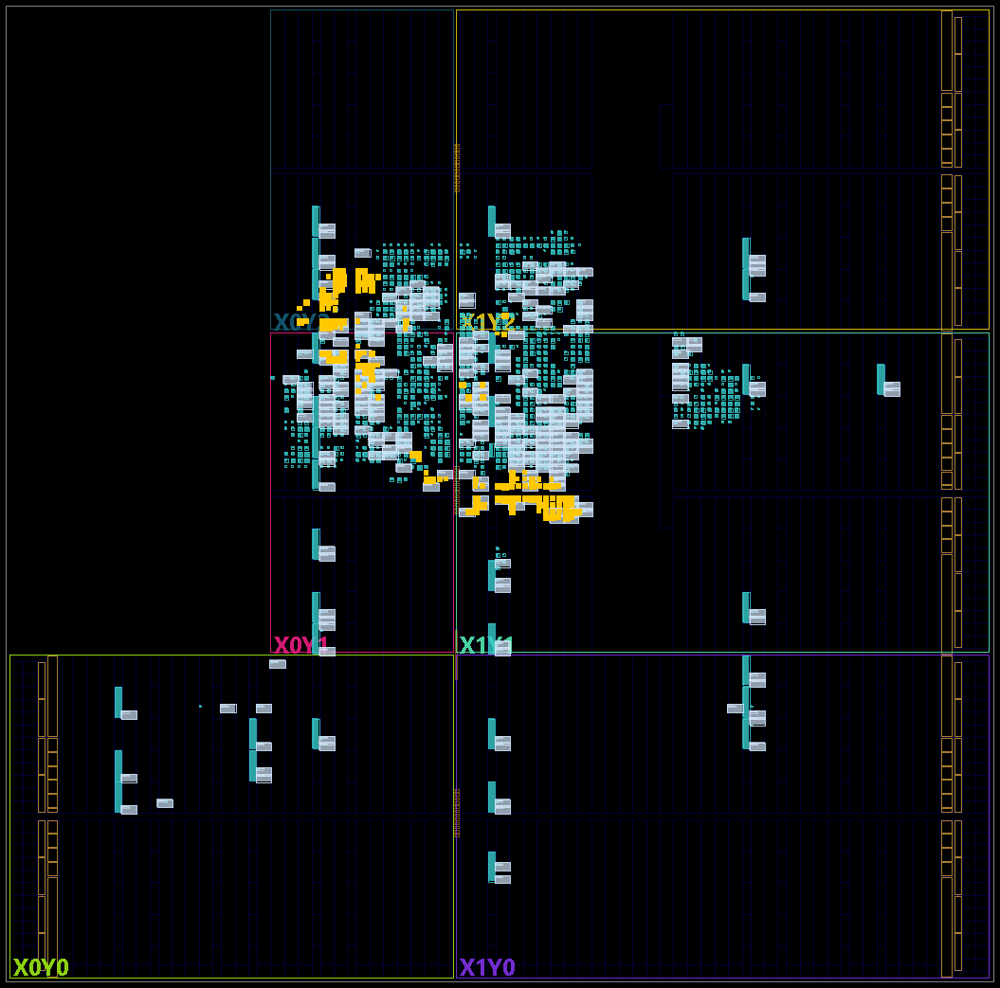
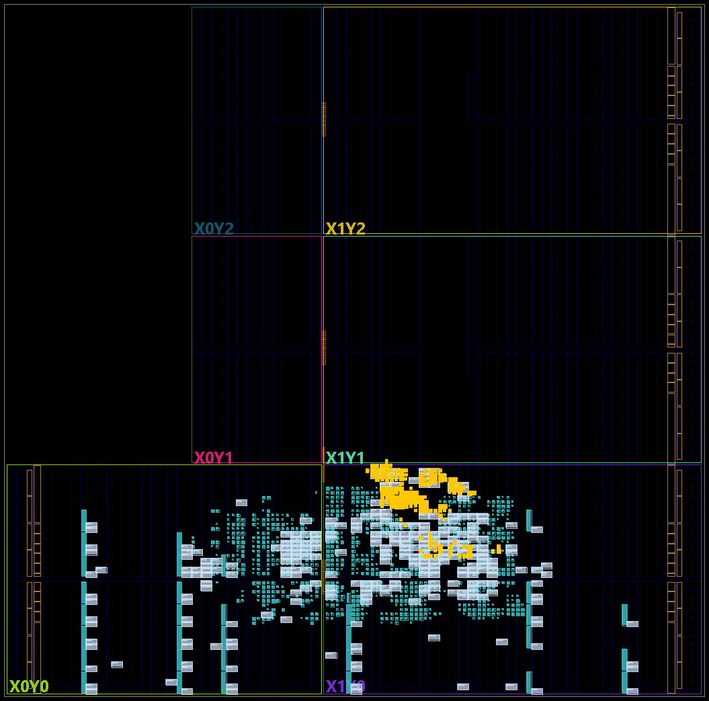
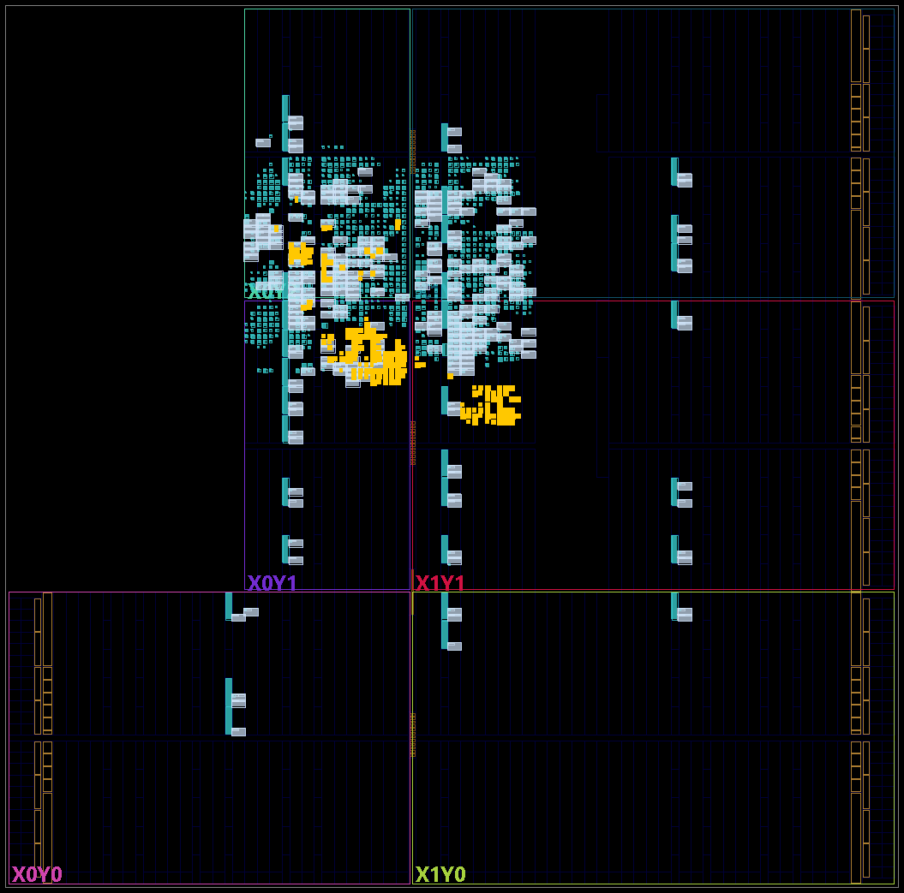

# The senseworks tag: three transmitters with BCH parity, side by side

**Project:** BTLE — reconfigurable RISC-V baseband  
**Branches:** `ble-tx-tag-8`, `ble-tx-tag-12`, `ble-tx-tag-18` (one implementation; they differ only in the default
of `BCH_T`)  
**Base:** `ble-tx-min` (`be5d9774`), the final Legacy Advertising transmitter (`TX_FINAL_DECISIONS.md`)  
**Date:** 2026-11-04  
**Author:** Miguel Simões  
**Status:** run `tx-tag`. Every number below is measured, and its evidence is committed (§ 13): simulation
against `ble-tx-min` and upstream's Python model, area and timing in 45 nm, signoff-clean layouts in
GF180MCU, the controller placed and routed on the Zynq's FPGA (out of context, § 9). **Not done:** the
board's bitstream (the block design with the AD9361's IP) and any test on a board; the firmware's tag mode
is written and compiled, not run (§ 11). Not a tape-out (`docs/Validation/ASIC_READINESS.md`: NOT READY, as
on every branch).

---

## How to read this document

The senseworks system has two ends. The **tag** has only a transmitter and two bytes to send (a
temperature and/or a humidity). The **gateway** has only a receiver. The tag should transmit as little as
it can, because its oscillator and its battery are small, and the gateway should still receive it far away.
The idea that this document measures on the tag's side: send the shortest standard Bluetooth LE packet that
carries the two bytes, and add to it the parity of a BCH code. A receiver that knows the code then corrects
bit errors that the CRC alone would have counted as a lost packet.

The packet stays a standard advertising packet (§ 2): any BLE receiver reads it as such. Only a
receiver that keeps packets with a wrong CRC (the gateway) can use the parity; that receiver is the next
step (branches `ble-rx-gateway-8/12/18`, not part of this document).

The three branches use three BCH codes. Each corrects up to t wrong bits among AdvA, the sensor's bytes
and the parity: t = 8 (8 bytes of parity), t = 12 (12 bytes) and t = 18 (16 bytes). § 1 compares them with
each other and with `ble-tx-min`; §§ 2–4 define the packet, the code and the RTL; §§ 5–9 give the
evidence and the measurements (§ 9 on the FPGA); § 11 says how to run the tag on a board; § 12 gives the
choice between the three.

## 1. The three tags and `ble-tx-min`, in one table

| | `ble-tx-min` (39-byte PDU of its campaigns) | **`ble-tx-tag-8`** | **`ble-tx-tag-12`** | **`ble-tx-tag-18`** |
|---|---|---|---|---|
| Packet | any Legacy Advertising PDU, ≤ 39 bytes, written by the software | ADV_NONCONN_IND, fixed: AdvA, Company ID, 2 sensor bytes, BCH parity | the same | the same |
| BCH parity (t) | — | 8 bytes (t = 8) | 12 bytes (t = 12) | 16 bytes (t = 18) |
| On the air, one packet | 47 bytes, 376 µs | 30 bytes, **240 µs** | 34 bytes, 272 µs | 38 bytes, 304 µs |
| One advertising event (channels 37, 38, 39) | 1 128 µs | **720 µs (−36.2 %)** | 816 µs (−27.7 %) | 912 µs (−19.1 %) |
| `btle_tx`, 45 nm (cells + macros, µm²) | 5 018.5 (with its 32 × 8 SRAM) | **2 921.2 (−41.8 %)** | 3 141.2 (−37.4 %) | 3 398.9 (−32.3 %) |
| `btle_tx`, static leakage, 45 nm (µW) | 68.12 | **59.43** | 63.83 | 68.94 |
| `btle_controller`, 45 nm (µm²) | 68 470.0 (with the receiver) | 17 228.3 (−74.8 %) | 17 424.6 | 17 662.4 |
| `btle_tx`, min period (pre-layout) | 1.199 ns | 1.209 ns | 1.181 ns | 1.228 ns |
| `btle_tx` laid out in GF180MCU-D with the AdvA OTP (µm²) | 160 785.0 (AdvData in flip-flops) | **129 286.0 (−19.6 %)** | 131 916.0 (−18.0 %) | 137 068.0 (−14.8 %) |
| xc7z020, routed (§ 9): `btle_tx` LUTs / flip-flops | 387 / 254 (8 of the LUTs as RAM) | 422 / 302 | 444 / 330 | 474 / 362 |
| xc7z020, routed: `btle_controller` LUTs / flip-flops / DSPs / RAMB18 + RAMB36 | 3 871 / 5 552 / 48 / 9 + 32 | **1 881 / 3 028 / 0 / 1 + 32** | 1 906 / 3 056 / 0 / 1 + 32 | 1 939 / 3 088 / 0 / 1 + 32 |
| Validation (§ 5) | `TX_MIN_VALIDATION.md` | **all pass** | all pass | all pass |
| SNR at PER 10 %, 0 / 20 / −30 / 50 ppm, the receiver of today (`ble-rx-1p1c`'s front end), **simulated** | 9.85 / 12.31 / 14.34 / 26.73 dB | **6.54 / 8.07 / 9.82 / 20.56 dB** | 6.40 / 7.90 / 9.67 / 20.38 | 6.23 / 7.84 / 9.55 / 20.38 |
| The same, the improved receiver (filter, CFO correction, AA tolerance 3), **simulated** | 4.46 / 4.58 / 4.60 / 4.88 dB | −0.05 / 0.29 / 0.14 / 2.82 dB | −0.36 / −0.15 / −0.26 / 2.78 | **−1.02 / −0.43 / −0.68 / 2.76** |

The SNR rows are the simulator of the FEC study (§ 10): a model of the receivers calibrated against the
RTL within 0.35 dB, not a measurement of these transmitters with a receiver; the gateway branches will
measure them in the RTL.

## 2. The packet

The tag sends one PDU, `ADV_NONCONN_IND`, its format fixed in the hardware:

| PDU bytes | Field | Value | Where it comes from |
|---|---|---|---|
| 0 | header byte 0 | `0x42`: PDU type `0010` (ADV_NONCONN_IND), ChSel 0, **TxAdd 1** (AdvA random), RxAdd 0 | constant (`TX_ADD`) |
| 1 | header byte 1, the payload length | 20 / 24 / 28 (t = 8 / 12 / 18) | constant |
| 2–7 | AdvA, least significant byte first | the chip's address | ROM (`ADV_ADDRESS`) or OTP (six GF180 eFuse blocks, `ADV_ADDRESS_OTP = 1`) |
| 8 | AD structure: length | 13 / 17 / 21 (type, Company ID, sensor, parity) | constant |
| 9 | AD structure: type | `0xFF`, Manufacturer Specific Data | constant |
| 10–11 | Company ID, least significant byte first | `0xFFFF` by default | constant (`COMPANY_ID`) |
| 12–13 | the sensor, d0 d1 | written by the software (or the sensor's interface) | two registers, the only bytes the (address, data) pair writes |
| 14– | BCH parity: 8 / 12 / 16 bytes | computed from AdvA and d0 d1 | the LFSR in `btle_tx` (§ 3) |
| then | CRC-24 | | `crc24` (unchanged) |

On the air: 1 byte of preamble, 4 of access address, 22 / 26 / 30 bytes of PDU, 3 of CRC: 30 / 34 / 38
bytes, 240 / 272 / 304 µs at 1 Mbit/s. Without the parity the same two bytes take 22 bytes on the air
(176 µs), the shortest standard way to send them.

**What makes it a standard packet** (Bluetooth Core 6.1 and the Core Specification Supplement v12):
- the PDU type, its fields and the length are the Link Layer's (Vol 6 Part B § 2.3.1.3); AdvData may hold
  fewer than 31 bytes ("if not empty", ibid.), and the significant part only is sent (Vol 3 Part C § 11);
- the Flags AD type is not needed: CSS v12 § 1.3 requires it only when the packet is connectable and a
  flag is set;
- Manufacturer Specific Data starts with a Company ID from Assigned Numbers (CSS v12 § 1.4). `0xFFFF` is the
  value for tests: **a product needs the Company ID of senseworks, assigned by the Bluetooth SIG**
  (`COMPANY_ID`);
- AdvA with TxAdd = 1 must be a random address; fixed per chip, it is a **random static** address, its two
  most significant bits 11 (Vol 6 Part B § 1.3.2.1). The ROM's default is C1:02:03:04:05:06 (the default
  01:02:03:04:05:06 of `ble-tx-min` would be a non-resolvable private address, which is meant to change);
  the OTP holds each chip's address, programmed in production;
- a device with a transmitter only is a Broadcaster (Vol 3 Part C § 2.2.2.1: it "shall have a transmitter
  and may have a receiver"); non-connectable and non-scannable advertising needs no receiver. The
  advertising event (the three channels, the interval, the pseudo-random advDelay of 0–10 ms, Vol 6
  Part B § 4.4.2.2) is the software's (§ 11), as on `ble-tx-min`.

An independent parser reads every packet the RTL sent as such (§ 5: scapy's BLE dissector, which also
computes the CRC). A phone would deliver it to an app as Manufacturer Data (the two sensor bytes in
clear, the parity as further bytes); a phone drops packets with a wrong CRC, so only the gateway uses the
parity.

## 3. The BCH code

A shortened binary BCH code of length 255 over GF(2^8), the primitive polynomial x^8 + x^4 + x^3 + x^2 + 1.
Its generator g(x) is the least common multiple of the minimal polynomials of α^1 … α^2t, so its designed
distance is 2t + 1 (the BCH bound) and it corrects any t errors.

| | t = 8 | t = 12 | t = 18 |
|---|---:|---:|---:|
| (255, k) code | (255, 191) | (255, 163) | (255, 131) |
| deg g = parity bits | 64 | 92 | 124 |
| parity bytes (the last 8P − deg g bits 0) | 8 | 12 (4 bits 0) | 16 (4 bits 0) |
| shortened to n (message 64 bits) | 128 | 156 | 188 |
| designed distance | 17 | 25 | 37 |
| g(x) without its x^deg term (hex) | `6ce707e26b6f9977` | `e810da40f70569be7529981` | `1bcb6cce6906958aa17f2231050eb39` |
| a random word decodes (≈ V(n, t) / 2^deg) | 8.3 × 10⁻⁸ | 6.2 × 10⁻¹¹ | 3.0 × 10⁻¹³ |

**The message is the 64 bits a receiver does not know**: AdvA (PDU bits 16–63) and the sensor (bits 96–111),
in the order they are sent (bytes in order, each least significant bit first). The header and the AD
structure's first four bytes are known to the gateway, which sets them instead of decoding them; the CRC
covers the parity like any PDU byte. The encoding is systematic, as a serial LFSR does it: the message bits
enter the division by g(x) in the order sent, the first one the highest power; the remainder follows the
message, its highest coefficient first, packed into PDU bytes 14 onwards least significant bit first.
`scripts/senseworks/tag_bch.py` is the reference (encoder, and a Berlekamp–Massey/Chien decoder for the
gateway); `check_bch_galois.py` checks it against the galois library.

The last row bounds what the gateway can wrongly accept: a word of noise (a false trigger) or of another
device decodes into some codeword with that probability, before the CRC is checked at all.

## 4. What the branches contain

| Part | Files | |
|---|---|---|
| The tag's packet buffer `tag_pdu_buffer`: header, AD structure and Company ID constants, AdvA ROM or OTP, the two sensor registers on `clkb` (pairs to every other address dropped); `ble-tx-min`'s read protocol (request toggle, two synchronizers) unchanged | `verilog/btle_tx.v` | replaces `adv_pdu_buffer`: no AdvData memory, no header registers |
| The BCH encoder: an LFSR of deg g bits in the `clk` domain. In TX_PDU each message bit enters it with the bit that leaves it; from bit 112 the bit sent is its top bit instead of the buffer's, and it shifts in 0s; cleared outside TX_PDU | `verilog/btle_tx.v` | 64 / 92 / 124 flip-flops |
| Counters for the fixed length: the PDU bit counter 8 bits, the byte address 5 bits; no `payload_length` register | `verilog/btle_tx.v` | |
| `TX_ADD`, `COMPANY_ID`, `BCH_T` passed down; `ADV_DATA_FLOPS` gone | `btle_tx.v`, `btle_phy.v`, `btle_controller.v` | the branches' only difference: `BCH_T` 8, 12, 18 by default |
| **No receiver**: `btle_phy` has no `btle_rx`; the RX ports stay (the controller's interface, the FPGA's block design), their outputs 0, so synthesis removes the Link Layer's RX logic too | `btle_phy.v`; `btle_rx.v`, `btle_rx_core.v`, `gfsk_demodulation.v`, `search_unique_bit_sequence.v`, `serial_in_ram_out.v` and their testbenches removed; `btle_controller.tcl` (the Vivado project) without them | |
| The tag mode of the firmware: `-T` interval, `-s` sensor value, `-k` count up, `-g` TX gain, `-e` events | `firmware/btle_ll.c` | not run on a board (§ 11) |
| Everything else: B2 (fixed Gaussian taps), the ROM VCO, the CRC, the whitening, the modulator | from `ble-tx-min`, unchanged | |

**Contract.** The sensor's two bytes are written before `tx_start`, never while the packet is sent;
`clkb` runs at 8 MHz or faster (as `ble-tx-min`). Within it, every output of `btle_tx` is, on every clock,
that of `ble-tx-min` given the whole PDU (§ 5).

**What the branches give up**: any other packet (the format is the hardware's; another sensor size or
another AD structure is an RTL change); a receiver (no scan response, no connection: not needed for
ADV_NONCONN_IND); and what `ble-tx-min` gives up already (a changeable AdvA, the runtime Gaussian taps).

## 5. Validation

Run `tx-tag`: `scripts/senseworks/run_tag_validation.sh` on each branch (`results/validation/tx-tag-<t>-validation/`).
The tests set `BCH_T` themselves, so each branch runs the three codes.

| Check | What it shows | Result (each branch) |
|---|---|---|
| `tag_bch.py --self-test` | g divides x^255 + 1, α^1 … α^2t are its roots; 1 000 words per code with 1..t errors all corrected, 1 000 with t+1..3t | **all corrected; all 3 000 beyond t detected**, none decoded to another codeword |
| `check_bch_galois.py` (galois 0.4.11, an independent BCH library) | generators, parity of 60 messages, both decoders on 60 words with 0..2t errors, per code | **equal** for t = 8, 12, 18 |
| `tests/test_tx_tag.py --mutants`: the tag against `ble-tx-min`'s `btle_tx` (`be5d9774`) given the whole PDU (the parity from `tag_bch.py`), **every output on every clock**; the tag on its own pair, only the sensor bytes among random writes to every other address; random channel, access address, CRC init, preamble, extra `tx_start`, resets that abort packets; `clkb` = `clk` and free at 100, 33.3, 16.1, 10, 8 MHz; ROM and OTP (programmed once); two AdvA and Company IDs | the tag sends, bit for bit and sample for sample, the packet `tag_bch.py` defines, through `ble-tx-min`'s validated chain | **216/216 runs, no difference**; **20/20 mutants caught** (the LFSR's input, start, range, generator of each t, bit order, clearing; the AD length, the Company ID's byte order, the sensor's address, TxAdd, the last bit, the read clock, AdvA's byte order, the OTP's order and sensing, the CRC's order, the whitening) |
| `tests/test_tx_tag_packet.py`: upstream's TX testbench, t = 8, 12, 18, channels 37, 38, 39, 0, 10, five sensor values, both Gaussian filters | the RTL's I/Q against upstream's Python model; upstream's Python receiver decodes it; the PDU is a codeword; t errors corrected, t + 1 not taken for the PDU sent | **150/150 waveforms, every sample equal**, CRC-valid loopback, every check of the code |
| `check_tag_scapy.py` (scapy 2.8.0's BLE dissector) on those 150 packets | an independent parser: its CRC, the PDU type, TxAdd, AdvA, one Manufacturer Specific Data structure, the sensor bytes | **150/150** |
| `tests/test_tag_controller.py`: `btle_controller` through its AXI registers as the firmware writes them (the boards' path), three readings × channels 37, 38, 39 back to back, t = 8, 12, 18, both filters | the PHY bits and the Gaussian filter's output against the model, the I/Q (turned, below), loopback, the samples to the RF transceiver; one packet per pulse of reg 9 | **54/54 packets** |
| `run_lint.py` (Verilator 5.020, `--Wall`, warnings fatal): `GAUSS_TABLE` 0, 1 × `BCH_T` 8, 12, 18 | | **PASS 6/6**, 13 reviewed exceptions (`tag_pdu_buffer` replaces `adv_pdu_buffer` and `pdu_buffer_ram`) |

**Three things the controller test showed**, none of them the tag's, all of them upstream's and present in
`ble-tx-min`:

1. **The VCO's phase carries over from one packet to the next** (its integrator is not cleared between
   packets), while upstream's model starts each packet at phase 0. The first packet after a reset is the
   model's sample for sample; the next ones are the model's turned by one constant angle (the spread of the
   angle over a packet at most 0.016 rad, the 8-bit quantization). A GFSK receiver does not see it, and the
   decoding of every packet is checked. Upstream's testbench, one packet per reset, never shows it.
2. **The window of valid samples to the RF transceiver lags one sample in about half of the packets**:
   `clock_domain_conversion_iq` registers the sample on `rf_clk` (8 MHz) and stretches the valid on `bb_clk`
   (16 MHz) without aligning the two. Depending on the 2:1 phase at which a packet starts, the 8 MHz window
   holds the PHY's samples (24 packets of 54) or lags one sample (30 of 54: the first sample the value held
   before the packet, the last one after the window). One sample (125 ns) at the ends of the packet.
3. **`tx_start` through the registers is a level**: reg 9 crosses into `bb_clk` as a level, and the CRC and
   channel loads follow it (`baremetal_phy_intf_mode = 0`). Held at 1, the transmitter starts again after
   each packet; the firmware pulses it (1, then 0) and gets one packet per pulse, as the test checks.

## 6. Area and leakage (45 nm)

Run `tx-tag`: `scripts/area/run_area.sh` (Yosys + ABC, Nangate45), `GAUSS_TABLE = 1`, AdvA in the ROM, the
five configurations in one run (`results/area/tx-tag/`); `ble-tx-min`'s 32 × 8 SRAM is its OpenRAM macro
(`results/area/openram-min`, 2 475.8 µm²; leakage 16.41 µW, `results/power/sram-leakage-min`). The leakage is
`scripts/power/logic_leakage.py`'s, the liberty's `cell_leakage_power` of every cell (1.10 V typical).

| `btle_tx` | cells | flip-flops | logic (µm²) | SRAM macro (µm²) | **TX total (µm²)** | vs `ble-tx-min` | logic leakage (µW) | + SRAM | **TX static (µW)** |
|---|---:|---:|---:|---:|---:|---:|---:|---:|---:|
| `ble-tx-min` (AdvData 32 × 8 SRAM) | 1489 | 239 | 2 542.7 | 2 475.8 | **5 018.5** | +0.0 % | 51.71 | 16.41 | **68.12** |
| `ble-tx-min`, AdvData in flip-flops | 2234 | 486 | 4 420.4 | — | **4 420.4** | -11.9 % | 87.84 | 0.00 | **87.84** |
| **`ble-tx-tag-8`** | 1670 | 295 | 2 921.2 | — | **2 921.2** | -41.8 % | 59.43 | 0.00 | **59.43** |
| **`ble-tx-tag-12`** | 1790 | 323 | 3 141.2 | — | **3 141.2** | -37.4 % | 63.83 | 0.00 | **63.83** |
| **`ble-tx-tag-18`** | 1918 | 355 | 3 398.9 | — | **3 398.9** | -32.3 % | 68.94 | 0.00 | **68.94** |

The blocks and the controller:

| Cell area (µm²) | `crc24` | `scramble` | `gfsk_modulation` | `btle_tx` | `btle_phy` | `btle_ll` | `btle_controller` |
|---|---:|---:|---:|---:|---:|---:|---:|
| `ble-tx-min` (AdvData 32 × 8 SRAM) | 353.8 | 147.9 | 1 115.9 | 2 542.7 | 51 194.1 | 16 537.8 | 68 470.0 |
| `ble-tx-min`, AdvData in flip-flops | 353.8 | 147.9 | 1 115.9 | 4 420.4 | 53 153.4 | 16 537.8 | 70 274.0 |
| **`ble-tx-tag-8`** | 353.8 | 147.9 | 1 150.2 | 2 921.2 | 2 939.3 | 16 529.5 | 17 228.3 |
| **`ble-tx-tag-12`** | 353.8 | 147.9 | 1 150.2 | 3 141.2 | 3 139.3 | 16 529.5 | 17 424.6 |
| **`ble-tx-tag-18`** | 353.8 | 147.9 | 1 150.2 | 3 398.9 | 3 397.1 | 16 529.5 | 17 662.4 |

| `btle_controller` | cells | flip-flops | cell area (µm²) | SRAM bits | of which `btle_phy` (µm², SRAM bits) |
|---|---:|---:|---:|---:|---:|
| `ble-tx-min` (AdvData 32 × 8 SRAM) | 47984 | 4392 | 68 470.0 | 1099462 | 51 194.1, 33024 |
| `ble-tx-min`, AdvData in flip-flops | 48690 | 4639 | 70 274.0 | 1099206 | 53 153.4, 32768 |
| **`ble-tx-tag-8`** | 10019 | 1995 | 17 228.3 | 1066438 | 2 939.3, 0 |
| **`ble-tx-tag-12`** | 10071 | 2023 | 17 424.6 | 1066438 | 3 139.3, 0 |
| **`ble-tx-tag-18`** | 10236 | 2055 | 17 662.4 | 1066438 | 3 397.1, 0 |

1. **The tag's transmitter is the smallest of all**: no memory, and fewer bits of storage than the
   AdvData it replaces. `ble-tx-min` keeps 31 bytes of AdvData (248 bits, in SRAM or flip-flops); the tag
   keeps 2 bytes of sensor and 64 / 92 / 124 bits of LFSR (80 / 108 / 140 flip-flops), against a header of
   16 bits and a 6-bit length it no longer has. From t = 8 to 12 and from 12 to 18 each LFSR bit costs
   7.9–8.1 µm²; t = 18 is still 32 % below `ble-tx-min` with its SRAM.
2. **Its static leakage is below `ble-tx-min`'s up to t = 12** (59.43 and 63.83 against 68.12 µW, the SRAM's
   16.41 µW included) and about equal at t = 18 (68.94 µW, +1 %); far below `ble-tx-min` with flip-flops (87.84 µW).
3. **Without the receiver the controller is a quarter of `ble-tx-min`'s** (17 228.3 against 68 470.0 µm²):
   `btle_phy` falls from 51 194.1 to 2 939.3 µm² and 33 024 SRAM bits to 0. The controller's 1 066 438
   SRAM bits that remain are the Link Layer's and the IQ-capture RAM of the FPGA platform, which a tag
   chip would not carry.
4. **The flow's noise**: `gfsk_modulation`, the same RTL in all five, is 1 115.9 µm² in `ble-tx-min`'s run and
   1 150.2 µm² in the tags' (a third file set gives 1 119.9): Yosys and ABC map an unchanged block
   differently when the set of files read differs. About ±3 % on a block; the comparisons above are of
   whole configurations.

## 7. Timing (pre-layout, 45 nm)

Run `tx-tag`: `scripts/timing/run_sta.sh` with `STA_SET=tx`, against `ble-tx-min` (`results/timing/tx-tag/`):
the mapped netlist cut at the flip-flops, sized by ABC.

| | comb. path (ns) | min period (ns) | slack at 62.5 ns | Fmax (MHz) |
|---|---:|---:|---:|---:|
| `ble-tx-min` `btle_controller` (receiver included, default parameters) | 3.062 | 3.421 | +59.078 ns | 292.3 |
| `ble-tx-tag-8` `btle_controller` | 1.190 | 1.549 | +60.951 ns | 645.5 |
| `ble-tx-min` `btle_tx` (GAUSS_TABLE=1) | 0.852 | 1.199 | +61.301 ns | 833.7 |
| **`ble-tx-tag-8` `btle_tx`** | 0.861 | 1.209 | +61.291 ns | 827.5 |
| `ble-tx-tag-12` `btle_controller` | 1.190 | 1.549 | +60.951 ns | 645.5 |
| **`ble-tx-tag-12` `btle_tx`** | 0.834 | 1.181 | +61.319 ns | 846.4 |
| `ble-tx-tag-18` `btle_controller` | 1.190 | 1.549 | +60.951 ns | 645.5 |
| **`ble-tx-tag-18` `btle_tx`** | 0.881 | 1.228 | +61.272 ns | 814.3 |

The LFSR adds no path of note: the transmitter's period stays within ±0.03 ns of `ble-tx-min`'s (the flow's
noise), 50 times faster than the 16 MHz clock needs. The controller's worst path falls from 3.421 to 1.549 ns
because the receiver, which held it (the demodulator's multiplier), is gone.

## 8. Layout in GF180MCU-D

Run `tx-tag`: `scripts/layout/tx_min_gf180/run.sh` (LibreLane Classic, GF180MCU-D, `gf180mcu_fd_sc_mcu7t5v0`, in
the eFuse compiler's Nix environment), `btle_tx` of each branch with `GAUSS_TABLE = 1`, `ADV_ADDRESS_OTP = 1`
(AdvA in the six eFuse blocks) and its `BCH_T`; die 760 × 760 µm, `clk` 62.5 ns and `clkb` 20 ns, the
settings of `ble-tx-min`'s final layout (`TX_FINAL_DECISIONS.md` § 8, `tx-clean-gf180`) and three more
(note 4 below). Evidence in
`results/layout/tx-tag-<t>-gf180/`.

| GF180MCU-D (µm²) | `ble-tx-min`, AdvData in flip-flops | `ble-tx-min`, AdvData in the SRAM 64 × 8 | **`ble-tx-tag-8`** | **`ble-tx-tag-12`** | **`ble-tx-tag-18`** |
|---|---:|---:|---:|---:|---:|
| eFuse blocks (AdvA, OTP) | 48 452.1 | 48 452.1 | 48 452.1 | 48 452.1 | 48 452.1 |
| SRAM | — | 100 571.9 | — | — | — |
| Logic: combinational, flip-flops, inverters, buffers | 74 685.1 | 50 204.2 | 48 691.7 | 51 699.2 | 55 850.2 |
| Timing-repair buffers + clock trees | 21 719.3 | 21 565.7 | 16 209.4 | 15 840.5 | 16 841.6 |
| Taps, end caps, antenna diodes | 15 928.4 | 13 206.3 | 15 932.8 | 15 924.0 | 15 924.0 |
| **Placed cells + macros** | 160 785.0 | 234 009.0 | 129 286.0 | 131 916.0 | 137 068.0 |
| flip-flops | 502 | 247 | 303 | 331 | 363 |

| Signoff | `ble-tx-min`, AdvData in flip-flops | `ble-tx-min`, AdvData in the SRAM 64 × 8 | **`ble-tx-tag-8`** | **`ble-tx-tag-12`** | **`ble-tx-tag-18`** |
|---|---:|---:|---:|---:|---:|
| DRC: routing, KLayout, Magic | 0, 0, 0 | 0, 0, 2353 | 0, 0, 0 | 0, 0, 0 | 0, 0, 0 |
| LVS errors | 0 | 0 | 0 | 0 | 0 |
| antenna violations | 0 | 0 | 0 | 0 | 0 |
| max slew violations | 0 | 0 | 0 | 0 | 0 |
| max capacitance violations | 0 | 0 | 0 | 0 | 0 |
| max fanout violations | 4 | 0 | 4 | 3 | 3 |
| worst setup / hold slack, 9 corners (ns) | +3.888 / +0.191 | +5.581 / +0.146 | +10.575 / +0.195 | +10.334 / +0.169 | +10.061 / +0.195 |
| IR drop, worst (mV) | 1.92 | 1.81 | 1.82 | 2.28 | 2.30 |
| clock skew, worst (ns) | 0.33 | 0.38 | 0.32 | 0.32 | 0.33 |
| OpenSTA vectorless power, 5 V (mW) | 43.28 | 35.29 | 27.78 | 24.38 | 25.42 |

Every layout passes `synth_warning_gate.py --librelane` (31 warnings, all reviewed, 0 unreviewed;
`warning_gate.txt` in each folder). The max fanout violations are clock-tree buffers driving 11–16 sinks
for a limit of 10, as on `ble-tx-min` (`CTS_SINK_CLUSTERING`, `TX_FINAL_DECISIONS.md` § 8.1).

1. **The tag laid out is 19.6 / 18.0 / 14.8 % smaller than `ble-tx-min` with AdvData in flip-flops**, and
   45 / 44 / 41 % smaller than `ble-tx-min` with the SRAM. The six eFuse blocks (48 452.1 µm²) are the same in
   all; without them the tag's cells are 80 834 / 83 464 / 88 616 µm² against 112 333 µm².
2. **Each LFSR bit costs about 120 µm² in GF180** (logic from t = 8 to t = 18: +7 158 µm² for 60 bits).
3. **Timing has room**: +10.1 to +10.6 ns of setup slack at 62.5 ns in the worst of 9 corners (`ble-tx-min`:
   +3.9 ns). The OpenSTA power is vectorless (every input toggling at a default rate), not the tag's activity:
   it does not follow t (tag-8 above tag-12), and is no basis for the choice.
4. **Three settings more than `ble-tx-min`'s final layout**, each found by a run that failed the gate,
   all in `run.sh`'s header:
   - `RUN_POST_GRT_DESIGN_REPAIR`: the reset net, which now also reaches the LFSR's flip-flops, left the
     repair after placement at 3.2–3.3 ns of slew at ss, over the 3 ns maximum (10, 4 and 19 pins);
   - `aoi221_1` excluded (as `ble-tx-min` excluded `aoi222_1`): one, in the AdvA multiplexer, then drove the
     only net over the maximum, at t = 18, by 1.3 ps;
   - `IO_EXCLUDE_PIN_REGION bottom:*` (as `ble-tx-min`'s SRAM variant): most of the pins (193 of 244 at t = 8) fell on the
     bottom edge, below the eFuse row, and their wires to the input buffers reached 4.8 ns at t = 8.
   The earlier runs were removed; the three committed layouts all use the same, final configuration.

| `ble-tx-tag-8` | `ble-tx-tag-12` | `ble-tx-tag-18` |
|---|---|---|
|  |  |  |

The eFuse row along the bottom and its power straps: `results/figures/tx-tag/tx_tag_<t>_gf180_efuse.png` and
`_efuse_pdn.png`.

## 9. FPGA: the controller on the xc7z020

Run `xc7z020-tag`: Vivado 2026.1, `scripts/fpga/xc7z020/impl.tcl` in mode `ooc_hd` (synthesis, placement and
routing of `btle_controller` out of context on `xc7z020clg484-1`, the part of upstream's
`verilog/btle_controller.tcl`; `bb_clk` 16 MHz, the AXI clock 100 MHz), then `post.tcl` for the reports,
the four configurations in one run, `GAUSS_TABLE = 1` set on each. `ble-tx-min` is the reference and
reproduces `TX_FINAL_DECISIONS.md`'s run `xc7z020-clean` exactly (the same LUTs, flip-flops, BRAM, DSPs and
WNS). Evidence in `results/fpga/xc7z020-tag/<configuration>/`; `post.tcl` writes the receiver's worst path
only where `btle_rx` exists.

| xc7z020, routed | `ble-tx-min` | **`ble-tx-tag-8`** | `ble-tx-tag-12` | `ble-tx-tag-18` |
|---|---:|---:|---:|---:|
| `btle_tx`: LUTs / flip-flops | 387 / 254 (8 LUTs as RAM) | 422 / 302 | 444 / 330 | 474 / 362 |
| `btle_tx`: block RAM | 0 | 0 | 0 | 0 |
| `btle_controller`: LUTs (of 53 200) | 3 871 (7.28 %) | **1 881 (3.54 %)** | 1 906 (3.58 %) | 1 939 (3.64 %) |
| `btle_controller`: flip-flops | 5 552 | 3 028 | 3 056 | 3 088 |
| `btle_controller`: DSP48 | 48 | 0 | 0 | 0 |
| `btle_controller`: RAMB36 / RAMB18 | 32 / 9 | 32 / 1 | 32 / 1 | 32 / 1 |
| WNS, `bb_clk` (16 MHz) | +46.041 ns | +54.130 ns | +54.109 ns | +53.363 ns |
| WNS, AXI clock (100 MHz) | +2.475 ns | +3.323 ns | +3.874 ns | +3.041 ns |
| `btle_tx`'s worst path, slack | +5.901 ns | +7.002 ns | +7.324 ns | +7.505 ns |
| power, total / dynamic (vectorless estimate) | 0.208 / 0.102 W | 0.188 / 0.082 W | 0.188 / 0.082 W | 0.188 / 0.082 W |
| of which `btle_tx`, dynamic | 0.001 W | 0.001 W | 0.001 W | 0.001 W |
| Vivado's warnings (`synth_warning_gate.py --vivado`) | 0 unreviewed (243 reviewed) | 0 unreviewed (450 reviewed) | the same | the same |

1. **On the FPGA the tag's `btle_tx` is larger than `ble-tx-min`'s**, against the ASIC: +35 to +87 LUTs and
   +48 to +108 flip-flops. On the FPGA `ble-tx-min`'s 31 bytes of AdvData cost 8 LUTs as distributed RAM;
   the LFSR's 64–124 bits are flip-flops either way. The block stays below 1 % of the device.
2. **Without the receiver the controller halves**: −51 % of the LUTs, −45 % of the flip-flops, the 48 DSPs
   (the demodulator) and 8 of the 9 RAMB18 gone. The 32 RAMB36 that remain are the IQ-capture RAM of the
   FPGA platform, which a tag chip would not carry.
3. **Timing has room everywhere.** The AXI clock's WNS, the tightest, is `ble-tx-min`'s receiver RAM read
   over AXI (`serial_in_ram_out` to `axi_rdata`); in the tags it is the Link Layer's AXI write-address
   decode (`axi_awaddr` to a `slv_reg` enable), +3.0 to +3.9 ns, the placer's spread of the same path. Power differs by the receiver only (−20 mW); the transmitter is 1 mW of it in all four, a vectorless
   estimate, not a measurement.

The placement of `btle_tx` (orange) in the routed controller, Vivado's Device view (`device_view.ps1`):

| `ble-tx-min`: 767 of 11 346 primitives | `ble-tx-tag-8`: 833 of 6 069 |
|---|---|
|  |  |
| **`ble-tx-tag-12`: 884 of 6 120** | **`ble-tx-tag-18`: 947 of 6 183** |
|  |  |

The controller without the receiver is about half the primitives of `ble-tx-min`'s; where the placer puts it
(the lower or the upper clock regions) changes from run to run, an effect of the out-of-context placement,
whose ports may sit anywhere in a range (`HD.PARTPIN_RANGE`), not of the design.

## 10. Time on the air, energy, and the link

| Packet | PDU (bytes) | On the air (bytes) | Time | One event (3 channels) | vs `ble-tx-min`'s 39-byte PDU |
|---|---:|---:|---:|---:|---:|
| `ble-tx-min`'s campaigns: 39-byte PDU (31 bytes of AdvData) | 39 | 47 | 376 µs | 1128 µs | +0.0 % |
| the minimal packet, no FEC (AdvA, `05 FF CID CID d0 d1`) | 14 | 22 | 176 µs | 528 µs | -53.2 % |
| **`ble-tx-tag-8`** (+8 bytes of parity) | 22 | 30 | 240 µs | 720 µs | -36.2 % |
| **`ble-tx-tag-12`** (+12 bytes of parity) | 26 | 34 | 272 µs | 816 µs | -27.7 % |
| **`ble-tx-tag-18`** (+16 bytes of parity) | 30 | 38 | 304 µs | 912 µs | -19.1 % |

The time on the air is the energy of the transmitter per event, to first order (the PA is on for the packet;
the digital part is small). What the parity buys back is SNR: the gateway needs less signal for the same
packet loss, so the tag can transmit with less power, or be heard further away.

The SNR at a packet error rate of 10 %, from the simulator of the FEC study (`fec_sim.py`, 500 packets per
point, upstream's channel model with the clock error of the tag's oscillator, the receivers modelled from
the RTL and calibrated against it within 0.35 dB; the short packets counted on the bits of 39-byte ones;
BCH success when AdvA, the sensor and the parity hold at most t wrong bits, the known bytes set):

| SNR at PER 10 % (dB), 0 / 20 / −30 / 50 ppm | the receiver of today (`ble-rx-1p1c`'s front end: no filter, no CFO correction, the access address exact) | the improved receiver (moving-sum filter of 4 samples, CFO correction from the 40 known bits, access address within 3 bits) |
|---|---|---|
| 39-byte PDU, CRC + 1 bit corrected (`ble-tx-min`'s campaigns) | 9.85 / 12.31 / 14.34 / 26.73 | 4.46 / 4.58 / 4.60 / 4.88 |
| the minimal packet, no FEC, CRC + 1 bit | 8.88 / 10.86 / 12.94 / 25.00 | 3.56 / 3.60 / 3.50 / 4.12 |
| **`ble-tx-tag-8`** | **6.54 / 8.07 / 9.82 / 20.56** | −0.05 / 0.29 / 0.14 / 2.82 |
| **`ble-tx-tag-12`** | 6.40 / 7.90 / 9.67 / 20.38 | −0.36 / −0.15 / −0.26 / 2.78 |
| **`ble-tx-tag-18`** | 6.23 / 7.84 / 9.55 / 20.38 | **−1.02 / −0.43 / −0.68 / 2.76** |
| the limit: the access address found (improved receiver) | — | −1.86 / −1.01 / −1.35 / 2.74 |

The energy the tag radiates per event for the same packet loss at the gateway, against `ble-tx-min`'s
39-byte PDU received by today's receiver (time on the air × the SNR it needs):

| Energy per event, same range, 0 / 20 / −30 / 50 ppm | today's receiver | the improved receiver |
|---|---|---|
| 39-byte PDU | 1 (the reference) | −71 / −83 / −89 / −99.3 % |
| the minimal packet, no FEC | −63 / −66 / −66 / −69 % | −89 / −94 / −96 / −99.7 % |
| **`ble-tx-tag-8`** | **−70 / −76 / −77 / −85 %** | −93 / −96 / −98 / −99.7 % |
| `ble-tx-tag-12` | −67 / −74 / −75 / −83 % | −93 / −96 / −97 / −99.7 % |
| `ble-tx-tag-18` | −65 / −71 / −73 / −81 % | −93 / −96 / −97 / −99.7 % |

1. **With today's receiver, t = 8 is the best of the three**: beyond 8 errors the receiver loses the packet
   at the access address first (it must match exactly), so 4 or 8 more bytes of parity win 0.1–0.3 dB and
   cost 13 % or 27 % more time on the air.
2. **With the improved receiver, the three codes are within 1 dB of each other** and t = 18 comes within
   0.6–0.8 dB of the limit (finding the access address); the energy per event is the same for the three
   (−93 % to −99.7 %): the extra parity pays for its time on the air, no more.
3. **The parity, not the shorter packet, is what helps at 50 ppm with today's receiver** (20.56 against
   25.00 dB for the minimal packet); with the improved receiver the CFO correction does it.
4. These are a model's numbers, not the RTL's. The gateway branches measure the same packets through the RTL
   receivers, the decoder in software, as `RX_BRANCH_COMPARISON.md` § 18 measured `ble-rx-1p1c`.

## 11. On a board

The tag runs on the platform of upstream's FPGA receiver, an AD9361 + Zynq board (upstream's default
target `antsdr`; `antsdr_e200` and `sdrpi` too, all `xc7z020clg400-1`). On the board the controller's TX
path is driven by its registers (`baremetal_phy_intf_mode` is tied to 0 in `fpga/*/src/system.bd`), and the
TX samples reach the AD9361's DAC through `util_ad9361_dac_upack`. What has to be done, none of it done
here beyond the controller's implementation of § 9:

1. **The bitstream**: Vivado 2022.2, upstream's flow (`fpga/README.md`: `fpga/build-adi-ip.sh`, then
   `fpga/antsdr/btle.sh`, the bitstream, `fpga/helpers/all_gen_and_scp.sh antsdr`). `verilog/btle_controller.tcl`,
   the controller IP's project, no longer lists the receiver's files. For a measured configuration set
   `GAUSS_TABLE = 1` on the IP (its default is 0, the runtime FIR; the firmware loads the taps either way).
   The controller alone fits and meets timing on the xc7z020 (§ 9, out of context, on the `clg484` package
   of upstream's IP project; the boards' `clg400` is the same die); the block design with the AD9361's IP
   is not built here.
2. **The firmware**: `firmware/compile.sh` (the Vitis 2022.2 ARM compiler), then on the board, after
   `btle_rf_init.sh` and `fir.sh` (the tag mode runs both unless `-o 1`):
   ```
   ./btle_ll -T 100 -s 0x1234 -k 1 -g -10
   ```
   an event every 100 ms + advDelay (0–10 ms, pseudo-random), the sensor value 0x1234 counting up by one per
   event (so the receiving side can count lost events), the TX gain −10 dB. Per event it writes the sensor
   bytes (reg 8, PDU addresses 12 and 13), then for channels 37, 38, 39: the AD9361's TX LO, reg 7, a pulse
   of reg 9, 400 µs. It sets the DAC's data source of both TX channels to the input data
   (`DAC_DDS_SEL = 2`, `cf-ad9361-dds-core-lpc` at `0x79024000`), instead of the internal DDS. These RF
   settings follow ADI's drivers and HDL and are **not tested**; the register sequence is the one
   `tests/tag_controller_tb.v` checks.
3. **Seeing the packets before the gateway exists**: a second board with a receiver branch (`ble-rx-1p1c`, or
   upstream's), upstream's `host/ble_fpga_ctl` and Wireshark (`./ble_fpga_ctl | wireshark -k -i -`) show the
   tag's ADV_NONCONN_IND with its Manufacturer Specific Data. For measurements, the two boards through a
   cable and attenuators give the received power and a repeatable link.

## 12. The choice

- **`ble-tx-tag-8` if the gateway keeps today's front end**: the shortest of the three (240 µs, −36 % of
  `ble-tx-min`'s event), the smallest (2 921.2 µm², the lowest leakage), and within 0.2–0.3 dB of the other
  two, which the access address limits. Its energy per event at equal range is the lowest: −70 % to −85 %.
- **`ble-tx-tag-18` if the gateway gets the improved front end and the range matters more than the time on
  the air**: −1.02 / −0.43 / −0.68 dB, the closest to the limit; +27 % of time on the air against t = 8, the
  same energy per event at equal range, still 32 % smaller than `ble-tx-min`.
- **`ble-tx-tag-12`** sits between the two in every row; it is the choice only if one code must serve both
  receivers.

The three are one implementation: the choice is a parameter, `BCH_T`, also once the chip is made by changing
it before synthesis. The gateway's receiver must match the tag's t (its packet length and the code).

## 13. Reproducing

From WSL, at the root of each branch (the tools of `results/validation/tx-tag-<t>-validation/provenance.txt`;
galois and scapy in an interpreter of their own, `GALOIS_PY`):

```bash
scripts/senseworks/run_tag_validation.sh tx-tag-<t>-validation      # § 5, every check
TOPS="crc24 scramble bit_repeat_upsample gauss_filter vco gfsk_modulation btle_tx btle_phy clock_domain_conversion_iq auxiliary_daemon btle_ll btle_controller"
AREA_PARAMS="GAUSS_TABLE=1" scripts/area/run_area.sh tx-tag/<branch> $TOPS                       # § 6, on each tag branch
RTL_REV=be5d9774 AREA_PARAMS="GAUSS_TABLE=1" scripts/area/run_area.sh tx-tag/ble-tx-min $TOPS
RTL_REV=be5d9774 AREA_PARAMS="GAUSS_TABLE=1 ADV_DATA_FLOPS=1" scripts/area/run_area.sh tx-tag/ble-tx-min-flops $TOPS
STA_SET=tx DUT_REV=<branch> scripts/timing/run_sta.sh tx-tag/<branch> 62.5 be5d9774              # § 7
scripts/layout/tx_min_gf180/run.sh tx-tag-<t>-gf180 HEAD                                          # § 8 (EFUSE_DIR, docker)
python3 scripts/senseworks/tag_summary.py > results/senseworks/tx_tag_summary.md                  # the tables
```

§ 9, on Windows (Vivado 2026.1), in a folder with a short path: per configuration a copy of `verilog/` with
`GAUSS_TABLE = 1` as the default of `btle_controller.v`, then
`vivado -mode batch -source scripts/fpga/xc7z020/impl.tcl -tclargs <dir> ooc_hd`, then
`vivado -mode batch -source scripts/fpga/xc7z020/post.tcl -tclargs <root> min tag8 tag12 tag18`,
`synth_warning_gate.py --vivado` on each `vivado.log`, and `device_view.ps1 <dir>` + `device_crop.py` for
the figures (the GUI: the screen left alone for a minute per figure).

The layouts download LibreLane's flake in their container: run them one after the other, or one after
another has started (three downloads at once broke the tar archives of all three, run `tx-tag`'s first try).
